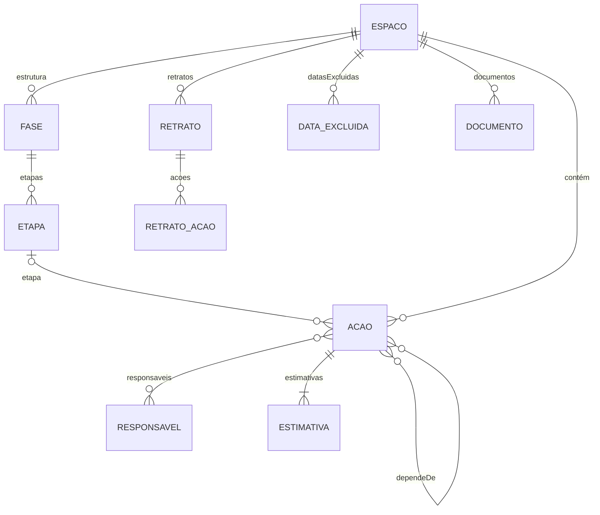

# Documentação técnica — versão 2 (Sextante) — RASCUNHO

> **Rascunho, preparado em lote em 22/10/2026 para o passo 1.20 (troca).** Ainda não é a documentação oficial: a oficial continua sendo `docs/documentacao-tecnica.md`, que descreve a versão em uso, e as decisões da versão 2 continuam em `docs/especificacao-reescrita.md`. Na troca, este texto é revisto pelo responsável, substitui a documentação atual, e a especificação é apagada.
>
> **Como foi montado:** as seções 4 (dicionário de dados), 5 (regras de cálculo), 6 (situações) e 8 (fundamentos matemáticos) foram copiadas da especificação, com a numeração dela, para o teste do dicionário poder passar a ler este arquivo na troca. As demais foram escritas a partir do sistema como está hoje. Referências a seções da especificação que não vêm para cá (interface, ordem de trabalho, ampliação do escopo) aparecem como "especificação, seção N" e precisam ser resolvidas na revisão.

**Última atualização deste documento:** 22/10/2026 (rascunho 1)

---

## 1. Visão geral

### 1.1 Objetivo

Planejar e acompanhar planos de ação institucionais da DGDI (Diretoria de Governança e Desenvolvimento Institucional) da UFCI-MG. Cada plano é um **espaço de planejamento**, com ações ligadas por dependências. O sistema calcula:

- quando o espaço deve terminar e quais ações não podem atrasar (caminho crítico, em dias úteis);
- a chance de cumprir o prazo final e as datas prováveis de conclusão (simulação de Monte Carlo com a distribuição beta-PERT);
- para cada ação, quanto um atraso nela atrasa o fim (índice de criticidade) e quanto da incerteza do prazo vem dela (contribuição para a variância).

E mostra o espaço em seis modos: lista, quadro, planilha, cronograma, rede e linha do tempo.

### 1.2 Público

Gestores e equipes **leigos** em gerenciamento de projetos. Por isso a interface usa palavras do dia a dia, com o termo técnico em itálico e menor, e cada termo tem um verbete em "Entenda os termos" (Ajuda > Glossário), com a equação e a fonte primária quando é uma medida matemática.

### 1.3 Princípios de projeto

- **Simples primeiro** (KISS e YAGNI): a solução mais simples que resolve; nada construído antes de haver necessidade.
- **Só pedir o necessário:** o usuário informa apenas o que entra em algum cálculo. Exemplo: o início real de uma ação não é pedido.
- **Aceitar o mundo real:** registros atrasados, reprogramações e imprecisões não travam o usuário.
- **Rigor nos cálculos:** fórmulas documentadas (seção 8), com referência, testadas contra a versão anterior e reproduzíveis (semente fixa, gerador mulberry32).
- **Números contínuos, não categorias:** indicadores como barras, com o número em cinza; carimbos só para fatos binários, como "Atrasada".
- **Movimento com sentido:** o que aparece, some ou muda de lugar faz uma transição curta (0,25 s, `--mov`), respeitando "Reduzir movimento".
- **Temas claro e escuro e celular:** cores só por variáveis CSS, nos três blocos de tema; toda tela funciona em cerca de 400 px de largura.
- **Acessibilidade:** contraste e papéis conferidos com o axe-core (regras WCAG 2 A e AA) em todos os modos; tudo alcançável pelo teclado.

---

## 2. Arquitetura

### 2.1 Arquivos, sem compilação

Módulos JavaScript carregados direto pelo navegador (`<script type="module">`), sem compilação, sem npm e sem *framework*. Bibliotecas externas só por CDN e com versão fixa: hoje, apenas o Firebase compat 10.14.1 (o desenho da rede é próprio; o dagre deixou de ser usado). Para ver localmente: `python3 -m http.server` na raiz e abrir `/v2/` (módulos não abrem com clique duplo).

| Arquivo | O que faz |
|---|---|
| `index.html` | Estrutura da página: menu lateral, barra do topo, área principal |
| `css/estilo.css` | Aparência, variáveis de cor (três blocos: claro, escuro pelo sistema, escuro escolhido) |
| `config.js` | Configuração do Firebase da versão 2 (pública por desenho; `null` = só memória) |
| `firestore.rules` | Regras do banco, publicadas à mão no console do Firebase |
| **Regras, sem tela nem banco** | |
| `js/calendario.js` | Dias úteis, datas excluídas, calendário geral mais o do espaço |
| `js/feriados.js` | Sugestão anual dos feriados nacionais e pontos facultativos (Páscoa calculada) |
| `js/calculo.js` | Estimativa vigente, ordem por dependência, caminho crítico, situações, carimbo Atrasada |
| `js/simulacao.js` | Monte Carlo beta-PERT, prioridades, chave da simulação (reaproveitamento) |
| `js/lista.js` | Linhas da lista: filtros, ordens, agrupamento por fase e etapa, resumos |
| `js/acao.js` | Regras da ação: estimativa livre, anteriores possíveis sem ciclo, busca, códigos |
| `js/cronograma.js`, `js/rede.js`, `js/linha-do-tempo.js` | Geometria do cronograma, da rede (camadas, marcos, setas em ângulo reto) e da linha do tempo |
| `js/retrato.js` | Montagem do retrato (cópia integral com resultados) |
| `js/historico.js` | Registros do histórico de alterações e as frases que os descrevem |
| `js/planilha.js`, `js/importar.js`, `js/importar-responsaveis.js`, `js/exportar.js` | Grade da planilha, importação e exportação |
| `js/migracao.js` | Conversão da cópia de segurança da versão 1 para a da versão 2 (troca) |
| `js/notas.js` | Markdown seguro das notas (conversor próprio) |
| `js/responsaveis.js`, `js/glossario.js`, `js/icones.js`, `js/identidade.js`, `js/formato.js`, `js/exemplo.js`, `js/conexao.js` | Apoio: iniciais e tons, glossário, ícones SVG, nome do sistema, formatação, espaço de exemplo, vigia da conexão |
| **Dados** | |
| `js/modelo.js` | Campos de cada entidade: o lado "código" do dicionário de dados (seção 4) |
| `js/dados.js` | `Store`: operações do sistema, com validação, histórico e permissão de gravar |
| `js/banco/local.js`, `js/banco/firestore.js` | Os dois bancos, com as mesmas operações (contrato em `testes/contrato-banco.js`) |
| `js/banco/firebase.js` | Carrega o SDK, login, troca e redefinição de senha, criação de contas |
| **Telas** | |
| `js/app.js` | Partida, roteamento (`#/espaco/<id>`), conexão, escolha do banco |
| `js/telas/*.js` | Uma tela ou peça por arquivo: navegação, abertura, espaço (lista e quadro), janela da ação, nova ação, planilha, cronograma, rede, linha do tempo, configurar espaço e sistema, lixeira, ajuda, acesso, seletor com busca, edição no lugar, movimento |

### 2.2 Bancos e modos de operação

- **Firebase** (projeto `sextante-v2`, separado do sistema em uso): leitura pública; gravação só com login por e-mail e senha. Tempo real pelo acompanhamento do espaço (`acompanharEspaco`).
- **Memória:** o espaço de exemplo roda sempre num banco em memória à parte e nunca vai ao Firebase. Sem `config.js` ou se o Firebase não carregar, o sistema abre só na memória, com aviso.
- **Sem conexão:** um vigia testa a rede a cada 10 s (5 s enquanto desconectado) e, depois de duas falhas, mostra "Sem conexão" na barra do topo; o `Store` recusa gravações até a conexão voltar.
- **Troca futura de banco:** o `Store` fala a língua do sistema; nenhum termo do Firestore aparece fora de `js/banco/firestore.js`. Um banco novo (servidor da UFCI-MG, PostgreSQL) precisa passar nos mesmos testes de contrato.

### 2.3 Testes

Dentro de `v2/`: `node --test`. Sem dependências. Cobrem calendário, cálculo, simulação (com os valores de referência da PI²), comparação com o cálculo da versão 1 (extraído do `index.html` da raiz), dicionário de dados, contratos dos dois bancos (inclusive gravações simultâneas), Store, histórico, checklist, importação, exportação, restauração, migração, geometria do cronograma e da rede (cartões sem sobreposição, setas sem passar por cartões) e a linha do tempo. Ferramentas à mão: `testes/desempenho.mjs` (velocidade com 50 a 300 ações) e `testes/migrar-copia.mjs` (ensaio da migração).

---

## 3. Funcionalidades

### 3.1 Navegação

- **Menu lateral recolhível**, como no Todoist: no alto, quem entrou (trocar senha, sair ou entrar); no meio, os espaços, cada um com engrenagem para "Configurar este espaço", e "+ Novo espaço"; no pé, Legenda, Lixeira, "Ajuda e manual" e "Configurar o sistema". O botão do menu fica dentro dele quando aberto e na borda esquerda quando recolhido; no celular, o menu abre por cima.
- **Barra do topo do espaço:** à esquerda, o seletor de modo, Filtrar e Ordenar; no meio, o nome do espaço; à direita, "Nova ação". No celular, um funil abre "Filtros e ordem", e o botão (+) cria ações.
- **Segunda linha:** "Exibir" (identificador antes do nome e, na lista, as colunas), "Barra" (tempo restante, índice de criticidade ou contribuição para a variância) e "Mostrar até" (fases, etapas ou ações), à esquerda; o alerta de ações atrasadas, à direita.
- **Abertura:** quem não tem espaço vê as boas-vindas (criar espaço, ver o exemplo e, com o banco vazio, restaurar a cópia de segurança); quem tem, vai ao último espaço aberto naquele aparelho.

### 3.2 Modos do espaço

| Modo | O que mostra |
|---|---|
| **Lista** | Cartões agrupados por fase e etapa (em qualquer ordem escolhida), com o ícone da situação antes do nome, avisos pequenos sob ele (data mínima, "Falta estimar", reprogramações, progresso do checklist), e as colunas escolhidas em "Exibir": descrição, participantes (em ordem alfabética, pela sigla) e a barra escolhida. Na linha de cada etapa aberta, a legenda da barra, com explicação ao passar o mouse e link para o glossário. Criação rápida no fim de cada etapa |
| **Quadro** | Colunas Não liberadas, Liberadas e Concluídas, com cartões enxutos (nome, etapa, participantes, barra); arrastar para Concluídas registra a conclusão |
| **Planilha** | Grade editável, só no computador, com colagem do Excel e do Google Planilhas |
| **Cronograma** | Gantt por fase e etapa, com dependências, caminho crítico, hoje, prazo final e comparação com um retrato |
| **Rede** | Fluxo das ações em camadas, como o Mermaid, com marcos (milestones) por etapa, como o Bizagi, setas em ângulo reto que não passam sobre cartões, poucos cruzamentos e salto onde se cruzam; zoom com Ctrl + rolar e arraste do fundo |
| **Linha do tempo** | Distribuição das datas de conclusão simuladas, com conclusão prevista, data segura (P80), prazo final e chance de cumpri-lo |

Os modos planilha, cronograma, rede e linha do tempo são só para o computador e mostram o espaço inteiro, sem filtros.

### 3.3 Ação

- **Janela da ação:** situação, conclusão prevista e as duas prioridades no alto; Reestimar e Registrar conclusão; campos editáveis no lugar (código, etapa, descrição, data mínima, estimativa enquanto livre); dependências e responsáveis como etiquetas, com busca; checklist; notas com editor visual; histórico das estimativas e histórico de alterações; excluir.
- **Edição no lugar, sem abrir a janela:** Alt+clique no nome (lista, quadro e rede), na descrição (lista) ou nos participantes (lista e quadro). Com Alt pressionado, os campos editáveis ficam contornados.
- **Nova ação:** janela compacta, com rótulo e três pontos à vista; a estimativa pode ficar para depois ("Falta estimar").
- **Checklist:** itens com caixa de marcar, texto editável e ×; o progresso aparece nos cartões.
- **Exclusão lógica:** a ação vai para a lixeira, com religação das dependentes às anteriores dela; restaurável.

### 3.4 Configuração

- **Configurar este espaço:** dados (nome, início, prazo final), datas excluídas próprias e desconsideradas do calendário geral, fases e etapas, campos opcionais (fases e etapas, descrição, notas, códigos), documentos, responsáveis (com importação por planilha e criação das contas de acesso), retratos, importação de ações por planilha, exportação e a simulação (semente e cenários, só leitura). No fim, "Excluir este espaço".
- **Configurar o sistema:** calendário geral, com sugestão anual dos feriados, e a cópia de segurança (baixar e, com o banco vazio, restaurar).

---

## 4. Modelo de dados (dicionário de dados)

**Esta seção é o dicionário de dados da versão 2.** Toda mudança na estrutura do banco atualiza esta seção no mesmo commit (AGENTS.md). O teste `testes/dicionario.test.js` compara cada tabela marcada abaixo com `js/modelo.js`, a lista de campos que o código usa, e falha se divergirem. O Store recusa gravar campos que não estejam nessa lista.

Quando a versão 2 entrar no ar, esta seção passa para a documentação técnica.

### Convenções

- **Data:** texto `AAAA-MM-DD`, sem hora nem fuso. É uma data do calendário, lida no horário de Brasília. Exemplo: `2026-10-19`.
- **Momento:** texto ISO 8601 em UTC, com milissegundos e `Z`. Exemplo: `2026-10-19T13:45:00.000Z` (10h45 em Brasília).
- **Id:** texto gerado pelo sistema (UUID). Exemplo: `3f2b8c1e-…`. Exceção: a ação, cuja chave é o código.
- **Usuário:** e-mail de login de quem gravou. Vazio quando não há login (modo local).
- **Dias úteis:** número de dias úteis do espaço, descontadas as datas excluídas. Aceita frações, como `2.5`.
- **Vazio:** campo ausente ou `null`. "Obrig." indica se o campo precisa ter valor.
- **Exclusão lógica:** nada é apagado; `excluidoEm` preenchido indica item excluído (seção 4.7).
- **Nomes dos campos:** em português, sem acentos, no formato `palavraPalavra`.

### Entidades e relações

**Como ler o diagrama:** notação "pé de galinha" (*Termo técnico: crow's foot, de James Martin*), padrão em modelagem de dados. Em cada ponta da linha: `||` exatamente um; `|o` zero ou um; `|{` um ou muitos; `o{` zero ou muitos (o "pé" indica "muitos"). Exemplo: entre ESPACO e ACAO, cada ação pertence a exatamente um espaço, e um espaço tem zero ou muitas ações.

- Um **espaço** tem ações, retratos, datas excluídas, documentos e uma estrutura de fases e etapas.
- Uma **ação** pertence a um espaço e, opcionalmente, a uma etapa; depende de outras ações do mesmo espaço; tem responsáveis e um histórico de estimativas.
- **Responsáveis** são globais: os mesmos para todos os espaços.

### 4.1 Espaço de Planejamento

<!-- dicionario: espaco -->
| Campo | Tipo | Obrig. | Significado | Exemplo |
|---|---|---|---|---|
| `id` | id | sim | Identificador do espaço. Imutável | `3f2b8c1e-…` |
| `nome` | texto | sim | Nome do espaço | `PI² · Fase 1` |
| `inicio` | data | não | Início do espaço: a partir dele contam os dias úteis | `2026-08-03` |
| `prazoFinal` | data | não | Prazo final, por exemplo o fixado por ato da Diretoria-Geral | `2027-04-14` |
| `datasExcluidas` | lista de data excluída (4.1.1) | não | Datas sem expediente próprias do espaço (feriados locais, exclusões específicas), que complementam o calendário geral (4.1.5) | |
| `datasGeraisDesconsideradas` | lista de data | não | Datas do calendário geral que este espaço não exclui (por exemplo, um ponto facultativo em que a equipe trabalha) | `["2027-02-08"]` |
| `documentos` | lista de documento (4.1.2) | não | Documentos do espaço, como o espaço aprovado e suas revisões | |
| `simulacoes` | inteiro | sim | Número de simulações. Padrão 10.000. Definido na criação e **imutável** (seção 5.7) | `10000` |
| `semente` | inteiro | sim | Semente da simulação. Padrão 20261014. Definida na criação e **imutável** (seção 5.7) | `20261014` |
| `estrutura` | lista de fase (4.1.3) | não | Fases e etapas, na ordem de exibição (seção 8.3 da especificação) | |
| `camposOpcionais` | campos opcionais (4.1.4) | não | Quais campos opcionais o espaço usa. Ausente: todos ligados | |
| `proximoNumero` | inteiro | não | Número que a próxima ação criada no espaço vai receber (seção 4.2). Mantido pelo sistema, não editável; só cresce, para nenhum número ser reaproveitado. Ausente: 1 | `13` |
| `tons` | mapa de id de responsável → inteiro de 1 a 15 | não | Tom do círculo de cada **pessoa** responsável por alguma ação do espaço (seção 8.3 da especificação). Mantido pelo sistema, não editável: quem chega recebe o menor tom livre; quem deixa de ser responsável por todas as ações sai, e o tom fica livre; acima de 15 pessoas, repete o tom menos usado. Gravado sem carimbo de alteração | `{"3f2b…": 1, "9c1a…": 2}` |
| `criadoEm` | momento | sim | Criação do espaço. Imutável | `2026-10-19T13:45:00.000Z` |
| `alteradoEm` | momento | sim | Última gravação no espaço | |
| `alteradoPor` | usuário | não | Autor da última gravação | `ana@ufci.edu.br` |
| `excluidoEm` | momento | não | Exclusão lógica (seção 4.7). Vazio: espaço ativo | |
| `excluidoPor` | usuário | não | Quem excluiu | |

Saem da versão atual: `dist` (escolha de distribuição), `statusDate` (a data de referência é sempre hoje), `baseline` (substituído pelos retratos) e `nearCrit` (seção 7.3 da especificação).

#### 4.1.1 Data excluída: cada item de `datasExcluidas`

<!-- dicionario: dataExcluida -->
| Campo | Tipo | Obrig. | Significado | Exemplo |
|---|---|---|---|---|
| `data` | data | sim | Dia sem expediente, que não conta como dia útil | `2026-11-20` |
| `motivo` | texto | não | Motivo, para conferência posterior | `Consciência Negra` |

#### 4.1.2 Documento: cada item de `documentos`

<!-- dicionario: documento -->
| Campo | Tipo | Obrig. | Significado | Exemplo |
|---|---|---|---|---|
| `nome` | texto | sim | Nome do documento | `Plano aprovado` |
| `data` | data | não | Data do documento | `2026-08-01` |
| `identificacao` | texto | não | Número no sistema de protocolo da instituição (SIPAC/Protocolo) | `23062.001234/2026-11` |
| `link` | texto (endereço web) | não | Endereço para abrir o documento. O envio do arquivo fica para o servidor da UFCI-MG (passo 4.3) | `https://…` |

#### 4.1.3 Fase e etapa: cada item de `estrutura` e de `etapas`

<!-- dicionario: fase -->
| Campo | Tipo | Obrig. | Significado | Exemplo |
|---|---|---|---|---|
| `id` | id | sim | Identificador da fase. Imutável | `f1` |
| `nome` | texto | sim | Nome da fase | `Planejamento` |
| `etapas` | lista de etapa | sim | Etapas da fase, na ordem de exibição | |

<!-- dicionario: etapa -->
| Campo | Tipo | Obrig. | Significado | Exemplo |
|---|---|---|---|---|
| `id` | id | sim | Identificador da etapa, usado no campo `etapa` da ação. Imutável | `e1` |
| `nome` | texto | sim | Nome da etapa | `Requisitos e arquitetura` |

#### 4.1.4 Campos opcionais: o objeto `camposOpcionais`

<!-- dicionario: camposOpcionais -->
| Campo | Tipo | Obrig. | Significado | Exemplo |
|---|---|---|---|---|
| `fasesEtapas` | sim/não | não | Usa fases e etapas. Desligado: lista sem separadores | `true` |
| `descricao` | sim/não | não | Usa o campo descrição das ações | `true` |
| `notas` | sim/não | não | Usa as notas das ações | `true` |
| `codigos` | sim/não | não | Usa os códigos mnemônicos das ações, como `LEV` (seção 4.2). **Ausente: desligado**, ao contrário dos demais | `false` |

Desligar um campo o esconde do formulário, da tabela e das exportações; os dados já gravados são mantidos.

#### 4.1.5 Calendário geral

Um só, para todos os espaços (seção 5.1). Cuidado pelo Administrador do Sistema.

<!-- dicionario: calendarioGeral -->
| Campo | Tipo | Obrig. | Significado | Exemplo |
|---|---|---|---|---|
| `datasExcluidas` | lista de data excluída (4.1.1) | sim | Feriados nacionais, recessos e outras datas sem expediente na instituição | |
| `alteradoEm` | momento | sim | Última gravação | |
| `alteradoPor` | usuário | não | Autor da última gravação | |

### 4.2 Ação

Chave: o par (espaço, `numero`).

**Como as ações são identificadas** (decisão do responsável, 20/10/2026). Ferramentas de equipe de uso amplo (Asana, Monday, Notion, Todoist) não mostram código: a dependência é escolhida pelo nome e aparece pelo nome. Códigos poluem a tela e aumentam a carga para o público leigo. Por isso:

- **Número fixo em sequência** (`numero`), como no Jira e no GitHub: 1, 2, 3…, dado pelo sistema ao criar a ação, imutável e nunca reaproveitado (nem depois de exclusões). Não é a posição na lista: inserir uma ação no meio não renumera nada. É ele que liga as dependências. Fica **invisível no uso normal** e aparece só onde é útil: no modo "Editar em planilha" e na importação por planilha, para digitar "depende de 3; 5" num espaço sem códigos.
- **Código mnemônico** (`codigo`), como `LEV`: opcional, ligado em "Configurar o espaço" (campo opcional `codigos`, desligado por padrão). Serve a equipes técnicas e às conversas em reunião ("o LIC atrasou"). Como não liga dependências, pode ser alterado; não pode repetir no espaço.
- Descartado o **número da posição** (MS Project, Smartsheet): inserir uma linha no meio renumera as seguintes, e o que estava escrito em atas passa a apontar para a ação errada.

<!-- dicionario: acao -->
| Campo | Tipo | Obrig. | Significado | Exemplo |
|---|---|---|---|---|
| `numero` | inteiro | sim | Identificador da ação no espaço: 1, 2, 3…, na ordem de criação. Imutável e nunca reaproveitado; é a referência das dependências | `7` |
| `codigo` | texto | não | Código mnemônico, de 2 a 8 letras maiúsculas ou números, único no espaço. Só aparece com o campo opcional `codigos` ligado | `LEV` |
| `ordem` | inteiro | sim | Posição na "Ordem do espaço" | `3` |
| `etapa` | id | não | Etapa a que a ação pertence (e, por ela, a fase). Vazio: sem fase nem etapa | `e1` |
| `rotulo` | texto | sim | Nome curto, usado no cronograma e no diagrama | `Levantar requisitos` |
| `descricao` | texto | não | Descrição completa | |
| `dependeDe` | lista de inteiro | sim | Números das ações anteriores, do mesmo espaço. Lista vazia: sem anteriores | `[1, 4]` |
| `responsaveis` | lista de id | sim | Ids dos responsáveis (4.5). Lista vazia: sem responsável | |
| `estimativas` | lista de estimativa (4.3) | sim | Da primeira à mais recente. A vigente é a última | |
| `concluidaEm` | data | não | Data de conclusão. Vazio: não concluída | `2026-09-22` |
| `naoAntesDe` | data | não | Data mínima de liberação, "Não começa antes de" (seção 5.1) | `2026-10-19` |
| `notas` | texto (Markdown) | não | Notas da ação (seção 8.5 da especificação) | |
| `checklist` | lista de item do checklist (4.2.2) | não | Itens a cumprir dentro da ação, na ordem em que foram acrescentados (seção 16.5 da especificação; passo 2.8). Vazio: sem checklist | |
| `criadaEm` | momento | sim | Criação da ação. Imutável | |
| `alteradaEm` | momento | sim | Última gravação na ação (seção 4.6) | |
| `alteradaPor` | usuário | não | Autor da última gravação | |
| `excluidaEm` | momento | não | Exclusão lógica (seção 4.7). Vazio: ação ativa | |
| `excluidaPor` | usuário | não | Quem excluiu | |

Saem da versão atual: custo, custo gasto, % concluído, início real e término real separado. O campo `entrega` da ação, previsto antes, foi retirado em 20/10/2026 para não se confundir com as **entregas do Plano de Ação** (seção 16.7 da especificação); o que a coluna "Entrega" da planilha da PI² dizia passa para a descrição.

#### 4.2.1 Histórico de alterações: um registro por campo alterado

Toda alteração de uma ação gera registros no histórico (seção 16.4 da especificação; passo 1.16): um por campo que mudou, com o valor antigo e o novo. A criação gera um registro só. Os registros são gravados na mesma operação da alteração (no Firebase, na mesma transação): um não existe sem o outro. Só de acréscimo: ninguém altera nem apaga, nem o Administrador do Sistema. Não entram os carimbos da própria gravação (`criadaEm`, `alteradaEm`, `alteradaPor`, `excluidaPor`), que o registro já guarda em `em` e `por`. A correção de uma estimativa, que não cria item novo em `estimativas` (seção 4.3), também é registrada aqui, com a lista antes e depois.

<!-- dicionario: historico -->
| Campo | Tipo | Obrig. | Significado | Exemplo |
|---|---|---|---|---|
| `id` | id | sim | Identificador do registro | |
| `entidade` | texto | sim | O que foi alterado. Por enquanto, sempre `acao` | `acao` |
| `chave` | inteiro | sim | Número da ação no espaço | `7` |
| `tipo` | texto | sim | `criacao` ou `alteracao` | `alteracao` |
| `campo` | texto | não | Campo da ação que mudou (seção 4.2). Vazio na criação | `concluidaEm` |
| `antes` | qualquer | não | Valor antes da alteração, no formato do campo. Vazio na criação ou se o campo não existia | `null` |
| `depois` | qualquer | não | Valor depois da alteração. Vazio na criação ou se o campo foi esvaziado | `2026-10-21` |
| `em` | momento | sim | Quando | |
| `por` | usuário | não | Quem. Vazio só em gravações sem login (espaço de exemplo, na memória) | |

#### 4.2.2 Item do checklist: cada item de `checklist`

Passo 2.8 (seção 16.5 da especificação). Cada item é mudado sozinho, numa operação que lê e grava a ação de uma vez (no Firebase, numa transação): duas pessoas marcando itens ao mesmo tempo não apagam uma à outra (seção 4.6). Cada mudança entra no histórico de alterações (4.2.1), com a lista antes e depois. O checklist não entra no cálculo: marcar itens não conclui a ação nem muda previsões.

<!-- dicionario: checklistItem -->
| Campo | Tipo | Obrig. | Significado | Exemplo |
|---|---|---|---|---|
| `id` | id | sim | Identificador do item, único na ação | |
| `texto` | texto | sim | O que precisa ser feito | `Enviar minuta à Procuradoria` |
| `feito` | sim ou não | sim | Marcado como feito | `false` |

### 4.3 Estimativa: cada item de `estimativas`

<!-- dicionario: estimativa -->
| Campo | Tipo | Obrig. | Significado | Exemplo |
|---|---|---|---|---|
| `em` | data | sim | Dia em que a estimativa foi feita | `2026-10-19` |
| `por` | usuário | não | Quem registrou | |
| `o` | dias úteis inteiros | sim | Otimista. A partir de 0 | `3` |
| `m` | dias úteis inteiros | sim | Mais provável. Entre `o` e `p` | `5` |
| `p` | dias úteis inteiros | sim | Pessimista. Maior que 0 | `10` |
| `contaDe` | texto | sim | `liberacao`: conta da liberação (primeira estimativa); `data`: conta do dia `em` (reestimativa) | `data` |
| `motivo` | texto | não | Motivo da reestimativa | `Atraso do fornecedor` |

A primeira estimativa nunca é alterada. Corrigir um erro de digitação logo após cadastrar substitui a estimativa mais recente, sem criar histórico, desde que seja no mesmo dia e antes de qualquer reestimativa. Enquanto a ação não está liberada, a estimativa muda sem histórico (seção 5.3).

### 4.4 Retrato

Chave: id. Pertence a um espaço. Só leitura depois de criado.

**O retrato é uma cópia integral do espaço naquele momento** (decisão de 20/10/2026): o espaço com todos os campos, todas as ações ativas com todos os campos (inclusive notas e o histórico completo de estimativas), os responsáveis citados e os resultados calculados. Assim ele se sustenta sozinho, mesmo que tudo mude ou seja excluído depois, e permite refazer o cálculo exatamente. Só ficam de fora os **comentários** e o **histórico de alterações**, que já são permanentes por conta própria (seções 16.4 da especificação e 16.5).

O retrato é guardado em duas partes: o cabeçalho, abaixo, e um registro por ação (4.4.1). Assim, um espaço grande com notas longas não esbarra no limite de tamanho de um documento do Firebase (cerca de 1 MB).

<!-- dicionario: retrato -->
| Campo | Tipo | Obrig. | Significado | Exemplo |
|---|---|---|---|---|
| `id` | id | sim | Identificador do retrato | |
| `nome` | texto | sim | Nome dado ao retrato | `Plano aprovado` |
| `origem` | texto | sim | `manual` (salvo por um administrador do espaço) ou `automatico` (salvo pelo sistema). Na tela, cada origem tem um selo | `manual` |
| `criadoEm` | momento | sim | Quando foi salvo | |
| `criadoPor` | usuário | não | Quem salvou. Vazio nos automáticos | |
| `semente` | inteiro | sim | Semente usada no cálculo | `20261014` |
| `simulacoes` | inteiro | sim | Número de simulações usado | `10000` |
| `versaoCalculo` | inteiro | sim | Versão do método de cálculo (seção 5.7) | `1` |
| `espaco` | espaço (4.1) | sim | Cópia integral do espaço, com todos os campos de 4.1 | |
| `datasExcluidasEfetivas` | lista de data excluída (4.1.1) | sim | Datas excluídas que valiam no cálculo naquele momento: calendário geral, menos as desconsideradas, mais as do espaço. O calendário geral pode mudar depois; sem esta cópia, refazer o cálculo daria outro resultado | |
| `responsaveis` | lista de responsável (4.5) | sim | Cópia integral dos responsáveis citados nas ações, para os nomes continuarem legíveis | |
| `resumo` | resumo do retrato (4.4.2) | sim | Resultado do espaço naquele momento | |

Os retratos **automáticos não podem ser excluídos** à mão, para o histórico usado no Data Lakehouse não ter buracos. O retrato automático depende de um programa no servidor; chega com o servidor da UFCI-MG (passo 4.4). No Firebase gratuito, só há retratos manuais.

Se um dia for preciso apagar algum texto de um retrato por exigência legal, isso será tratado caso a caso pela equipe de TI, fora do sistema (decisão de 20/10/2026: situação extremamente rara, que não justifica uma função própria).

#### 4.4.1 Ação do retrato: um registro por ação

Cada ação do retrato tem **todos os campos da ação (4.2)**, copiados como estavam, e mais estes valores calculados naquele momento:

<!-- dicionario: retratoAcaoCalculos -->
| Campo | Tipo | Obrig. | Significado | Exemplo |
|---|---|---|---|---|
| `situacao` | texto | sim | `naoLiberada`, `liberada` ou `concluida` | `liberada` |
| `atrasada` | sim/não | sim | Carimbo Atrasada | `false` |
| `liberacaoPrevista` | data | sim | Data prevista de liberação | `2026-10-05` |
| `conclusaoPrevista` | data | sim | Data prevista de conclusão | `2026-10-27` |
| `folga` | dias úteis | sim | Folga total no cálculo determinístico | `4` |
| `prioridadeExecucao` | número de 0 a 1 | sim | Índice de criticidade (seção 7.1) | `0.72` |
| `prioridadeRevisao` | número de 0 a 1 | sim | Contribuição para a variância do prazo (seção 7.2) | `0.18` |

#### 4.4.2 Resumo do retrato: o objeto `resumo`

<!-- dicionario: retratoResumo -->
| Campo | Tipo | Obrig. | Significado | Exemplo |
|---|---|---|---|---|
| `conclusaoPrevista` | data | sim | Conclusão prevista do espaço (P50) | `2026-12-22` |
| `dataSegura` | data | sim | Data com 80% de chance (P80) | `2027-01-15` |
| `p95` | data | sim | Data com 95% de chance | `2027-02-03` |
| `chancePrazo` | número de 0 a 1 | não | Chance de cumprir o prazo final. Vazio se o espaço não tem prazo final | `0.74` |

### 4.5 Responsável

Chave: id. Pertence a um espaço (desde o passo 1.14b), com cadastro livre em "Configurar este espaço".

**Revisto em 21/10/2026 (decisão do responsável; feito no passo 1.14b):** os responsáveis **criados no sistema** passam a ser **de cada espaço**: ficam dentro do espaço (`espacos/{id}/responsaveis/{id}`), aparecem só nele e são cuidados em "Configurar este espaço". A mesma pessoa em dois espaços tem dois cadastros, até a integração com a instituição; o e-mail de login não se repete dentro de um espaço, mas pode aparecer em vários. Só os responsáveis **da instituição** (servidores pela IU e unidades organizacionais do CEFET-MG, Fase 4) formam uma lista geral, só para leitura, vinda de outro sistema. **O Administrador do sistema não cadastra responsáveis.**

<!-- dicionario: responsavel -->
| Campo | Tipo | Obrig. | Significado | Exemplo |
|---|---|---|---|---|
| `id` | id | sim | Identificador do responsável. Imutável | |
| `tipo` | texto | sim | `pessoa` ou `unidade` (unidade organizacional, equipe ou grupo de unidades). Escolhido no cadastro e **imutável**. Define o desenho na tela: pessoa num círculo com as iniciais; unidade num quadrado arredondado com a sigla | `pessoa` |
| `nome` | texto | sim | Nome da pessoa, equipe ou unidade | `Ana Souza` |
| `sigla` | texto | não | Sigla curta, usada em espaços pequenos como o diagrama; numa unidade, é o que aparece no quadrado | `DTI` |
| `setor` | texto | não | Setor ou unidade | `DGDI` |
| `usuario` | usuário | não | E-mail de login ligado a este responsável. Vazio: responsável sem login. Só uma pessoa pode ter login | `ana@ufci.edu.br` |
| `criadoEm` | momento | sim | Cadastro do responsável. Imutável | |
| `alteradoEm` | momento | sim | Última gravação | |
| `alteradoPor` | usuário | não | Autor da última gravação | |
| `excluidoEm` | momento | não | Exclusão lógica (seção 4.7) | |
| `excluidoPor` | usuário | não | Quem excluiu | |

O campo `tipo` (decisão do responsável, 20/10/2026) separa **pessoas** de **unidades**. **O tipo não muda depois do cadastro** (decisão do responsável, 21/10/2026): pessoa e unidade são coisas diferentes, e "converter" uma na outra seria estranho. Um cadastro com o tipo errado é corrigido criando outro, com o tipo certo, e excluindo o errado com a opção "substituir por" (seção 4.7), que passa todas as ações para o novo de uma vez, sem refazê-las à mão. Entre as pessoas, há hoje dois casos, sem campo próprio para distingui-los:

- **Membro da equipe com acesso ao sistema:** tem `usuario`. Para esses, funcionam o filtro "Minhas ações" e, na Fase 2, os papéis por espaço.
- **Responsável diverso:** pessoa de fora do sistema, ou qualquer unidade organizacional, equipe ou grupo de unidades (`tipo: unidade`). Fica sem `usuario`. É cadastrado livremente, inclusive direto no formulário da ação ("Cadastrar … como responsável").

**Quatro tipos de responsável, previstos para a Fase 4** (decisão do responsável, 21/10/2026). O tipo (pessoa ou unidade) e a **origem** (da instituição ou criado no sistema) são duas perguntas separadas:

| | Da instituição | Criado no sistema |
|---|---|---|
| **Pessoa** | (i) usuário do sistema, identificado pela Identificação Única (IU) do CEFET-MG | (ii) etiqueta: pessoa de fora, ou que não usa o sistema |
| **Unidade** | (a) unidade organizacional oficial, do banco de dados da instituição | (b) grupo de pesquisa, comissão temporária ou outro grupo de pessoas |

- Os cadastros **da instituição** vêm de fora e não são editados no sistema: nome, e-mail e sigla seguem o cadastro oficial, sem duplicatas nem nomes escritos de jeitos diferentes. Cada um guarda o identificador oficial (a IU da pessoa; o código da unidade). As unidades oficiais vêm em árvore (subunidades), o que permite, no futuro, filtros como "ações da DGDI e das suas subunidades".
- Os cadastros **criados no sistema** continuam livres, como hoje.
- Até a Fase 4, o e-mail de login (`usuario`) é a forma provisória de ligar uma pessoa a quem entra no sistema (login por e-mail e senha, passo 1.14). Com a IU, a ligação passa a ser pelo identificador da IU.
- Campos previstos (seção 4.10): `origem` (`instituicao` ou `sistema`) e `identificadorInstitucional`. Não entram antes da Fase 4, porque, sem a IU e o banco de unidades, ficariam vazios.

### 4.6 Edição simultânea

Várias pessoas podem editar o mesmo espaço ao mesmo tempo. Nenhuma gravação pode apagar, em silêncio, o trabalho de outra pessoa. A versão 1 já grava só o campo alterado e mostra as mudanças em tempo real; a versão 2 mantém isso e fecha três falhas encontradas na versão 1 em 17/10/2026 (registradas em "Pendências" da documentação técnica).

| Situação | Regra |
|---|---|
| Duas pessoas mudam campos diferentes | Cada gravação leva só o campo alterado, nunca a ação inteira |
| Responsáveis e "depende de" | Acrescentar e retirar itens um a um, nunca regravar a lista inteira. Assim, se duas pessoas acrescentam responsáveis ao mesmo tempo, os dois ficam |
| Reestimativa | Entra no fim do histórico, sem regravar as anteriores. A correção de digitação da seção 4.3, que substitui a mais recente, só grava se ninguém tiver acrescentado outra estimativa nesse meio-tempo |
| Ação nova | O número é reservado no banco (contador do espaço, gravado numa transação), e não na tela de quem cria: duas pessoas criando ao mesmo tempo recebem números diferentes. O código mnemônico, quando usado, é conferido contra o banco; se outra pessoa usou o mesmo código antes, aparece "Já existe uma ação com o código X. Escolha outro." |
| Mesmo campo, mesma ação, quase juntas | Vale a última gravação, mas sem surpresa: se a ação aberta na janela for alterada por outra pessoa, a janela mostra "Fulano alterou esta ação agora" e atualiza os campos que não estão sendo editados. O campo em edição fica como está, e a pessoa decide se grava |
| Importação, restauração e regravação de ações inteiras | Só em operações explícitas, com confirmação, e nunca durante a edição comum |

Os campos `alteradaEm` e `alteradaPor` (seção 4.2) servem para o aviso. As regras dizem o que garantir, não como: cada banco as executa do seu jeito (seção 3.4). No modo local há um usuário só. Cada regra tem um teste em `node --test`, com duas gravações concorrentes simuladas.

### 4.7 Exclusão lógica

Nada é apagado de verdade pelo uso comum do sistema. Excluir um espaço, uma ação ou um responsável grava **quando** e **quem** excluiu (`excluidoEm`/`excluidaEm` e `excluidoPor`/`excluidaPor`), e o item some da tela.

- **Um único filtro, no `Store`.** As operações comuns (listar ações, calcular, exportar) devolvem só itens ativos. Ver os excluídos exige pedir explicitamente: a lixeira, a cópia de segurança e as cargas para o Data Lakehouse. Como nenhuma outra parte do código lê o banco (seção 3.4), o filtro existe num lugar só.
- **Teste automático:** um espaço de exemplo com uma ação excluída; o teste confere que ela não aparece na lista, no quadro, no cálculo, na simulação nem nas exportações, e que aparece na lixeira e na cópia de segurança.
- **Desfazer:** a lixeira do espaço mostra as ações excluídas, com quem e quando, e permite restaurá-las.
- **Exclusão encadeada:** excluir algo que outros itens usam abre uma janela que explica a consequência e oferece alternativas.
  - **Ação de que outras dependem:** (a) ligar as dependentes às anteriores da ação excluída, mantendo a sequência lógica; é a opção já marcada, e só aparece se a excluída tiver anteriores; (b) só retirar a dependência; (c) cancelar e rever a estrutura.
  - **Responsável que está em ações:** (a) substituir por outro responsável; (b) só retirar das ações; (c) cancelar.
  - **Etapa ou fase com ações:** (a) mover as ações para outra etapa; (b) deixar as ações sem etapa; (c) cancelar.
  - Cada mudança feita assim entra no histórico de alterações das ações afetadas. Restaurar o item da lixeira não refaz as ligações alteradas; o histórico mostra como eram.
- **Código ocupado:** o código de uma ação excluída continua reservado. Ao tentar criar uma ação com ele, o sistema oferece restaurar a antiga.
- **Carga incremental:** `alteradaEm` muda também na exclusão, para que a carga perceba.

Motivos da escolha, em vez de uma lista separada de exclusões: uma única consulta para a carga incremental, possibilidade de desfazer, auditoria completa (inclusive o conteúdo do que foi excluído) e retratos antigos que continuam mostrando o nome das ações.

### 4.8 Valores calculados, que não ficam no banco

O banco guarda os fatos: estimativas, dependências, datas de conclusão. O que deriva deles e da data de hoje é calculado na tela, a cada mudança, e **não é gravado**: um valor gravado ficaria velho no dia seguinte e criaria duas fontes de verdade. Quem fizer cargas para o Data Lakehouse encontra esses valores congelados nos retratos (4.4).

| Valor | Onde é definido |
|---|---|
| Situação (Não liberada, Liberada, Concluída) e carimbo Atrasada | Seção 6 |
| Datas previstas de liberação e de conclusão, folga | Seções 5.1 a 5.5 |
| Estimativa vigente, número de reprogramações, deslocamento do término | Seção 5.3 |
| Conclusão prevista (P50), data segura (P80), P95 e chance de cumprir o prazo | Seção 5.7 |
| Prioridade de execução e prioridade de revisão | Seções 7.1, 7.2 e 15 |

### 4.9 Onde cada entidade é guardada

| Entidade | Firebase (versão 2, segundo projeto) | PostgreSQL (servidor da UFCI-MG, proposta) |
|---|---|---|
| Espaço | `espacos/{id}` | tabela `espaco` |
| Data excluída, documento | listas dentro do espaço | tabelas `espaco_data_excluida`, `espaco_documento` |
| Fase, etapa | lista `estrutura` dentro do espaço | tabelas `fase`, `etapa` |
| Ação | `espacos/{id}/acoes/{numero}` | tabela `acao`, chave (`espaco_id`, `numero`) |
| Dependência | lista `dependeDe` dentro da ação | tabela `acao_dependencia` |
| Responsável da ação | lista `responsaveis` dentro da ação | tabela `acao_responsavel` |
| Estimativa | lista `estimativas` dentro da ação | tabela `estimativa` |
| Histórico de alterações | `espacos/{id}/historico/{id}` | tabela `historico`, com `espaco_id` |
| Retrato | cabeçalho em `espacos/{id}/retratos/{id}`; ações em `espacos/{id}/retratos/{id}/acoes/{numero}` | tabelas `retrato`, `retrato_acao` |
| Calendário geral | documento `sistema/calendario` | tabela `data_excluida_geral` |
| Responsável (criado no sistema) | `espacos/{id}/responsaveis/{id}` | tabela `responsavel`, com `espaco_id` |

Os nomes do Firebase passam a ser em português, porque a versão 2 usa um projeto novo (seção 3.3); a migração (seção 11 da especificação) converte os nomes da versão atual (`projects`, `tasks`, `people`). No PostgreSQL, as listas viram tabelas de ligação e as regras da seção 4.6 viram restrições do banco (seção 3.4).

### 4.10 Entidades previstas, ainda fora do código

Entram no dicionário, com tabela marcada e teste, no passo em que forem construídas.

- **Fase 2 e seguintes:** campos opcionais da seção 16.8 da especificação (`etiquetas`, `posicaoPrioridade`, `documentos` da ação, `justificativa`, `local`, `dataLimite`; depois, `custoPrevisto`, `custosExecutados`, `orcamento` e o registro de riscos).
- **Fase 4:** origem dos responsáveis (`origem`: `instituicao` ou `sistema`) e identificador institucional (`identificadorInstitucional`: a IU da pessoa ou o código da unidade), com a lista de unidades oficiais em árvore (seção 4.5).
- **Fase 2:** entregas do Plano de Ação e registro do alcance, com evidência (seção 16.7 da especificação); tipo do espaço, visibilidade, espaço aberto ou fechado, encerramento e papéis por espaço (seção 16.3 da especificação); catálogo do PEI/PDI (seção 16.1 da especificação); situações personalizadas (seção 16.2 da especificação); comentários (seção 16.5 da especificação). O checklist entrou no passo 2.8 (4.2.2).

---

## 5. Regras de cálculo

### 5.1 Contagem do tempo

- Prazos em **dias úteis**: de segunda a sexta, descontadas as datas excluídas, que vêm de dois cadastros (decisão do responsável, 21/10/2026):
  - **Calendário geral**, cuidado pelo Administrador do Sistema em "Configurar o sistema" (menu do usuário): feriados nacionais, recessos e datas da instituição, que valem para todos os espaços. Um botão acrescenta as datas de um ano conforme a lista anual típica do MGI (feriados nacionais e pontos facultativos, inclusive os móveis: Carnaval, Quarta-feira de Cinzas, Paixão de Cristo, Corpus Christi; Dia do Servidor Público, vésperas de Natal e de Ano Novo), para revisão antes de salvar: a lista pode ser corrigida e completada. Os pontos facultativos de parte do dia entram como dia inteiro, por zelo com os prazos. As pontes prováveis (segunda-feira antes de feriado na terça; sexta-feira depois de feriado na quinta) entram com o motivo "⚠️ Ponte provável (ponto facultativo) — confira na portaria do MGI" (decisão do responsável, 21/10/2026). Os anos oferecidos vão do anterior a dois à frente do ano corrente. Até existirem os papéis (Fase 2), qualquer pessoa conectada pode editá-lo.
  - **Datas do espaço**, cuidadas pelo administrador do espaço em "Configurar o espaço": feriados locais e exclusões específicas, que complementam o calendário geral. Ali se vê também a lista geral, sem poder editá-la, e se pode **desconsiderar** uma data geral no espaço (por exemplo, um ponto facultativo em que a equipe trabalha).
  - Datas efetivas do espaço = calendário geral, menos as desconsideradas, mais as do espaço.
  - Nas listas editáveis (datas e documentos), o que ainda não foi salvo fica destacado, com o aviso "Alterações não salvas" junto do botão Salvar; ao salvar, volta à aparência normal.
- Uma ação é **liberada** quando todas as anteriores estão concluídas. Sem ações anteriores, é liberada no início do espaço.
- **"Não começa antes de" (data mínima, opcional).** A ação só é liberada quando todas as anteriores estiverem concluídas **e** essa data tiver chegado. Liberação = a mais tardia entre a conclusão das anteriores e a data mínima. É o mesmo conceito da restrição "não iniciar antes de" do MS Project, numa forma simples.
  - **Nova ação:** o campo já vem preenchido com a data de criação. Assim, uma ação criada depois que as anteriores terminaram não nasce atrasada. O usuário pode apagar a data, se a ação puder começar assim que as anteriores terminarem.
  - **Outros usos:** ações que dependem de uma data externa, como liberação de orçamento, início do semestre ou publicação de um ato.
  - Enquanto a data não chega, a ação fica "Não liberada", com a indicação "a partir de dd/mm".
  - **Na janela da ação:** o campo só aparece quando tem data. Vazio, dá lugar a um link discreto, "+ Definir data mínima de início", que abre o campo. Em ações concluídas, não aparece.
  - **Em reavaliação** (seção 14 da especificação, item 1).
- **O prazo de uma ação conta da liberação até a conclusão**, incluindo o tempo até alguém começar. A data de início real não é registrada. Isso precisa estar claro no formulário de estimativa e na Ajuda.

### 5.2 Estimativa de cada ação

- Fórmula PERT: (O + 4M + P) / 6, a média da distribuição beta-PERT.
- **Os três pontos são dias úteis inteiros** (decisão do responsável, 20/10/2026): o calendário conta em dias inteiros, e a fração sugeriria uma precisão que a estimativa não tem; a incerteza se expressa pela distância entre otimista e pessimista. O otimista pode ser 0 ("pode terminar no dia em que for liberada"). O prazo PERT resultante pode ter fração, que o calendário arredonda ao virar data.
- **Uma só distribuição em todo o sistema: beta-PERT.** A escolha entre triangular e beta é retirada. Motivos: coerência entre as datas do cronograma e a simulação, simplicidade para o usuário leigo e estabilidade das datas e carimbos. O otimismo nas estimativas será tratado pela previsão por classe de referência, não por troca de fórmula.

- **Ação sem estimativa** (decisão do responsável, 21/10/2026; passo 1.14a): pode existir, para a criação rápida. Conta como zero dias no cálculo e na simulação, só para o fluxo não quebrar; leva a marca **"Falta estimar"** no lugar da conclusão prevista, e o espaço avisa "Previsão incompleta: N ações sem estimativa contam como zero dias". Não recebe o carimbo Atrasada, porque não tem prazo para vencer, e não mostra as prioridades de execução e de revisão, que sairiam de uma duração zero (a faixa de cor fica neutra); como qualquer ação liberada, não termina no passado (seção 5.5). Rejeitados: esconder as previsões enquanto faltar estimativa (o espaço em montagem ficaria sem informação) e pedir um único número de dias (estimativa sem incerteza deixaria a chance de cumprir o prazo otimista sem ninguém perceber).

### 5.3 Reestimativa

- **Antes da liberação**, a estimativa pode ser alterada livremente, sem histórico: ainda é planejamento. A estimativa "original", que vale para o histórico e para a previsão por classe de referência, é a vigente no momento da liberação. Aceita pelo responsável, mas **em reavaliação** (seção 14 da especificação, item 2).

- Disponível **a qualquer momento** para ação liberada e não concluída. Para ação atrasada, aparece em destaque, com alerta.
- O usuário informa os três pontos do **tempo que falta, a partir de hoje**.
- Cada reestimativa é registrada com data, autor, três pontos e motivo opcional.
- Conclusão prevista de uma ação reestimada: data da reestimativa + PERT dos novos três pontos.
- A tela da ação mostra a estimativa original, o número de reprogramações e quantos dias úteis o término andou desde a primeira estimativa.

### 5.4 Ações concluídas

Entram em todos os cálculos com a **duração real**, da liberação à conclusão, sem sorteio.

### 5.5 Regra interna: nada termina no passado

Para uma ação liberada e não concluída cuja conclusão prevista já passou sem reestimativa, **o cálculo considera conclusão a partir de hoje**. Na simulação, vale o mesmo: um sorteio que terminaria antes de hoje passa a terminar hoje.

A regra não restringe o usuário; só evita previsões otimistas demais. Na tela, quando ela estiver em ação, aparece ao lado da data prevista: "Prazo vencido sem reestimativa: o cálculo considera conclusão a partir de hoje." Ela deve constar na Ajuda e no manual, quando este for refeito.

### 5.6 Recálculo

Tudo é recalculado a cada mudança: conclusão, reestimativa ou edição. A estimativa vigente de cada ação é a mais recente.

### 5.7 Simulação de Monte Carlo

- Distribuição beta-PERT.
- **Semente e número de simulações visíveis, mas imutáveis.** São definidos na criação do espaço (pelo usuário ou com o padrão) e aparecem em "Configurar este espaço" só para leitura. Assim, qualquer pessoa ou IA pode conferir os resultados por fora, em planilha, Python ou R, e ninguém pode trocar a semente até o número "ficar bonito".
- **Conferência por fora:** a seção 8 deve documentar, junto com o código da versão 2, o gerador de números (mulberry32), a ordem dos sorteios e o método de sorteio da beta-PERT, para permitir reproduzir os resultados **exatamente**. Uma ferramenta com outro gerador chega a resultados estatisticamente equivalentes, com diferença da ordem de meio ponto percentual na chance de cumprir o prazo.
- **Versão do cálculo:** se um dia o método de cálculo mudar (por exemplo, a correção de um erro), a mesma semente passa a dar outro resultado. Por isso, o código tem um número de versão do cálculo, guardado em cada retrato.
- Ações concluídas: duração real. Ações reestimadas: a contagem começa na data da reestimativa. Regra da seção 5.5 aplicada.
- **Resultados do espaço:** datas P50, P80 e P95 da conclusão, chance de cumprir o prazo final e distribuição das datas finais (gráfico).
- **Resultados por ação:** índice de criticidade (seção 7.1) e contribuição para a variância do prazo (seção 7.2). Fórmulas e justificativas na seção 8.
- **Saem da tela o SSI e a crucialidade** como números próprios. A contribuição para a variância é a forma padrão e mais comunicável de responder à pergunta que os dois respondiam (seção 8.4).

---

## 6. Situações e carimbo

### 6.1 Situação: exatamente uma

| Situação | Quando |
|---|---|
| **Não liberada** | Alguma ação anterior não foi concluída, ou a data mínima ("Não começa antes de") não chegou. Antes chamada "Aguardando" (seção 16.2 da especificação) |
| **Liberada** | Todas as anteriores concluídas (ou nenhuma anterior), e esta não concluída |
| **Concluída** | Tem data de conclusão |

### 6.2 Carimbo **Atrasada**

- Aplica-se à ação **liberada** cuja data prevista de conclusão (PERT da estimativa mais recente) já passou.
- O atraso é medido contra a **estimativa mais recente**, de propósito. A reestimativa tira o carimbo. É uma "colher de chá" ao executor, que exige dele uma atitude ativa (assumir uma nova data). O histórico de reprogramações registra a dimensão do problema.
- Uma ação não liberada nunca recebe o carimbo, porque, pela regra da seção 5.5, a previsão das anteriores não fica no passado.
- Não existe mais o carimbo "Prioritária": a prioridade é mostrada pela barra contínua da seção 7.1.

---

## 7. Indicadores por ação e barras

Cada cartão mostra uma barra, à escolha de quem vê ("Barra", na segunda linha), com o símbolo à esquerda e o número em cinza. A escolha fica guardada no aparelho. Na lista, a coluna Barras pode ser desligada em "Exibir".

| Barra | Símbolo e cor | O que mostra |
|---|---|---|
| **Tempo restante** | relógio; verde à direita, vermelho à esquerda | Dias úteis até a conclusão prevista; em vermelho, dias úteis desde que ela venceu. Uma escala só para o espaço, com a marca do zero |
| **Índice de criticidade** | raio; violeta (`--execucao`) | Quanto cada dia de atraso na ação adia o fim do espaço, de 0% a 100% (seção 8.2). Em linguagem simples: prioridade de execução |
| **Contribuição para a variância** | lupa; laranja | Parte da incerteza do prazo final que vem da ação; as parcelas somam 100% (seção 8.3). Em linguagem simples: prioridade de revisão do planejamento |

- **Legenda da barra:** na linha de cada etapa aberta, sobre a coluna das barras, o nome e o que representa; passar o mouse abre uma explicação média; clicar abre o verbete do glossário, com a equação e a fonte primária (Van Slyke, 1963, para o índice de criticidade; Williams, 1992, para a correlação usada na contribuição para a variância).
- **Rede e cronograma:** a cor separa sem folga (vermelho), com folga (verde-azulado) e concluída (verde); a folga em dias úteis aparece no cartão da rede.
- **Símbolos de situação:** visto num círculo (concluída), cadeado fechado (não liberada) e relógio (atrasada). A ação liberada, o caso normal, fica sem marca. Ícones em SVG, coloridos pelas variáveis dos temas.

---

## 8. Fundamentos matemáticos dos indicadores por ação

Esta seção registra as fórmulas, as hipóteses e as razões de cada escolha, para revisão por especialistas. As decisões foram discutidas com o responsável em 16/10/2026, inclusive à luz da conversa "Schedule Sensitivity Index".

### 8.1 Notação

- A simulação gera *K* cenários (padrão: 10.000), com semente fixa.
- Em cada cenário *k*: dᵢ⁽ᵏ⁾ é a duração sorteada da ação *i*, em dias úteis (distribuição beta-PERT; ações concluídas têm duração fixa, igual à real); T⁽ᵏ⁾ é a duração total, do início à conclusão de todas as ações.
- σᵢ e σ_T são os desvios-padrão de dᵢ e de T entre os cenários.
- 𝟙ᵢ⁽ᵏ⁾ vale 1 se a ação *i* está no caminho crítico do cenário *k* (folga total zero), e 0 caso contrário.

### 8.2 Prioridade de execução: índice de criticidade

**Fórmula:** CIᵢ = (1/K) · Σₖ 𝟙ᵢ⁽ᵏ⁾

**Por que é a medida certa para "o que não pode atrasar":** em cada cenário, T é o máximo das somas de durações sobre todos os caminhos da rede. Quando o caminho crítico é único (o que ocorre com probabilidade 1 em distribuições contínuas), a derivada de T em relação a dᵢ é 1 se *i* está nesse caminho e 0 se não está: ∂T⁽ᵏ⁾/∂dᵢ = 𝟙ᵢ⁽ᵏ⁾. Logo, um atraso pequeno δ, imposto à ação *i*, aumenta a duração esperada do espaço em aproximadamente E[∂T/∂dᵢ] · δ = CIᵢ · δ. Ou seja, CIᵢ é o **efeito médio, em dias do espaço, de cada dia de atraso na ação**. Daí a legenda "com 70%, cada dia de atraso atrasa o espaço em cerca de 0,7 dia".

**Limitação conhecida:** numa rede muito sequencial, quase todas as ações têm CI perto de 100%, e o indicador diferencia pouco. Não é erro: nessa rede, qualquer atraso atrasa a conclusão. A ordem de execução entre ações igualmente críticas fica a critério da equipe, como diz a legenda.

**Alternativa considerada e descartada: inclinação da regressão** de T sobre dᵢ, βᵢ = Cov(dᵢ, T) / Var(dᵢ), que também estima "dias de conclusão por dia da ação". Ela mede a resposta da conclusão à **variação natural** da ação; o CI mede a resposta a um **atraso imposto**, que é a pergunta do gestor. Além disso, βᵢ é instável quando Var(dᵢ) é pequena (divisão por um número próximo de zero) e indefinida para ações de duração fixa. Em redes com caminho dominante, βᵢ ≈ CIᵢ, e o CI é mais estável.

**Por que não usar um corte (por exemplo, "prioritária se CI ≥ 50%"):** cortes tratam como diferentes casos praticamente iguais (49% e 51%), o problema do paradoxo de sorites. O indicador é mostrado como barra contínua.

### 8.3 Prioridade de revisão: contribuição para a variância

**Fórmula, em três passos:**

1. Correlação de Pearson entre a duração da ação e a duração total, nos *K* cenários: rᵢ = Cov(dᵢ, T) / (σᵢ · σ_T).
2. Parcela bruta: qᵢ = max(rᵢ, 0)². Correlações negativas, que em redes só com dependências término→início vêm de ruído amostral, são tratadas como zero.
3. Normalização: CVᵢ = qᵢ / Σⱼ qⱼ, somando sobre as ações não concluídas. Assim, Σᵢ CVᵢ = 100%.

Ações concluídas e ações de duração fixa (σᵢ = 0, em que rᵢ fica indefinida) recebem CVᵢ = 0.

**Interpretação:** se T fosse uma função linear das durações, T ≈ a + Σᵢ bᵢ dᵢ, com durações independentes, teríamos Var(T) = Σᵢ bᵢ² σᵢ² e rᵢ² = bᵢ² σᵢ² / σ_T². Então rᵢ² seria exatamente a **fração da variância do prazo explicada pela ação *i***, e as frações somariam 1. Como a rede tem trechos em paralelo, T é o máximo entre caminhos e não é linear; a soma dos rᵢ² fica abaixo de 1. A normalização reparte a parte explicada entre as ações, preservando a ordem e dando um número fácil de comunicar: "responde por X% da incerteza".

**Precisão:** com K = 10.000, o erro-padrão de rᵢ é aproximadamente (1 − rᵢ²)/√K ≤ 0,01. É mais que suficiente para ordenar as ações.

**Relação com o SSI:** SSIᵢ = CIᵢ · σᵢ / σ_T. No modelo linear com bᵢ ≈ CIᵢ, rᵢ ≈ CIᵢ · σᵢ / σ_T = SSIᵢ. Logo, a ordem das ações pela contribuição para a variância é, em geral, a mesma que pelo SSI; as duas medidas respondem à mesma pergunta.

### 8.4 Por que a contribuição para a variância, e não o SSI ou a crucialidade

- **SSI (índice de sensibilidade do cronograma):** responde à pergunta certa, mas o número ("0,28") não tem leitura direta para leigos e não tem nome comum fora da literatura acadêmica.
- **Crucialidade (correlação de Pearson ou de Spearman):** é o passo 1 do cálculo acima. Sozinha, também não tem leitura direta, e seus valores não somam nada interpretável. O defeito apontado antes, a instabilidade em ações de prazo pouco incerto, pesa pouco aqui, porque essas ações ficam com parcelas quase nulas de qualquer forma.
- **Contribuição para a variância:** mesma ordem, leitura direta ("18% da incerteza") e é a medida padrão das ferramentas comerciais de análise de risco de cronograma, reconhecível por gestores e auditores.
- **Conferência por dois índices (SSI e crucialidade de Spearman),** recomendada para analistas: fica fora da tela, para não mostrar dois números parecidos a leigos. Ideia futura: calcular a crucialidade de Spearman internamente e só mostrar um aviso quando a ordem divergir muito, o que costuma indicar caminhos paralelos competindo.

### 8.6 Como reproduzir a simulação por fora

Com a semente, o número de simulações e a versão do cálculo de um retrato, qualquer pessoa ou IA pode refazer a simulação, em Python, R ou outra linguagem, e obter **exatamente** os mesmos números, desde que siga estes passos (versão do cálculo 1; código em `v2/js/simulacao.js`):

1. **Gerador:** mulberry32, iniciado com a semente (inteiro de 32 bits sem sinal). Cada chamada soma 0x6D2B79F5 ao estado e devolve um número em [0, 1), pelas operações de 32 bits do código.
2. **Normal padrão:** Box-Muller, com dois sorteios (u, v), repetidos enquanto valem 0: √(−2 ln u) · cos(2πv).
3. **Gama(forma, 1):** método de Marsaglia e Tsang; para forma < 1, Gama(1 + forma) · U^(1/forma), com um sorteio U depois.
4. **Beta-PERT:** se P ≤ O, a duração é M, sem sorteio. Senão, α = 1 + 4(M − O)/(P − O), β = 1 + 4(P − M)/(P − O), X = Gama(α), Y = Gama(β), nessa ordem, e a duração é O + (P − O) · X/(X + Y).
5. **Ordem dos sorteios:** cenário por cenário; dentro de cada cenário, ação por ação na ordem de cálculo, que é a ordem topológica (algoritmo de Kahn, com fila) partindo das ações ordenadas por `ordem` e, nos empates, por código. Ações concluídas não sorteiam.
6. **Em cada cenário:** as regras do cálculo determinístico (seções 5.1 a 5.5), com a duração sorteada no lugar do PERT. Uma ação liberada cuja conclusão sorteada caia em dia anterior a hoje passa a terminar hoje.
7. **Resultados:** quantis pela posição mais próxima para cima (o valor de posição ⌈q·K⌉ na lista ordenada); chance de cumprir o prazo = fração dos cenários com conclusão até o prazo final, inclusive; prioridades pelas fórmulas das seções 8.2 e 15.3, com folga menor que 10⁻⁶ dia considerada zero.

Com outro gerador, os resultados são estatisticamente equivalentes, com diferença da ordem de meio ponto percentual na chance de cumprir o prazo.

### 8.5 Referências

- VAN SLYKE, R. M. Monte Carlo methods and the PERT problem. *Operations Research*, v. 11, n. 5, p. 839–860, 1963. DOI: [10.1287/opre.11.5.839](https://doi.org/10.1287/opre.11.5.839). Texto completo (relatório técnico, Universidade da Califórnia em Berkeley): [DTIC AD0412731](https://apps.dtic.mil/sti/pdfs/AD0412731.pdf). (Fonte primária do índice de criticidade: probabilidade de a ação estar no caminho mais longo.)
- WILLIAMS, T. M. Criticality in stochastic networks. *Journal of the Operational Research Society*, v. 43, n. 4, p. 353–357, 1992. DOI: [10.1057/jors.1992.50](https://doi.org/10.1057/jors.1992.50) (resumo público). (Discute o índice de criticidade e propõe a crucialidade, base da contribuição para a variância; o SSI.)
- ELMAGHRABY, S. E. On criticality and sensitivity in activity networks. *European Journal of Operational Research*, v. 127, 2000.
- VANHOUCKE, M. Using activity sensitivity and network topology information to monitor project time performance. *Omega*, v. 38, 2010. (Compara CI, SSI e crucialidade.)
- HULETT, D. *Practical Schedule Risk Analysis*. Gower, 2009. (Análise de risco de cronograma e gráficos de sensibilidade.)

---

---

## 9. Importação, exportação e cópia de segurança

- **Importar ações de planilha** ("Configurar este espaço"): colar a planilha a partir da linha de títulos; as colunas são reconhecidas pelo nome, em qualquer ordem. Antes de gravar, a conferência aponta erros (código inválido ou repetido, nome repetido, dependência que não existe, ciclo) e avisos. Quem importa escolhe entre só criar ações novas ou também atualizar as existentes. Dependências por código da planilha, número ou nome, nessa ordem. Fases e etapas que faltam são criadas.
- **Importar responsáveis de planilha:** Nome (obrigatório), Tipo, Sigla, Setor e E-mail. Com e-mail, é pessoa e ganha a conta de acesso, criada numa instância separada do Firebase, sem guardar sessão; a senha é sorteada e descartada, e a pessoa recebe o e-mail para definir a sua. Sem e-mail, o tipo precisa vir na planilha. Provisório até os papéis por espaço (especificação, passo 2.1).
- **Exportar:** "Copiar para planilha" e "Copiar fluxograma" (Mermaid), por cópia para colar.
- **Cópia de segurança** ("Configurar o sistema"): arquivo `sextante-copia-de-seguranca`, versão 2, com todos os espaços (inclusive a lixeira), ações, responsáveis, histórico e retratos, e o calendário geral. A restauração só é feita num banco sem nenhum espaço, para nunca misturar nem sobrescrever dados.
- **Migração da versão 1:** `js/migracao.js` converte a cópia de segurança da versão 1 numa cópia da versão 2, que se restaura como qualquer outra (seção 11 da especificação; ensaio em `testes/migrar-copia.mjs`).

---

## 10. Permissões

Regras provisórias do Firestore (`v2/firestore.rules`), até os papéis por espaço:

- qualquer pessoa consulta;
- só quem entrou com e-mail e senha cria e altera;
- ninguém apaga: a exclusão é lógica (lixeira);
- o histórico de alterações e os retratos só recebem registros novos: ninguém altera nem apaga.

Usuários são cadastrados pela importação de responsáveis (provisório) ou pelo administrador no console do Firebase. **Obrigatório antes do uso oficial:** papéis por espaço (administrador, usuário, leitor), visibilidade e proteção da branch `main` (especificação, passos 2.1 a 2.3 e 2.11). Ao mudar as regras, é preciso publicá-las no console e conferir que entraram em vigor antes de publicar o código que depende delas.

---

## 11. Decisões tomadas

As decisões da versão 2, com os motivos, estão hoje na especificação. Na revisão deste rascunho, as que continuam valendo entram aqui; as superadas saem. As principais:

- **Vários arquivos, sem compilação** (especificação, seção 10): qualquer pessoa edita e vê o resultado; menos ferramentas e menos riscos.
- **Número fixo e código opcional** (seção 4.2): o número liga as dependências e nunca muda; o código mnemônico é opcional e pode mudar.
- **Uma só distribuição, a beta-PERT** (seção 5.2), com semente e número de simulações visíveis e imutáveis (seção 5.7).
- **Carimbo Atrasada contra a estimativa mais recente** (seção 6.2), com a regra "nada termina no passado" (seção 5.5).
- **Índice de criticidade e contribuição para a variância**, e não o SSI ou a crucialidade (seção 8.4).
- **Exclusão lógica e lixeira**; histórico de alterações e retratos só de acréscimo.
- **Responsáveis por espaço**, com o tipo (pessoa ou unidade) fixo depois do cadastro.
- **Rede desenhada pelo próprio sistema** (camadas, marcos, setas em ângulo reto), sem biblioteca externa, para abrir mesmo sem acesso ao CDN.
- **Simulação reaproveitada** quando nada do que entra nela muda, com resultado idêntico (chave da simulação).

Decisões provisórias, ainda à espera do responsável: especificação, seção 14.1, e diário de execução (`docs/registro-de-execucao.md`).

---

## 12. Pendências e próximos passos

- **Troca (passo 1.20):** revisar este rascunho; decidir como levar os planos da versão 1 (o banco da versão 2 já tem a PI², e a restauração exige banco vazio); migrar; publicar a versão 2 na raiz; atualizar AGENTS.md, README e CONTRIBUTING; apagar a especificação.
- **Piloto (1.21):** PI² com o andamento real, acompanhada na versão 2.
- **Manual do usuário (1.22):** quando o responsável liberar.
- **Fase 2:** papéis e visibilidade, encerramento, tipos de espaço, catálogo do PEI/PDI, entregas dos Planos de Ação, situações personalizadas, comentários, extração de dados (especificação, seção 12).
- **Pontos para reavaliação:** data de liberação de ações criadas depois, estimativa livre antes da liberação, distribuição beta-PERT e durações independentes entre ações (especificação, seção 14).
- **Velocidade:** com 200 ações, a simulação leva cerca de 1 s no ambiente de teste. Se travar no celular, levá-la para segundo plano (*Web Worker*).

---

## 13. Histórico de versões da página

| Versão | Mudança |
|---|---|
| 1 | Rascunho montado a partir da especificação da reescrita e do sistema como estava em 22/10/2026 (lote de 22/10/2026) |
