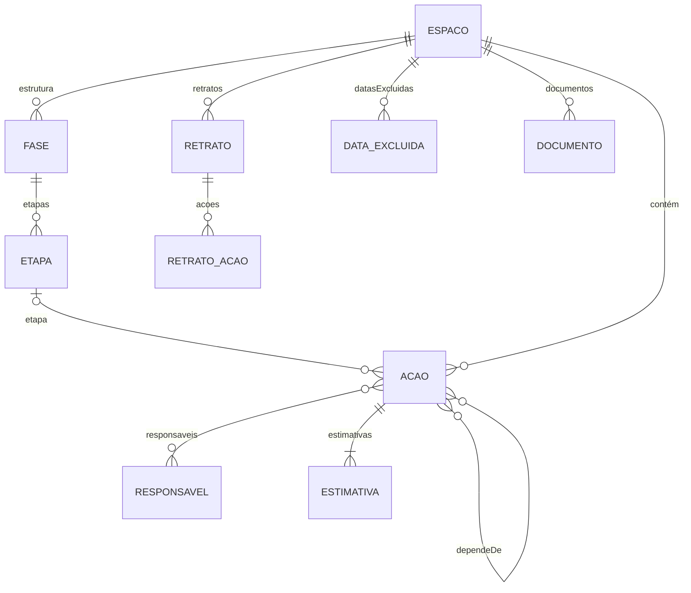

# Documentação técnica — Sistema de Gerenciamento de Planos de Ação (Sextante)

**Última atualização deste documento:** 30/10/2026 (versão 246 da página)

Sistema da DGDI da UFCI-MG, em https://dgdi-ufci-mg.github.io/sistema-planos-de-acao/. **Protótipo** (seção 1.2): esta documentação é o modelo conceitual para o sistema definitivo e precisa permitir reconstruir o comportamento sem ler o código.

**Sumário:** 1. Visão geral · 2. Princípios · 3. Arquitetura · 4. Modelo de dados (dicionário de dados) · 5. Regras de cálculo · 6. Situações e carimbo · 7. Indicadores por ação · 8. Interface · 9. O que saiu da versão 1 · 10. Decisões tomadas · 11. Migração dos dados da versão 1 · 12. Plano de trabalho · 13. Pendências e ideias futuras · 14. Pontos para reavaliação · 15. Fundamentos matemáticos dos indicadores · 16. Ampliação do escopo · 17. Histórico de versões da página

---

## 1. Visão geral

### 1.1 Objetivo

Planejar e acompanhar planos de ação institucionais da DGDI (Diretoria de Governança e Desenvolvimento Institucional) da UFCI-MG. Cada plano é um **espaço de planejamento**, com ações ligadas por dependências. O sistema calcula:

- quando o espaço deve terminar e quais ações não podem atrasar (caminho crítico, em dias úteis);
- a chance de cumprir o prazo final e as datas prováveis de conclusão (simulação de Monte Carlo com a distribuição beta-PERT);
- para cada ação, quanto um atraso nela atrasa o fim (índice de criticidade) e quanto da incerteza do prazo vem dela (contribuição para a incerteza; *termo técnico: contribuição para a variância*).

E mostra o espaço em seis visualizações: lista, quadro, rede, cronograma, planilha e linha do tempo.

### 1.2 Natureza: protótipo

O sistema é um **protótipo, uma prova de conceito** (decisão do responsável, 23/10/2026). Ele não vai para o Data Center da UFCI-MG: o sistema definitivo será desenvolvido do zero pela equipe de TI da instituição, com as linguagens e ferramentas dela e com a participação dela desde o início. O protótipo pode ser usado e testado fora da instituição e serve de **modelo conceitual**: regras, cálculos, modelo de dados, telas e decisões descritos aqui valem como requisitos; o código não é reaproveitado. Por isso, esta documentação deve permitir reconstruir o comportamento do sistema sem ler o código. Onde o texto e o código divergirem, a divergência é um defeito a corrigir, em um ou no outro.

### 1.3 Público

Gestores e equipes **leigos** em gerenciamento de projetos. Por isso a interface usa palavras do dia a dia, com o termo técnico em itálico e menor, e cada termo tem um verbete na Ajuda (glossário), com a equação e a fonte primária quando é uma medida matemática.

### 1.4 Origem: a versão 1 e a reescrita

A versão 1 era um arquivo único (`index.html`), feito em etapas como artefato do Claude, com valor agregado e Earned Schedule. A versão 2, chamada provisoriamente de **Sextante**, foi reescrita do zero entre 19 e 23/10/2026, a partir de uma especificação aprovada pelo responsável, e substituiu a versão 1 no endereço oficial em 23/10/2026 (passo 1.20). Motivos da reescrita:

- **Código difícil de revisar.** A versão 1 tinha 1.300 linhas compactas, com nomes curtos; a cada versão, limpar ficava mais caro.
- **O modelo de acompanhamento mudou.** Saíram o valor agregado e o Earned Schedule; entraram situações, reestimativas com histórico, retratos e anotações (seção 9).
- **Não foi do zero no conteúdo.** A lógica já testada foi mantida e reescrita de forma legível: calendário de dias úteis, caminho crítico, Monte Carlo e conexão com o Firebase. O teste de comparação (seção 3.2) garante que o caminho crítico dá as mesmas datas da versão 1.

A especificação da reescrita foi incorporada a este documento na troca e apagada. Para preservar as remissões, **as seções 2 a 16 mantêm a numeração da especificação**. O texto anterior da especificação, da documentação da versão 1 e do rascunho desta documentação continua no histórico do Git (commit `da7b272` e anteriores). O diário da execução em lote fica em `docs/registro-de-execucao.md`.

---

## 2. Princípios

- **KISS** ("mantenha simples"): a solução mais simples que resolve o problema é a melhor.
- **YAGNI** ("você não vai precisar disso"): nada é construído antes de haver necessidade real.
- **Código limpo:** nomes claros, funções pequenas, um assunto por arquivo, sem duplicação e sem código morto. Código que perde a função é apagado, não escondido; o histórico do Git guarda tudo.
- **Só pedir o necessário:** o usuário informa apenas dados que o sistema usa. Exemplo: a data de início real de uma ação não é pedida, porque não entra em nenhum cálculo.
- **Aceitar o mundo real:** o sistema absorve registros atrasados, reprogramações e imprecisões sem travar o usuário. Exemplo: a data de conclusão pode ser registrada com qualquer data, mesmo passada.
- **Linguagem simples:** princípio herdado da versão 1. Termo técnico em itálico, como "Termo técnico: …", e clicável, abrindo a explicação na Ajuda.
- **Movimento com sentido** (decisão do responsável, 21/10/2026): o que aparece, some ou muda de lugar na tela faz uma transição curta, nunca um salto. A animação mostra de onde a coisa veio e para onde foi, e isso ajuda a entender o sistema. É padrão em toda tela nova ou alterada: painéis e janelas deslizam, formulários e seções crescem a partir da altura zero e encolhem ao fechar, itens reordenados deslizam até a nova posição, alternadores movem a marca da opção escolhida. Durações curtas e iguais em todo o sistema: 0,25 s (`--mov`) e 0,18 s para detalhes (`--mov-rapido`), com a mesma curva (`--mov-curva`), no CSS e em `js/telas/movimento.js` (`abrirSuave`, `fecharSuave`). Quem ativou "Reduzir movimento" no aparelho não vê animação.
- **Carregamento com esqueletos** (item 15 da avaliação de usabilidade, 24/10/2026): enquanto os dados chegam, a área que vai recebê-los mostra blocos cinza no formato do conteúdo (linhas de lista, cartões ou linhas de texto), com um brilho que passa devagar, em vez de "Carregando…". Os blocos só aparecem se a espera passar de 0,3 s, para não piscar em carregamentos rápidos; com "Reduzir movimento", ficam parados. Para o leitor de tela, o bloco é um aviso de situação (`role="status"`) com o nome "Carregando". Usado na abertura da página, ao abrir um espaço, nas entregas, na lixeira, nos comentários e no histórico da janela da ação e no módulo Superior (`js/telas/esqueleto.js`).
- **Números contínuos, não categorias:** indicadores contínuos aparecem como barras, com o número discreto em cinza. Cortes arbitrários, como "acima de 50% é prioritária", são evitados, porque tratam como diferentes casos praticamente iguais (paradoxo de sorites). Carimbos ficam só para fatos binários, como "Atrasada".
- **Rigor nos cálculos:** fórmulas documentadas (seções 5 e 15), com a fonte primária, testadas contra a versão 1 e reproduzíveis (semente fixa, gerador mulberry32).
- **Temas claro e escuro e celular:** cores só por variáveis CSS, em três blocos (claro, escuro pelo sistema, escuro escolhido); toda tela funciona em cerca de 400 px de largura.
- **Acessibilidade:** contraste e papéis conferidos com o axe-core (regras WCAG 2 A e AA) em todas as visualizações; tudo alcançável pelo teclado; textos pequenos com contraste mínimo de 4,5:1.

---

## 3. Arquitetura

### 3.1 Arquivos, sem compilação

Módulos JavaScript carregados direto pelo navegador (`<script type="module">`), sem compilação, sem npm e sem *framework*. Os motivos estão na seção 10. Para ver localmente, é preciso um servidor simples, como `python3 -m http.server` na raiz do repositório, porque módulos não abrem com clique duplo no arquivo.

- **Bibliotecas externas:** só por CDN e com versão fixa. Hoje, apenas o Firebase 10.14.1 (jsDelivr), carregado por `js/banco/firebase.js`. O desenho da rede é próprio (seção 8.4); o dagre, usado na versão 1, saiu. As fontes vêm do Google Fonts.
- **Funções puras:** cálculo, simulação e geometria não acessam a tela nem o banco. Recebem dados e devolvem resultados, e por isso são testadas com o Node, sem navegador.
- **Tipos por comentários (JSDoc):** cada função tem, acima dela, a descrição do que recebe e devolve.
- **Nome do sistema como variável:** o nome aparece na tela, no título da aba do navegador, na Ajuda e nas exportações, mas é definido num único lugar, `js/identidade.js`. Nome provisório: **Sextante** (decisão do responsável em 19/10/2026), sob avaliação.

| Arquivo | O que faz |
|---|---|
| `sextante/index.html` | Estrutura da página do Sextante: barra lateral, barra do topo, área principal, barra de baixo do celular. Desde 27/10/2026 fica na pasta `sextante/`, ao lado de `strata/`, e carrega `../css`, `../js` e os ícones da raiz |
| `index.html` (raiz) | Só leva ao Sextante (`sextante/`), mantendo o que vier depois do `?` e do `#` (27/10/2026) |
| `css/estilo.css` | Aparência e variáveis de cor, em três blocos de tema |
| `config.js` | Configuração do Firebase (projeto `sextante-v2`; pública por desenho; `null` = só memória) |
| `firestore.rules` | Regras do banco, publicadas à mão no console do Firebase |
| `js/tema.js` e `js/tema-inicial.js` | Tema claro ou escuro escolhido em cada aparelho (27/10/2026; seção 8.0): ler, gravar e aplicar a escolha (`tema.js`, módulo) e aplicá-la antes do primeiro desenho (`tema-inicial.js`, script comum no `<head>`), com uma chave, um tema padrão e uma cor de barra para cada aplicativo (`sextante.tema` e `strata.tema`, desde 30/10/2026) |
| `js/marca.js` | Marca do sistema em SVG (27/10/2026): o **símbolo** (setor de 60°, um sexto do círculo, como o sextante, com o braço indicador apontando um ponto do arco) e o **logotipo** (símbolo à esquerda e o nome em caixa alta, desenhado em traço, com o A sem travessão no mesmo ângulo de 60° do símbolo; o símbolo tem cerca de 1,6 vez a altura das letras). As cores vêm do tema, pelas classes `marca-*` de `css/estilo.css`: corpo, escala e nome em `--accent` (verde-azulado), braço e pontos em `--warn` (dourado); a escala interna com 35% de opacidade. O nome é desenhado, e não escrito com fonte, para ficar igual em todo aparelho: se `NOME` mudar em `js/identidade.js`, o desenho precisa ser refeito. Usos: logotipo nas boas-vindas (40 px de altura) e na Ajuda (32 px), com a sigla da instituição pequena embaixo. O arquivo guarda também a marca do **Strata**: o símbolo (três camadas em arco, `DESENHO_DO_STRATA`; camadas em `--accent`, a de cima em `--strata-sol`) e, desde 29/10/2026, o **logotipo do Strata** (`strataLogotipoSvg`): o símbolo à esquerda e o nome em caixa alta no mesmo traço do nome do Sextante (letras com 80 de altura e 10,5 de espessura; S, T e A sem travessão iguais aos do Sextante; o R, novo, com a barra do meio na altura da do E), nas cores do tema da página do Strata. Também desenhado, sem fonte: se o nome do Strata (`NOME_DO_MODULO`, em `js/superior/app.js`) mudar, o desenho precisa ser refeito. Uso: barra do topo do Strata (24 px de altura) |
| `logo.png` | Símbolo em imagem, 112 px: ícone da aba do navegador. Desde a versão 202.1, como os ícones do aplicativo: quadrado de cantos arredondados (raio de 22% do lado) em verde-azulado escuro `#00594F`, com o corpo e a escala do símbolo em branco e o braço em dourado `#F2B04A`. Até 27/10/2026, era a rosa dos ventos |
| `sextante/manifest.webmanifest`, `icones/`, `sw.js` | Aplicativo instalável pelo navegador: manifesto (nome, cores, ícones; escopo `sextante/`), ícones de 180, 192 e 512 px (um deles com margem para o recorte do Android) e o *service worker*, sem cache (seção 8, "Instalar como aplicativo") |
| `v2/index.html` | Só leva quem guardou o endereço antigo `/v2/` para a raiz |
| `strata/index.html`, `strata/manifest.webmanifest`, `strata/icones/` | Página do **Strata** (antes, módulo Superior), a gestão da estratégia (passo 2.5; seção 8, "Strata"), no endereço `/strata/`, com manifesto e ícones próprios, para ser instalado como aplicativo separado do Sextante (27/10/2026) |
| `superior/index.html` | Só o redirecionamento do endereço antigo, `/superior/`, para `/strata/`, mantendo o que vier depois do # |
| **Regras, sem tela nem banco** | |
| `js/calendario.js` | Dias úteis, datas excluídas, calendário geral mais o do espaço |
| `js/feriados.js` | Sugestão anual dos feriados nacionais e pontos facultativos (Páscoa calculada) |
| `js/calculo.js` | Estimativa vigente, ordem por dependência, caminho crítico, situações, carimbo Atrasada |
| `js/simulacao.js` | Monte Carlo beta-PERT, prioridades, chave da simulação (reaproveitamento) |
| `js/lista.js` | Linhas da lista: filtros, ordens, agrupamento por fase e etapa, resumos |
| `js/busca.js` | Regra da busca (Ctrl+K): combinar o digitado com os itens, sem acento, e ordenar (seção 8.0) |
| `js/acao.js` | Regras da ação: estimativa livre, anteriores possíveis sem ciclo, busca, códigos |
| `js/entregas.js` | Entregas do Plano de Ação: tipos de meta, situações, validações, alcance atual, avisos de coerência e o que falta para encerrar |
| `js/extracao.js`, `js/arquivo-planilha.js` | Extração personalizada: as tabelas (ações, entregas, alcances, histórico) e os arquivos CSV, .xlsx e .ods, feitos sem biblioteca |
| `js/vocabulario.js` | Palavras da tela que mudam com o tipo do espaço: "ação" ou "tarefa" (passo 3.1) |
| `js/tipos.js` | Tipos de espaço: nomes, tipo padrão, o que cada tipo exige, agrupamento do menu lateral |
| `js/modelos.js` | Modelos do espaço: estruturado, aberto e personalizado; o que cada espaço usa (estimativas ou data-limite, dependências, simulação) e as opções do cálculo |
| `js/cronograma.js`, `js/rede.js`, `js/linha-do-tempo.js` | Geometria do cronograma, da rede e da linha do tempo |
| `js/mapa.js` | Mapa do Strata: faixas por camada, ordem dos pontos por baricentro, posição em degraus, curvatura e contornos, céu e solo da tela cheia e limites da vista com a folga do alto (seção 8, "Mapa") |
| `js/filtro-do-mapa.js` | Filtros do Mapa do Strata: vigência de cada ponto, camadas escondidas, linhas que passam pelos itens escondidos (`via`) e o alerta do item fora da vigência com algo vigente abaixo (seção 8, "Mapa", "Filtros"); regras puras, testadas em `testes/filtro-do-mapa.test.js` |
| `js/retrato.js` | Montagem do retrato (cópia integral com resultados) |
| `js/historico.js` | Registros do histórico de alterações e as frases que os descrevem |
| `js/planilha.js`, `js/importar.js`, `js/importar-responsaveis.js`, `js/exportar.js` | Leitura e escrita da grade da planilha, importação e exportação |
| `js/notas.js` | Markdown seguro das anotações (conversor próprio) |
| `js/responsaveis.js`, `js/glossario.js`, `js/icones.js`, `js/identidade.js`, `js/formato.js`, `js/exemplo.js`, `js/conexao.js` | Apoio: iniciais e tons, glossário, ícones SVG, nome do sistema, formatação, espaço de exemplo, vigia da conexão |
| **Dados** | |
| `js/modelo.js` | Campos de cada entidade: o lado "código" do dicionário de dados (seção 4) |
| `js/dados.js` | `Store`: operações do sistema, com validação, histórico e permissão de gravar |
| `js/banco/local.js`, `js/banco/firestore.js` | Os dois bancos, com as mesmas operações (contrato em `testes/contrato-banco.js`) |
| `js/banco/firebase.js` | Carrega o SDK, login, troca e redefinição de senha, criação de contas |
| **Telas** | |
| `js/app.js` | Partida, roteamento (`#/espaco/<id>`), conexão, escolha do banco |
| `js/telas/abas-da-janela.js` | Janela central em abas, com o desenho de "Configurar este espaço": lista das seções à esquerda no computador; no celular, a lista e uma seção de cada vez (27/10/2026; usada por "Configurar o sistema") |
| `js/superior/app.js`, `js/superior/telas.js`, `js/superior/mapa.js`, `js/superior/planilha.js`, `js/superior/exemplo.js` | Strata (antes, módulo Superior): partida (banco, login, conexão; o nome provisório do módulo, `NOME_DO_MODULO`, num lugar só), o Mapa em tela cheia como porta de entrada (desenho em `js/superior/mapa.js`), o menu e as folhas que abrem por cima dele (Desdobramento, Instrumentos, Camadas e Importar), e o catálogo de exemplo usado sem o Firebase |
| `js/planilha-estrategia.js` | Regras puras da Planilha do Strata (seção 8, "Strata", "Planilha"): colunas, alterações pendentes, problemas de cada linha, filtro e ordem, desfazer e refazer, leitura do valor colado e plano de gravação |
| `js/telas/instalar.js` | "Instalar como aplicativo": o pedido de instalação do navegador ou as instruções para cada aparelho; registro do *service worker* |
| `js/telas/esqueleto.js` | Blocos cinza de carregamento (esqueletos) nos formatos lista, cartões e texto (seção 2) |
| `js/telas/voltar.js` | Botão e gesto de Voltar: uma entrada no histórico enquanto houver janela, painel, diálogo, busca ou barra lateral aberta (seção 8.7) |
| `js/telas/busca.js` | Caixa de busca e paleta de comandos (Ctrl+K): fontes de itens, teclado e lista (seção 8.0) |
| `js/telas/atalhos.js` | Atalhos de teclado de uma tecla ("/", "N", "?") e a lista mostrada em "?" (seção 8.0) |
| `js/telas/extracao.js` | Tela "Extração de dados" (passo 2.10) |
| `js/telas/*.js` | Uma tela ou peça por arquivo: navegação, abertura, espaço (lista e quadro), janela da ação, nova ação, planilha (`editar-planilha.js`), cronograma, rede, linha do tempo, configurar espaço e sistema, tipo e modelo do espaço (`tipo-espaco.js`, `modelo-espaco.js`), entregas do Plano de Ação (`entregas.js`), lixeira, ajuda, acesso, seletor com busca, edição no lugar, exclusão, pendências, pessoas, painel, movimento |
| **Testes** | |
| `testes/*.test.js` | Testes automáticos (`node --test`, na raiz) |
| `testes/contrato-banco.js`, `testes/firebase-falso.js` | Garantias que todo banco cumpre; Firebase falso, em memória |
| `testes/dados/` | A PI² (`pi2-fase1.json`) e uma cópia congelada da versão 1 (`versao1-index.html`), usada só pelo teste de comparação |
| `testes/desempenho.mjs` | Medida de velocidade, rodada à mão, com 50 a 300 ações |
| `testes/navegador/` | Testes de navegador (seção 3.2): o sistema aberto num Chromium pelo Playwright, com toques e larguras de tela simulados; `apoio.mjs` tem o servidor local e os gestos; `mapa.test.mjs`, `strata-entrada.test.mjs` e `strata-planilha.test.mjs` abrem o Strata (`caminho: "strata/"`) |
| `package.json` | Só marca os arquivos como módulos para o Node; sem dependências |

### 3.2 Testes

- **Testes de unidade** das funções de calendário, cálculo, simulação e Markdown, com `node --test`, sem dependências.
- **Teste de comparação:** o espaço da PI² precisa produzir as mesmas datas do caminho crítico da versão 1, já que essa regra não mudou. O cálculo da versão 1 é executado a partir da cópia congelada em `testes/dados/versao1-index.html`. As probabilidades mudam por causa da troca para a beta-PERT; os novos valores são registrados como referência. **Referência (versão do cálculo 1, semente 20261014, 10.000 simulações, só estimativas):** P50 em 30/03/2027, P80 em 08/04/2027, P95 em 22/04/2027 e chance de 89,5% de cumprir o prazo de 14/04/2027. Na versão 1, com a triangular e 3.000 simulações, a chance era de 74%: a triangular, com os mesmos três pontos, espalha mais as durações do que a beta-PERT, que concentra os sorteios perto do mais provável. Um teste automático confere esses valores; se mudarem, é preciso aumentar a versão do cálculo.
- **Teste do dicionário de dados:** compara os campos usados pelo código (tipos JSDoc do modelo) com os da seção 4 e falha se divergirem. Roda com os demais, em toda mudança.
- **Teste visual:** capturas de tela das visualizações afetadas, nos temas claro e escuro e na largura de celular, com o Playwright e o Chromium, sobre o sistema servido localmente e com o Firebase desligado (`config.js` interceptado com `null`).
- **Testes de navegador** (desde 27/10/2026, `testes/navegador/`): abrem o sistema num Chromium, pelo Playwright, sobre o "Ver um exemplo", só na memória (o `config.js` é interceptado com `null` e nada sai para a internet), e simulam o uso. **Celular** (`celular.test.mjs`, 390 × 800 px, com toque): barra de baixo (e a ausência dela no tablet, 700 px); alvos de 44 px; faixa do prazo, que abre a Linha do tempo; Voltar fechando "Filtros e exibição" e a janela da ação sem sair do espaço, e reabrindo o espaço anterior depois de uma troca; segurar o cartão (menu do cartão); deslizar para a direita (registro da conclusão), para a esquerda (menu) e na vertical (só rola); puxar a janela para baixo (fecha com 200 px, volta com 40 px); "Criar ação" acima de um teclado de 320 px simulado pela área visível do navegador (`visualViewport`); campos com 16 px. **Barra do topo** (`barra-do-topo.test.mjs`, sem toque): de 700 a 1.366 px, com a barra lateral aberta e recolhida, nenhum controle encosta no vizinho (8 px entre grupos) nem é cortado, pelas mesmas regras de `ajustarBarra`; em 1.366 px os nomes dos menus aparecem; clicar num menu não muda a barra (correção da versão 184).
  - Os toques são reais para o navegador (protocolo do Chromium, eventos de ponteiro do tipo "touch"). Limite conhecido: o Chromium sem tela não reconhece o toque longo e, ao soltar o dedo, gera um clique que cai no fundo escurecido do menu do cartão recém-aberto e o fecha; no Android, o toque longo não gera esse clique. Por isso o teste de segurar confere o menu com o dedo ainda na tela. Num iPhone de verdade, vale conferir se o menu continua aberto ao soltar o dedo (seção 13.1).
  - O Playwright **não** é dependência do repositório: sem ele na máquina, estes testes são pulados com aviso e os demais rodam normalmente. Com `SEM_NAVEGADOR=1`, são pulados de propósito, para uma rodada rápida (cerca de 6 s, contra cerca de 1 min com eles).
  - Defeitos encontrados e ainda não corrigidos ficam como testes "a fazer" (*todo* do `node --test`): aparecem no resultado, mas não o reprovam. Quando o defeito for corrigido, retirar a marca.
- **Como rodar:** `node --test` na raiz do repositório. Todos precisam passar antes de publicar.

### 3.3 Fluxo de trabalho

O sistema evolui na ordem da seção 12. Desde 27/10/2026 (decisão do responsável), os pedidos podem ser feitos **em bloco**: cada mudança é testada, documentada e tem o seu commit, e o responsável confere o bloco depois.

- **Onde:** a branch `main` é publicada pelo GitHub Pages em https://dgdi-ufci-mg.github.io/sistema-planos-de-acao/. Até a troca (23/10/2026), a versão 2 foi construída na pasta `/v2/`, ao lado da versão 1; hoje ela está na raiz, e `/v2/` só redireciona.
- **Dados:** até o passo 1.14, a versão 2 usou só o banco em memória e o espaço de exemplo. Desde então usa **um projeto próprio no Firebase**, `sextante-v2` (decisão do responsável em 19/10/2026), que passou a ser o banco do sistema na troca. O projeto da versão 1 (`sistema-planos-de-acao`) deixou de ser usado, e os dados dele foram descartados (decisão do responsável, 23/10/2026).
- **Execução em lote** (decisão do responsável, 21/10/2026): passos independentes podem ser feitos em sequência, sem esperar a conferência de cada um, se cada passo for um commit próprio, testado, documentado e registrado em `docs/registro-de-execucao.md`, com as decisões tomadas sem consulta marcadas como provisórias. A execução para diante de teste que falhe sem solução clara, de mudança em dados reais, nas regras do banco ou na segurança, ou de decisão de método que mude o sentido de um número. As decisões dos lotes de 21 e 22/10/2026 foram aprovadas em 23/10/2026 (seção 14.1).

### 3.4 Preparação para a troca de banco

*Revisto em 23/10/2026:* o protótipo não irá para o servidor da UFCI-MG (seção 1.2). O que segue continua valendo como orientação ao sistema definitivo: separar o domínio do banco facilita reproduzir as regras sobre o PostgreSQL ou outro banco que a equipe de TI escolher.

- **O `Store` fala a língua do sistema, não a do banco.** Oferece operações com nomes do domínio, como `criarAcao`, `alterarCampo`, `acrescentarResponsavel`, `retirarResponsavel`, `registrarEstimativa`, `concluirAcao`, `salvarRetrato` e `acompanharPlano`. Nenhum termo do Firestore (coleção, documento, `onSnapshot`, `arrayUnion`) aparece fora de `js/banco/firestore.js`.
- **Cada banco é um arquivo** em `js/banco/`, que executa as mesmas operações. Hoje: Firestore e memória local. No sistema definitivo, o banco escolhido pela equipe de TI.
- **As regras de edição simultânea (seção 4.6) são do sistema.** No Firestore, viram transações e acréscimos em listas. No PostgreSQL, viram restrições do próprio banco, como código único por espaço, tabelas de ligação para responsáveis e dependências, e conferência da última alteração antes de gravar.
- **Tempo real como operação, não como recurso do banco.** `acompanharPlano` avisa a tela quando algo muda. No Firestore, isso vem pronto. No servidor, pode começar com consultas periódicas, por exemplo a cada 10 segundos.
- **Os mesmos testes para todos os bancos.** Os testes de `node --test` rodam contra o banco em memória e servem de contrato: um banco novo precisa passar neles.
- **A cópia de segurança é a ponte.** O arquivo da cópia tem formato próprio, independente do banco (seção 8.6). Se o sistema definitivo quiser receber os dados do protótipo, o caminho é ler esse arquivo.

Ficam para o sistema definitivo (seção 12, fase 4): o programa do servidor, que passa a conter as permissões hoje no `firestore.rules`, e o login institucional, que exigirá recadastrar os usuários.

### 3.5 Bancos e modos de operação

- **Firebase** (projeto `sextante-v2`): leitura pública; gravação só com login por e-mail e senha. Tempo real pelo acompanhamento do espaço (`acompanharEspaco`).
- **Memória:** o espaço de exemplo roda sempre num banco em memória à parte e nunca vai ao Firebase. Sem `config.js`, ou se o Firebase não carregar, o sistema abre só na memória, com aviso.
- **Sem conexão:** um vigia testa a rede a cada 10 s (5 s enquanto desconectado) e, depois de duas falhas, mostra "Sem conexão" na barra do topo; o `Store` recusa gravações até a conexão voltar. **Toda** operação que grava passa por essa recusa (lista `GRAVACOES` em `js/dados.js`), com a mesma mensagem; um teste confere as situações e os comentários, que tinham ficado de fora até 24/10/2026.
- **Preferências de cada pessoa** (visualização, colunas, indicador, barra lateral recolhida, último espaço aberto) ficam só no navegador (`localStorage`, chaves `sextante.*`). Não são dados do sistema e não entram na cópia de segurança.

### 3.6 Permissões

Papéis por espaço desde o passo 2.1 (seção 16.3). As mesmas regras estão em dois lugares, que precisam mudar juntos: no `Store` (`js/papeis.js` e a função `exigir` de `js/dados.js`), que recusa com mensagem clara e é testado pelo `node --test`, e no `firestore.rules`, que recusa no próprio banco o que alguém tentasse gravar por fora da tela.

| Quem | No espaço | Nas ações | Responsáveis | Comentários | Retratos |
|---|---|---|---|---|---|
| Qualquer pessoa, mesmo sem login | consulta, se o espaço for público | idem | idem | idem | idem |
| Com login, sem papel no espaço | consulta, se for público ou institucional | idem | idem | idem | idem |
| **Leitor** | consulta | consulta | consulta | escreve, edita e apaga os próprios | consulta |
| **Usuário** | muda só os tons das pessoas e acrescenta etiquetas ao catálogo (sem mudar as que existem) | atualiza (no espaço fechado, só as ações em que é responsável); não cria, não exclui nem restaura; no fechado, não muda a prioridade da equipe | cadastra só responsáveis sem login (pela janela da ação) | como o Leitor | salva |
| **Administrador do espaço** | tudo: configuração, papéis, aberto ou fechado, exclusão | tudo | tudo | como o Leitor, e apaga (esconde) os alheios, marcados "apagado pelo administrador do espaço" | salva |

Regras complementares:
- **Visibilidade** (passo 2.2): o espaço novo nasce **restrito**; o administrador escolhe pública, institucional ou restrita. Sem o campo (espaços anteriores, como a PI²), pública. **O cabeçalho do espaço** (o documento `espacos/{id}`: nome, configuração, papéis com os e-mails) **continua legível por qualquer pessoa no banco**, para a barra lateral e "Espaços abertos à consulta" funcionarem sem consultas que não puderam ser testadas no protótipo (decisão do responsável, 24/10/2026); a tela não o mostra a quem não pode consultar. O **conteúdo** (ações, responsáveis, histórico, comentários e retratos) só é lido conforme a visibilidade. **Requisito do sistema definitivo:** proteger também o cabeçalho dos espaços restritos.
- **Criar espaço:** qualquer pessoa com login; quem cria é gravado como administrador (`acessos`), e o banco recusa a criação sem isso.
- **Espaço sem administração** (sem `acessos`, criado antes do passo 2.1, como a PI²): vale a regra provisória de antes, em que quem tem login altera tudo, inclusive gravar `acessos`, que é o "Assumir a administração".
- **Espaço fechado, ao desfazer uma conclusão:** as ações seguintes voltam à situação inicial (passo 2.7). O banco aceita essa única mudança (só `situacaoPersonalizada` para vazio) também nas ações em que o usuário não é responsável.
- **O último administrador não sai:** o Store recusa a mudança de papel, a troca de e-mail ou a exclusão de responsável que deixaria o espaço sem administrador. O banco não confere isso (as regras do Firestore não percorrem o mapa); o espaço órfão é tratado no passo 2.3.
- Ninguém apaga documentos do banco: a exclusão é lógica (lixeira, seção 4.7). Histórico e retratos só recebem registros novos.
- Comentários: o autor é sempre o e-mail do login, em minúsculas; o autor edita guardando as versões anteriores (a lista só cresce, com o começo igual); apagado, o comentário não muda mais. A leitura é pública: um comentário "apagado" some da tela, mas continua legível por quem consultar o banco diretamente.
- **Espaço encerrado** (passo 2.3): só leitura para todos, inclusive comentários e retratos; o administrador do espaço só reabre (apaga `encerradoEm`).
- **Entregas do Plano de Ação** (passo 2.6; seção 4.12): consultadas como o conteúdo do espaço; só o administrador do espaço cadastra, altera e muda a situação; os registros de alcance são só de acréscimo, pelo administrador e em nome próprio (`registradoPor` igual ao e-mail do login). Nada disso no espaço encerrado. As exigências da situação e do encerramento ficam só no Store.
- **Catálogo da estratégia** (passo 2.5; seção 4.11): `sistema/estrategia`, `instrumentos` e `itensEstrategicos` são consultados por qualquer pessoa e gravados só pelo Gestor da Estratégia (provisoriamente, o Administrador do Sistema). O Store confere também as regras do catálogo (camadas permitidas nas ligações, códigos, vigência); o banco, só quem grava.
- **Administrador do Sistema** (passo 2.3): os e-mails ficam no documento `sistema/administradores` (campo `emails`, do tipo lista, em minúsculas), **editado só no console do Firebase**; todos com login o leem. Ele altera o calendário geral e nomeia um administrador num espaço órfão (acrescenta a si mesmo como autor em `nomeacoes` e um único e-mail como administrador em `acessos`). Fora isso, não tem passe livre nos espaços.
- **Usuários** (27/10/2026; 4.1.13): `usuarios/{email}` é lido por quem entrou e gravado só pelo Administrador do Sistema, com o campo `email` igual ao id; ninguém apaga. **Regra nova, a publicar no console do Firebase.**
- **Limitações conhecidas:** (0) a cópia de segurança só leva os espaços que quem a gera pode consultar; os restritos de que não participa ficam de fora (o arquivo diz quantos, em `omitidos`), até existir o Administrador do Sistema; (1) a restauração de uma cópia de segurança no Firebase só recria os espaços em que quem restaura é administrador, e não recria comentários de outras pessoas, nem os já editados ou apagados; para restaurar tudo, o administrador do Firebase precisa relaxar as regras no console durante a restauração e publicá-las de novo em seguida; (2) as regras do passo 2.1 não puderam ser executadas num emulador do Firestore durante o desenvolvimento (o ambiente não baixa o emulador); foram conferidas por leitura, contra a tabela acima, e precisam ser conferidas no uso logo depois de publicadas.

Usuários são cadastrados pela importação de responsáveis (provisório; seção 8.6) ou pelo administrador no console do Firebase. **Obrigatório antes de qualquer uso oficial:** papéis por espaço (administrador, usuário, leitor), visibilidade e proteção da branch `main` (seção 12, passos 2.1 a 2.3 e 2.11). Ao mudar as regras, é preciso publicá-las no console e conferir que entraram em vigor antes de publicar o código que depende delas.

---

## 4. Modelo de dados (dicionário de dados)

**Esta seção é o dicionário de dados da versão 2.** Toda mudança na estrutura do banco atualiza esta seção no mesmo commit (AGENTS.md). O teste `testes/dicionario.test.js` compara cada tabela marcada abaixo com `js/modelo.js`, a lista de campos que o código usa, e falha se divergirem. O Store recusa gravar campos que não estejam nessa lista.

### Convenções

- **Data:** texto `AAAA-MM-DD`, sem hora nem fuso. É uma data do calendário, lida no horário de Brasília. Exemplo: `2026-10-19`.
- **Momento:** texto ISO 8601 em UTC, com milissegundos e `Z`. Exemplo: `2026-10-19T13:45:00.000Z` (10h45 em Brasília).
- **Id:** texto gerado pelo sistema (UUID). Exemplo: `3f2b8c1e-…`. Exceção: a ação, cuja chave é o código.
- **Usuário:** e-mail de login de quem gravou. Vazio quando não há login (modo local).
- **Dias úteis:** número de dias úteis do espaço, descontadas as datas excluídas. Aceita frações, como `2.5`.
- **Vazio:** campo ausente ou `null`. "Obrig." indica se o campo precisa ter valor.
- **Exclusão lógica:** nada é apagado; `excluidoEm` preenchido indica item excluído (seção 4.7).
- **Nomes dos campos:** em português, sem acentos, no formato `palavraPalavra`.

### Entidades e relações

**Como ler o diagrama:** notação "pé de galinha" (*Termo técnico: crow's foot, de James Martin*), padrão em modelagem de dados. Em cada ponta da linha: `||` exatamente um; `|o` zero ou um; `|{` um ou muitos; `o{` zero ou muitos (o "pé" indica "muitos"). Exemplo: entre ESPACO e ACAO, cada ação pertence a exatamente um espaço, e um espaço tem zero ou muitas ações.

- Um **espaço** tem ações, retratos, datas excluídas, documentos e uma estrutura de fases e etapas.
- Uma **ação** pertence a um espaço e, opcionalmente, a uma etapa; depende de outras ações do mesmo espaço; tem responsáveis e um histórico de estimativas.
- **Responsáveis** são globais: os mesmos para todos os espaços.

### 4.1 Espaço de Planejamento

<!-- dicionario: espaco -->
| Campo | Tipo | Obrig. | Significado | Exemplo |
|---|---|---|---|---|
| `id` | id | sim | Identificador do espaço. Imutável | `3f2b8c1e-…` |
| `nome` | texto | sim | Nome do espaço | `PI² · Fase 1` |
| `tipo` | texto: `planoDeAcao`, `projeto`, `quadro` ou `lista` | não | Tipo do espaço (seção 16.1; passo 2.4a; `quadro`, o Quadro de tarefas, desde o passo 3.1; `lista`, a Lista de tarefas, desde o passo 3.4). **Ausente: `projeto`**, como nos espaços criados antes do passo 2.4a. O `quadro` é escolhido na criação e não muda: um espaço não vira nem deixa de ser Quadro de tarefas | `planoDeAcao` |
| `programa` | texto | não | Programa do PEI/PDI que prevê o Plano de Ação, em texto livre. No Plano de Ação, é obrigatório um dos dois: `vinculos` (o catálogo, desde o passo 2.5) ou este texto (planos anteriores ao catálogo, ou catálogo ainda sem Programas); escolher um Programa do catálogo apaga o texto (`null`); no Projeto, vazio | `Programa de Governança de Dados` |
| `aprovacao` | aprovação (4.1.6) | não | Documento que aprovou o Plano de Ação. **Obrigatório no Plano de Ação**, com a identificação; no Projeto, vazio | |
| `modelo` | modelo (4.1.7) | não | Como o espaço define prazos, dependências e simulação. Escolhido na criação e **imutável** (passo 2.4b). **Ausente: cronograma estruturado** (estimativas, dependências e simulação), como nos espaços criados antes do passo 2.4b | |
| `acessos` | mapa de e-mail → acesso (4.1.10) | não | Quem tem papel no espaço (passo 2.1; seção 16.3): para cada e-mail de login, em minúsculas, o papel e o responsável ligado a ele. Mantido pelo sistema (papéis na lista de responsáveis), não editado direto. **Ausente: espaço sem administração**, criado antes do passo 2.1, em que vale a regra provisória (quem tem login altera tudo) até alguém assumir a administração | `{"ana@ufci.edu.br": {"papel": "administrador", "responsavel": "3f2b…"}}` |
| `visibilidade` | texto: `publica`, `institucional` ou `restrita` | não | Quem consulta o espaço (passo 2.2; seção 16.3): pública, qualquer pessoa com o link, mesmo sem login; institucional, quem entra com login; restrita, só quem tem papel no espaço. Espaço novo: `restrita` (decisão do responsável, 24/10/2026). **Ausente: pública**, como nos espaços criados antes do passo 2.2 | `restrita` |
| `fechado` | sim/não | não | Espaço fechado: cada Usuário atualiza só as ações em que é responsável (passo 2.1; seção 16.3). **Ausente: aberto** | `true` |
| `administracaoAssumidaPor` | usuário | não | Quem assumiu a administração de um espaço sem administração (passo 2.1). Imutável | `ana@ufci.edu.br` |
| `administracaoAssumidaEm` | momento | não | Quando a administração foi assumida. Imutável | |
| `encerradoEm` | momento | não | Encerramento do espaço (passo 2.3; seção 16.3): só leitura para todos, fora da lista principal, ainda acessível. Vazio: aberto. Muda só por "Encerrar" e "Reabrir" | `2027-04-15T18:00:00.000Z` |
| `encerradoPor` | usuário | não | Quem encerrou. Vazio ao reabrir | `ana@ufci.edu.br` |
| `nomeacoes` | lista de nomeação (4.1.11) | não | Administradores nomeados pelo Administrador do Sistema num espaço órfão (passo 2.3), em ordem. Só cresce; mantida pelo sistema | |
| `vinculos` | lista de id | não | Itens do catálogo da estratégia (4.11) a que o Plano de Ação se liga: da camada mais baixa, hoje o Programa (passo 2.5). Lista, para aceitar mais de um no futuro; hoje a tela oferece um só (decisão do responsável, 24/10/2026). Vazio: o Programa vem do texto livre de `programa` (planos anteriores ao catálogo, ou catálogo ainda vazio) | `["7c1e…"]` |
| `nomeInicial` | texto | não | Nome da situação inicial nos espaços sem dependências (seção 16.2; passo 2.7). **Ausente: "A fazer"**. Nos espaços com dependências, a inicial é sempre "Liberada" | `Para fazer` |
| `situacoes` | lista de situação (4.1.8) | não | Situações personalizadas, na ordem das colunas do quadro, entre a inicial e Concluídas (passo 2.7) | |
| `etiquetas` | lista de etiqueta (4.1.9) | não | Catálogo de etiquetas do espaço, na ordem de cadastro (passo 2.10a). Só aparece na tela com o campo opcional `etiquetas` ligado | |
| `inicio` | data | não | Início do espaço: a partir dele contam os dias úteis | `2026-08-03` |
| `prazoFinal` | data | não | Prazo final, por exemplo o fixado por ato da Diretoria-Geral | `2027-04-14` |
| `datasExcluidas` | lista de data excluída (4.1.1) | não | Datas sem expediente próprias do espaço (feriados locais, exclusões específicas), que complementam o calendário geral (4.1.5) | |
| `datasGeraisDesconsideradas` | lista de data | não | Datas do calendário geral que este espaço não exclui (por exemplo, um ponto facultativo em que a equipe trabalha) | `["2027-02-08"]` |
| `documentos` | lista de documento (4.1.2) | não | Documentos do espaço, como o espaço aprovado e suas revisões | |
| `simulacoes` | inteiro | sim | Número de simulações. Padrão 10.000. Definido na criação e **imutável** (seção 5.7) | `10000` |
| `semente` | inteiro | sim | Semente da simulação. Padrão 20261014. Definida na criação e **imutável** (seção 5.7) | `20261014` |
| `estrutura` | lista de fase (4.1.3) | não | Fases e etapas, na ordem de exibição (seção 8.3) | |
| `camposOpcionais` | campos opcionais (4.1.4) | não | Quais campos opcionais o espaço usa. Ausente: todos ligados | |
| `proximoNumero` | inteiro | não | Número que a próxima ação criada no espaço vai receber (seção 4.2). Mantido pelo sistema, não editável; só cresce, para nenhum número ser reaproveitado. Ausente: 1 | `13` |
| `tons` | mapa de id de responsável → inteiro de 1 a 15 | não | Tom do círculo de cada **pessoa** responsável por alguma ação do espaço (seção 8.3). Mantido pelo sistema, não editável: quem chega recebe o menor tom livre; quem deixa de ser responsável por todas as ações sai, e o tom fica livre; acima de 15 pessoas, repete o tom menos usado. Gravado sem carimbo de alteração | `{"3f2b…": 1, "9c1a…": 2}` |
| `criadoEm` | momento | sim | Criação do espaço. Imutável | `2026-10-19T13:45:00.000Z` |
| `alteradoEm` | momento | sim | Última gravação no espaço | |
| `alteradoPor` | usuário | não | Autor da última gravação | `ana@ufci.edu.br` |
| `excluidoEm` | momento | não | Exclusão lógica (seção 4.7). Vazio: espaço ativo | |
| `excluidoPor` | usuário | não | Quem excluiu | |

Saíram da versão 1: `dist` (escolha de distribuição), `statusDate` (a data de referência é sempre hoje), `baseline` (substituído pelos retratos) e `nearCrit` (seção 7.3).

#### 4.1.1 Data excluída: cada item de `datasExcluidas`

<!-- dicionario: dataExcluida -->
| Campo | Tipo | Obrig. | Significado | Exemplo |
|---|---|---|---|---|
| `data` | data | sim | Dia sem expediente, que não conta como dia útil | `2026-11-20` |
| `motivo` | texto | não | Motivo, para conferência posterior | `Consciência Negra` |

#### 4.1.2 Documento: cada item de `documentos`

<!-- dicionario: documento -->
| Campo | Tipo | Obrig. | Significado | Exemplo |
|---|---|---|---|---|
| `nome` | texto | sim | Nome do documento | `Plano aprovado` |
| `data` | data | não | Data do documento | `2026-08-01` |
| `identificacao` | texto | não | Número no sistema de protocolo da instituição (SIPAC/Protocolo) | `23062.001234/2026-11` |
| `link` | texto (endereço web) | não | Endereço para abrir o documento. O envio do arquivo fica para o servidor da UFCI-MG (passo 4.3) | `https://…` |

#### 4.1.3 Fase e etapa: cada item de `estrutura` e de `etapas`

<!-- dicionario: fase -->
| Campo | Tipo | Obrig. | Significado | Exemplo |
|---|---|---|---|---|
| `id` | id | sim | Identificador da fase. Imutável | `f1` |
| `nome` | texto | sim | Nome da fase | `Planejamento` |
| `etapas` | lista de etapa | sim | Etapas da fase, na ordem de exibição | |

<!-- dicionario: etapa -->
| Campo | Tipo | Obrig. | Significado | Exemplo |
|---|---|---|---|---|
| `id` | id | sim | Identificador da etapa, usado no campo `etapa` da ação. Imutável | `e1` |
| `nome` | texto | sim | Nome da etapa | `Requisitos e arquitetura` |

#### 4.1.4 Campos opcionais: o objeto `camposOpcionais`

<!-- dicionario: camposOpcionais -->
| Campo | Tipo | Obrig. | Significado | Exemplo |
|---|---|---|---|---|
| `fasesEtapas` | sim/não | não | Usa fases e etapas. Desligado: lista sem separadores | `true` |
| `descricao` | sim/não | não | Usa o campo descrição das ações | `true` |
| `notas` | sim/não | não | Usa as notas das ações | `true` |
| `codigos` | sim/não | não | Usa os códigos mnemônicos das ações, como `LEV` (seção 4.2). **Ausente: desligado**, ao contrário dos demais | `false` |
| `etiquetas` | sim/não | não | Usa etiquetas nas ações (4.1.9; passo 2.10a). **Ausente: desligado** | `true` |
| `justificativa` | sim/não | não | Usa a justificativa das ações, o "por quê" do 5W2H (passo 2.10a). **Ausente: desligado** | `true` |
| `local` | sim/não | não | Usa o local das ações, o "onde" do 5W2H (passo 2.10a). **Ausente: desligado** | `true` |
| `prioridade` | sim/não | não | Usa a prioridade da equipe: a ordenação "Prioridade da equipe", em que a equipe arrasta as ações (passo 2.10a). **Ausente: ligado** (desde 29/10/2026); só desliga com `false` | `true` |
| `documentos` | sim/não | não | Usa documentos e links nas ações (4.2.4; passo 2.10a). **Ausente: desligado**. Não confundir com os documentos do espaço (4.1.2), que estão sempre disponíveis | `true` |

Desligar um campo o esconde do formulário, da tabela e das exportações; os dados já gravados são mantidos.

#### 4.1.5 Calendário geral

Um só, para todos os espaços (seção 5.1). Cuidado pelo Administrador do Sistema.

<!-- dicionario: calendarioGeral -->
| Campo | Tipo | Obrig. | Significado | Exemplo |
|---|---|---|---|---|
| `datasExcluidas` | lista de data excluída (4.1.1) | sim | Feriados nacionais, recessos e outras datas sem expediente na instituição | |
| `alteradoEm` | momento | sim | Última gravação | |
| `alteradoPor` | usuário | não | Autor da última gravação | |

#### 4.1.6 Aprovação: o objeto `aprovacao`

Passo 2.4a. Só no Plano de Ação. Quando o tipo muda para Projeto, `programa` e `aprovacao` são apagados (gravados como vazios).

<!-- dicionario: aprovacao -->
| Campo | Tipo | Obrig. | Significado | Exemplo |
|---|---|---|---|---|
| `identificacao` | texto | sim | Número do documento de aprovação no SIPAC ou no Protocolo | `23062.001234/2026-11` |
| `link` | texto (endereço web) | não | Endereço para abrir o documento; começa com `https://` ou `http://` | `https://…` |

#### 4.1.7 Modelo: o objeto `modelo`

Passo 2.4b (seção 16.1). Escolhido na criação, entre três modelos, e fixo depois (decisão do responsável, 23/10/2026, a reavaliar com o uso). Os prazos são **ou** por estimativa **ou** por data-limite, nunca os dois no mesmo espaço. O Store recusa gravar o que o modelo desliga: estimativas no espaço com data-limite, data-limite no espaço com estimativas e dependências no espaço sem elas. Regras em `js/modelos.js`.

<!-- dicionario: modelo -->
| Campo | Tipo | Obrig. | Significado | Exemplo |
|---|---|---|---|---|
| `nome` | texto: `estruturado`, `aberto` ou `personalizado` | sim | Modelo escolhido. Estruturado: estimativa, dependências e simulação. Aberto: data-limite, sem dependências nem simulação. Personalizado: as três escolhas abaixo | `aberto` |
| `prazos` | texto: `estimativa` ou `dataLimite` | sim | Como os prazos das ações são definidos (seção 16.1) | `dataLimite` |
| `dependencias` | sim/não | sim | Usa dependências entre ações. Não: as anteriores não são pedidas nem entram no cálculo | `false` |
| `simulacao` | sim/não | sim | Faz a simulação de Monte Carlo (chance de cumprir o prazo, linha do tempo e índices). Só pode ser sim com prazos por estimativa | `false` |

#### 4.1.8 Situação personalizada: cada item de `situacoes`

Passo 2.7 (seção 16.2). Subtipos de Liberada, como "Em andamento", "Em teste" e "Em revisão", criados no espaço pelo administrador do espaço (até o passo 2.1, por quem tinha login). Viram colunas do quadro, na ordem da lista. Os nomes não se repetem, nem com a inicial, "Não liberada" e "Concluída", e têm até 40 caracteres. Retirar uma situação devolve as ações que estavam nela à situação inicial. **No Quadro de tarefas** (desde 27/10/2026), a lista é o conjunto inteiro das colunas, "A fazer" inclusive, sem situação inicial fixa nem Concluída: precisa ter pelo menos uma coluna, os nomes só não se repetem entre si, e a tarefa sem coluna válida fica na primeira.

<!-- dicionario: situacao -->
| Campo | Tipo | Obrig. | Significado | Exemplo |
|---|---|---|---|---|
| `id` | id | sim | Identificador da situação. Imutável | `s1a2…` |
| `nome` | texto | sim | Nome na tela e na coluna do quadro | `Em teste` |

#### 4.1.9 Etiqueta: cada item de `etiquetas`

Passo 2.10a (seção 16.8). Catálogo **por espaço**, como no Trello e no Planner: cada equipe cria as suas. A ação guarda só os ids (`etiquetas`, seção 4.2). Os nomes não se repetem no espaço (sem diferenciar maiúsculas e minúsculas) e têm até 30 caracteres. Retirar uma etiqueta do catálogo a retira também de todas as ações, uma a uma, com registro no histórico de cada uma. Regras em `js/etiquetas.js`.

<!-- dicionario: etiqueta -->
| Campo | Tipo | Obrig. | Significado | Exemplo |
|---|---|---|---|---|
| `id` | id | sim | Identificador da etiqueta, usado no campo `etiquetas` da ação. Imutável | `t1a2…` |
| `nome` | texto | sim | Nome na tela, até 30 caracteres, único no espaço | `Compras` |
| `cor` | texto: `verde`, `azul`, `laranja`, `lilas`, `vermelho`, `turquesa`, `rosa` ou `oliva` | sim | Cor da etiqueta. Na tela, cada cor usa um dos tons das pessoas (`--tom-N`, seção 8.3), que já existem nos temas claro e escuro: verde 6, azul 7, laranja 5, lilás 4, vermelho 1, turquesa 2, rosa 8, oliva 3. Etiqueta nova: a cor menos usada no catálogo, nesta ordem | `verde` |

#### 4.1.10 Acesso: cada valor de `acessos`

Passo 2.1 (seção 16.3). A chave é o e-mail de login, em minúsculas. O papel é escolhido na lista de responsáveis (decisão do responsável, 24/10/2026): cada pessoa com e-mail ganha um papel no espaço, Usuário por padrão. Quem cria o espaço é o primeiro administrador, mesmo sem ser responsável (aparece sem responsável ligado). O espaço tem sempre pelo menos um administrador: o Store recusa a mudança que deixaria o espaço sem nenhum. Regras em `js/papeis.js` e, no banco, em `firestore.rules`.

<!-- dicionario: acesso -->
| Campo | Tipo | Obrig. | Significado | Exemplo |
|---|---|---|---|---|
| `papel` | texto: `administrador`, `usuario` ou `leitor` | sim | Administrador do espaço, Usuário ou Leitor (seção 16.3) | `usuario` |
| `responsavel` | id | não | Responsável (4.5) cujo e-mail de login é a chave. Vazio: e-mail com papel sem cadastro de responsável, como o de quem criou o espaço. Cópia mantida pelo sistema, para as regras do banco conferirem, no espaço fechado, se a pessoa é responsável pela ação; no PostgreSQL, vira junção com a tabela de responsáveis | `3f2b…` |

#### 4.1.11 Nomeação: cada item de `nomeacoes`

Passo 2.3 (seção 16.3). O Administrador do Sistema não tem passe livre nos espaços; a única exceção é nomear um administrador para um espaço órfão. O sistema não sabe quando um administrador deixou de poder administrar (saiu da instituição, por exemplo): quem nomeia declara, e a nomeação fica registrada no espaço, para sempre, visível aos administradores dele.

<!-- dicionario: nomeacao -->
| Campo | Tipo | Obrig. | Significado | Exemplo |
|---|---|---|---|---|
| `email` | usuário | sim | Quem foi nomeado administrador do espaço | `bia@ufci.edu.br` |
| `por` | usuário | sim | Administrador do Sistema que nomeou | `wesley@ufci.edu.br` |
| `em` | momento | sim | Quando | |

#### 4.1.12 Administradores do Sistema: o documento `sistema/administradores`

Passo 2.3. Um só documento, **editado só no console do Firebase** (decisão do responsável, 24/10/2026): o sistema lê, ninguém grava pela tela. Quem está na lista muda o calendário geral (4.1.5) e nomeia administradores para espaços órfãos (4.1.11). No sistema definitivo, vira um papel do login institucional.

<!-- dicionario: administradoresDoSistema -->
| Campo | Tipo | Obrig. | Significado | Exemplo |
|---|---|---|---|---|
| `emails` | lista de usuário | sim | E-mails de login dos Administradores do Sistema, em minúsculas | `["wesley@ufci.edu.br"]` |

**Atenção ao editar no console:** `emails` precisa ser do tipo **array** (lista), com um item por e-mail. Gravado como texto (*string*), mesmo com um só e-mail, ninguém é reconhecido como Administrador do Sistema: a tela não mostra os botões de alterar, e as regras do banco recusam a gravação (o operador `in` das regras só funciona com listas). Foi a causa, em 27/10/2026, de o responsável não conseguir cadastrar nada no Strata.

#### 4.1.13 Usuário cadastrado pela tela: a coleção `usuarios`

27/10/2026 (pedido do responsável). A **conta de acesso** (e-mail e senha) fica no Firebase Authentication, que o navegador não consegue listar nem alterar para outras pessoas (isso exigiria um servidor, as Cloud Functions, no plano pago). Por isso, o sistema guarda o seu **registro** dos usuários: o Administrador do Sistema cadastra o e-mail em "Configurar o sistema" (seção 8.1, "Usuários"); o sistema cria a conta com uma senha sorteada e descartada (a mesma criação usada na importação de responsáveis, `criarConta`, em `js/banco/firebase.js`) e o Firebase envia à pessoa o e-mail para ela definir a própria senha; o e-mail entra nesta coleção. Documento por e-mail (o id é o e-mail, em minúsculas); lido por quem entrou e gravado só pelo Administrador do Sistema; ninguém apaga. Fica **fora da cópia de segurança**: as contas não vão na cópia, e o registro se refaz cadastrando de novo (o cadastro de um e-mail que já tem conta só o registra). No sistema definitivo, vira o cadastro de usuários do login institucional.

<!-- dicionario: usuario -->
| Campo | Tipo | Obrig. | Significado | Exemplo |
|---|---|---|---|---|
| `email` | usuário | sim | E-mail de login, em minúsculas; é também o id do documento | `ana@ufci.edu.br` |
| `nome` | texto | não | Nome da pessoa, até 80 caracteres | `Ana Lima` |
| `cadastradoEm` | momento | sim | Quando foi cadastrado pela primeira vez | |
| `cadastradoPor` | usuário | sim | Administrador do Sistema que cadastrou | `wesley@ufci.edu.br` |

### 4.2 Ação

Chave: o par (espaço, `numero`).

**Como as ações são identificadas** (decisão do responsável, 20/10/2026). Ferramentas de equipe de uso amplo (Asana, Monday, Notion, Todoist) não mostram código: a dependência é escolhida pelo nome e aparece pelo nome. Códigos poluem a tela e aumentam a carga para o público leigo. Por isso:

- **Número fixo em sequência** (`numero`), como no Jira e no GitHub: 1, 2, 3…, dado pelo sistema ao criar a ação, imutável e nunca reaproveitado (nem depois de exclusões). Não é a posição na lista: inserir uma ação no meio não renumera nada. É ele que liga as dependências. Fica **invisível no uso normal** e aparece só onde é útil: no modo "Editar em planilha" e na importação por planilha, para digitar "depende de 3; 5" num espaço sem códigos.
- **Código mnemônico** (`codigo`), como `LEV`: opcional, ligado em "Configurar o espaço" (campo opcional `codigos`, desligado por padrão). Serve a equipes técnicas e às conversas em reunião ("o LIC atrasou"). Como não liga dependências, pode ser alterado; não pode repetir no espaço.
- Descartado o **número da posição** (MS Project, Smartsheet): inserir uma linha no meio renumera as seguintes, e o que estava escrito em atas passa a apontar para a ação errada.

<!-- dicionario: acao -->
| Campo | Tipo | Obrig. | Significado | Exemplo |
|---|---|---|---|---|
| `numero` | inteiro | sim | Identificador da ação no espaço: 1, 2, 3…, na ordem de criação. Imutável e nunca reaproveitado; é a referência das dependências | `7` |
| `codigo` | texto | não | Código mnemônico, de 2 a 8 letras maiúsculas ou números, único no espaço. Só aparece com o campo opcional `codigos` ligado | `LEV` |
| `ordem` | inteiro | sim | Posição na "Ordem do espaço" | `3` |
| `etapa` | id | não | Etapa a que a ação pertence (e, por ela, a fase). Vazio: sem fase nem etapa | `e1` |
| `rotulo` | texto | sim | Nome curto, usado no cronograma e no diagrama. Na interface, "Ação" (título de coluna) ou "Nome da ação" (campos e mensagens); "rótulo" é só o nome do campo no banco (decisão do responsável, 23/10/2026) | `Levantar requisitos` |
| `descricao` | texto | não | Descrição completa | |
| `justificativa` | texto | não | Por que a ação existe, o "por quê" do 5W2H (passo 2.10a). Só aparece com o campo opcional `justificativa` ligado | `Exigência do acórdão do TCU` |
| `local` | texto | não | Onde a ação acontece, o "onde" do 5W2H (passo 2.10a), até 200 caracteres na tela. Só aparece com o campo opcional `local` ligado | `Campus Nova Gameleira` |
| `dependeDe` | lista de inteiro | sim | Números das ações anteriores, do mesmo espaço. Lista vazia: sem anteriores | `[1, 4]` |
| `responsaveis` | lista de id | sim | Ids dos responsáveis (4.5). Lista vazia: sem responsável | |
| `estimativas` | lista de estimativa (4.3) | sim | Da primeira à mais recente. A vigente é a última. Sempre vazia no espaço com prazos por data-limite | |
| `situacaoPersonalizada` | id | não | Situação personalizada em que a ação está (4.1.8; passo 2.7). Só vale enquanto a ação está liberada; vazia: a situação inicial. Volta a vazia quando a ação é concluída ou deixa de estar liberada. **No Quadro de tarefas** (desde 27/10/2026), é a coluna da tarefa e vale também com ela concluída; vazia ou de uma coluna retirada: a primeira coluna | |
| `dataLimite` | data | não | Data-limite escolhida pela pessoa, só no espaço com prazos por data-limite (passo 2.4b). Vencida e a ação não concluída: carimbo Atrasada. Vazia: a ação não tem prazo | `2026-11-30` |
| `concluidaEm` | data | não | Data de conclusão. Vazio: não concluída. No Quadro de tarefas, fica sempre vazia desde 27/10/2026 (lá, a conclusão é a marca `conclusaoMarcadaEm`) | `2026-09-22` |
| `conclusaoMarcadaEm` | data e hora | não | Só no Quadro e na Lista de tarefas (revisão de 27/10/2026, decisão do responsável; passo 3.4): momento em que a tarefa foi marcada como concluída, pela caixinha. Não é a data em que o trabalho terminou, que não é conhecida. Preenchido: a tarefa está concluída. Vazio: não concluída. Gravado e apagado só pela operação `marcarConclusao` do Store | `2026-10-27T14:05:12.000Z` |
| `naoAntesDe` | data | não | Data mínima de liberação, "Não começa antes de" (seção 5.1) | `2026-10-19` |
| `notas` | texto (Markdown) | não | Notas da ação (seção 8.5) | |
| `checklist` | lista de item do checklist (4.2.2) | não | Itens a cumprir dentro da ação, na ordem em que foram acrescentados (seção 16.5; passo 2.8). Vazio: sem checklist | |
| `posicaoPrioridade` | texto | não | Posição da ação na prioridade da equipe (passo 2.10a; seção 5.8): chave de ordenação fracionária, em base 36 ("0" a "9" e "a" a "z"), sem terminar em "0", comparada em ordem alfabética. Mantida pelo sistema quando a ação é arrastada; não é digitada. Vazia: a ação vem depois das que têm posição, na ordem do espaço | `i`, `iz`, `0i` |
| `entregaDoPlano` | id | não | Entrega do Plano de Ação (4.12) para a qual a ação contribui (passo 2.6): uma entrega ativa do mesmo espaço, conferida pelo Store. Opcional e discreta, em "Mais campos" da janela da ação. Se a entrega for excluída depois, a ligação fica e a tela mostra "(entrega excluída)" | `e1a2…` |
| `documentos` | lista de documento da ação (4.2.4) | não | Documentos e links da ação, na ordem em que foram acrescentados (passo 2.10a). Vazio: sem documentos | |
| `etiquetas` | lista de id | não | Ids das etiquetas do catálogo do espaço (4.1.9; passo 2.10a), acrescentados e retirados um a um (seção 4.6). Na tela, aparecem na ordem do catálogo. Vazio: sem etiquetas | |
| `criadaEm` | momento | sim | Criação da ação. Imutável | |
| `alteradaEm` | momento | sim | Última gravação na ação (seção 4.6) | |
| `alteradaPor` | usuário | não | Autor da última gravação | |
| `excluidaEm` | momento | não | Exclusão lógica (seção 4.7). Vazio: ação ativa | |
| `excluidaPor` | usuário | não | Quem excluiu | |

Saíram da versão 1: custo, custo gasto, % concluído, início real e término real separado. O campo `entrega` da ação, previsto antes, foi retirado em 20/10/2026 para não se confundir com as **entregas do Plano de Ação** (seção 16.7); o que a coluna "Entrega" da planilha da PI² dizia passa para a descrição.

#### 4.2.1 Histórico de alterações: um registro por campo alterado

Toda alteração de uma ação gera registros no histórico (seção 16.4; passo 1.16): um por campo que mudou, com o valor antigo e o novo. A criação gera um registro só. Os registros são gravados na mesma operação da alteração (no Firebase, na mesma transação): um não existe sem o outro. Só de acréscimo: ninguém altera nem apaga, nem o Administrador do Sistema. Não entram os carimbos da própria gravação (`criadaEm`, `alteradaEm`, `alteradaPor`, `excluidaPor`), que o registro já guarda em `em` e `por`. A correção de uma estimativa, que não cria item novo em `estimativas` (seção 4.3), também é registrada aqui, com a lista antes e depois.

<!-- dicionario: historico -->
| Campo | Tipo | Obrig. | Significado | Exemplo |
|---|---|---|---|---|
| `id` | id | sim | Identificador do registro | |
| `entidade` | texto | sim | O que foi alterado. Por enquanto, sempre `acao` | `acao` |
| `chave` | inteiro | sim | Número da ação no espaço | `7` |
| `tipo` | texto | sim | `criacao` ou `alteracao` | `alteracao` |
| `campo` | texto | não | Campo da ação que mudou (seção 4.2). Vazio na criação | `concluidaEm` |
| `antes` | qualquer | não | Valor antes da alteração, no formato do campo. Vazio na criação ou se o campo não existia | `null` |
| `depois` | qualquer | não | Valor depois da alteração. Vazio na criação ou se o campo foi esvaziado | `2026-10-21` |
| `em` | momento | sim | Quando | |
| `por` | usuário | não | Quem. Vazio só em gravações sem login (espaço de exemplo, na memória) | |

#### 4.2.2 Item do checklist: cada item de `checklist`

Passo 2.8 (seção 16.5). Cada item é mudado sozinho, numa operação que lê e grava a ação de uma vez (no Firebase, numa transação): duas pessoas marcando itens ao mesmo tempo não apagam uma à outra (seção 4.6). Cada mudança entra no histórico de alterações (4.2.1), com a lista antes e depois. O checklist não entra no cálculo: marcar itens não conclui a ação nem muda previsões.

<!-- dicionario: checklistItem -->
| Campo | Tipo | Obrig. | Significado | Exemplo |
|---|---|---|---|---|
| `id` | id | sim | Identificador do item, único na ação | |
| `texto` | texto | sim | O que precisa ser feito | `Enviar minuta à Procuradoria` |
| `feito` | sim ou não | sim | Marcado como feito | `false` |

#### 4.2.3 Comentário: a conversa da ação

Passo 2.9 (seção 16.5). Fica fora do documento da ação, numa coleção própria do espaço, ligada à ação pelo número. **Nunca é apagado do banco:** "apagar" só esconde o comentário da tela, que mostra no lugar "Comentário apagado pelo autor" com a data; o texto e todas as versões continuam guardados, para eventual pedido formal das autoridades competentes à equipe de TI. Editar guarda a versão anterior em `versoes`; a tela mostra a última, com a indicação "editado". Só o autor edita e apaga; o administrador do espaço também poderá apagar, com os papéis (passo 2.1), e então `apagadoComo` valerá `administrador`. Os comentários entram na cópia de segurança e **não** entram nos retratos (já são o próprio histórico). Não geram registro no histórico de alterações da ação.

<!-- dicionario: comentario -->
| Campo | Tipo | Obrig. | Significado | Exemplo |
|---|---|---|---|---|
| `id` | id | sim | Identificador do comentário. Imutável | `c7a1…` |
| `acao` | inteiro | sim | Número da ação comentada (4.2). Imutável | `12` |
| `autor` | texto (e-mail) | sim | E-mail de quem escreveu, o mesmo do login. Imutável | `ana@ufci.edu.br` |
| `texto` | texto | sim | Texto atual, de 1 a 4.000 caracteres, sem formatação | `Mandei o ofício hoje.` |
| `criadoEm` | data e hora | sim | Momento em que foi escrito. Imutável | `2026-10-23T18:40:00Z` |
| `editadoEm` | data e hora | não | Última edição. Vazio: nunca editado | |
| `versoes` | lista de versão (abaixo) | sim | Textos anteriores, do mais antigo ao mais recente; só cresce | |
| `apagadoEm` | data e hora | não | Quando foi apagado (escondido). Depois disso, não muda mais | |
| `apagadoPor` | texto (e-mail) | não | Quem apagou | |
| `apagadoComo` | texto: `autor` ou `administrador` | não | Papel de quem apagou, para a frase da tela | `autor` |

<!-- dicionario: comentarioVersao -->
| Campo | Tipo | Obrig. | Significado | Exemplo |
|---|---|---|---|---|
| `texto` | texto | sim | O texto que valia antes da edição | |
| `em` | data e hora | sim | Desde quando esse texto valia (a criação ou a edição anterior) | |

#### 4.2.4 Documento da ação: cada item de `documentos`

Passo 2.10a (seção 16.8). Como o documento do espaço (4.1.2), mais o `id`, porque cada documento é acrescentado, alterado e retirado sozinho, sem regravar os demais (seção 4.6), como os itens do checklist. Precisa do nome e de **pelo menos um** entre identificação e link: um documento sem nenhum dos dois não leva a lugar nenhum. O envio do arquivo fica para o sistema definitivo.

<!-- dicionario: documentoDaAcao -->
| Campo | Tipo | Obrig. | Significado | Exemplo |
|---|---|---|---|---|
| `id` | id | sim | Identificador do documento na ação. Imutável | `d1a2…` |
| `nome` | texto | sim | Nome do documento ou do link, até 120 caracteres | `Termo de referência` |
| `data` | data | não | Data do documento | `2026-10-20` |
| `identificacao` | texto | não | Número no SIPAC/Protocolo. Obrigatório quando não há link | `23062.004512/2026-10` |
| `link` | texto (endereço web) | não | Endereço para abrir o documento; começa com `https://` ou `http://`. Obrigatório quando não há identificação | `https://…` |

### 4.3 Estimativa: cada item de `estimativas`

<!-- dicionario: estimativa -->
| Campo | Tipo | Obrig. | Significado | Exemplo |
|---|---|---|---|---|
| `em` | data | sim | Dia em que a estimativa foi feita | `2026-10-19` |
| `por` | usuário | não | Quem registrou | |
| `o` | dias úteis inteiros | sim | Otimista. A partir de 0 | `3` |
| `m` | dias úteis inteiros | sim | Mais provável. Entre `o` e `p` | `5` |
| `p` | dias úteis inteiros | sim | Pessimista. Maior que 0 | `10` |
| `contaDe` | texto | sim | `liberacao`: conta da liberação (primeira estimativa); `data`: conta do dia `em` (reestimativa) | `data` |
| `motivo` | texto | não | Motivo da reestimativa | `Atraso do fornecedor` |

A primeira estimativa nunca é alterada. Corrigir um erro de digitação logo após cadastrar substitui a estimativa mais recente, sem criar histórico, desde que seja no mesmo dia e antes de qualquer reestimativa. Enquanto a ação não está liberada, a estimativa muda sem histórico (seção 5.3).

### 4.4 Retrato

Chave: id. Pertence a um espaço. Só leitura depois de criado.

**O retrato é uma cópia integral do espaço naquele momento** (decisão de 20/10/2026): o espaço com todos os campos, todas as ações ativas com todos os campos (inclusive notas e o histórico completo de estimativas), os responsáveis citados e os resultados calculados. Assim ele se sustenta sozinho, mesmo que tudo mude ou seja excluído depois, e permite refazer o cálculo exatamente. Só ficam de fora os **comentários** e o **histórico de alterações**, que já são permanentes por conta própria (seções 16.4 e 16.5).

O retrato é guardado em duas partes: o cabeçalho, abaixo, e um registro por ação (4.4.1). Assim, um espaço grande com notas longas não esbarra no limite de tamanho de um documento do Firebase (cerca de 1 MB).

<!-- dicionario: retrato -->
| Campo | Tipo | Obrig. | Significado | Exemplo |
|---|---|---|---|---|
| `id` | id | sim | Identificador do retrato | |
| `nome` | texto | sim | Nome dado ao retrato | `Plano aprovado` |
| `origem` | texto | sim | `manual` (salvo por um administrador do espaço) ou `automatico` (salvo pelo sistema). Na tela, cada origem tem um selo | `manual` |
| `criadoEm` | momento | sim | Quando foi salvo | |
| `criadoPor` | usuário | não | Quem salvou. Vazio nos automáticos | |
| `semente` | inteiro | sim | Semente usada no cálculo | `20261014` |
| `simulacoes` | inteiro | sim | Número de simulações usado | `10000` |
| `versaoCalculo` | inteiro | sim | Versão do método de cálculo (seção 5.7) | `1` |
| `espaco` | espaço (4.1) | sim | Cópia integral do espaço, com todos os campos de 4.1 | |
| `datasExcluidasEfetivas` | lista de data excluída (4.1.1) | sim | Datas excluídas que valiam no cálculo naquele momento: calendário geral, menos as desconsideradas, mais as do espaço. O calendário geral pode mudar depois; sem esta cópia, refazer o cálculo daria outro resultado | |
| `responsaveis` | lista de responsável (4.5) | sim | Cópia integral dos responsáveis citados nas ações, para os nomes continuarem legíveis | |
| `resumo` | resumo do retrato (4.4.2) | sim | Resultado do espaço naquele momento | |
| `entregas` | lista de entrega (4.12) | sim | Cópia das entregas ativas do Plano de Ação naquele momento (passo 2.6); vazia no Projeto | |
| `alcances` | lista de registro de alcance (4.12) | sim | Cópia dos registros de alcance naquele momento (passo 2.6); vazia no Projeto | |

Os retratos **automáticos não podem ser excluídos** à mão, para o histórico usado no Data Lakehouse não ter buracos. O retrato automático depende de um programa no servidor; chega com o servidor da UFCI-MG (passo 4.4). No Firebase gratuito, só há retratos manuais.

Se um dia for preciso apagar algum texto de um retrato por exigência legal, isso será tratado caso a caso pela equipe de TI, fora do sistema (decisão de 20/10/2026: situação extremamente rara, que não justifica uma função própria).

#### 4.4.1 Ação do retrato: um registro por ação

Cada ação do retrato tem **todos os campos da ação (4.2)**, copiados como estavam, e mais estes valores calculados naquele momento:

<!-- dicionario: retratoAcaoCalculos -->
| Campo | Tipo | Obrig. | Significado | Exemplo |
|---|---|---|---|---|
| `situacao` | texto | sim | `naoLiberada`, `liberada` ou `concluida` | `liberada` |
| `atrasada` | sim/não | sim | Carimbo Atrasada | `false` |
| `liberacaoPrevista` | data | sim | Data prevista de liberação | `2026-10-05` |
| `conclusaoPrevista` | data | sim | Data prevista de conclusão; no espaço com data-limite, a data-limite (vazia se a ação não tem) | `2026-10-27` |
| `folga` | dias úteis | sim | Folga total no cálculo determinístico; 0 no espaço com data-limite, que não tem caminho crítico | `4` |
| `prioridadeExecucao` | número de 0 a 1 | sim | Índice de criticidade (seção 7.1). Vazio no espaço sem simulação (passo 2.4b) | `0.72` |
| `prioridadeRevisao` | número de 0 a 1 | sim | Contribuição para a variância do prazo (seção 7.2). Vazio no espaço sem simulação (passo 2.4b) | `0.18` |

#### 4.4.2 Resumo do retrato: o objeto `resumo`

<!-- dicionario: retratoResumo -->
| Campo | Tipo | Obrig. | Significado | Exemplo |
|---|---|---|---|---|
| `conclusaoPrevista` | data | sim | Conclusão prevista do espaço (P50). Sem simulação: a do cálculo determinístico, no espaço com estimativas, ou vazia, no espaço com data-limite (passo 2.4b) | `2026-12-22` |
| `dataSegura` | data | sim | Data com 80% de chance (P80). Vazia sem simulação | `2027-01-15` |
| `p95` | data | sim | Data com 95% de chance. Vazia sem simulação | `2027-02-03` |
| `chancePrazo` | número de 0 a 1 | não | Chance de cumprir o prazo final. Vazio se o espaço não tem prazo final ou não tem simulação | `0.74` |

### 4.5 Responsável

Chave: id. Pertence a um espaço (desde o passo 1.14b), com cadastro livre em "Configurar este espaço".

**Revisto em 21/10/2026 (decisão do responsável; feito no passo 1.14b):** os responsáveis **criados no sistema** passam a ser **de cada espaço**: ficam dentro do espaço (`espacos/{id}/responsaveis/{id}`), aparecem só nele e são cuidados em "Configurar este espaço". A mesma pessoa em dois espaços tem dois cadastros, até a integração com a instituição; o e-mail de login não se repete dentro de um espaço, mas pode aparecer em vários. Só os responsáveis **da instituição** (servidores pela IU e unidades organizacionais do CEFET-MG, Fase 4) formam uma lista geral, só para leitura, vinda de outro sistema. **O Administrador do sistema não cadastra responsáveis.**

<!-- dicionario: responsavel -->
| Campo | Tipo | Obrig. | Significado | Exemplo |
|---|---|---|---|---|
| `id` | id | sim | Identificador do responsável. Imutável | |
| `tipo` | texto | sim | `pessoa` ou `unidade` (unidade organizacional, equipe ou grupo de unidades). Escolhido no cadastro e **imutável**. Define o desenho na tela: pessoa num círculo com as iniciais; unidade num quadrado arredondado com a sigla | `pessoa` |
| `nome` | texto | sim | Nome da pessoa, equipe ou unidade | `Ana Souza` |
| `sigla` | texto | não | Sigla curta, usada em espaços pequenos como o diagrama; numa unidade, é o que aparece no quadrado | `DTI` |
| `setor` | texto | não | Setor ou unidade | `DGDI` |
| `usuario` | usuário | não | E-mail de login ligado a este responsável. Vazio: responsável sem login. Só uma pessoa pode ter login | `ana@ufci.edu.br` |
| `criadoEm` | momento | sim | Cadastro do responsável. Imutável | |
| `alteradoEm` | momento | sim | Última gravação | |
| `alteradoPor` | usuário | não | Autor da última gravação | |
| `excluidoEm` | momento | não | Exclusão lógica (seção 4.7) | |
| `excluidoPor` | usuário | não | Quem excluiu | |

O campo `tipo` (decisão do responsável, 20/10/2026) separa **pessoas** de **unidades**. **O tipo não muda depois do cadastro** (decisão do responsável, 21/10/2026): pessoa e unidade são coisas diferentes, e "converter" uma na outra seria estranho. Um cadastro com o tipo errado é corrigido criando outro, com o tipo certo, e excluindo o errado com a opção "substituir por" (seção 4.7), que passa todas as ações para o novo de uma vez, sem refazê-las à mão. Entre as pessoas, há hoje dois casos, sem campo próprio para distingui-los:

- **Membro da equipe com acesso ao sistema:** tem `usuario`. Para esses, funcionam o filtro "Minhas ações" e, na Fase 2, os papéis por espaço.
- **Responsável diverso:** pessoa de fora do sistema, ou qualquer unidade organizacional, equipe ou grupo de unidades (`tipo: unidade`). Fica sem `usuario`. É cadastrado livremente, inclusive direto no formulário da ação ("Cadastrar … como responsável").

**Quatro tipos de responsável, previstos para o sistema definitivo (antiga Fase 4)** (decisão do responsável, 21/10/2026). O tipo (pessoa ou unidade) e a **origem** (da instituição ou criado no sistema) são duas perguntas separadas:

| | Da instituição | Criado no sistema |
|---|---|---|
| **Pessoa** | (i) usuário do sistema, identificado pela Identificação Única (IU) do CEFET-MG | (ii) etiqueta: pessoa de fora, ou que não usa o sistema |
| **Unidade** | (a) unidade organizacional oficial, do banco de dados da instituição | (b) grupo de pesquisa, comissão temporária ou outro grupo de pessoas |

- Os cadastros **da instituição** vêm de fora e não são editados no sistema: nome, e-mail e sigla seguem o cadastro oficial, sem duplicatas nem nomes escritos de jeitos diferentes. Cada um guarda o identificador oficial (a IU da pessoa; o código da unidade). As unidades oficiais vêm em árvore (subunidades), o que permite, no futuro, filtros como "ações da DGDI e das suas subunidades".
- Os cadastros **criados no sistema** continuam livres, como hoje.
- No protótipo, o e-mail de login (`usuario`) é a forma provisória de ligar uma pessoa a quem entra no sistema (login por e-mail e senha, passo 1.14). Com a IU, a ligação passa a ser pelo identificador da IU.
- Campos previstos (seção 4.10): `origem` (`instituicao` ou `sistema`) e `identificadorInstitucional`. Não entram no protótipo, porque, sem a IU e o banco de unidades, ficariam vazios.

### 4.6 Edição simultânea

Várias pessoas podem editar o mesmo espaço ao mesmo tempo. Nenhuma gravação pode apagar, em silêncio, o trabalho de outra pessoa. A versão 1 já grava só o campo alterado e mostra as mudanças em tempo real; a versão 2 mantém isso e fecha três falhas encontradas na versão 1 em 17/10/2026 (registradas nas pendências da documentação da versão 1).

| Situação | Regra |
|---|---|
| Duas pessoas mudam campos diferentes | Cada gravação leva só o campo alterado, nunca a ação inteira |
| Responsáveis, "depende de" e etiquetas | Acrescentar e retirar itens um a um, nunca regravar a lista inteira. Assim, se duas pessoas acrescentam responsáveis ao mesmo tempo, os dois ficam |
| Reestimativa | Entra no fim do histórico, sem regravar as anteriores. A correção de digitação da seção 4.3, que substitui a mais recente, só grava se ninguém tiver acrescentado outra estimativa nesse meio-tempo |
| Ação nova | O número é reservado no banco (contador do espaço, gravado numa transação), e não na tela de quem cria: duas pessoas criando ao mesmo tempo recebem números diferentes. O código mnemônico, quando usado, é conferido contra o banco; se outra pessoa usou o mesmo código antes, aparece "Já existe uma ação com o código X. Escolha outro." |
| Mesmo campo, mesma ação, quase juntas | Vale a última gravação, mas sem surpresa: se a ação aberta na janela for alterada por outra pessoa, a janela mostra "Fulano alterou esta ação agora" e atualiza os campos que não estão sendo editados. O campo em edição fica como está, e a pessoa decide se grava |
| Importação, restauração e regravação de ações inteiras | Só em operações explícitas, com confirmação, e nunca durante a edição comum |

Os campos `alteradaEm` e `alteradaPor` (seção 4.2) servem para o aviso. As regras dizem o que garantir, não como: cada banco as executa do seu jeito (seção 3.4). No modo local há um usuário só. Cada regra tem um teste em `node --test`, com duas gravações concorrentes simuladas.

### 4.7 Exclusão lógica

Nada é apagado de verdade pelo uso comum do sistema. Excluir um espaço, uma ação ou um responsável grava **quando** e **quem** excluiu (`excluidoEm`/`excluidaEm` e `excluidoPor`/`excluidaPor`), e o item some da tela.

- **Um único filtro, no `Store`.** As operações comuns (listar ações, calcular, exportar) devolvem só itens ativos. Ver os excluídos exige pedir explicitamente: a lixeira, a cópia de segurança e as cargas para o Data Lakehouse. Como nenhuma outra parte do código lê o banco (seção 3.4), o filtro existe num lugar só.
- **Teste automático:** um espaço de exemplo com uma ação excluída; o teste confere que ela não aparece na lista, no quadro, no cálculo, na simulação nem nas exportações, e que aparece na lixeira e na cópia de segurança.
- **Desfazer:** a lixeira do espaço mostra as ações excluídas, com quem e quando, e permite restaurá-las.
- **Exclusão encadeada:** excluir algo que outros itens usam abre uma janela que explica a consequência e oferece alternativas.
  - **Ação de que outras dependem:** (a) ligar as dependentes às anteriores da ação excluída, mantendo a sequência lógica; é a opção já marcada, e só aparece se a excluída tiver anteriores; (b) só retirar a dependência; (c) cancelar e rever a estrutura.
  - **Responsável que está em ações:** (a) substituir por outro responsável; (b) só retirar das ações; (c) cancelar.
  - **Etapa ou fase com ações:** (a) mover as ações para outra etapa; (b) deixar as ações sem etapa; (c) cancelar.
  - Cada mudança feita assim entra no histórico de alterações das ações afetadas. Restaurar o item da lixeira não refaz as ligações alteradas; o histórico mostra como eram.
- **Código ocupado:** o código de uma ação excluída continua reservado. Ao tentar criar uma ação com ele, o sistema oferece restaurar a antiga.
- **Carga incremental:** `alteradaEm` muda também na exclusão, para que a carga perceba.

Motivos da escolha, em vez de uma lista separada de exclusões: uma única consulta para a carga incremental, possibilidade de desfazer, auditoria completa (inclusive o conteúdo do que foi excluído) e retratos antigos que continuam mostrando o nome das ações.

### 4.8 Valores calculados, que não ficam no banco

O banco guarda os fatos: estimativas, dependências, datas de conclusão. O que deriva deles e da data de hoje é calculado na tela, a cada mudança, e **não é gravado**: um valor gravado ficaria velho no dia seguinte e criaria duas fontes de verdade. Quem fizer cargas para o Data Lakehouse encontra esses valores congelados nos retratos (4.4).

| Valor | Onde é definido |
|---|---|
| Situação (Não liberada, Liberada, Concluída) e carimbo Atrasada | Seção 6 |
| Datas previstas de liberação e de conclusão, folga | Seções 5.1 a 5.5 |
| Estimativa vigente, número de reprogramações, deslocamento do término | Seção 5.3 |
| Conclusão prevista (P50), data segura (P80), P95 e chance de cumprir o prazo | Seção 5.7 |
| Prioridade de execução e prioridade de revisão | Seções 7.1, 7.2 e 15 |

### 4.9 Onde cada entidade é guardada

| Entidade | Firebase (versão 2, segundo projeto) | PostgreSQL (servidor da UFCI-MG, proposta) |
|---|---|---|
| Espaço | `espacos/{id}` | tabela `espaco` |
| Data excluída, documento | listas dentro do espaço | tabelas `espaco_data_excluida`, `espaco_documento` |
| Fase, etapa | lista `estrutura` dentro do espaço | tabelas `fase`, `etapa` |
| Ação | `espacos/{id}/acoes/{numero}` | tabela `acao`, chave (`espaco_id`, `numero`) |
| Dependência | lista `dependeDe` dentro da ação | tabela `acao_dependencia` |
| Responsável da ação | lista `responsaveis` dentro da ação | tabela `acao_responsavel` |
| Etiqueta | lista `etiquetas` dentro do espaço | tabela `etiqueta`, com `espaco_id` |
| Etiqueta da ação | lista `etiquetas` dentro da ação | tabela `acao_etiqueta` |
| Acesso (papel por espaço) | mapa `acessos` dentro do espaço | tabela `acesso`, chave (`espaco_id`, e-mail), com o papel; o responsável ligado sai da tabela `responsavel` |
| Documento da ação | lista `documentos` dentro da ação | tabela `acao_documento` |
| Estimativa | lista `estimativas` dentro da ação | tabela `estimativa` |
| Histórico de alterações | `espacos/{id}/historico/{id}` | tabela `historico`, com `espaco_id` |
| Comentário (versões dentro dele) | `espacos/{id}/comentarios/{id}` | tabelas `comentario` e `comentario_versao`, com `espaco_id` e o número da ação |
| Entrega (mudanças de situação dentro dela) | `espacos/{id}/entregas/{id}` | tabelas `entrega`, `entrega_responsavel` e `entrega_situacao`, com `espaco_id` |
| Registro de alcance (evidências dentro dele) | `espacos/{id}/alcances/{id}` | tabelas `alcance`, `alcance_evidencia` e `alcance_realizador` |
| Retrato | cabeçalho em `espacos/{id}/retratos/{id}`; ações em `espacos/{id}/retratos/{id}/acoes/{numero}` | tabelas `retrato`, `retrato_acao` |
| Calendário geral | documento `sistema/calendario` | tabela `data_excluida_geral` |
| Administradores do Sistema | documento `sistema/administradores` | papel no login institucional |
| Nomeação | lista `nomeacoes` dentro do espaço | tabela `nomeacao`, com `espaco_id` |
| Modelo e camadas da estratégia | documento `sistema/estrategia` | tabela `camada` |
| Instrumento, prorrogação | `instrumentos/{id}`, com a lista `prorrogacoes` | tabelas `instrumento`, `prorrogacao` |
| Item do catálogo, ligação | `itensEstrategicos/{id}`, com a lista `superiores` | tabelas `item_estrategico`, `ligacao` (superior, subordinado) |
| Vínculo do Plano de Ação | lista `vinculos` dentro do espaço | tabela `espaco_vinculo` |
| Responsável (criado no sistema) | `espacos/{id}/responsaveis/{id}` | tabela `responsavel`, com `espaco_id` |

Os nomes do Firebase passam a ser em português, porque a versão 2 usa um projeto novo (seção 3.3); os nomes da versão 1 (`projects`, `tasks`, `people`) não são usados. No PostgreSQL, as listas viram tabelas de ligação e as regras da seção 4.6 viram restrições do banco (seção 3.4).

### 4.10 Entidades previstas, ainda fora do código

Entram no dicionário, com tabela marcada e teste, no passo em que forem construídas.

- **Fase 2 e seguintes:** campos opcionais futuros da seção 16.8: `custoPrevisto`, `custosExecutados`, `orcamento` e o registro de riscos.
- **Sistema definitivo (antiga Fase 4):** origem dos responsáveis (`origem`: `instituicao` ou `sistema`) e identificador institucional (`identificadorInstitucional`: a IU da pessoa ou o código da unidade), com a lista de unidades oficiais em árvore (seção 4.5).
- **Fase 2:** entregas do Plano de Ação e registro do alcance, com evidência (seção 16.7); tipo do espaço, visibilidade, espaço aberto ou fechado, encerramento e papéis por espaço (seção 16.3); situações personalizadas (seção 16.2); comentários (seção 16.5). O checklist entrou no passo 2.8 (4.2.2).

---

### 4.11 Estratégia: catálogo do desdobramento (módulo Superior)

Passo 2.5 (seção 16.1). O catálogo do PEI/PDI é **comum a todos os espaços** e mantido pelo **Gestor da Estratégia** (provisoriamente, o Administrador do Sistema, 4.1.12; decisão do responsável, 24/10/2026) no **módulo Superior**, de telas próprias (seção 8). Modelo genérico, para acompanhar o modelo da instituição sem mudar o sistema (decisões do responsável, 24/10/2026):

- **Camadas**, de cima para baixo. Hoje: **Missão (opcional, a mais alta; um item só)**, Objetivo Estratégico, Objetivo de Desenvolvimento, Política, Portfólio (opcional) e Programa. O gestor renomeia, acrescenta, retira (sem itens) e marca como opcional.
- **Instrumentos**: os documentos que criam os itens (o PEI, o PDI, uma política…), cada um com vigência própria, que pode mudar: o PEI de hoje vale dez anos e o PDI, cinco, mas isso pode variar, e um PDI pode ser prorrogado. A prorrogação fica registrada (4.11.3).
- **Itens**: cada um numa camada, com código e nome; vale enquanto o instrumento dele vale (sem instrumento, sempre).
- **Ligações**: um item se liga a um ou mais **superiores**, e um superior tem um ou mais subordinados (não precisam ser unívocas). O superior fica **na camada logo acima ou, enquanto a de cima for opcional, numa camada acima dela**: um Programa fica sob um Portfólio ou direto sob uma Política. O Store recusa outra ligação (`camadasAcima`, em `js/estrategia.js`).
- **A última camada são os Planos de Ação**: os espaços do tipo Plano de Ação ligam-se, por `vinculos` (4.1), a itens da camada mais baixa do catálogo, pela mesma regra. Hoje, um só (a tela oferece um; o dado é lista).
- **Mudanças nas camadas** que deixariam itens numa camada retirada ou com ligações que o modelo novo não permite são recusadas, com o nome do primeiro item afetado.
- **Exclusão lógica** de itens e instrumentos: recusada para o item com subordinados ou com Planos de Ação ligados, e para o instrumento com itens.

#### 4.11.1 Modelo do catálogo: o documento `sistema/estrategia`

<!-- dicionario: modeloEstrategia -->
| Campo | Tipo | Obrig. | Significado | Exemplo |
|---|---|---|---|---|
| `camadas` | lista de camada (4.11.2) | sim | Camadas, de cima para baixo. **Documento ausente: as camadas de partida**, listadas acima | |
| `alteradoEm` | momento | sim | Última gravação | |
| `alteradoPor` | usuário | não | Autor da última gravação | |

#### 4.11.2 Camada: cada item de `camadas`

<!-- dicionario: camada -->
| Campo | Tipo | Obrig. | Significado | Exemplo |
|---|---|---|---|---|
| `id` | id | sim | Identificador da camada, usado em `camada` do item. Imutável | `programa` |
| `nome` | texto | sim | Nome no singular, único | `Programa` |
| `plural` | texto | sim | Nome no plural, para títulos | `Programas` |
| `opcional` | sim/não | sim | Camada que pode ser pulada nas ligações: um item da camada de baixo pode se ligar direto à de cima dela | `true` |

#### 4.11.3 Instrumento: coleção `instrumentos`

<!-- dicionario: instrumento -->
| Campo | Tipo | Obrig. | Significado | Exemplo |
|---|---|---|---|---|
| `id` | id | sim | Identificador. Imutável | |
| `nome` | texto | sim | Nome do instrumento | `PDI 2024–2028` |
| `inicio` | data | sim | Início da vigência | `2024-01-01` |
| `fim` | data | não | Fim da vigência, já com as prorrogações. Vazio: sem fim definido | `2028-12-31` |
| `aprovacao` | aprovação (4.1.6) | não | Documento que aprovou o instrumento: identificação no SIPAC/Protocolo e link | |
| `prorrogacoes` | lista de prorrogação | sim | Prorrogações, em ordem; só cresce | |
| `criadoEm` | momento | sim | Criação. Imutável | |
| `alteradoEm` | momento | sim | Última gravação | |
| `alteradoPor` | usuário | não | Autor da última gravação | |
| `excluidoEm` | momento | não | Exclusão lógica | |
| `excluidoPor` | usuário | não | Quem excluiu | |

<!-- dicionario: prorrogacao -->
| Campo | Tipo | Obrig. | Significado | Exemplo |
|---|---|---|---|---|
| `fimAnterior` | data | não | Fim antes da prorrogação (vazio, se não havia) | `2028-12-31` |
| `fim` | data | sim | Fim novo; sempre depois do anterior | `2029-12-31` |
| `em` | momento | sim | Quando foi registrada | |
| `por` | usuário | sim | Quem registrou | |
| `aprovacao` | aprovação (4.1.6) | não | Documento que aprovou a prorrogação | |

#### 4.11.4 Item do catálogo: coleção `itensEstrategicos`

<!-- dicionario: itemEstrategico -->
| Campo | Tipo | Obrig. | Significado | Exemplo |
|---|---|---|---|---|
| `id` | id | sim | Identificador, usado nas ligações e em `vinculos` do espaço. Imutável | |
| `camada` | id | sim | Camada (4.11.2). Imutável: um item noutra camada é outro item | `programa` |
| `codigo` | texto | não | Código, único na camada (sem diferenciar maiúsculas) | `PRG-3` |
| `nome` | texto | sim | Nome | `Programa de Governança de Dados` |
| `instrumento` | id | não | Instrumento que criou o item (4.11.3). Vazio: vale sempre | |
| `superiores` | lista de id | sim | Itens superiores (ligações para cima), mudados um a um (seção 4.6). Vazio na camada mais alta | |
| `criadoEm` | momento | sim | Criação. Imutável | |
| `alteradoEm` | momento | sim | Última gravação | |
| `alteradoPor` | usuário | não | Autor da última gravação | |
| `excluidoEm` | momento | não | Exclusão lógica | |
| `excluidoPor` | usuário | não | Quem excluiu | |

#### 4.11.5 Preferência pessoal do Mapa: `usuarios/{e-mail}/preferencias/mapa`

Lote 6 do Mapa (29/10/2026; seção 8, "Mapa"). **Um documento por pessoa**, na subcoleção `preferencias` do registro dela (o id da pessoa é o e-mail, em minúsculas), com a **ordem dos pontos** que ela escolheu arrastando, no computador. **Só a própria pessoa lê, grava e apaga o seu** (`firestore.rules`: `eu() == email`, e o documento só pode ter os campos abaixo); nem o Administrador do Sistema lê o dos outros. Vale só para quem o criou, nas telas dela: quem não tem documento vê a ordem automática (a mesma para todos). O botão **"Voltar ao automático"** apaga o documento. **Não vai na cópia de segurança** nem no retrato: é preferência de uso, e não dado do plano ou do catálogo. Sem login (modo de exemplo, na memória), vale uma pessoa de mentira (`exemplo@local`) e some ao recarregar. **Regra nova, a publicar no console do Firebase** (seção 3.6): `usuarios/{email}/preferencias/{preferencia}`, leitura e apagar só com `eu() == email`; criar e alterar só com `eu() == email` e só com os campos `ordem` e `alteradoEm`.

<!-- dicionario: preferenciaMapa -->
| Campo | Tipo | Obrig. | Significado | Exemplo |
|---|---|---|---|---|
| `ordem` | mapa de id de camada → lista de texto | sim | Para cada camada (4.11.2, ou `planosDeAcao` para a última faixa), as **chaves dos pontos** da esquerda para a direita: o id do item, ou `plano:` seguido do id do Plano de Ação. No máximo 40 camadas e 1.000 pontos por camada. Ponto que a lista não conhece (item novo) vai ao fim, na ordem automática; chave de ponto que não existe mais é ignorada | `{"politica": ["7c1e…", "a93d…"]}` |
| `alteradoEm` | momento | sim | Última gravação | |

### 4.12 Entregas do Plano de Ação e registros de alcance

Passo 2.6 (seção 16.7). Duas coleções dentro do espaço, só no **Plano de Ação**: as **entregas** (`espacos/{id}/entregas/{id}`), os resultados do plano que importam para o PEI/PDI, e os **registros de alcance** (`espacos/{id}/alcances/{id}`), só de acréscimo. Regras puras em `js/entregas.js`; operações no Store (`listarEntregas`, `listarAlcances`, `criarEntrega`, `alterarEntrega`, `mudarSituacaoDaEntrega`, `excluirEntrega`, `registrarAlcance`). **Só o administrador do espaço** cadastra, altera, muda a situação e registra o alcance (decisão do responsável, 24/10/2026, confirmando a de 20/10/2026: o registro é uma declaração do administrador). Entram na cópia de segurança (versão 4) e nos retratos (4.4).

- **Situação:** começa "Não iniciada" e muda só por `mudarSituacaoDaEntrega`, que confere as exigências de qualquer momento (tabela da seção 16.7): "Alcançada" e "Parcialmente alcançada" exigem pelo menos um registro de alcance (e todo registro tem evidência); "Parcialmente alcançada", "Não alcançada" e "Cancelada" exigem justificativa. Na "Não iniciada", a justificativa é opcional até o encerramento. Cada mudança fica em `mudancasDeSituacao`.
- **Meta fixa depois do primeiro alcance:** com alcance registrado, `tipoMeta`, `meta` e `unidade` não mudam, para os registros continuarem comparáveis.
- **Exclusão lógica** só da entrega sem alcance registrado; a que já tem alcance se marca como "Cancelada", com a justificativa.
- **Alcance atual:** o registro mais recente (pela data do alcance; no mesmo dia, pela ordem de registro). Fração da meta: valor ÷ meta nas metas percentuais e quantitativas (pode passar de 1); 1 ou 0 na entrega padrão.
- **Aviso de coerência** (não impede gravar): "Alcançada" abaixo da meta; "Parcialmente alcançada" na meta ou em zero; "Não alcançada" com valor acima de zero; "Não iniciada" com algum registro.
- **Continuar uma entrega** (caminho A da seção 16.7): ao cadastrar, a entrega pode continuar uma entrega "Em andamento" de outro Plano de Ação que a pessoa consulte (`listarEntregasParaContinuar`), gravada em `continuaDe`. O Store confere que a origem existe, é de outro Plano de Ação e não foi continuada ainda neste. A cadeia se lê de trás para frente, da continuação para a origem.
- **Ações ligadas:** a ação guarda em `entregaDoPlano` (4.2) a entrega para a qual contribui; uma ação, no máximo uma entrega.
- **Encerrar o Plano de Ação** exige pelo menos uma entrega ativa, justificativa em cada "Não iniciada" e pelo menos um registro de alcance em cada "Em andamento"; o Store recusa com a lista do que falta. Exigir pelo menos uma entrega para encerrar foi escolha técnica, coerente com o cadastro obrigatório (seção 16.7). As regras do banco não conferem isso.

<!-- dicionario: entrega -->
| Campo | Tipo | Obrig. | Significado | Exemplo |
|---|---|---|---|---|
| `id` | id | sim | Identificador da entrega. Imutável | |
| `ordem` | número | sim | Posição na lista de entregas do plano | `1` |
| `titulo` | texto | sim | O que se quer alcançar, até 200 caracteres | `Procedimentos-Padrão publicados` |
| `descricao` | texto | não | Detalhes, até 2.000 caracteres | |
| `tipoMeta` | texto: `percentual`, `quantitativa` ou `padrao` | sim | Tipo de meta, como no PGD (seção 16.7) | `quantitativa` |
| `meta` | número | não | Meta: na percentual, de 0 a 100 (%); na quantitativa, maior que zero. Vazio na entrega padrão | `10` |
| `unidade` | texto | não | Unidade da meta quantitativa, até 40 caracteres | `POPs` |
| `prazo` | data | não | Data prevista para a entrega | `2027-03-31` |
| `responsaveis` | lista de id | sim | Responsáveis do espaço (4.5) pela entrega; pode ser vazia | |
| `situacao` | texto: `naoIniciada`, `emAndamento`, `alcancada`, `parcialmenteAlcancada`, `naoAlcancada` ou `cancelada` | sim | Situação atual (tabela da seção 16.7) | `emAndamento` |
| `justificativa` | texto | não | Justificativa da situação atual, até 2.000 caracteres | `Mudança de prioridade no Conselho` |
| `mudancasDeSituacao` | lista de mudança de situação (abaixo) | sim | Cada mudança de situação, em ordem; só cresce | |
| `continuaDe` | continuação (abaixo) | não | Entrega de outro Plano de Ação que esta continua (caminho A da seção 16.7). Gravada só no cadastro; não muda depois | |
| `criadaEm` | momento | sim | Criação. Imutável | |
| `alteradaEm` | momento | sim | Última gravação | |
| `alteradaPor` | usuário | não | Autor da última gravação | |
| `excluidaEm` | momento | não | Exclusão lógica | |
| `excluidaPor` | usuário | não | Quem excluiu | |

<!-- dicionario: continuacao -->
| Campo | Tipo | Obrig. | Significado | Exemplo |
|---|---|---|---|---|
| `espaco` | id | sim | Plano de Ação de origem, outro que não o desta entrega | |
| `entrega` | id | sim | Entrega de origem, ativa. Uma mesma entrega só é continuada uma vez em cada Plano de Ação | |

<!-- dicionario: mudancaDeSituacao -->
| Campo | Tipo | Obrig. | Significado | Exemplo |
|---|---|---|---|---|
| `situacao` | texto (valores de `situacao`, acima) | sim | Situação escolhida | `cancelada` |
| `justificativa` | texto | não | Justificativa dada junto | |
| `em` | momento | sim | Quando | |
| `por` | usuário | não | Quem mudou | |

<!-- dicionario: registroDeAlcance -->
| Campo | Tipo | Obrig. | Significado | Exemplo |
|---|---|---|---|---|
| `id` | id | sim | Identificador do registro. Imutável, como todo o registro | |
| `entrega` | id | sim | Entrega a que se refere | |
| `data` | data | sim | Data do alcance (não a do registro) | `2026-12-10` |
| `valor` | número, ou sim/não na entrega padrão | sim | Valor alcançado até essa data: na percentual, de 0 a 100; na quantitativa, a partir de zero | `7` |
| `descricao` | texto | sim | O que foi alcançado, até 2.000 caracteres | `Sete POPs publicados no portal` |
| `evidencias` | lista de evidência (abaixo) | sim | Pelo menos uma | |
| `realizadores` | lista de id | sim | Quem realizou: responsáveis do espaço (pessoas, equipes ou unidades); pode ser vazia | |
| `registradoEm` | momento | sim | Quando foi registrado | |
| `registradoPor` | usuário | sim | Quem registrou: o e-mail do login (o banco confere) | `ana@ufci.edu.br` |

<!-- dicionario: evidencia -->
| Campo | Tipo | Obrig. | Significado | Exemplo |
|---|---|---|---|---|
| `descricao` | texto | sim | O que a evidência mostra | `Portaria de publicação` |
| `identificacao` | texto | não | Número no SIPAC/Protocolo. Obrigatório quando não há link | `23062.000001/2026-10` |
| `link` | texto (endereço web) | não | Começa com `https://` ou `http://`. Obrigatório quando não há identificação. O envio de arquivo vem com o servidor da UFCI-MG (passo 4.3) | |

## 5. Regras de cálculo

### 5.1 Contagem do tempo

- Prazos em **dias úteis**: de segunda a sexta, descontadas as datas excluídas, que vêm de dois cadastros (decisão do responsável, 21/10/2026):
  - **Calendário geral**, cuidado pelo Administrador do Sistema em "Configurar o sistema" (menu do usuário): feriados nacionais, recessos e datas da instituição, que valem para todos os espaços. Um botão acrescenta as datas de um ano conforme a lista anual típica do MGI (feriados nacionais e pontos facultativos, inclusive os móveis: Carnaval, Quarta-feira de Cinzas, Paixão de Cristo, Corpus Christi; Dia do Servidor Público, vésperas de Natal e de Ano Novo), para revisão antes de salvar: a lista pode ser corrigida e completada. Os pontos facultativos de parte do dia entram como dia inteiro, por zelo com os prazos. As pontes prováveis (segunda-feira antes de feriado na terça; sexta-feira depois de feriado na quinta) entram com o motivo "⚠️ Ponte provável (ponto facultativo) — confira na portaria do MGI" (decisão do responsável, 21/10/2026). Os anos oferecidos vão do anterior a dois à frente do ano corrente. Desde o passo 2.3, só o Administrador do Sistema o edita (4.1.12); os demais o consultam.
  - **Datas do espaço**, cuidadas pelo administrador do espaço em "Configurar o espaço": feriados locais e exclusões específicas, que complementam o calendário geral. Ali se vê também a lista geral, sem poder editá-la, e se pode **desconsiderar** uma data geral no espaço (por exemplo, um ponto facultativo em que a equipe trabalha).
  - Datas efetivas do espaço = calendário geral, menos as desconsideradas, mais as do espaço.
  - Nas listas editáveis (datas e documentos), o que ainda não foi salvo fica destacado, com o aviso "Alterações não salvas" junto do botão Salvar; ao salvar, volta à aparência normal. **Revisto em 24/10/2026 (gravação automática):** sem botão Salvar; fica destacada só a linha que ainda não pôde ser gravada (incompleta ou recusada), com o aviso "Linha destacada ainda não gravada".
- Uma ação é **liberada** quando todas as anteriores estão concluídas. Sem ações anteriores, é liberada no início do espaço.
- **"Não começa antes de" (data mínima, opcional).** A ação só é liberada quando todas as anteriores estiverem concluídas **e** essa data tiver chegado. Liberação = a mais tardia entre a conclusão das anteriores e a data mínima. É o mesmo conceito da restrição "não iniciar antes de" do MS Project, numa forma simples.
  - **Nova ação:** o campo já vem preenchido com a data de criação. Assim, uma ação criada depois que as anteriores terminaram não nasce atrasada. O usuário pode apagar a data, se a ação puder começar assim que as anteriores terminarem.
  - **Outros usos:** ações que dependem de uma data externa, como liberação de orçamento, início do semestre ou publicação de um ato.
  - Enquanto a data não chega, a ação fica "Não liberada", com a indicação "a partir de dd/mm".
  - **Na janela da ação:** o campo só aparece quando tem data. Vazio, dá lugar a um link discreto, "+ Definir data mínima de início", que abre o campo. Em ações concluídas, não aparece.
  - **Em reavaliação** (seção 14, item 1).
- **O prazo de uma ação conta da liberação até a conclusão**, incluindo o tempo até alguém começar. A data de início real não é registrada. Isso precisa estar claro no formulário de estimativa e na Ajuda.

### 5.2 Estimativa de cada ação

- Fórmula PERT: (O + 4M + P) / 6, a média da distribuição beta-PERT.
- **Os três pontos são dias úteis inteiros** (decisão do responsável, 20/10/2026): o calendário conta em dias inteiros, e a fração sugeriria uma precisão que a estimativa não tem; a incerteza se expressa pela distância entre otimista e pessimista. O otimista pode ser 0 ("pode terminar no dia em que for liberada"). O prazo PERT resultante pode ter fração, que o calendário arredonda ao virar data.
- **Uma só distribuição em todo o sistema: beta-PERT.** A escolha entre triangular e beta é retirada. Motivos: coerência entre as datas do cronograma e a simulação, simplicidade para o usuário leigo e estabilidade das datas e carimbos. O otimismo nas estimativas será tratado pela previsão por classe de referência, não por troca de fórmula.

- **Ação sem estimativa** (decisão do responsável, 21/10/2026; passo 1.14a): pode existir, para a criação rápida. Conta como zero dias no cálculo e na simulação, só para o fluxo não quebrar; leva a marca **"Falta estimar"** no lugar da conclusão prevista, e o espaço avisa "Previsão incompleta: N ações sem estimativa contam como zero dias". Não recebe o carimbo Atrasada, porque não tem prazo para vencer, e não mostra as prioridades de execução e de revisão, que sairiam de uma duração zero (a faixa de cor fica neutra); como qualquer ação liberada, não termina no passado (seção 5.5). Rejeitados: esconder as previsões enquanto faltar estimativa (o espaço em montagem ficaria sem informação) e pedir um único número de dias (estimativa sem incerteza deixaria a chance de cumprir o prazo otimista sem ninguém perceber).

### 5.3 Reestimativa

- **Antes da liberação**, a estimativa pode ser alterada livremente, sem histórico: ainda é planejamento. A estimativa "original", que vale para o histórico e para a previsão por classe de referência, é a vigente no momento da liberação. Aceita pelo responsável, mas **em reavaliação** (seção 14, item 2).

- Disponível **a qualquer momento** para ação liberada e não concluída. Para ação atrasada, aparece em destaque, com alerta.
- O usuário informa os três pontos do **tempo que falta, a partir de hoje**.
- Cada reestimativa é registrada com data, autor, três pontos e motivo opcional.
- Conclusão prevista de uma ação reestimada: data da reestimativa + PERT dos novos três pontos.
- A tela da ação mostra a estimativa original, o número de reprogramações e quantos dias úteis o término andou desde a primeira estimativa.

### 5.4 Ações concluídas

Entram em todos os cálculos com a **duração real**, da liberação à conclusão, sem sorteio.

### 5.5 Regra interna: nada termina no passado

Para uma ação liberada e não concluída cuja conclusão prevista já passou sem reestimativa, **o cálculo considera conclusão a partir de hoje**. Na simulação, vale o mesmo: um sorteio que terminaria antes de hoje passa a terminar hoje.

A regra não restringe o usuário; só evita previsões otimistas demais. Na tela, quando ela estiver em ação, aparece ao lado da data prevista: "Prazo vencido sem reestimativa: o cálculo considera conclusão a partir de hoje." Ela deve constar na Ajuda e no manual, quando este for refeito.

### 5.6 Recálculo

Tudo é recalculado a cada mudança: conclusão, reestimativa ou edição. A estimativa vigente de cada ação é a mais recente.

### 5.7 Simulação de Monte Carlo

- Distribuição beta-PERT.
- **Semente e número de simulações visíveis, mas imutáveis.** São definidos na criação do espaço (pelo usuário ou com o padrão) e aparecem em "Configurar este espaço" só para leitura. Assim, qualquer pessoa ou IA pode conferir os resultados por fora, em planilha, Python ou R, e ninguém pode trocar a semente até o número "ficar bonito".
- **Conferência por fora:** a seção 15 deve documentar, junto com o código da versão 2, o gerador de números (mulberry32), a ordem dos sorteios e o método de sorteio da beta-PERT, para permitir reproduzir os resultados **exatamente**. Uma ferramenta com outro gerador chega a resultados estatisticamente equivalentes, com diferença da ordem de meio ponto percentual na chance de cumprir o prazo.
- **Versão do cálculo:** se um dia o método de cálculo mudar (por exemplo, a correção de um erro), a mesma semente passa a dar outro resultado. Por isso, o código tem um número de versão do cálculo, guardado em cada retrato.
- Ações concluídas: duração real. Ações reestimadas: a contagem começa na data da reestimativa. Regra da seção 5.5 aplicada.
- **Resultados do espaço:** datas P50, P80 e P95 da conclusão, chance de cumprir o prazo final e distribuição das datas finais (gráfico).
- **Resultados por ação:** índice de criticidade (seção 7.1) e contribuição para a variância do prazo (seção 7.2). Fórmulas e justificativas na seção 15.
- **Saem da tela o SSI e a crucialidade** como números próprios. A contribuição para a variância é a forma padrão e mais comunicável de responder à pergunta que os dois respondiam (seção 15.4).

---

### 5.8 Prioridade da equipe: ordem por chave fracionária

Passo 2.10a (seção 16.8). Não é cálculo do sistema: é a ordem que a equipe escolhe, arrastando as ações. Fica aqui porque a regra de posição precisa ser reproduzida exatamente. Regras em `js/prioridade.js`.

- **Chave:** cada ação pode ter `posicaoPrioridade`, um texto com dígitos da base 36 (`0`–`9`, `a`–`z`), que nunca termina em `0`. A ordem é a alfabética das chaves (comparação simples de textos, caractere a caractere, como no JavaScript e no `COLLATE "C"` do PostgreSQL).
- **Ordem completa:** primeiro as ações com chave, da menor para a maior; depois as sem chave, na ordem do espaço (`ordem`). Duas ações com a mesma chave (possível só se duas pessoas moverem ao mesmo tempo para o mesmo lugar) ficam na ordem do espaço.
- **Chave entre duas** (`chaveEntre(a, b)`, com `a` < `b`; `a` ausente = início; `b` ausente = fim): percorre as posições `i` = 0, 1, 2…; em cada uma, `da` é o dígito de `a` (0 se `a` acabou) e `db` o de `b` (36 se `b` acabou ou já deixou de limitar). Se `da` = `db`, copia o dígito e segue. Senão, o meio `⌊(da + db) / 2⌋`: se for maior que `da`, a chave é o que foi copiado mais o dígito do meio, e termina. Se não for (`db` = `da` + 1), copia `da`, e daí em diante `b` deixa de limitar (`db` = 36). Exemplos: entre nada e nada, `i`; depois de `i`, `r`; antes de `i`, `9`; entre `i` e `j`, `ii`; entre `az` e `b`, `azi`; antes de `1`, `0i`.
- **Mover uma ação** para entre as vizinhas `depoisDe` e `antesDe` (as ações logo acima e logo abaixo de onde ela foi solta, na ordem de prioridade, sem contar ela mesma):
  1. se a de cima ainda não tem chave, as ações sem chave, na ordem completa, até ela (inclusive), recebem chaves em sequência, cada uma `chaveEntre(última chave, fim)`; isso só acontece na primeira vez em que se mexe nessa parte da lista;
  2. a ação movida recebe `chaveEntre(chave de cima, chave de baixo)`; a de baixo sem chave conta como fim;
  3. se as duas vizinhas tiverem chaves iguais ou fora de ordem (duas pessoas mexendo ao mesmo tempo), a de baixo é ignorada e a ação fica logo depois da de cima.
- **Gravação:** só a ação movida (mais, na primeira vez, as que receberam chave no passo 1), cada uma com carimbo e registro no histórico ("Mudou a posição na prioridade da equipe"). Nada regrava a lista inteira, por isso duas pessoas reordenando ao mesmo tempo não apagam o trabalho uma da outra (seção 4.6).
- **Tamanho:** cada inserção no mesmo intervalo pode alongar a chave em um caractere; na prática, poucas dezenas de caracteres mesmo com muito uso. Não há rebalanceamento.

## 6. Situações e carimbo

### 6.1 Situação: exatamente uma

| Situação | Quando |
|---|---|
| **Não liberada** | Alguma ação anterior não foi concluída, ou a data mínima ("Não começa antes de") não chegou. Antes chamada "Aguardando" (seção 16.2) |
| **Liberada** | Todas as anteriores concluídas (ou nenhuma anterior), e esta não concluída |
| **Concluída** | Tem data de conclusão |

### 6.2 Carimbo **Atrasada**

- Aplica-se à ação **liberada** cuja data prevista de conclusão (PERT da estimativa mais recente) já passou.
- O atraso é medido contra a **estimativa mais recente**, de propósito. A reestimativa tira o carimbo. É uma "colher de chá" ao executor, que exige dele uma atitude ativa (assumir uma nova data). O histórico de reprogramações registra a dimensão do problema.
- Uma ação não liberada nunca recebe o carimbo, porque, pela regra da seção 5.5, a previsão das anteriores não fica no passado.
- Não existe mais o carimbo "Prioritária": a prioridade é mostrada pela barra contínua da seção 7.1.

---

## 7. Indicadores por ação

Barras horizontais, com o número em cinza ao lado. A tabela pode ser ordenada por qualquer uma delas.

### 7.1 Prioridade de execução

*Termo técnico: índice de criticidade.*

Legenda: "Quanto um atraso nesta ação atrasa a conclusão prevista. Por exemplo, com 70%, cada dia de atraso nesta ação atrasa a conclusão em cerca de 0,7 dia. Considera só o prazo final; outros motivos de prioridade ficam a critério da equipe."

Fundamento: em cada simulação, um dia a mais numa ação atrasa a conclusão de todas as ações em um dia se ela estiver no caminho crítico, e em zero se não estiver. A média é o índice de criticidade. Por isso ele mede exatamente o efeito esperado de um atraso.

### 7.2 Prioridade de revisão do planejamento

*Termo técnico: contribuição para a variância do prazo.*

Legenda: "Esta ação responde por 18% da incerteza do prazo final. Quanto maior, mais vale revisar as estimativas, dividir a ação ou reduzir riscos." (o número é o da ação)

- **O que mostra:** a parcela da incerteza do prazo final que vem de cada ação. As parcelas de todas as ações não concluídas somam 100%.
- **Número em cinza:** a parcela em porcentagem inteira; abaixo de 1%, aparece "<1%".
- **Barra:** proporcional à parcela, numa escala fixa de 0% a 100%. Assim, a barra e o número dizem a mesma coisa, e o tamanho da barra pode ser comparado entre espaços.
- **Fundamento:** é a medida padrão das ferramentas de análise de risco de cronograma (gráfico "tornado"). Uma ação previsível no caminho crítico tem prioridade de execução alta e parcela quase nula: não há incerteza nela para reduzir. Detalhes matemáticos na seção 15.
- **Natureza relativa:** a parcela compara as ações entre si. Isso é adequado aqui, porque a barra serve para ordenar onde revisar o planejamento, não para disparar alertas.

### 7.3 Cores no fluxo e no cronograma

- **Intensidade contínua pela prioridade de execução:** a cor de cada ação não concluída varia gradualmente do **cinza** (índice de criticidade 0%) ao **vermelho** (100%). Quanto mais vermelha, mais um atraso nela atrasa a conclusão.
- **Verde:** ação concluída.
- Saem as categorias "sem folga", "quase sem folga" e "com folga", o limite de 10 dias (`nearCrit`) e as setas vermelhas do caminho crítico determinístico. Tudo passa a seguir uma única medida, a mesma da barra da seção 7.1. Isso evita que uma ação apareça como "crítica" numa tela e com prioridade baixa em outra.
- A folga em dias úteis continua visível como número, no detalhe da ação e no rótulo do fluxo.
- A legenda mostra a faixa de cores, de cinza a vermelho, com "menos prioritária" e "mais prioritária" nas pontas.
- As cores do gradiente seguem a paleta do logotipo e são ajustadas para o tema escuro.

### 7.4 Símbolos

Os mesmos da planilha da PI², no fluxo, no cronograma e na aba Ações:

| Símbolo | Significado |
|---|---|
| Visto num círculo | Concluída |
| Cadeado aberto | Liberada |
| Cadeado fechado | Não liberada |
| Relógio | Atrasada |

São ícones em SVG, desenhados no mesmo estilo e coloridos pelas variáveis dos temas, e não emojis (seção 16.2). O protótipo ainda usa emojis e "Aguardando"; vale esta seção.

Saem o símbolo "▶ em andamento", porque o sistema não registra mais o início real, e o "❗ prioritária", substituído pela intensidade da cor.

---

## 8. Interface

### 8.0 Como a tela está hoje (resumo)

As seções 8.1 a 8.5 guardam as decisões de interface na ordem em que foram tomadas, com as revisões ("Revisto em…"). Quando duas se contradizem, vale a mais recente. Este resumo descreve o estado em 23/10/2026.

**Barra lateral** (como no Todoist e no Notion): no alto, quem entrou (tema, trocar senha, sair, numa caixinha que abre por cima da barra, sem empurrar as linhas, e fecha ao clicar fora ou com Esc; desde 27/10/2026, pedido do responsável) ou "Entrar"; logo abaixo, "Buscar" e, sob ele, **"Novo espaço"** (desde 29/10/2026, decisão do responsável: antes ficava no fim da lista, depois dos encerrados, e se afastava à medida que a lista crescia; no alto, fica sempre à vista, como "Buscar" e "Criar" no Todoist e no Notion); no meio, os espaços, agrupados por tipo ("Planos de Ação", "Projetos", "Quadros de tarefas" e "Listas de tarefas", só os tipos que existem; seção 16.1), com os títulos dos grupos em destaque desde 27/10/2026 (decisão do responsável, entre destacar e juntar tudo): o ícone do tipo em verde, letra mais forte e escura, e um traço fino entre os grupos; cada um com a engrenagem de "Configurar este espaço"; no pé, à vista, "Ajuda e manual" e "Configurar o sistema"; acima deles, o grupo recolhível **Mais** (aberto ou fechado, lembrado no aparelho; item 9 da avaliação de usabilidade, 24/10/2026), com "Espaços abertos à consulta" (desde 27/10/2026), Lixeira, "Extração de dados" (passo 2.10), "Gestão da estratégia" (link para o Strata, passo 2.5) e "Instalar como aplicativo" (some quando já aberto como aplicativo). A **Legenda** dos símbolos saiu da barra lateral: liga e desliga no menu **Exibir** do espaço ("Ajuda na tela"; lista, quadro, rede e cronograma) e, no celular, no painel "Filtros e ordem". No computador, fica ao lado do conteúdo e pode ser recolhida (lembrado no aparelho): o botão de recolher fica no canto superior direito dela. Recolhida, o nome do espaço aparece grande no alto do conteúdo e o **botão de painel** fica no canto esquerdo da barra do topo, para abrir a barra de novo (revisto em 26/10/2026: antes, um puxador na borda esquerda); **Ctrl+B** (⌘B no Mac) abre e recolhe. No celular, abre por cima, com fundo escurecido, pelo botão de três linhas.

**Janelas centrais** (27/10/2026, pedido do responsável): "Espaços abertos à consulta", Lixeira e "Extração de dados" abrem como **janela no centro da tela** (até 720 px de largura e 86% da altura, com um leve aumento ao surgir, como "Configurar este espaço"), e não mais deslizando da direita; no celular, sobem de baixo, como as demais. "Configurar o sistema" também abre no centro, em abas (seção 8.1). O menu da conta (tema, trocar senha, sair) continua como caixinha sob o nome, porque é curto (decisão do responsável). Classe `central` em `css/estilo.css`.

**Tema claro ou escuro por aparelho** (pedido do responsável, 27/10/2026, versão 205): no menu da conta, "Tema" com três opções lado a lado: **Automático** (padrão: segue o tema do sistema do aparelho, como antes), **Claro** e **Escuro**. A troca é imediata e o menu continua aberto. A escolha fica no armazenamento do navegador, e não no banco: vale só naquele aparelho e navegador, e continua depois de fechar e reabrir. Para não piscar, um script comum no `<head>`, depois das `<meta name="theme-color">` (`js/tema-inicial.js`), aplica o tema antes do primeiro desenho; as regras ficam em `js/tema.js`, e os dois arquivos precisam ter as mesmas chaves, padrões e cores. Na página, o tema forçado é o atributo `data-theme` na raiz (`light` ou `dark`), que os três blocos de cores de `css/estilo.css` já atendiam; Automático não põe o atributo. A cor da barra do navegador no celular (`theme-color`) acompanha a escolha desde o primeiro desenho.

**Cada aplicativo com a sua escolha** (pedido do responsável, 30/10/2026): o Sextante e o Strata ficam no mesmo endereço base e, com uma chave só (`sextante.tema`), trocar o tema num trocava no outro. Agora cada um tem a sua chave, o seu tema padrão e a sua cor de barra; o Strata é reconhecido pela classe `strata` no `<html>`.

| Aplicativo | Chave no navegador | Padrão, sem escolha guardada | Cor da barra (claro / escuro) |
|---|---|---|---|
| Sextante | `sextante.tema` | Claro | `#F5F3EF` / `#0F1A19` |
| Strata | `strata.tema` | Escuro (Noite) | `#F3F5F9` / `#0E1424` |

Valores guardados: `automatico`, `claro` ou `escuro`. Como o padrão deixou de ser Automático, essa opção também é gravada; valor ausente ou inválido vale o padrão do aplicativo. Os padrões seguem o tema de cada um que o responsável acha mais bonito. Sem login não há menu da conta no Sextante, e vale o padrão (ou a escolha já guardada).

**"Configurar este espaço": como surge** (pedido do responsável, 27/10/2026): a partir de 641 px, numa janela no centro da tela, que aparece com um leve aumento e esmaecimento, como a janela da ação (com as seções em abas a partir de 900 px); no celular, sobe de baixo, como as demais janelas, com a alça para puxar e fechar. Antes, a classe da janela entrava depois de o painel começar a deslizar da direita, e o movimento não fazia sentido; o painel agora recebe a classe já na criação (`abrirPainel`, opção `classe`).

**Colunas do quadro como no Trello** (pedido do responsável, 27/10/2026; em todos os tipos que têm o Quadro): (1) **largura fixa** de 272 px no computador (antes, as colunas se esticavam para ocupar a largura); no celular, continuam ocupando quase a tela, uma por vez. (2) **Rolagem própria:** a coluna vai até o pé da tela (descontando a barra de baixo, no celular) e os cartões rolam dentro dela, com uma barra estreita que só aparece com o ponteiro sobre a coluna; a página não precisa rolar. O redesenho mantém a rolagem de cada coluna. (3) **Mover colunas:** arrastar o título (no computador, com o mouse) descola a coluna, levemente inclinada e com sombra, que acompanha o ponteiro; as outras deslizam para abrir o lugar; ao soltar, ela assenta no lugar novo e a ordem é gravada. Perto da borda, o quadro rola para o lado; Esc desiste; com "Reduzir movimento", sem as transições. O clique que termina o arraste não abre o nome para renomear. Movem-se as colunas que podem mudar de ordem: no Quadro de tarefas, todas; nos demais espaços, as situações personalizadas. Substitui o arrastar anterior, que só mostrava uma linha verde do lado.

**Quadro na janela inteira** (pedido do responsável, 27/10/2026, como no Trello; no computador, a partir de 641 px): o quadro ocupa toda a largura abaixo da barra do topo (antes, a largura de leitura de 1240 px) e vai até o pé da tela, sem a folga de baixo da página, que não rola. As colunas, de largura fixa, ficam **centralizadas**: uma coluna fica no meio; duas, lado a lado no meio; e assim por diante. Quando não cabem, começam da esquerda e o quadro rola para o lado (CSS `justify-content: safe center`). A **barra de rolagem para o lado** é a do próprio quadro, mais visível (12 px, com trilho), e fica colada no pé da tela. No celular, nada muda. **Altura do quadro** (`--altura-quadro`, em `js/telas/espaco.js`): altura da janela menos o início do quadro, menos a barra de baixo do celular e uma folga (4 px no computador; 20 px no celular). No computador, o início é medido **na página** (desde 29/10/2026; antes, na tela, e uma rolagem qualquer se mantinha, porque o quadro encolhia na mesma medida); no celular, na tela, como antes. A medida se refaz ao redimensionar a janela, quando as fontes terminam de carregar, aos 0,4 s e, desde 29/10/2026, sempre que muda de altura algo acima do quadro (resumo do espaço, legenda, avisos), observado com `ResizeObserver`: num aparelho lento, a simulação podia terminar depois da última medida, e a página passava a rolar. Teste em `testes/navegador/quadro.test.mjs`, que inclui algo crescendo acima do quadro depois de aberto.

**Planilha: classificar, filtrar e escolher vários** (pedido do responsável, 27/10/2026): (1) cada título de coluna tem um botão (seta; vira funil quando a coluna está filtrada, ou ↑ e ↓ quando classifica a grade) que abre uma caixinha como a do Excel: classificar "De A a Z" e "De Z a A" (nas colunas de números e datas, "Do menor para o maior" e "Do maior para o menor"; vazias sempre por último; "Voltar à ordem do espaço"), e filtrar marcando os valores da coluna, com "Selecionar tudo", busca (com mais de seis valores), "Limpar filtro" e "Aplicar". Nas colunas com vários itens por célula (Responsáveis, Depende de, Etiquetas, Documentos), a lista traz cada item, e a linha fica à vista se tiver algum dos escolhidos; "(Vazias)" filtra as células em branco. Com filtro ou classificação, uma linha acima da grade diz quantas ações estão escondidas e por qual coluna está classificada, com "Limpar filtros e classificação". Valem enquanto o espaço está aberto; colar um bloco e Enter seguem as linhas à vista. (2) **Responsáveis** e **Depende de** ganham, além de digitar, uma lista de várias escolhas, como no Google Planilhas: a seta que aparece na célula (ou Alt+↓) abre a caixinha com as pessoas e unidades do espaço (ou as outras ações, pelo número ou código e o nome), com busca; cada marca grava na hora, pelas mesmas operações e recusas de antes (por exemplo, a dependência que formaria ciclo é recusada e a marca volta).

**Visualização lembrada** (pedido do responsável, 27/10/2026): cada espaço abre na última visualização usada nele, naquele aparelho (guardada no navegador, na chave `sextante.modo.<id do espaço>`). Vale só se o espaço ainda tem essa visualização (por exemplo, depois de trocar Lista por Quadro de tarefas, não) e, no celular, só se ela existe lá (rede, cronograma e planilha não); senão, abre na padrão do tipo: Lista nos Planos de Ação e Projetos, Quadro no Quadro de tarefas, Lista na Lista de tarefas.

**Busca e paleta de comandos** (item 7 da avaliação de usabilidade, 24/10/2026; como no Linear, no Notion e no GitHub): **Ctrl+K** (⌘K no Mac), em qualquer tela, mesmo com o cursor num campo, ou o item **Buscar** no alto da barra lateral (com a dica do atalho), abre uma caixa no alto da tela. Digitar filtra; ↑ e ↓ escolhem; Enter executa; Esc ou clique fora fecha. Os resultados vêm em grupos, nesta ordem quando nada foi digitado:

| Grupo | Itens | O que faz |
|---|---|---|
| Neste espaço | "Nova ação" (ou "Nova tarefa"), se a pessoa pode criar; "Ver como …" para cada visualização permitida, exceto a atual (no celular, só as do celular); "Mostrar só as ações atrasadas", se houver; "Mostrar/Esconder a legenda dos símbolos" | Executa no espaço aberto |
| Ações (ou Tarefas) de *nome do espaço* | Todas as ações do espaço aberto, na ordem do espaço; abaixo do nome, número, código, situação (ou "Atrasada") e etapa | Abre a janela da ação |
| Espaços | Os da pessoa, os de exemplo e os abertos à consulta, menos o aberto; abaixo do nome, o tipo e "exemplo", "aberto à consulta" ou "encerrado" | Abre o espaço |
| Comandos | Configurar este espaço (se pode), Novo espaço, Espaços abertos à consulta, Lixeira, Extração de dados, Gestão da estratégia, Instalar como aplicativo, Ajuda e manual, Configurar o sistema, Entrar, Trocar senha, Sair (cada um só quando aparece também na barra lateral) | O mesmo que o item da barra lateral |
| Glossário | "O que é: *termo*", para cada termo do glossário; só depois de digitar algo | Abre a Ajuda no termo |

Regra de combinação (`js/busca.js`, com testes): sem maiúsculas e sem acentos, cada palavra digitada precisa aparecer no título do item ou nas palavras extras dele (por exemplo, o número "#4", o código, a descrição, a etapa e as siglas dos responsáveis, numa ação; num comando, sinônimos simples, como "exportar" para a Extração de dados). Ordem: título que começa pelo digitado; depois, título com uma palavra que começa pela primeira palavra digitada; depois, os demais; empates na ordem acima; até 60 resultados. Os itens são lidos de novo a cada abertura da caixa. Para o leitor de tela, o campo é uma caixa de combinação (`combobox`) ligada à lista de opções (`listbox`), com a opção escolhida em `aria-activedescendant`.

**Atalhos de teclado** (item 8 da avaliação de usabilidade, 24/10/2026; `js/telas/atalhos.js`). As teclas de uma tecla só valem com o cursor fora de campos de texto e sem painel, janela, diálogo, busca ou menu aberto, para nunca atrapalhar a digitação; com Ctrl, ⌘ ou Alt, não valem.

| Tecla | Onde | O que faz |
|---|---|---|
| Ctrl+K (⌘K) ou / | Qualquer tela | Abre a busca (Ctrl+K vale até dentro de um campo) |
| N | Espaço aberto | Nova ação (ou tarefa), como o botão; nas Entregas, nova entrega (desde 25/10/2026); não vale para quem não pode criar |
| ? | Qualquer tela | Mostra a lista de atalhos (também em Ajuda, botão "Atalhos de teclado", e na busca) |
| Ctrl+B (⌘B) | Qualquer tela | Mostra ou recolhe a barra lateral (já existia) |
| ↑ ↓ | Lista e quadro, com um cartão escolhido | Andam entre os cartões à vista (na lista, os das etapas recolhidas ficam de fora; no quadro, dentro da coluna) |
| ← → | Quadro | Passam para a coluna ao lado, no cartão de mesma posição ou no último dela; coluna vazia é pulada |
| Enter ou espaço | Cartão escolhido | Abre a ação (já existia) |

O cartão escolhido pelo teclado mostra o contorno de foco por dentro da borda. O botão "Nova ação" mostra "(tecla N)" ao passar o mouse.

**Barra do topo do espaço, no computador** (três grupos, como no Numbers do Mac; aprovada em 23/10/2026):

| Grupo | Conteúdo |
|---|---|
| Esquerda | Menu **Visualização**, com o nome da atual: Lista, Quadro, Rede, Cronograma, Planilha e Linha do tempo, nessa ordem |
| Centro | **Classificar e filtrar** (ordem: a do espaço, índice de criticidade, contribuição para a incerteza ou conclusão prevista; filtro por situação, com contagens; filtro por responsável e "Minhas ações"; limpar filtros), com um ponto quando a ordem não é a do espaço e o número de filtros ativos. **Exibir** ("Mostrar até" fases, etapas ou ações; identificador antes do nome: nenhum, número ou código; na lista, as colunas Descrição, Participantes e Indicador; na planilha, a escolha das colunas). **Indicador**, onde há barras (quadro, e lista com a coluna Indicador): tempo restante, índice de criticidade ou contribuição para a incerteza e, na barra de tempo, o número ao lado em dias úteis restantes ou data prevista. Cada menu só aparece onde vale: na planilha, no cronograma, na rede e na linha do tempo não há filtros nem ordem, porque as setas e a grade precisam do espaço inteiro |
| Direita | Chip "N atrasada(s)", que filtra as atrasadas, e **Nova ação** |

Os painéis abrem sob o menu, com a transição padrão. Os menus do centro mostram ícone e nome sempre que couberem (25/10/2026, item 4 da avaliação de usabilidade, a pedido do responsável; antes, até 1399 px, só o ícone). A barra confere, a cada desenho e quando a largura muda (inclusive ao abrir ou recolher a barra lateral, pela mudança de largura da própria barra do topo; corrigido na versão 191), se os controles de grupos vizinhos se encostam (menos de 8 px entre eles), se algum controle se sobrepõe a outro ou se algum texto não cabe; mede só os controles (nome do espaço, menus, chip e Nova ação), e não os grupos inteiros, porque o painel que desce de um menu aberto alargava o grupo e fazia os nomes sumirem ao clicar (correção de 27/10/2026); nesse caso, primeiro o chip das atrasadas fica só com o relógio e o número; se ainda faltar lugar, os menus ficam só com o ícone, com o nome ao passar o mouse e para o leitor de tela; e, se nem assim couber (em janelas estreitas, como 700 px), as setas dos menus do centro saem, e os menus continuam abrindo igual (correção de 27/10/2026, versão 192). Na prática, os nomes aparecem a partir de cerca de 1.000 px com a barra lateral aberta e de 900 px com ela recolhida; no tablet, ficam só os ícones; entre 641 e 1099 px, sem espaço para centralizar, os grupos ficam lado a lado. Entre 641 e 899 px (tablet), a barra lateral abre por cima, como no celular, e o nome do espaço fica na barra do topo. A barra do topo ocupa a largura toda; o conteúdo fica em até 1240 px, salvo planilha, cronograma e rede, que usam a largura toda. Planilha e rede vão até o fim da tela.

**No celular (até 640 px):** no alto, só o nome do espaço e o chip das atrasadas; embaixo, a **barra de navegação** (desde 25/10/2026, seção 8.7): Espaços (abre a barra lateral), Buscar, o (+) (cria ação, ou entrega nas Entregas), Filtros (abre **"Filtros e exibição"**, painel que sobe de baixo; antes "Filtros e ordem") e Ajuda. Visualizações no celular: Lista, Quadro, Entregas (no Plano de Ação) e, desde 25/10/2026, Linha do tempo (seção 8.7). *Revisto em 25/10/2026 (item 3 da avaliação de usabilidade, a pedido do responsável):* a segunda linha com Exibir, Indicador e "Mostrar até" saiu do alto da lista, que agora começa logo abaixo da barra do topo; o alerta das atrasadas, que ficava nela, virou o chip da barra do topo (item 12 da avaliação de celular, seção 8.7). Esses controles foram para o painel, depois da situação, do responsável e da ordem, nesta ordem: Indicador (com "Ao lado da barra de tempo"), Mostrar até, Identificador antes do nome, Colunas (na lista) e Legenda dos símbolos, com os mesmos desenhos do menu Exibir do computador. Cada escolha vale na hora, com o painel aberto.

**Visualizações:**

| Visualização | O que mostra |
|---|---|
| **Lista** | Cartões agrupados por fase e etapa (em qualquer ordem escolhida), com o ícone da situação antes do nome, avisos pequenos sob ele (data mínima, "Falta estimar", reprogramações, progresso do checklist) e as colunas escolhidas: descrição, participantes (em ordem alfabética, pela sigla) e o indicador. Na linha da **primeira etapa aberta** (só nela, desde 25/10/2026: repetida em todas, era ruído; continua no cartão da etapa, sem voltar o cabeçalho de tabela retirado em 20/10/2026), a legenda do indicador, com explicação ao passar o mouse e link para o glossário; recolher essa etapa passa a legenda para a seguinte aberta. "+ Adicionar ação" no fim de cada etapa |
| **Quadro** | Colunas Não liberadas, Liberadas e Concluídas, com cartões enxutos (nome, etapa, participantes, indicador); arrastar para Concluídas registra a conclusão |
| **Rede** | Fluxo das ações em camadas, com faixas por etapa e marcos, setas em ângulo reto que não passam sobre cartões e salto onde se cruzam; zoom com Ctrl + rolar ou − e +, arraste do fundo; "Ver tudo" |
| **Cronograma** | Gantt por fase e etapa, com dependências, caminho crítico, hoje, prazo final e comparação com um retrato; semanas ou meses |
| **Planilha** | Grade editável, só no computador (seção 8.3, passo 1.11 da seção 12): todos os campos, inclusive os calculados, com Nº e Ação parados à esquerda. Largura de cada coluna ajustável arrastando a borda direita do título (meio em de cada vez, de 3 a 60 em), lembrada no aparelho; dois cliques na borda voltam ao tamanho original; o texto cortado aparece inteiro ao passar o mouse (24/10/2026) |
| **Linha do tempo** | Distribuição das datas de conclusão simuladas, com conclusão prevista, data segura (P80), prazo final e chance de cumpri-lo |
| **Entregas** | Só no Plano de Ação, também no celular (passo 2.6): as entregas do plano em cartões, com a situação, o alcance em barra e a meta; o painel de cada entrega registra o alcance e muda a situação (seção 8, "Entregas do Plano de Ação") |

**Ação** (janela revista em 23/10/2026, a pedido do responsável, para usabilidade): no computador, duas colunas: à esquerda, os dados da ação; à direita, sobre fundo levemente mais escuro e com rolagem própria, a **atividade** (comentários, histórico de estimativas e histórico de alterações). No celular, as mesmas partes em duas abas, "Detalhes" e "Atividade" (com o número de comentários). O título da janela diz onde a ação fica (código, fase e etapa), e a etapa não se repete no corpo. No alto, o nome da ação, editável ali mesmo; depois, situação, conclusão prevista (ou data-limite) e os dois índices, com um "?" que abre o glossário; "Reestimar" e "Registrar conclusão" continuam como formulários em bloco, com Salvar e Cancelar. **Os demais campos gravam ao sair deles**, sem Salvar nem Cancelar: ao lado do nome do campo aparece "Salvando…" e depois "Salvo" por 2 segundos, ou a mensagem de erro, com o valor digitado mantido e o campo em vermelho; **Esc desfaz** o que foi digitado e ainda não gravado (sem alteração, Esc fecha a janela, como antes); Enter grava o nome e o código. **Campos de data** (data-limite e "Não começa antes de") gravam só ao sair do campo ou com Enter, com a data inteira: o navegador avisa uma alteração a cada parte digitada (dia, mês, ano) que já forme uma data válida, e gravar nesse momento redesenhava o campo e devolvia o cursor ao dia (correção de 29/10/2026, pedido do responsável; teste em `testes/navegador/data-limite.test.mjs`). Escolher no calendário do navegador também só grava ao sair do campo. A estimativa livre grava quando os três pontos estão preenchidos. As anotações ficam sempre editáveis, com a barra de formatação aparecendo com o cursor dentro, e gravam ao sair do editor. Responsáveis e dependências mostram as etiquetas e um botão "+ Acrescentar", que abre a busca; a busca recolhe ao sair dela vazia ou com Esc. Campos opcionais vazios (descrição, "Não começa antes de", checklist, anotações e código) ficam recolhidos em "Mais campos", como na Nova ação. Quando outra pessoa grava a mesma ação, a janela se atualiza sem apagar o que estiver sendo digitado e não gravado. Sem permissão de gravar, os campos aparecem só para leitura. Sem abrir a janela, **Alt+clique** edita no lugar o nome (lista, quadro e rede), a descrição (lista) e os participantes (lista e quadro). "Nova ação" abre uma janela compacta, com o nome e os três pontos (ou a data-limite); a estimativa pode ficar para depois ("Falta estimar"); o botão "Criar ação" fica sempre à vista, no pé da janela. Na interface, o campo `rotulo` se chama **Ação** (títulos de coluna) ou **Nome da ação** (campos e mensagens) (decisão do responsável, 23/10/2026).

**Novo espaço:** nome, tipo (Plano de Ação ou Projeto, em dois cartões com a explicação; no Plano de Ação, o Programa do PEI/PDI e o documento de aprovação), modelo (Cronograma estruturado, Cronograma aberto ou Personalizado; fixo depois de criado; seção 4.1.7), início e prazo final. **Programa do PEI/PDI** (passo 2.5, parte 3), na criação e em "Configurar este espaço": uma lista com os Programas vigentes do catálogo (código · nome), começando em "Escolha o Programa", e, sob ela, o caminho do escolhido até o topo (Objetivo Estratégico › … › superior imediato); um Programa fora da vigência já ligado ao plano continua na lista. Plano com Programa digitado antes do catálogo: a lista começa em "Digitado antes do catálogo: …", que mantém o texto, com a nota "Escolha o do catálogo para ligar este plano ao PEI/PDI". Com o catálogo sem Programas vigentes (ou enquanto ele carrega), o campo é de texto livre, como antes.

**O que muda conforme o modelo** (passo 2.4b): rede só com dependências; cronograma só com estimativas; linha do tempo, índice de criticidade e contribuição para a incerteza só com simulação. No espaço com prazos por data-limite, a ação tem a data-limite no lugar da estimativa, o "Tempo restante" conta até ela e o carimbo Atrasada vem dela (seção 16.1).

**Situações** (passo 2.7): a inicial ("Liberada", ou "A fazer" e renomeável sem dependências), as personalizadas do espaço (colunas do quadro, etiqueta na lista, lista de escolha na janela da ação) e Concluída; configuradas em "Configurar este espaço" > Situações ou no próprio quadro.

**Colunas no quadro** (ajuste de 23/10/2026; revisto em 24/10/2026, depois de uma avaliação de usabilidade pedida pelo responsável, inspirada no Trello, no Planner, no Jira e no GitHub Projects), só para quem pode gravar no espaço:
- **"+" para nova coluna:** uma faixa estreita (40 px), tracejada, com "+", logo antes de Concluídas, no lugar da antiga coluna inteira reservada ao botão. O clique a abre no lugar, como uma coluna curta: campo "Nome da coluna", **Criar** e **Cancelar**. Criar (ou Enter) acrescenta a situação personalizada e **deixa o campo aberto e vazio para a próxima**, como no Trello; Cancelar, Esc ou sair do campo vazio fecham. No celular, a faixa tem 44 px e o quadro rola até a coluna aberta.
- **Menu "⋯" no título** de cada coluna personalizada, no lugar do × que ficava sempre à vista: **Renomear**, **Mover para a esquerda**, **Mover para a direita** (desativados nas pontas), **Nova coluna à direita** (abre o mesmo formulário logo depois dela; as seguintes também entram ali, em sequência) e **Retirar a coluna** (em vermelho, separado; abre o aviso de antes, dentro da coluna, com Retirar e Cancelar). O menu fica por cima do quadro, fecha com Esc, com um clique fora ou ao rolar.
- **Arrastar o título** de uma coluna personalizada (no computador) muda a ordem entre as personalizadas: uma linha verde-azulada mostra de que lado ela vai entrar. No celular e pelo teclado, a ordem muda pelo menu.
- **Renomear** também pelo clique no próprio título: Enter ou sair do campo grava; Esc desiste. Nome vazio ou igual ao atual não grava nada.
- **Retirar** devolve as ações (ou tarefas) da coluna à situação inicial, como na configuração.
- O quadro mantém a rolagem lateral a cada atualização, sem voltar para a primeira coluna.
- As colunas fixas (Não liberadas, a inicial e Concluídas) não têm esses controles; o nome da inicial muda só na configuração.
- Os nomes seguem as mesmas regras (até 40 caracteres, sem repetir, sem diferença entre maiúsculas e minúsculas); uma recusa aparece como aviso e o campo continua aberto com o texto digitado.

**Etiquetas** (passo 2.10a, com o campo opcional ligado; seção 4.1.9):
- **Catálogo:** em "Configurar este espaço" > Etiquetas, cada etiqueta com a amostra da cor, o nome (grava ao sair do campo), a cor (lista com as oito cores, grava ao escolher) e × (aviso na própria linha: "N ações perdem esta etiqueta. Retirar 'X'?"); "Nova etiqueta" com Enter.
- **Na ação:** campo "Etiquetas" na janela, recolhido em "Mais campos" enquanto a ação não tem nenhuma; aberto, já vem com a busca. A busca mostra as etiquetas do espaço que a ação ainda não tem e, para um nome novo, "Criar a etiqueta 'X'", que cria no catálogo (com a cor menos usada) e acrescenta à ação. Cada etiqueta tem × para retirar da ação.
- **Nos cartões:** na lista e no quadro, as etiquetas aparecem sob o nome, na ordem do catálogo, como rótulos pequenos na cor delas.
- **Filtro:** "Etiqueta", em Classificar e filtrar (e no painel do celular), só no espaço com etiquetas cadastradas; conta como um filtro ativo e some com "Limpar filtros". Uma etiqueta retirada do catálogo deixa de filtrar.
- **Planilha:** coluna "Etiquetas", só de leitura (nomes separados por ";"); a edição é na janela da ação.
- **Importação e exportação:** coluna "Etiquetas" (também "Etiqueta", "Marcadores" e "Tags"), com os nomes separados por ";" (a vírgula pode fazer parte do nome). Na importação, as etiquetas que não existem são criadas, listadas na conferência, e o campo opcional é ligado; na atualização, as etiquetas da linha substituem as da ação, e a mesma lista não conta como mudança. A exportação traz a coluna só com o campo ligado, depois de "Responsáveis".
- **Histórico:** "Etiquetas: acrescentou 'X'" e "Etiquetas: retirou 'X'"; etiqueta já retirada do catálogo aparece como "etiqueta retirada".

**Documentos e links da ação** (passo 2.10a, com o campo opcional "Documentos e links das ações" ligado; seção 4.2.4):
- Campo "Documentos e links" na janela da ação, recolhido em "Mais campos" enquanto a ação não tem nenhum; aberto, já vem com o formulário.
- Cada documento mostra o nome (que abre o link numa aba nova, quando há link seguro), a identificação e a data, com "Editar" e ×. "+ Documento" abre um formulário curto (nome; identificação no SIPAC/Protocolo e data lado a lado; link) com Salvar e Cancelar; Esc desiste. É o único campo da janela com Salvar, porque um documento tem vários campos que só fazem sentido juntos.
- Recusas, em aviso: sem nome, sem identificação nem link, link que não começa com `https://` ou `http://`.
- Planilha: coluna "Documentos e links", só de leitura (os nomes). Exportação: coluna "Documentos", com "nome (link ou identificação)" separados por ";", só com o campo ligado. Importação: a coluna não é lida (fica entre as ignoradas), porque um documento tem vários campos.
- Os cartões não mostram os documentos, para não pesar; eles aparecem na janela da ação.

**Justificativa e local** (passo 2.10a, cada um com o seu campo opcional ligado): campos "Justificativa" (caixa de texto que cresce) e "Local" (uma linha, até 200 caracteres) na janela da ação, recolhidos em "Mais campos" enquanto vazios; gravam ao sair do campo, como a descrição. Colunas editáveis na planilha; colunas "Justificativa" e "Local" na exportação e na importação (também "Por quê" e "Onde"); a coluna na importação liga o campo opcional. Na tela, os nomes ficam sem a sigla 5W2H, para não exigir o termo técnico.

**Prioridade da equipe** (passo 2.10a; ligada por padrão desde 29/10/2026; regra na seção 5.8):
- **Ligada por padrão, em todos os espaços**, também nos que já existiam: o campo opcional `prioridade` só fica desligado quando alguém o desliga em Campos opcionais (`prioridade: false`). A regra é `usaPrioridade(espaco)`, em `js/prioridade.js`.
- Nova ordenação "Prioridade da equipe", logo depois de "Ordem do espaço", em Classificar e filtrar e no painel do celular. Separada da ordem do espaço: arrastar aqui não muda fases, etapas nem a ordem do espaço.
- **Ordem inicial:** o Quadro e a Lista de tarefas abrem já nessa ordenação (e ela não conta como filtro ou ordem escolhida: sem ponto no menu, sem "Limpar filtros e ordem"). Plano de Ação e Projeto continuam abrindo na "Ordem do espaço"; a pessoa escolhe a prioridade quando quiser.
- **Como se arrasta** (revisto em 29/10/2026, pedido do responsável: "como no Trello"):
  - **Lista:** cada ação ganha à esquerda um **puxador** (seis pontos); arrastá-lo (mouse ou dedo) move a ação. Com o puxador em foco, as setas para cima e para baixo sobem ou descem uma posição. Clicar no puxador não abre a ação.
  - **Quadro:** **não há puxador**; o cartão inteiro se arrasta, como já era para mudar de coluna. Com o mouse, começa ao mexer o ponteiro mais de 4 px (um clique simples continua abrindo a ação); com o dedo, é preciso **segurar uns 0,4 s** (o cartão dá uma vibração curta e sobe): antes disso, arrastar o dedo rola o quadro. Soltar o dedo sem ter mexido abre o menu do cartão (marcar e mover para outra coluna), como antes. Botões, links e campos dentro do cartão não iniciam o arrasto.
  - **Animação:** o cartão pego sobe, inclina 3° e ganha sombra, e acompanha o ponteiro; no lugar dele fica uma **vaga** tracejada; os outros cartões deslizam (0,22 s) para abrir espaço onde a vaga passa; ao soltar, o cartão assenta na vaga (0,2 s) e só então a posição é gravada. *Correção de 29/10/2026 (versão 231):* ao trocar de coluna, a vaga não some nem surge de uma vez: na coluna que ela deixa fica uma cópia que fecha (altura até zero, 0,22 s) e, na que ela entra, a vaga abre do zero (0,22 s). Assim a altura das colunas muda aos poucos, e os cartões que deslizam não ficam cortados pela borda de baixo da coluna; antes, a coluna de origem encolhia num salto e cortava os cartões, e "Adicionar tarefa" pulava. A escolha do lugar da vaga mede a coluna como se a vaga já estivesse aberta e a cópia já tivesse sumido, para não oscilar durante a animação. *Correção de 29/10/2026 (versão 233), colunas vazias:* quando a vaga entra numa coluna vazia, o aviso "Nenhuma tarefa." (ou "Nenhuma ação.") se recolhe aos poucos (altura e margens até zero, sumindo, 0,22 s), junto com a vaga que abre; quando a coluna de origem fica sem cartões, o aviso surge aos poucos ainda durante o arrasto. Antes, o aviso ficava abaixo da vaga e embaixo do cartão solto até a tela ser refeita, e então sumia ou surgia de uma vez, com um pulo da coluna. Com "Reduzir movimento", muda sem animação. Esc cancela e o cartão volta. *Correção de 29/10/2026 (versão 237):* ao soltar, o gesto se encerra; enquanto o cartão assenta na vaga (0,2 s), nenhum toque nem movimento do ponteiro abre outro gesto. Antes, o pequeno movimento que um mouse de verdade ainda faz depois de soltar era lido como o começo de um novo arrasto do mesmo cartão: o cartão era "levantado" de novo no meio da animação, com a posição zerada, e voava para o canto superior esquerdo da tela até ela ser refeita. Com "Reduzir movimento", sem deslizar nem inclinar. Perto da borda do quadro, da coluna ou da tela, a rolagem é automática. Enquanto se arrasta, atualizações vindas do banco esperam o fim do gesto para redesenhar a tela.
  - **No quadro**, a posição na coluna só muda com a ordenação "Prioridade da equipe" (nas outras ordens, o cartão só muda de coluna). Sem permissão, o cartão não é arrastável. *Correção de 29/10/2026 (versão 229):* nas outras ordens, a vaga não segue o ponteiro dentro da coluna; ao entrar numa coluna, ela vai direto para **o lugar em que o cartão vai ficar depois de gravar**, pela ordem da tela (na coluna de origem, o lugar de antes). Antes, a vaga ia para o fim da coluna, o cartão assentava ali e, ao redesenhar, saltava sem animação para o lugar certo, e os cartões da coluna pulavam junto.
- **No quadro**, os cartões de cada coluna ficam na ordem da prioridade, e há duas formas de soltar: na mesma coluna, só muda a posição; em outra coluna, muda a coluna e a posição de uma vez, com as regras de sempre de cada coluna (para Concluídas abre o registro da conclusão, sem posição, e o cartão volta ao lugar; coluna que a ação não pode receber não mostra vaga). As vizinhas são os cartões vizinhos na coluna de destino. A posição é uma só por espaço: a lista e o quadro mostram a mesma ordem. O arrastar nativo do navegador (HTML5) deixou de ser usado: o arrasto é por eventos de ponteiro, que funcionam igual com mouse e dedo. Na lista, o toque longo com menu do celular continua.
- Com fases e etapas, a ação se move dentro da própria etapa (os separadores continuam, como em qualquer ordenação). Com filtros, as vizinhas são as que estão à vista.
- Sem permissão de gravar, a ordenação aparece, mas sem puxadores. O cronograma, a rede e as demais visualizações não mudam.
- Planilha: coluna "Prioridade da equipe", só de leitura, com a posição (1, 2, 3…) das ações que já têm posição. Exportação: a mesma coluna, depois de "Responsáveis". Importação: não lida (a posição é feita arrastando).

**Papéis** (passo 2.1; seção 16.3):
- **No alto do espaço**, um aviso conforme o papel de quem entrou: no espaço sem administração, "Este espaço ainda não tem administrador", com o botão **Assumir a administração**; para o Leitor, "Você é Leitor neste espaço: consulta e comenta, sem alterar"; para quem tem login sem papel, "só consulta"; para o Usuário num espaço fechado, "você atualiza só as ações em que é responsável". O administrador e o Usuário do espaço aberto não veem aviso.
- **O que some para quem não pode:** "Nova ação" e as linhas de criação rápida (só o administrador cria ações); na janela da ação, os campos ficam só de leitura e somem Reestimar, Registrar conclusão e Excluir (Leitor, sem papel, ou Usuário numa ação alheia do espaço fechado); no quadro, arrastar cartões e criar, renomear e retirar colunas; o puxador da prioridade; Alt+clique para editar no lugar; na lixeira, Restaurar.
- **Comentários:** quem tem papel escreve; quem tem login sem papel vê "Só quem tem papel neste espaço comenta". O administrador vê "Apagar" também nos comentários dos outros, com confirmação.
- **Configurar este espaço**, para o administrador: no alto, a seção **Acesso ao espaço**, com o que cada papel faz, a escolha **Aberto** ou **Fechado** (grava ao escolher) e a lista **Com papel, sem cadastro de responsável** (e-mail, papel e ×), como o e-mail de quem criou o espaço. Na lista de responsáveis, cada pessoa com login mostra o papel ("Login: … · Usuário"), e o formulário tem **Papel neste espaço** (Administrador do espaço, Usuário, Leitor ou "Sem papel (só consulta)"). Uma recusa, como tirar o último administrador, aparece em aviso.
- **Configurar este espaço**, para os demais: o aviso "Seu papel neste espaço: …", a lista de responsáveis só para consulta, a simulação, os retratos (o Usuário salva) e a exportação.

**Visibilidade** (passo 2.2; seção 16.3):
- **Barra lateral:** só os espaços de que a pessoa participa, e o exemplo. Sem login, a barra diz "Entre com seu e-mail e senha para ver os seus espaços"; com login e nenhum espaço, "Nenhum espaço seu ainda".
- **Espaços abertos à consulta:** item da barra lateral, com o número de espaços. Desde 27/10/2026 fica no grupo recolhível **Mais**, como o primeiro item (decisão do responsável: logo abaixo de "Novo espaço", parecia fazer parte da lista de espaços e deixava a barra confusa); antes, ficava logo abaixo de "Novo espaço". Continua também na busca (Ctrl+K). Abre um painel com a explicação "Espaços de que você não participa, mas que os administradores abriram para consulta: os públicos, que qualquer pessoa vê, e os institucionais, que quem tem login na UFCI-MG vê. Os espaços restritos não aparecem aqui."; os espaços vêm agrupados por tipo, com a visibilidade e o Programa; com mais de seis, há busca pelo nome ou pelo Programa. Sem login, uma nota diz que aparecem só os públicos.
- **Sem acesso:** quem chega por link a um espaço restrito de que não participa (ou a um institucional, sem login) vê "Espaço restrito" (ou "Espaço institucional"), com a explicação de como participar, "Entrar" (sem login) e "Ir para o início". O sistema esquece esse espaço como "último aberto".
- **Configurar este espaço > Acesso ao espaço**, para o administrador: "Quem consulta", com Pública, Institucional e Restrita (grava ao escolher), antes de "Quem atualiza as ações".
- **Cópia de segurança:** o aviso diz quantos espaços restritos ficaram de fora.

**Encerrar e reabrir; Administrador do Sistema** (passo 2.3; seção 16.3):
- **Encerrar:** em "Configurar este espaço", só para o administrador, "Encerrar este espaço", antes de "Excluir este espaço", com a explicação "Quando o plano termina: fica só para consulta e sai da lista principal. Diferente de excluir." e confirmação na própria seção.
- **Encerrado:** no alto do espaço, em verde, "Espaço encerrado em dd/mm/aaaa por …: só consulta.", com **Reabrir** para o administrador. Tudo fica só para consulta, para todos: some o que grava (como no Leitor, seção 8, "Papéis"), inclusive comentar e salvar retratos. Em "Configurar este espaço", o mesmo aviso, com "Reabrir o espaço", e só as seções de consulta.
- **Barra lateral:** o grupo **Encerrados**, recolhido, com o número, no fim da lista de espaços; abre sozinho quando o espaço aberto é um encerrado. Em "Espaços abertos à consulta", o encerrado aparece com "· encerrado".
- **Configurar o sistema**, para quem não é Administrador do Sistema: o calendário geral só para consulta, com o aviso "Só o Administrador do Sistema altera o calendário geral", e a cópia de segurança. Para o Administrador do Sistema, o calendário editável e mais duas seções (27/10/2026, pedido do responsável):
  - **Usuários:** "E-mail", "Nome (opcional)" e **Cadastrar**. Cadastrar cria a conta de acesso (senha sorteada e descartada) e o Firebase envia à pessoa o e-mail para definir a própria senha; o e-mail entra no registro `usuarios` (4.1.13). Se a conta já existia, só registra e avisa ("já tinha conta de acesso; ficou registrado na lista…"). Sem o Firebase, só registra na memória, com o aviso na própria seção. A lista, em ordem de e-mail, junta os cadastrados pela tela, os Administradores do Sistema e quem tem papel nos espaços que o administrador consulta; cada linha mostra o nome (ou o e-mail), o e-mail, e "Administrador do Sistema", "cadastrado pela tela em dd/mm/aaaa" e "papel em N espaços", e o botão **Enviar e-mail de nova senha**, que pergunta antes e manda o e-mail de redefinição do Firebase. Trocar o e-mail de login, desativar ou apagar uma conta continua no console do Firebase, porque o navegador não pode alterar a conta de outra pessoa (isso pediria um servidor; ver 4.1.13); a seção diz isso.
  - **Espaços** (antes "Espaços e administradores"): cada espaço com o tipo, a visibilidade, "criado em dd/mm/aaaa" e "encerrado", os administradores (ou "Sem administração", ou "Sem administrador") e **Nomear administrador** (e-mail, Nomear, Cancelar), com a explicação de quando usar. Traz os espaços que o administrador consulta; os restritos de que ele não participa ficam de fora (a seção diz isso).
- **Acesso ao espaço:** quando houver, a lista "Nomeações pelo Administrador do Sistema" (quem, por quem e quando).

**Sextante e Strata lado a lado** (27/10/2026, decisão do responsável): o Chrome trata como parte de um aplicativo instalado tudo o que fica dentro do endereço (escopo) dele. Com o Sextante na raiz do site, o Strata, em `/strata/`, ficava dentro do Sextante e não se instalava à parte. Por isso, as páginas de entrada passaram a ficar em pastas irmãs: `/sextante/` e `/strata/`, cada uma com o seu manifesto, de escopo restrito à própria pasta. A raiz e o antigo `/v2/` levam ao `/sextante/`, e o antigo `/superior/`, ao `/strata/`, mantendo o que vier depois do `?` e do `#`. Os arquivos de código (`js/`, `css/`) continuam na raiz, usados pelas duas páginas, e o *service worker* (`sw.js`), na raiz, serve às duas. Considerada e deixada para depois a mudança para `…/sistemas/sextante/` e `…/sistemas/strata/`, que exigiria renomear o repositório e criar outro só para levar do endereço antigo ao novo (o GitHub Pages não redireciona o endereço de um repositório renomeado). Quem já tinha instalado o Sextante precisa reinstalá-lo uma vez. **Identidade do aplicativo (29/10/2026, relatado ao instalar):** o campo `id` do manifesto não é resolvido pela pasta do manifesto, e sim pela raiz do site; com `"id": "./"`, os dois manifestos viravam o mesmo `…/` e o Chrome tratava Strata e Sextante como um só aplicativo (instalado um, o outro deixava de ser oferecido). Por isso o `id` de cada um é um caminho absoluto próprio: `/sistema-planos-de-acao/sextante/` e `/sistema-planos-de-acao/strata/`. Quem já instalou algum dos dois precisa desinstalá-lo e instalar de novo, um de cada vez. Se o repositório for renomeado ou mudar de endereço, os dois `id` mudam junto.

**Strata** (antes, módulo Superior; passo 2.5, parte 2; seção 4.11): a gestão da estratégia, numa página própria (`/strata/`), com o mesmo banco, o mesmo login e o mesmo desenho do sistema de planos, mas sem a barra lateral (decisão do responsável, 24/10/2026). **Desde 27/10/2026** (decisão do responsável), chama-se **Strata** (palavra que liga estratos, estratégia e estrada; `NOME_DO_MODULO`, em `js/superior/app.js`) e é um **aplicativo à parte**: endereço `/strata/` (o antigo `/superior/` redireciona), manifesto próprio (`strata/manifest.webmanifest`, nome "Strata", escopo `/strata/`), ícones próprios e o nome "Strata" na tela inicial; assim, o Chrome no Windows e o celular o instalam como um aplicativo separado do Sextante. O código continua em `js/superior/`. Difere do Sextante só no **símbolo** e na **paleta**: o símbolo são três camadas em arco, como os estratos da atmosfera sobre o horizonte, cada uma mais curta que a de baixo (lembram também uma estrada em perspectiva e os níveis do desdobramento); as duas de baixo na cor de destaque e a de cima, o destino, em âmbar (`strataSvg`, em `js/marca.js`); a paleta troca o verde-azulado por azuis de céu (claro: fundo `#F3F5F9`, texto `#1B2A44`, destaque anil `#2F5BB7`; escuro: fundo `#0E1424`, destaque `#7FA6F0`; faixa do topo `#5B9BD5`; âmbar `#E9A23B`/`#F2B85A`), nos três blocos de tema, ligada pela classe `strata` no `<html>` da página; as cores de situação (folga, crítico, atenção) continuam as do sistema. Os ícones do aplicativo têm fundo anil escuro `#1F4290`, as camadas brancas e a de cima âmbar. O tema é escolhido no aparelho como no Sextante, mas à parte dele (seção 8.0). Qualquer pessoa consulta; só o Gestor da Estratégia altera e, para os demais, os botões de alterar não aparecem e "Importar" e "Novo item" somem do menu.
- **Tela cheia, porta de entrada** (29/10/2026, tarde; decisão do responsável; levantamento na tabela abaixo): o Strata **abre no Mapa**, que ocupa a tela toda, sem tela inicial antes dele e sem abas. **Nada tira a pessoa do mapa:** tudo abre por cima dele e, ao fechar, o mapa está no mesmo ponto (a mesma vista), com o item ainda aceso. A página não rola; cada folha e o menu rolam por dentro. Por cima do mapa:
  - **alto, à esquerda:** o logotipo do Strata (24 px de altura) e, logo abaixo, pequeno, o nome da universidade, por extenso (`INSTITUICAO_POR_EXTENSO`, em `js/identidade.js`) ou, em telas de até 640 px, a sigla (`INSTITUICAO`); em cor clara com sombra, sobre o céu, como no esboço; o conjunto leva ao início do Strata. Só o próprio logotipo recebe o toque: o resto do alto deixa o toque passar para o mapa;
  - **alto, à direita:** o botão **Filtros** (ícone e a palavra "Filtros", com um número quando a escolha difere do padrão; desde 30/10/2026, no lugar do botão de liga e desliga "Só o que vale hoje"; seção 8, "Mapa", "Filtros") e o botão **Menu** (ícone e a palavra "Menu"), lado a lado também no celular;
  - **avisos** (sem conexão, catálogo de exemplo, mais de um item na Missão): sob o alto, no meio, por cima do mapa;
  - **embaixo, à direita:** +, − e Centralizar, em coluna no computador e **em fila** no celular;
  - **mapa vazio** ("O catálogo está vazio…" ou, com itens no catálogo e nada a mostrar, "Nada a mostrar com estes filtros. Abra “Filtros”, no alto, para ver mais."): uma mensagem no meio, sobre as faixas vazias; com o catálogo vazio, o Gestor tem ali "Novo item" e "Importar".
  O **conteúdo do mapa não fica sob o alto** (título, filtro, menu e avisos) nem, no celular, sob a fila de botões: a tela mede essas áreas e as passa às regras de vista como **folga** (`folga.topo` e `folga.base`, em pixels; `limitarTransformacao`, `transformacaoInicial` e `escalaMinima`, em `js/mapa.js`): a vista de abertura e "Centralizar" encaixam o mapa inteiro na faixa útil, e o movimento não leva o conteúdo para baixo dessas áreas (folga de 24 px, como antes). Os nomes das camadas, presos à borda esquerda, também param abaixo do alto, e o cartão do ponto nunca sobe para baixo dele.
- **Menu** (alto, à direita; nomes escritos, não só ícones): no alto dele, a frase sobre quem altera ("Você é Gestor da Estratégia: pode alterar o catálogo." ou "Só o Gestor da Estratégia altera o catálogo; aqui você consulta."); depois **Ver como lista**, **Ver como planilha** (abaixo, "Planilha"), **Novo item** (Gestor), **Instrumentos**, **Camadas**, **Importar** (Gestor), **Voltar ao automático** (só com ordem pessoal) e **Como usar o mapa** (o texto de ajuda que ficava sob o mapa, num painel); o **Tema** deste aparelho, com **Automático, Dia e Noite** (os mesmos valores do Sextante, mas com chave própria, `strata.tema`, e padrão Noite, seção 8.0: troca na hora, sem fechar o menu); e a conta: o e-mail de quem entrou, "Trocar senha" e "Sair", ou "Entrar", e **"Sextante: planos"** (volta ao sistema de planos). Abre por cima do mapa, com a transição curta (`--mov-rapido`; sem ela em "Reduzir movimento"); fecha ao escolher um item, com Esc, com um toque fora dele e com Voltar, no celular.
- **Folhas** (Ver como lista, Instrumentos, Camadas e Importar): abrem por cima do mapa, **à esquerda no computador** (até 640 px de largura, com o mapa à vista ao lado) e **na tela toda no celular** (sobe de baixo), com o título e o botão **"Voltar ao mapa"**; fecham também com Esc e com Voltar, no celular. O conteúdo de cada uma é o das antigas abas, sem outra mudança. O painel de um item (aberto pela lista, pelo cartão do ponto ou por "Novo item") abre por cima da folha ou do mapa, como antes. Ao fechar a folha, o mapa é redesenhado com a mesma vista; o item aberto na lista fica aceso.
- **Sem o Firebase** (`config.js` com `null`, ou falha ao conectar): roda na memória, com um catálogo de exemplo fictício (PEI 2021–2030, PDI 2024–2028, dois objetivos de cada, duas políticas, um portfólio e três programas, um deles com dois superiores e outro direto sob uma política), com o aviso "Catálogo de exemplo, na memória: nada é gravado."
- **Mapa** (29/10/2026, lote 1 do Mapa; decisões do responsável, no mesmo dia; `js/mapa.js`, `js/superior/mapa.js`): a vista principal e, desde a tarde do mesmo dia, a **tela inteira** do Strata (acima); o Desdobramento continua como a vista em lista ("Ver como lista", no menu). Mostra os itens do catálogo como **pontos** em **faixas horizontais**, uma por camada, do chão (Planos de Ação) ao alto (a camada mais alta), ligados pela relação "vem de" (os superiores de cada item). **Especificação**, independente de biblioteca (a TI vai reescrever o sistema):
  - **Faixas:** as camadas do catálogo, na ordem dele, com a mais alta em cima, e a dos Planos de Ação embaixo. **A camada opcional sem itens não ocupa faixa**; a que não é opcional ocupa mesmo vazia. O número e a altura das faixas são calculados pela tela, e não escritos à mão (a altura mínima é calculada pela altura da área: `(altura − 60) ÷ número de faixas`, entre 52 e 72 unidades, para uma faixa com poucos itens ainda parecer céu; a faixa cresce com as suas fileiras, `40 + fileiras × 19`: **altura variável**, lote 4, abaixo). O nome da camada, no plural, fica **preso à borda esquerda, no alto da faixa**, e some quando a faixa sai da vista; tem 11 px e encolhe, até 8 px, só quando o mapa é afastado (escala menor que 1), para não cobrir os pontos.
  - **Pontos:** um por item ativo que passa nos **filtros** (abaixo; ao abrir, só o que vale hoje); e um por Plano de Ação que passa nos filtros, ligado aos itens mostrados ou, se nenhum aparecer, solto. O Plano de Ação que a pessoa não pode consultar aparece como "Plano de Ação restrito", sem o nome, como no Desdobramento. O texto do ponto é "código · nome", cortado com reticências a partir de 34 letras; o nome inteiro fica no título do ponto (dica ao parar o mouse).
  - **Ordem dos pontos na faixa:** por regras, e não por posições escritas à mão. Parte da ordem de código e nome e faz **cinco passadas de baricentro** (descendo, subindo, descendo, subindo e descendo): a posição de cada ponto vira a média das posições dos pontos a que ele se liga, para reduzir os cruzamentos de linhas; o desempate mantém a ordem anterior. É determinística: a mesma entrada dá o mesmo mapa.
  - **Posição horizontal e nomes:** a **largura do mapa é a da área** (todo o conteúdo cabe numa tela). **Faixa cheia demais cresce para baixo, em fileiras** (lote 4, 29/10/2026, tarde): cada faixa usa a menor quantidade de fileiras, até 8, que deixa 26 unidades entre pontos vizinhos **da mesma fileira**; os pontos se alternam entre as fileiras pela ordem (o primeiro na 1ª, o segundo na 2ª…), e dois pontos seguidos ficam a pelo menos `26 ÷ fileiras` na horizontal (estão em alturas diferentes, então não se encostam). A largura só passa da área se nem 8 fileiras bastarem. Antes, a faixa cheia esticava o mapa para os lados, e o catálogo real (72 Objetivos de Desenvolvimento) abria miúdo, com muito céu e muito solo vazios. Os pontos se distribuem pela ordem, com um puxão suave (30%) para a média da posição dos itens a que se ligam, e distância mínima de 26 unidades. O nome fica **à direita do ponto**; quando não cabe ao lado do vizinho, o ponto desce para um **degrau** abaixo (até 4 degraus por faixa, ou tantos quantas forem as fileiras, se forem mais; 19 unidades cada) e, em último caso, o nome é **cortado com reticências**. O espaço livre à direita de cada ponto (`espacoDoNome`) fica guardado para os rótulos da tela. Nenhum nome encosta noutro e nenhum ponto sai das pontas.
  - **Curvatura:** as faixas e os pontos seguem uma curva suave por uma correção simples de altura, **deslocamento = `(x − centro)² ÷ (2 × R)`**, para baixo, com R = 4 larguras do mapa e a mesma correção no contorno das faixas (uma curva de Bézier quadrática, que é exatamente essa parábola) e na posição dos pontos; sem coordenadas polares. Um ponto fica sempre dentro da sua faixa. As linhas "vem de" são **retas** de ponto a ponto (cada uma com ângulo próprio, por isso não se sobrepõem). A regra pura `problemasDasLigacoes` confere que nenhuma linha passa a menos de 6 unidades de um ponto que não é seu e que duas linhas do mesmo ponto não ficam com menos de 2° de diferença; o teste usa o catálogo de exemplo em área larga e estreita. Em catálogos muito densos (dezenas de itens por faixa) ainda pode haver linhas muito próximas, e uma linha pode cruzar o texto de outro nome (o nome tem contorno claro para continuar legível).
  - **Movimento e zoom** (limitados ao conteúdo, nos dois sentidos): arrastar com o dedo ou o mouse (só depois de 6 px de deslocamento, para o toque com tremor continuar sendo toque), **pinça**, **Ctrl + rolagem** (e a pinça do *touchpad*), rolagem sem Ctrl para mover, botões **+** e **−** (aproximam ou afastam em 1,3 vez, com uma transição de 0,22 s, sem ela com "Reduzir movimento") e **Centralizar**. Não afasta além de ver o conteúdo inteiro (escala mínima: a que o faz caber na área, no máximo 1), não aproxima além de 3 vezes e não deixa o conteúdo sair da área (folga de 24 px); conteúdo menor que a área fica no meio. A vista de abertura **mostra o conteúdo inteiro, na largura e na altura**, centrado. **Só centraliza ao abrir e no botão**: ao mudar de tamanho (no celular, a barra de endereço dispara isso), apenas reaplica os limites. Sem biblioteca: `limitarTransformacao` e `transformacaoInicial`, em `js/mapa.js`, são regras puras; os gestos usam eventos de ponteiro. A página não rola para o lado.
  - **Seleção, caminho e cartão** (lote 2; `caminhoDoNo` em `js/mapa.js`, regra pura): **tocar ou clicar num ponto** o seleciona (também por teclado: Enter ou espaço; Esc desfaz). O toque só vale se o dedo não passou de 6 px (o tremor de 3 px seleciona; um arrasto só move o mapa) e se não houve pinça. O **caminho** acende em âmbar (`--warn`): o ponto, tudo o que ele "vem de" até o topo e tudo o que vem dele até os Planos de Ação, **por todos os superiores** (um item com dois superiores acende os dois caminhos); o resto fica apagado (28% de opacidade nos pontos, linhas quase transparentes). Um **cartão** junto ao ponto (abaixo dele, ou acima se faltar lugar, sempre dentro da área) mostra "código · nome", a camada e o botão **Abrir**: o painel do item (ao lado no computador, de baixo no celular) ou, no Plano de Ação, o espaço dele. **Plano de Ação restrito:** o cartão diz "Plano de Ação restrito" e "Só quem participa dele vê o nome", e **não oferece "Abrir"**. Tocar **noutro ponto troca a seleção**; tocar no fundo desfaz. A seleção (`estado.selecionado`, a chave do ponto) sobrevive a redesenhos, ao filtro e à troca de aba; se o ponto some (filtro, exclusão), é desfeita. A área de toque de cada ponto tem raio 11 (o ponto, 6). **Prévia ao passar o mouse** (lote 2, item 7; 29/10/2026, tarde): no computador, com mouse de verdade (`pointerType` mouse e `hover: hover`), parar sobre um ponto acende o caminho dele como prévia, sem cartão; o ponto fica em destaque (âmbar, classe `foco`) e o SVG ganha `em-previa`; sair do ponto desfaz. **O clique fixa** a seleção (com o cartão). Com um ponto já selecionado, passar o mouse noutro não muda o caminho aceso. Durante um arrasto, não há prévia. No celular, só o toque.
  - **Filtros** (30/10/2026, pedido do responsável; regras puras em `js/filtro-do-mapa.js`, `filtrarParaOMapa`; tela em `js/superior/telas.js` e `js/superior/mapa.js`; substitui o botão de liga e desliga "Só o que vale hoje" do alto). O botão **Filtros**, no alto, abre um painel com o desenho do menu (fecha com Esc, com um toque fora dele e com Voltar, no celular). Duas partes:
    - **Mostrar os níveis:** uma caixa por camada do catálogo (nome no plural) e uma para os Planos de Ação. Nível desmarcado **não ocupa faixa** (os Planos de Ação desmarcados tiram a faixa do chão).
    - **Vigência:** "Vigentes", "Encerrados" e "Ainda não começaram", combináveis. **Vigência de cada ponto:** o item vale pelo instrumento dele (`itemVigente`); fora dele, "ainda não começou" quando o início do instrumento é depois de hoje, e "encerrado" nos outros casos (inclusive instrumento excluído); item sem instrumento é sempre vigente. O Plano de Ação é "encerrado" quando tem `encerradoEm` e "vigente" nos outros casos.
    - **Padrão, ao abrir:** todos os níveis e só "Vigentes" (o mesmo que o antigo "Só o que vale hoje", ligado). O botão mostra um número com quantas escolhas diferem do padrão (níveis escondidos mais vigências trocadas); "Voltar ao padrão", no fim do painel, desfaz tudo (desligado quando já está no padrão). **Diferença em relação a antes:** o Plano de Ação encerrado, que aparecia sempre, agora segue a vigência (some no padrão).
    - **Guardado no navegador** (`localStorage`, chave `strata:filtrosDoMapa`): vale para a pessoa naquele aparelho, volta ao recarregar e **não vai ao banco** (sem mudança no dicionário de dados). Valor estranho ou nível que não existe mais é ignorado (`normalizarFiltro`); sem armazenamento no navegador, vale até recarregar.
    - **Linhas por itens escondidos:** "vem de" é transitiva. Cada ponto visível sobe pelos seus superiores; ao encontrar um ponto escondido (pelo nível ou pela vigência), continua subindo por ele até o primeiro ponto visível de cada caminho, e liga a ele com uma linha **tracejada** (`indireta`), que guarda os itens escondidos do caminho (`via`, na ordem de baixo para cima). **Uma linha só** quando dois caminhos escondidos chegam ao mesmo ponto; a ligação **direta vence** a que passa por escondidos; entre duas indiretas, a mais curta (busca em largura). Sem nenhum ponto visível acima, o ponto aparece **solto**, sem linha (decisão técnica desta versão: ligar à Missão inventaria uma relação). A dica da linha tracejada (mouse) diz por quais itens ela passa; o cartão do ponto selecionado diz "Ligado acima por itens escondidos: …".
    - **Fora da vigência, mas com algo vigente abaixo** (decisão do responsável, 30/10/2026: a incoerência é real nos dados e o mapa não deve escondê-la): o item que não é vigente e tem algum descendente vigente (item ou Plano de Ação, por qualquer caminho, **sem olhar os filtros**) leva um **alerta** com uma frase curta, por exemplo "Encerrado em 31/12/2025, mas ainda tem 2 Planos de Ação vigentes ligados a ele." ou "Começa em 01/01/2029, mas já tem 1 item vigente ligado a ele." (sem a data do fim: "Fora da vigência, mas…"). Se a vigência dele não está marcada e "Vigentes" está, ele **aparece mesmo assim, apagado** (bolinha tracejada e 55% de opacidade; inteiro quando está no caminho aceso), para o caminho não mentir; com a vigência dele marcada, aparece normal. Nos dois casos, leva um **sinal de atenção** (círculo âmbar com "!", no alto à direita do ponto) e a frase vai no cartão (faixa âmbar), no título e no rótulo para leitores de tela. Sem nada vigente abaixo, segue o filtro. Sem "Vigentes" marcado, nada é mantido apagado.
    - **Movimento:** o mapa se refaz na hora; os pontos que ficam deslizam (física, abaixo); o que entra se acende e o que sai se apaga aos poucos, no lugar em que estava (`--mov`); nada disso em "Reduzir movimento".
    - **Desdobramento** (30/10/2026, versão 245, decisão do responsável): a lista segue **a mesma vigência** dos Filtros, **nos dois sentidos**, e **não os níveis** (esconder níveis serve para limpar o desenho do Mapa; na lista, os ramos já abrem e fecham). Detalhes no item "Desdobramento", abaixo.
  - **Lista:** **"Ver como lista"**, no menu, abre o Desdobramento, por cima do mapa, **com o item selecionado mantido**: os ramos que o escondem se abrem, a busca é limpa, o item ganha o destaque (`.selecionado`, fundo dourado) e rola até o meio da tela (sem animação em "Reduzir movimento"); o Plano de Ação selecionado aparece destacado sob os itens a que se liga. Ao abrir um item na lista, ele passa a ser o selecionado do Mapa, e "Voltar ao mapa" o mostra aceso.
  - **Rótulos em três níveis de zoom e nomes do caminho** (lote 4, item 11, da passagem da tarde de 29/10/2026; substitui o "de longe, só o código" da versão 222; `js/superior/mapa.js`): o texto de cada ponto tem **sempre o mesmo tamanho na tela** (nome 13 px, código 11 px, a 9 px do ponto), seja qual for o zoom, e o nível é escolhido **faixa a faixa**, pelo espaço que os pontos dela têm na tela à direita (`espacoDoNome` × escala, regra acima): **de longe, só os pontos**; **no meio, só os códigos** (em seminegrito; ponto sem código fica só com o ponto), quando o código de todos cabe; **de perto, os nomes** ("código · nome"), quando todos têm pelo menos 72 px, cada um cortado com reticências no espaço que tiver. Numa faixa com degraus, o nível também exige que o degrau, na tela, tenha a altura do texto mais 5 px, para o texto de uma fileira não encostar no da de baixo. O nível de cada faixa fica em `data-niveis` no SVG (para os testes). É refeito quando a escala muda mais de 3%, quando o caminho aceso muda e quando o mapa é redesenhado; as larguras dos textos são medidas uma vez e guardadas. **Ao passar o mouse ou tocar num ponto**, só os nomes **do caminho inteiro** aparecem (de quem ele vem e quem vem dele), **inteiros, sem reticências, em qualquer zoom**; os demais somem, para não encavalar; o do **ponto em foco** fica **maior (15 px), em negrito e âmbar**, com contorno escuro, legível de dia e de noite. Limite conhecido: num nível com muitos irmãos no caminho, os nomes inteiros podem se sobrepor parcialmente (o contorno os mantém legíveis).
  - **Física: mola até o destino** (lote 5; `passoDaMola`, `emRepouso` e `MOLA` em `js/mapa.js`; movimento em `js/superior/mapa.js`): **as regras decidem o destino** de cada ponto (ordem, posição e degrau, como acima) **e a física só leva o ponto até lá**. Quando o mapa é recalculado e um ponto que já existia muda de lugar (a janela muda de largura, as fontes terminam de carregar, o filtro tira ou põe itens), ele **desliza do lugar em que estava até o novo**, e as linhas e os nomes vão junto; o ponto novo aparece no destino. Cada coordenada segue uma mola: aceleração = rigidez × (alvo − posição) − amortecimento × velocidade, com **rigidez 180 e amortecimento 26** (razão de amortecimento ≈ 0,97, perto do crítico: chega sem balançar), Euler semi-implícito, passo limitado a 32 ms. **Para** quando a distância é menor que 0,05 e a velocidade também, e então o ponto fica **exatamente** no destino; deslocamentos menores que 1,5 unidade nem começam. Dura menos de 1,5 s. **Reduzir movimento:** sem deslize, direto ao destino. Enquanto desliza, o SVG tem o atributo `data-movendo` (os testes esperam por ele). A posição de cada ponto é guardada junto com a vista, para um redesenho no meio do movimento continuar de onde está. O cartão do ponto selecionado acompanha o ponto. O arrasto de pontos, com os vizinhos que reagem, está no item seguinte. Determinismo: as regras e o destino são os mesmos sempre; só o deslize depende do relógio, e o ponto de chegada, não.
  - **Física: vizinhos que reagem e inércia** (lote 5 da passagem da tarde de 29/10/2026; decisão provisória do responsável, a confirmar depois de vê-la funcionando; `puxaoDosVizinhos`, `alturaPuxada`, `PUXAO`, `passoDaInercia`, `velocidadeDeSaida` e `INERCIA` em `js/mapa.js`, regras puras): **as regras continuam decidindo o destino** de cada ponto (o desenho é o mesmo a cada abertura); a física só dá a sensação, como no Obsidian.
    - **Puxar um ponto** (só com o mouse, no computador; no celular, o dedo move o mapa): o ponto acompanha o mouse na horizontal e **cede um pouco na vertical** (35% do puxão, sem sair da faixa: até metade da altura dela menos 8). Enquanto ele está na mão, **os vizinhos reagem**: os ligados a ele por "vem de" (superiores e os que vêm dele, um passo só) acompanham **22% do puxão na horizontal e 12% na vertical**, como presos por um elástico; os outros pontos **da mesma faixa** a menos de **64 unidades** da posição de agora **abrem espaço** para o lado em que estão, em 55% do que falta para as 64. Esses deslocamentos são passageiros: viram o destino da mola só enquanto o ponto está na mão. **Ao soltar**, os deslocamentos voltam a zero e a mola (rigidez 180, amortecimento 26) leva todos de volta; o ponto solto **leva a velocidade do mouse** (média suave dos últimos movimentos, limitada a 1.500 unidades/s na horizontal e 600 na vertical; sem impulso se o mouse parou mais de 80 ms antes de soltar), então passa um pouco do lugar e volta. Todos param **exatamente** no destino.
    - **Quem pode puxar:** qualquer pessoa, no computador (decisão técnica desta versão, para todos sentirem a física; o cursor de "pegar" vale para todos). **Só quem pode gravar muda a ordem** (item seguinte): para os demais, o ponto sempre volta ao lugar, e nada é guardado.
    - **Inércia do mapa:** ao soltar o mapa em movimento (mouse ou um dedo, sem pinça), ele **continua deslizando e para aos poucos**: a velocidade (média suave dos últimos movimentos, em px/s) cai exponencialmente, com tempo característico de **0,32 s** (meia-vida de cerca de 0,22 s), e o deslocamento de cada passo é a integral exata da velocidade. Só começa acima de **120 px/s** e se o ponteiro se mexeu nos últimos 80 ms; é limitada a 4.000 px/s; para abaixo de 25 px/s; o sentido que bate na borda do conteúdo para (os limites de sempre continuam valendo). Um novo toque, a rolagem e os botões +, − e Centralizar a interrompem.
    - **Reduzir movimento:** sem vizinhos que reagem, sem ceder na vertical, sem impulso e sem inércia do mapa.
    - **Leve no celular:** a mola só roda enquanto algo se mexe; o puxão é calculado só para o ponto na mão, uma vez por movimento do mouse.
  - **Ordem pessoal: arrastar pontos** (lote 6; desde a física do lote 5 da tarde, os vizinhos reagem ao puxão, acima; `ordemPessoal` em `calcularMapa`, regra pura; documento `usuarios/{e-mail}/preferencias/mapa`, seção 4.11.5; `lerOrdemDoMapa`, `gravarOrdemDoMapa` e `voltarAoAutomaticoNoMapa` no `Store`): **só com o mouse, no computador**; no celular, o dedo continua movendo o mapa. Quem pode gravar (logado, ou no exemplo) arrasta um ponto **para os lados**: depois de 6 px, o ponto acompanha o mouse (dentro da área) e as linhas vão junto; a mola não o puxa enquanto está na mão. **Ao soltar,** a nova ordem do nível é a dos pontos da esquerda para a direita (o solto pela posição dele; os demais pelo destino das regras, sem o puxão); se **não mudou**, o ponto volta ao lugar; se mudou, a ordem **do nível** passa a valer **na hora** (o mapa é refeito sem esperar o servidor) e é gravada em segundo plano (os outros níveis ficam como estavam); se a gravação falhar, a ordem anterior volta e a mensagem de erro aparece. O mesmo vale para "Voltar ao automático". O mapa é refeito **sem deslizar**: todos os pontos já nascem no lugar novo (decisão do responsável, 29/10/2026: o deslizar depois de soltar parecia lento). A física segue valendo nas demais mudanças do mapa. Arrastar não seleciona o ponto. **Como a ordem entra no cálculo:** vale **depois** das passadas de baricentro (a ordem automática); os pontos que ela não lista (itens novos) vão ao fim do nível, na ordem automática; chaves que não existem mais são ignoradas; a posição horizontal, os degraus, as reticências e a regra de distância mínima seguem valendo, então nada se encosta. Sem ordem pessoal, o mapa é **igual para todos**. O botão **"Voltar ao automático"** só aparece quando a pessoa tem ordem guardada; apaga o documento e refaz o mapa. A ordem é guardada **por pessoa, no servidor**, e acompanha a pessoa entre aparelhos. Quem não está logado vê a ordem automática e o texto "Entre para mudar a ordem dos pontos no computador"; sem conexão, a gravação é recusada com a mensagem de sempre e o ponto volta ao lugar.
  - **Termos na tela:** "vem de", "nível""" e "caminho"; nunca "deriva de", "estrato" nem "cadeia de derivação" (teste em `testes/navegador/mapa.test.mjs`). O texto de ajuda, em "Como usar o mapa", no menu, explica as linhas e os gestos. Sem nada a mostrar com os filtros, a mensagem sobre o mapa diz "Nada a mostrar com estes filtros" e aponta "Filtros", no alto; sem catálogo, diz que está vazio.
  - **Celular** (390 px): o mapa ocupa a tela toda; o alto (título, menu e filtro, em duas linhas) e a fila de botões do pé ficam livres de conteúdo (folga, acima), e tudo continua numa tela só. Num celular de 800 px de altura o mapa já abre perto o bastante para os nomes; numa tela baixa, de longe (só os códigos). Testes de navegador no computador (1.280 px) e num celular simulado (390 px): faixas na ordem do catálogo, camada opcional vazia sem faixa, nenhum ponto fora da faixa e nenhuma rolagem lateral da página.
  - **Desenho:** SVG, sem filtro de desfoque e sem gradientes grandes (pesam no celular); cores só pelas variáveis do tema.
  - **Céu e solo na tela cheia** (29/10/2026, tarde; referência: o esboço; `caminhoAlem`, `linhaDoSolo` e `estrelasDoCeu` em `js/mapa.js`): para o mapa não parecer um recorte no meio da tela, **as faixas continuam, só como desenho, para os dois lados**, três larguras do mapa além de cada ponta, pela **mesma curva** (a mesma correção de altura), com o mesmo tom e o contorno entre elas; a faixa do mapa propriamente dita fica invisível por cima da sua continuação (sem emenda) e segue servindo à tela (a tinta do texto é escolhida pelo tom dela) e aos testes (ponto dentro da faixa). **Abaixo da faixa dos Planos de Ação, o solo:** a mesma curva, com um gradiente linear do azul de perto da superfície ao fundo (`--mapa-terra-cima` e `--mapa-terra-baixo`: de dia `#8CBDE8` a `#1E3F73`; de noite `#2A6FB3` a `#03060D`), a **linha do solo** (`--mapa-solo`: branco de dia, `#BFE6FF` de noite) e um **brilho** largo e quase transparente sobre ela, sem filtro de desfoque. **Acima da faixa mais alta, o céu:** o fundo da tela tem a cor do alto (`--mapa-topo`) e, de noite, **estrelas** fixas (gerador com semente; de 0,4 a 1,4 unidade), acima da curva do topo, até uma vez e meia a largura do mapa. Fora de tudo isso, o fundo da tela é metade céu, metade solo. Cada curva longa é feita em **partes de no máximo meia largura do mapa**, cada uma uma curva de Bézier quadrática exata da parábola (o ponto de controle sai da tangente): uma curva só, longa demais, saía facetada no navegador. Teste de navegador: as faixas vão de uma borda à outra da tela, o solo começa na base dos Planos de Ação e as estrelas só aparecem à noite.
  - **Temas dia e noite** (lote 4, item 9; variáveis `--mapa-*` em `css/estilo.css`, nos três blocos de tema; `lerCor`, `razaoDeContraste`, `melhorTinta` e `estrelasDoMapa` em `js/mapa.js`): **de dia**, as faixas vão do azul-claro (`#DCEBFA`) no chão ao anil profundo (`#263278`) no alto; **de noite**, do azul-noite (`#1B3158`) ao preto (`#03050B`), com **estrelas** (pontos de 0,5 a 1,4 unidade, sempre nos mesmos lugares, só nas faixas de cima e só no tema noite). O tom de cada faixa é a mistura das duas pontas pela posição dela (0% no chão, 100% no alto). **Contraste (WCAG 1.4.3, nível AA, 4,5:1):** o nome de cada item usa a tinta **clara** (`#FFFFFF`) ou a **escura** (`#0A0F1E`) de maior contraste sobre a faixa onde está, escolhida pela tela a partir da cor já resolvida da faixa (e refeita quando o tema muda); o contorno do texto usa a outra tinta. Cada linha tem uma **borda** da cor oposta (de dia, a linha é escura com borda clara; de noite, o inverso), para aparecer sobre o claro e sobre o escuro (contraste mínimo de 3:1 entre a linha e a borda). O âmbar (`--warn`) continua sendo o destaque do caminho, nos dois temas. Os testes de navegador conferem, nos dois temas, o contraste de **todos** os nomes do catálogo de exemplo e a troca de tema com a tela aberta. Ao mudar a paleta, rode-os: entre as duas tintas há uma faixa estreita de tons de fundo sem tinta que chegue a 4,5:1 (luminância relativa de cerca de 0,18 a 0,20), e nenhuma faixa pode cair nela. Ao redesenhar (por exemplo, depois de gravar um item), a vista é mantida.
- **Desdobramento** ("Ver como lista", no menu; folha por cima do mapa): a árvore, de cima para baixo. Raízes: os itens sem superior (a camada mais alta e os ainda não ligados). Cada item mostra código e nome e, em letra menor, a camada, o instrumento, "fora da vigência" e o número de Planos de Ação ligados; um item com mais de um superior aparece sob cada um. Setas abrem e fecham cada ramo; "Recolher tudo"/"Abrir tudo". Sob os itens da última camada, os Planos de Ação ligados: o nome, com link para o espaço, quando a pessoa pode consultá-lo (seção 3.6, visibilidade); senão, "Plano de Ação restrito". Desde o passo 2.6, cada Plano de Ação que a pessoa consulta mostra o número de entregas, ou "rascunho, sem entregas", e, logo abaixo, as entregas: título, selo da situação e alcance atual ("2 de 3 painéis (67%)", ou "sem alcance registrado"). **Vigência** (desde 30/10/2026, versão 245; antes, a caixa própria "Só o que vale hoje"): no alto da lista, as três caixas dos Filtros do Mapa ("Vigentes", "Encerrados", "Ainda não começaram", com a legenda "Vigência, a mesma dos Filtros do Mapa"), ligadas à **mesma escolha**: marcar na lista muda o Mapa por baixo, o painel Filtros e o número do botão, e mudar nos Filtros redesenha a lista aberta; a escolha é guardada no navegador como a do Mapa. Os níveis escondidos no Mapa **continuam na lista**. As regras são as de `filtrarParaOMapa`, com nenhum nível escondido: o item aparece quando a vigência dele está marcada; o **fora da vigência com algo vigente abaixo** aparece **apagado** (texto em 55% da tinta) com o **sinal de atenção** (círculo âmbar com "!") antes do código e a **frase** do alerta, numa faixa âmbar, sob a linha da camada (o sinal e a frase aparecem também com a vigência dele marcada, sem apagar); os Planos de Ação sob cada item seguem a vigência deles (encerrado só com "Encerrados"). **Raízes** são os itens da lista sem nenhum superior na lista (com "Vigentes" desmarcado, um item encerrado sob um objetivo vigente vira raiz). Nada a mostrar: "Nada a mostrar com esta vigência. Marque outra opção acima." A busca, por código ou nome, troca a árvore por uma lista dos achados, cada um com o caminho até o topo. No pé, a sequência das camadas ("… › Planos de Ação"). O Gestor tem "Novo item".
- **Planilha** ("Ver como planilha", no menu, logo abaixo de "Ver como lista"; 30/10/2026, pedido do responsável; `js/superior/planilha.js`, tela, e `js/planilha-estrategia.js`, regras puras): o catálogo em linhas e colunas, para ver e alterar muitos itens de uma vez **sem sair do Mapa**.
  - **Onde abre:** por cima do Mapa, que fica **escurecido ao fundo** (o mesmo fundo escuro dos painéis). No computador, é uma janela grande que **sobe do pé da tela** e ocupa quase toda a tela, com uma margem de 40 px em cima e 28 px dos lados, por onde o mapa continua à vista; no celular (até 640 px), ocupa a tela toda. Fica abaixo dos painéis (camada 45; painéis, 50): o painel do item abre por cima dela. O botão Voltar do celular e o "Fechar" a fecham. "Ver como planilha" fecha a folha aberta, se houver.
  - **Colunas** (`COLUNAS`): Código, Nome, Camada, Instrumento, Vigência ("Vigente", "Encerrado" ou "Ainda não começou", pelos mesmos estados dos Filtros do Mapa, `vigenciaDoItem`), Vem de (os superiores, cada um numa ficha com código e nome), Subordinados (quantos) e Planos de Ação (quantos; só na camada que recebe Planos de Ação). Código e Nome **não se escondem**; a primeira coluna mostrada fica **presa à esquerda** e o cabeçalho, **preso no alto**, ao rolar. O botão **"Colunas"** abre uma lista para mostrar, esconder e mudar a ordem das colunas (setas ↑ e ↓) e "Voltar ao padrão". Essa escolha fica **neste aparelho** (navegador, chave `strata.planilha.colunas`; só conveniência: sem armazenamento, vale a de partida) e não vai ao banco.
  - **Linhas:** todos os itens ativos, de qualquer vigência (a planilha tem filtros próprios e não segue os Filtros do Mapa: para cuidar do catálogo, o que está fora da vigência também precisa ser visto; decisão técnica, a confirmar pelo responsável). **Agrupadas por camada**, na ordem das camadas, com o nome da camada no plural, o número de linhas e, havendo, "N a corrigir"; cada grupo se recolhe e se abre pelo título.
  - **Barra:** busca (em todas as colunas, sem diferenciar acentos e maiúsculas), lista de camadas, lista de instrumentos (inclusive "Sem instrumento"), lista de vigência ("Qualquer vigência", "Vigentes", "Encerrados", "Ainda não começaram"), o botão de liga e desliga **"Só o que precisa de atenção"** (linhas com problema ou aviso) e "Colunas". **Ordem:** clicar no título de uma coluna ordena de forma crescente, de novo decrescente, de novo volta à ordem de partida (camada, depois código em ordem natural, OE2 antes de OE10, depois nome); a ordem vale dentro de cada grupo; células vazias ficam no fim nos dois sentidos. Filtros, busca, ordem e grupos recolhidos são lembrados enquanto a página está aberta.
  - **Quem altera:** só o Gestor da Estratégia, com login e **no computador**. As demais pessoas, e o Gestor no celular, consultam. Na planilha se alteram o **Código** e o **Nome** (texto), o **Instrumento** (lista de uma opção: os instrumentos ativos e "Sem instrumento (vale sempre)") e **"Vem de"** (várias opções: uma lista com busca e caixas de marcar, com os itens das camadas permitidas, `candidatosASuperior`, aplicada por "Aplicar"). **A camada não se altera:** um item noutra camada é outro item (seção 4.11.4). Criar e excluir itens continuam no menu e no painel do item.
  - **Teclado, como numa planilha:** setas andam pelas células (Page Up e Page Down, de 10 em 10; Home e End, início e fim da linha; com Ctrl, também do topo e do fim); Tab e Shift+Tab, para os lados; **Enter, F2, clique duplo ou um segundo clique** na célula começam a alterar; **digitar uma letra** numa coluna de texto começa a alterar já com ela; na edição, **Enter** conclui e desce, **Tab** conclui e vai para o lado, **Esc** cancela; clicar fora conclui. Delete ou Backspace esvaziam a célula. **Ctrl+C** copia o texto da célula; **Ctrl+V** cola, também um **bloco** vindo do Google Planilhas ou do Excel (linhas por quebra, colunas por tabulação), a partir da célula ativa, só nas colunas que se alteram; o instrumento colado é reconhecido pelo nome e os superiores, por código ou nome separados por ponto e vírgula, só entre os permitidos (`lerValorDaCelula`); o que não se reconhece fica de fora, com aviso. **Ctrl+Z** desfaz e **Ctrl+Y** (ou Ctrl+Shift+Z) refaz; **Ctrl+S** salva. O pé da janela lembra os atalhos.
  - **Alterações pendentes:** o que muda **não grava na hora**: fica pendente, por item e por campo, e a célula fica **marcada** (fundo na cor de destaque suave e faixa à esquerda; ao passar o mouse, "Alterado, ainda não salvo."). Voltar ao valor gravado tira a marca. O botão do alto diz quantas: **"Salvar N alterações"** (ou "Nada a salvar"). **"Desfazer"** e **"Refazer"** andam pelas células alteradas, uma a uma (`criarHistoricoDeEdicao`); salvar limpa o histórico.
  - **Problemas** (`problemasDaLinha`, com as alterações pendentes de **todas** as linhas: um código repetido entre duas linhas aparece nas duas): as regras do item (`problemaDoItem`, seção 4.11: nome vazio, código repetido na camada, instrumento ou superior inexistente, superior em camada não permitida) marcam a célula com **canto e contorno vermelhos** e **impedem salvar**; o item ainda sem superior, quando há itens nas camadas permitidas, é só **aviso**, com **canto dourado**. A explicação aparece ao passar o mouse e é lida pelos leitores de tela.
  - **Salvar** (`planoDeGravacao`): se uma linha alterada tem problema que impede salvar, nada é gravado; a planilha abre o grupo e vai à primeira célula com problema, com o aviso "Corrija as células marcadas antes de salvar: …". Senão, grava pelas operações de sempre do Store, que repetem as validações: primeiro os campos de cada item (`alterarItemEstrategico`), depois as ligações (`desligarSuperior` e `ligarSuperior`), porque podem depender de um código novo. Cada item vale sozinho: o que falhar continua pendente e marcado, e o aviso diz quantos itens não foram salvos e o primeiro motivo; o resto é gravado. Depois, o catálogo é lido de novo, e o Mapa e a planilha mostram o resultado.
  - **Esc e fechar:** Esc **primeiro cancela a edição da célula** (ou fecha a lista aberta); fora da edição, **fecha a planilha**. Com alterações pendentes, fechar (Esc, "Fechar", toque no fundo escuro ou Voltar do celular) **não fecha**: o alto da janela pergunta "N alterações não salvas." com **"Salvar e fechar"** (só quando nada impede salvar), **"Descartar e fechar"** e **"Continuar editando"**.
  - **Ligação com o Mapa:** a linha escolhida **acende o ponto dela no Mapa**, ao fundo (fica selecionado, com o caminho aceso, e dá um pulso curto, sem pulso com "Reduzir movimento"; `destacar`, em `js/superior/mapa.js`). Ao fechar, o ponto continua aceso. Uma alteração feita no painel do item, com a planilha aberta, aparece também na planilha, sem perder as pendências.
  - **Celular:** a planilha ocupa a tela toda e **só consulta** (sem Salvar, Desfazer e Refazer; as células não se alteram); a tabela rola para os lados dentro dela, com a primeira coluna presa, e a página não rola. **Tocar numa linha abre o painel do item**, por cima da planilha, onde o Gestor altera como de costume. O pé diz "Para alterar pela planilha, use o computador. Toque numa linha para abrir o item."
  - **Feita no próprio sistema, sem biblioteca de planilha:** as regras do repositório não admitem dependências novas (`AGENTS.md`, seção 9); a planilha usa só uma tabela HTML, as variáveis de tema (claro e escuro) e as transições padrão.
  - **Testes:** `testes/planilha-estrategia.test.js` (regras puras) e `testes/navegador/strata-planilha.test.mjs` (abrir por cima do mapa, alterar pelo teclado e pelas listas, desfazer e refazer, problema que segura o Salvar, Esc e a pergunta ao fechar, copiar e colar, filtros, busca, ordem e colunas, o ponto aceso no Mapa, tema escuro e celular).
- **Painel do item** (clique no item): camada, instrumento com a vigência, caminho até o topo, Superiores (com × para desligar, e uma lista com os itens das camadas permitidas mais "Ligar"), Subordinados (cada um abre o seu painel) e "Novo subordinado", Planos de Ação (na última camada) e, para o Gestor, "Editar" (código, instrumento, nome) e "Excluir item", com confirmação na própria seção.
- **Novo item:** camada, código (opcional), instrumento (o do superior, se houver), nome e o superior (os itens das camadas permitidas, com a explicação de quais são; "Ligar depois" quando aberto pelo botão geral). Aberto de "Novo subordinado", só as camadas que podem ficar sob o item. Depois de criar, abre o painel do item novo.
- **Instrumentos** (no menu; folha por cima do mapa): do mais recente para o mais antigo, cada um com nome, vigência ("dd/mm/aaaa a dd/mm/aaaa · vigente", "ainda não começou" ou "encerrado"; "sem fim definido"), número de itens, documento de aprovação (com link, se houver) e as prorrogações registradas (de quando para quando, documento, quem e quando). O vigente tem a borda esquerda verde-azulada. O Gestor tem "Novo instrumento", "Editar" (nome, início e aprovação; o fim só muda por "Prorrogar", que registra a mudança), "Prorrogar" (novo fim, documento e link opcionais) e "Excluir", só no instrumento sem itens.
- **Camadas** (no menu; folha por cima do mapa): a lista, de cima para baixo, terminando em "Planos de Ação", com a explicação das camadas opcionais. Para o Gestor, cada camada tem dois campos com rótulo visível, "Nome no singular" (exemplo no campo vazio: "Ex.: Programa") e "Nome no plural" ("Ex.: Programas"), e uma frase acima da lista explica que o singular nomeia um item e o plural, os títulos das listas; depois, "Opcional", ↑ ↓ e × (desativado na camada com itens), "+ Camada" e "Salvar camadas"; nada grava antes de salvar, e uma recusa (como uma ligação que deixaria de valer) aparece em aviso, com o rascunho mantido. Para os demais, só a consulta, com o número de itens de cada camada.
- **Importar** (só o Gestor; no menu; folha por cima do mapa): colar as linhas da planilha (colunas Camada, Nome, Código, Superiores e Instrumento; seção 4.11), "Conferir" mostra cada linha como Novo, Atualiza, Sem mudança ou Fica de fora (com o motivo) e os avisos, e "Gravar" grava, com o resumo em aviso.

**Mapa em tela cheia como porta de entrada: levantamento das funções** (29/10/2026, tarde; feito na versão 235; decisão do responsável na passagem do Mapa: o Strata abre no Mapa, que ocupa a tela toda, e todo o resto fica por cima dele, sem tirar a pessoa do mapa). Antes de mudar a entrada, cada tela e comando que o Strata tinha foi listado com o lugar para onde vai, para nenhuma função ficar sem caminho. Os testes de navegador da nova entrada (`testes/navegador/strata-entrada.test.mjs`) conferem cada linha desta tabela.

| Função (antes da nova entrada) | Onde ficava | Para onde vai |
|---|---|---|
| Logotipo do Strata, que leva ao início | barra do topo, à esquerda | alto, à esquerda, pequeno, sobre o céu; abaixo, o nome da universidade (no lugar de "Gestão da estratégia") |
| "← Sextante: planos" | barra do topo, à direita | menu |
| E-mail de quem entrou, "Trocar senha", "Sair" ou "Entrar" | barra do topo, à direita | menu, no grupo da conta |
| Tema do aparelho (Automático, Claro, Escuro) | só no menu da conta do Sextante (valia também aqui) | menu |
| Aviso "Sem conexão" e aviso "Catálogo de exemplo" | sob a barra do topo e acima da página | por cima do mapa, sob o título |
| Título "Estratégia" e a frase sobre quem altera o catálogo | cabeça da página | a frase vai para o alto do menu; o título sai (o mapa é a tela) |
| Abas Mapa, Desdobramento, Instrumentos, Camadas e Importar | cabeça da página | as abas saem: o Mapa é a tela; as demais viram itens do menu e abrem **por cima do mapa** |
| "Só o que vale hoje" | alto do Mapa e do Desdobramento | botão de liga e desliga **sempre visível** sobre o mapa (desde 30/10/2026, o botão **Filtros**, com níveis e vigência; no Desdobramento, as caixas de vigência dos Filtros, versão 245) |
| "Ver como lista" (o Desdobramento) | alto do Mapa | menu |
| "Voltar ao automático" (só com ordem pessoal) | alto do Mapa | menu |
| Aviso de mais de um item na Missão | alto do Mapa e do Desdobramento | por cima do mapa, junto dos outros avisos; no Desdobramento, como antes |
| Texto de ajuda sob o mapa | pé do Mapa | menu, "Como usar o mapa" |
| +, − e Centralizar | canto de baixo, à direita, do mapa | o mesmo canto, agora da tela |
| Cartão do ponto, com "Abrir", e o painel do item (editar, ligar, excluir, novo subordinado) | sobre o mapa e ao lado (computador) ou de baixo (celular) | como antes, por cima do mapa |
| Mapa vazio ou "Nada vale hoje" | no lugar do mapa | mensagem por cima do céu, com o caminho (o filtro; para o Gestor, "Novo item" e "Importar") |
| Desdobramento (busca, filtro, "Recolher tudo", árvore, Planos de Ação e entregas, "Novo item") | aba | "Ver como lista", no menu, por cima do mapa, sem outra mudança |
| "Novo item" (cadastrar itens; só o Gestor) | Desdobramento | também no menu |
| Instrumentos (lista, "Novo instrumento", "Editar", "Prorrogar", "Excluir") | aba | "Instrumentos", no menu, por cima do mapa |
| Camadas (consulta; para o Gestor, edição e "Salvar camadas") | aba | "Camadas", no menu, por cima do mapa |
| Importar (só o Gestor) | aba | "Importar", no menu, por cima do mapa |
- **Movimento:** a troca de aba entra com a transição padrão; painéis como no sistema de planos.

**Entregas do Plano de Ação** (passo 2.6, parte 2; seções 4.12 e 16.7; `js/telas/entregas.js`):
- **Visualização "Entregas"**, a última do menu de visualizações, só no Plano de Ação e também no celular, sem filtros nem ordem. No alto, a explicação ("Os resultados do Plano de Ação que importam para o PEI/PDI…") e, para o administrador, **Nova entrega**; depois, o número de entregas por situação, com os selos. Cada entrega é um cartão, na ordem do cadastro: título, selo da situação, barra do alcance (fração da meta, até 100%; verde-azulada, verde ao chegar à meta) com o texto ("1 de 3 painéis · 33% em dd/mm/aaaa", "Feita", ou "Sem alcance registrado"), meta, prazo e responsáveis; quando a situação e o valor não combinam, o aviso de coerência, em dourado. Sem entregas, um quadro explica o que é uma entrega e os três tipos de meta.
- **Selos das situações:** Não iniciada (neutro), Em andamento (verde-azulado), Alcançada (verde), Parcialmente alcançada (dourado), Não alcançada (vermelho) e Cancelada (neutro, riscado).
- **Painel da entrega** (clique no cartão): título, selo, descrição, meta com o tipo, prazo, responsáveis, a barra, a justificativa e o aviso de coerência; para o administrador, **Registrar alcance**, **Mudar situação** e **Editar**; depois, os **registros de alcance**, do mais recente ao mais antigo (valor, data, "alcance atual" no primeiro, descrição, evidências com link, quem realizou, quem registrou e quando) e as **mudanças de situação**. "Excluir entrega", com confirmação na própria seção, só na entrega sem alcance, com a explicação de que a que perdeu o sentido se marca como Cancelada. Para os demais, só a consulta.
- **Registrar alcance:** data (hoje, sem datas futuras), valor alcançado até a data (o total acumulado; na entrega padrão, "Sim" ou "Ainda não"), o que foi alcançado, evidências (descrição, identificação no SIPAC/Protocolo e link; "+ Evidência" acrescenta outra) e quem realizou (os responsáveis do espaço, opcional), com a nota de que o registro não muda depois.
- **Mudar situação:** as seis situações em cartões, cada uma com a explicação da tabela de decisão (seção 16.7) e, em "Alcançada" e "Parcialmente alcançada", "Pede um registro de alcance antes"; justificativa, marcada como obrigatória, opcional ou "opcional agora; obrigatória para encerrar o plano", conforme a situação; o aviso de coerência aparece ao escolher. Recusas, em aviso.
- **Nova entrega e Editar:** título, descrição, tipo de meta (três cartões com a explicação e o exemplo), meta (em % na percentual) e unidade (só na quantitativa), prazo e responsáveis. Com alcance registrado, o tipo de meta e a meta ficam travados, com a explicação.
- **Aviso "Sem entregas cadastradas"** no alto do Plano de Ação sem entregas, fora da visualização Entregas, em dourado: "Este Plano de Ação fica como rascunho até ter pelo menos uma entrega", com **Ver entregas**.
- **Encerrar** (Configurar este espaço): no Plano de Ação, "Encerrar este espaço" confere antes as entregas; se faltar algo, mostra "Antes de encerrar, complete o registro das entregas", com a lista do que falta e "Entendi", no lugar da confirmação.
- **Ajuda:** o glossário ganhou "Entrega do Plano de Ação" (com as situações) e "Evidência".
- **Continuar uma entrega** (parte 3): em "Nova entrega", quando há entregas "Em andamento" em outros Planos de Ação que a pessoa consulta, o campo "Continua uma entrega de outro Plano de Ação? (opcional)", com "Não: entrega nova" e as opções "Plano › Entrega" (com "(encerrado)" no plano encerrado). Escolher uma preenche título, descrição, tipo de meta, meta e unidade, que podem ser mudados. No painel da entrega continuada: "Continua a entrega X, do Plano de Ação Y", com o selo da situação de origem e link para o outro plano (ou "…que você não pode consultar").
- **Ação ligada a uma entrega** (parte 3): na janela da ação, o campo "Entrega do Plano de Ação" (lista com "Nenhuma" e as entregas), em "Mais campos" enquanto vazio, só no Plano de Ação com entregas; grava ao escolher. Histórico: "Ligou a ação à entrega “X”" e "Desligou a ação da entrega do Plano de Ação". No painel da entrega, a lista "Ações ligadas", que abre a ação. Exportação: coluna "Entrega do Plano de Ação" (o título), depois de "Documentos", no Plano de Ação com entregas. Importação e planilha: o campo não entra (fica para depois, se houver pedido).
- **Links entre espaços:** um link `#/espaco/<id>` dentro do sistema abre aquele espaço.
- **Exemplo** ("Ver um exemplo"): passou a ser um Plano de Ação (Programa e aprovação fictícios), com três entregas: uma quantitativa em andamento com um registro de alcance, uma padrão em andamento e uma percentual não iniciada.
- Atualização: as entregas são lidas ao abrir o espaço, ao entrar na visualização e depois de cada gravação nelas; o que outra pessoa registrar aparece ao voltar à visualização.

**Extração de dados** (passo 2.10; seção 16.6; `js/telas/extracao.js`): item "Extração de dados" no pé da barra lateral, que abre o painel do mesmo nome. Só leitura.
- **Espaços:** caixas de marcar com os espaços que a pessoa pode consultar (os seus e os abertos à consulta) e, se aberto, o exemplo (marcado "exemplo"); "Marcar todos" e "Desmarcar todos". Nenhum vem marcado.
- **O que extrair:** **Ações**, com "Quais ações" (todas, não concluídas, concluídas ou atrasadas) e a lista dos campos, cada um com o nome na tela e o nome do dicionário de dados, mais "Campos padrão" e "Todos os campos"; **Entregas** e **Registros de alcance** (desativados quando nenhum Plano de Ação está marcado); **Histórico de alterações**.
- **Formato:** Excel (.xlsx), LibreOffice (.ods), CSV com ponto e vírgula (um arquivo por tabela; o navegador pode pedir licença para baixar vários) ou PDF pela impressão (abre a impressão do navegador, com as tabelas numa folha própria, de títulos repetidos a cada página; escolher "Salvar como PDF").
- **Extrair:** "Preparando…" enquanto lê e calcula; depois baixa o arquivo `extracao-AAAA-MM-DD` e avisa quantas tabelas e linhas. Recusas em aviso: nenhum espaço, nenhum campo das ações, nada escolhido.
- O que foi escolhido (o que extrair, os campos e o formato) fica lembrado no aparelho; os espaços, não.

**Quadro de tarefas** (passo 3.1; seção 16.1; **revisto em 27/10/2026**, passo 3.3, decisões do responsável, como no Trello):
- **Criação:** terceiro cartão em "Tipo", "Quadro de tarefas" ("Tarefas do dia a dia, em colunas, como no Trello e no Planner, com data-limite opcional. Para uma pessoa ou uma equipe."). Escolhido, somem o Modelo e as datas (o espaço começa hoje, sem prazo final).
- **Uma visualização só:** o Quadro. Não há Lista, Planilha nem as demais; o menu de visualizações some da barra do topo e do painel "Filtros e exibição", e a busca não oferece "Ver como…".
- **Sem o menu Indicador** (decisão do responsável, 27/10/2026; vale também para a Lista de tarefas): nesses tipos, o único indicador possível é o tempo até a data-limite, que o cartão já mostra; o menu sai da barra do topo e do painel "Filtros e exibição".
- **Colunas todas iguais e livres:** o espaço novo começa com **A fazer** e **Fazendo**, e as duas são colunas como as outras. Todas se renomeiam (clique no título ou "Renomear" no menu "⋯"), mudam de lugar (arrastar o título ou "Mover para a esquerda/direita") e saem ("Retirar a coluna"; fica pelo menos uma, e o item fica desativado na última). Não há a coluna **Concluídas**, nem os ícones fixos no título das colunas. As colunas ficam na lista `situacoes` do espaço (4.1.8); a tarefa guarda a coluna em `situacaoPersonalizada` (4.2), e a tarefa sem coluna válida (por exemplo, a de uma coluna retirada) aparece na **primeira coluna**. Ao retirar uma coluna, as tarefas dela vão para a primeira das que ficam, e o aviso diz para qual. "Não liberadas" só aparece se alguma tarefa espera a data mínima ("Não começa antes de").
- **Caixinha de concluída:** cada cartão tem, antes do nome, um círculo que marca a tarefa como concluída (marcado: verde, com o sinal de visto; o nome fica cinza). Marcar **não move o cartão**: ele continua na coluna em que estava, e pode ser movido depois para qualquer coluna. Marcar e desmarcar dão um aviso com "Desfazer" e, no Android, a vibração curta da conclusão. Clicar na caixinha não abre a tarefa; segurar e deslizar não começam nela. Quem não pode atualizar a tarefa vê só a marca.
- **O que se grava:** só o **momento da marcação** (`conclusaoMarcadaEm`, data e hora; 4.2). A **data de conclusão** (`concluidaEm`) fica em branco: sabe-se que a tarefa foi concluída e quando foi marcada, mas não quando o trabalho terminou. O Store recusa registrar data de conclusão no quadro e só grava a marca pela operação `marcarConclusao`. Desmarcar apaga a marca (e a data dos quadros de antes da revisão, que passam a valer como marcadas).
- **Atraso:** a tarefa com data-limite vencida fica **Atrasada** até ser marcada; marcada, deixa de estar.
- **Filtro das concluídas:** em "Classificar e filtrar" (e no painel "Filtros e exibição", no celular), **"Mostrar as concluídas"**, ligado por padrão, com o número delas. Desligado, as concluídas somem do quadro, conta como filtro ativo e sai com "Limpar filtros".
- **Janela da tarefa:** no lugar de "Registrar conclusão" (com data), o botão **"Marcar como concluída"**; marcada, "Desmarcar a conclusão" e a linha "Marcada como concluída" com a data e a hora da marcação e a explicação "Momento da marcação, e não a data em que o trabalho terminou." O histórico diz "Marcou como concluída." e "Desmarcou a conclusão."
- **Celular:** segurar o cartão abre o menu com Abrir, "Marcar como concluída" (ou "Desmarcar a conclusão") e "Mover para" cada outra coluna. Não há o deslizar dos cartões, que é da Lista.
- **"+ Adicionar tarefa"** no pé de cada coluna: Enter cria a tarefa naquela coluna e deixa o campo pronto para a próxima; Esc desiste.
- **Palavra "tarefa"** no lugar de "ação" (seção 16.1): "Nova tarefa", "Adicionar tarefa", "Nome da tarefa", "Excluir tarefa", título da janela, "Nenhuma tarefa" e o aviso de tarefas atrasadas.
- **Barra lateral:** o grupo "Quadros de tarefas", depois de "Projetos".
- **Configurar este espaço:** o tipo mostra Quadro de tarefas e Lista de tarefas, para trocar entre os dois (passo 3.5; ver "Lista de tarefas"), sem Modelo, datas, nem o campo opcional "Fases e etapas". A seção "Situações" vira **"Colunas"**: as colunas na ordem, com nome editável, ↑, ↓ e retirar (desativado na última), e "Nova coluna" (Enter). Nos outros tipos, o Quadro de tarefas não aparece entre as opções.
- **Extração de dados:** a coluna "Marcada como concluída em" (a data da marcação).
- **Exemplo:** "Ver um exemplo" abre também "Exemplo: tarefas da equipe de dados", com sete tarefas em A fazer, Fazendo e Em revisão, duas pessoas e datas-limite (uma vencida); "Publicar o boletim de indicadores" está marcada como concluída, na coluna Em revisão.

**Lista de tarefas** (passo 3.4, 27/10/2026, decisões do responsável; seção 16.1):
- **Criação:** quarto cartão em "Tipo", "Lista de tarefas" ("Tarefas do dia a dia numa lista simples, para marcar como feitas, como no Todoist e no Microsoft To Do. Para uma pessoa ou uma equipe."). Como no Quadro, somem o Modelo e as datas (começa hoje, sem prazo final).
- **Troca com o Quadro** (passo 3.5): em "Configurar este espaço", "Dados do espaço", o Tipo mostra os dois cartões, Quadro de tarefas e Lista de tarefas, com a nota "As tarefas são as mesmas; só muda a forma de ver. As colunas do quadro ficam guardadas enquanto o espaço é lista." A escolha grava na hora, como o resto da configuração, e a tela passa para a visualização do tipo novo. Plano de Ação e Projeto não aparecem.
- **Uma visualização só:** a Lista, sem colunas, fases nem situações personalizadas; o menu de visualizações some. Regras de dados como as do Quadro: modelo aberto (data-limite opcional, sem dependências nem simulação), palavra "tarefa", sem Programa nem aprovação.
- **Caixinha de concluída** na linha de cada tarefa, no lugar do ícone da situação, com as mesmas regras do Quadro: grava só o momento da marcação (`conclusaoMarcadaEm`), data de conclusão em branco, "Desfazer" no aviso, atraso até a marcação, e a janela com "Marcar como concluída".
- **A tarefa marcada some na hora**, por padrão (como no Todoist). O filtro **"Mostrar as concluídas"** começa desligado; ligado, as concluídas aparecem com a caixinha marcada e o nome cinza. O filtro conta como ativo só quando difere do padrão do tipo (no Quadro, ligado; na Lista, desligado), e "Limpar filtros" volta a esse padrão. O filtro de situação oferece só Todas e Atrasadas.
- **Celular:** deslizar a linha para a direita marca a tarefa (numa concluída à vista, desmarca), sem abrir a janela; para a esquerda, ou segurando, abre o menu com Abrir e "Marcar como concluída".
- **Configurar este espaço:** sem a seção de situações ou colunas e sem "Fases e etapas".
- **Barra lateral:** o grupo "Listas de tarefas", depois de "Quadros de tarefas".
- **Exemplo:** "Ver um exemplo" abre também "Exemplo: minhas tarefas", com seis tarefas de uma pessoa, uma com data-limite vencida e duas já marcadas como concluídas (escondidas até ligar o filtro).

**Instalar como aplicativo** (seção 13.2, primeiro passo; feito em 24/10/2026, a pedido do responsável):
- **O que é:** o site fica na tela inicial do celular, ou como aplicativo no computador, aberto sem a barra do navegador, sem loja e sem custo (*termo técnico: aplicativo instalável pelo navegador, PWA*). Vale para o sistema de planos e para o módulo Superior, que fica dentro dele.
- **Barra lateral:** "Instalar como aplicativo", depois de "Ajuda e manual"; some quando o sistema já está aberto como aplicativo. No Android e no computador (Chrome e Edge), abre o pedido de instalação do próprio navegador, quando ele oferece; senão, e sempre no iPhone e no iPad, abre um painel com os passos para cada aparelho.
- **Arquivos:** `sextante/manifest.webmanifest` (nome, cores claras do fundo, tela cheia, início e escopo em `sextante/`; ícones em `../icones/`), `icones/` (desde 27/10/2026, gerados direto do desenho do símbolo; desde a versão 202.1, pedido do responsável, com fundo escuro `#00594F`, corpo branco e braço dourado, como é o padrão atual de ícones: os comuns, de 192 e 512 px, usados no Windows e na barra de tarefas, são quadrados de cantos arredondados com o símbolo em 62%; o do iPhone e o do Android com recorte ficam com o fundo inteiro, porque o próprio aparelho arredonda, e o símbolo em 64% e 50%) e, no `sextante/index.html` (e, com os próprios, no `strata/index.html`), o manifesto, o ícone do iPhone, a cor da barra do sistema (clara ou escura, conforme o tema do aparelho) e o nome na tela inicial.
- **Sem cache, de propósito** (escolha técnica): o *service worker* (`sw.js`) não guarda cópia das páginas, para cada publicação chegar ao aplicativo instalado como chega ao navegador, sem versões velhas presas no celular. O sistema precisa de internet de qualquer forma (Firebase); sem conexão, a abertura mostra uma página simples, "Sem conexão com a internet", com "Tentar de novo", no lugar da página de erro do navegador.
- **O nome** está também nos arquivos estáticos (manifesto e páginas), porque o celular os lê sem rodar o sistema; um teste (`testes/aplicativo.test.js`) confere que é o mesmo de `js/identidade.js`.
- **Acesso:** continua o mesmo do site. A restrição da leitura a quem tem login (passo 2 da ideia, seção 13.2) não foi feita; depende de decisão do responsável.
- **Conferido no Chromium:** o manifesto não tem erros e a instalação é aceita (o único impedimento no teste foi a janela anônima do próprio teste). A página "Sem conexão" e a instalação num iPhone e num Android de verdade ficaram para o responsável conferir.

**Revisão de usabilidade e acessibilidade** (24/10/2026, a pedido do responsável; relatório no projeto do claude.ai, `claude/avaliacao-usabilidade-2026-10-24.md`). Aplicadas só as correções sem dúvida, que não mudam o jeito de usar:
- **Contraste:** `--muted` do tema claro passou de #62706C para #5A6864, para 4,5:1 também sobre o verde-claro dos cartões escolhidos e o cinza das células travadas (WCAG 1.4.3).
- **Leitores de tela:** o título de nível 1 (nome do espaço; sem espaço aberto, o nome do sistema) fica fora da vista, mas não é mais apagado; os painéis e janelas são `div` com papel de diálogo e cabeçalho sem papel de faixa do topo; os subtítulos da janela da ação são de nível 3; os cartões das entregas não usam `article`; no Superior, "Estratégia" é o título de nível 1.
- **Alvos de toque:** os × pequenos (responsáveis, etiquetas, dependências, listas da configuração) têm área de 24 px (WCAG 2.5.8), sem mudar o desenho.
- **Celular:** o fim da lista tem espaço para o botão (+), que não cobre mais o último cartão.
- **Boas-vindas:** "Boas-vindas ao Sextante", com um texto que serve aos quatro tipos de espaço ("Há quatro tipos:", desde o passo 3.4) e a lista deles (os textos vêm de `js/tipos.js`).
- O teste automático de acessibilidade (axe-core, WCAG 2.2 AA) passou de 59 ocorrências em 16 telas para 1 (a barra fina do cronograma, com 18 px de altura; fica como está, porque engrossá-la muda o desenho).

**Comentários** (passo 2.9): na janela da ação, entre as anotações e o histórico de estimativas, uma conversa com nome, data, "editado", e Editar e Apagar nos próprios comentários; Ctrl+Enter envia.

**Configurar este espaço:** dados (nome, tipo, com o Programa e a aprovação no Plano de Ação, início, prazo final), datas excluídas próprias e desconsideradas do calendário geral, fases e etapas, campos opcionais (fases e etapas, descrição, anotações, códigos), documentos, responsáveis (com importação por planilha e criação das contas de acesso), retratos, importação de ações, exportação e a simulação (semente e número de cenários, só leitura). No fim, "Excluir este espaço". **Em abas no computador** (24/10/2026; item 11 da avaliação de usabilidade; como nas configurações do Linear, do Notion e do GitHub): com a tela a partir de 900 px, abre como janela larga no centro (até 980 × 820 px), com a lista das seções à esquerda, na mesma ordem e com os mesmos nomes de antes, e só a escolhida à direita, com o nome dela no alto; a última, **Encerrar ou excluir**, reúne o aviso da cópia de segurança, "Encerrar este espaço" e "Excluir este espaço". Abre em "Dados do espaço" (ou na primeira seção que a pessoa vê) e mantém a escolhida quando a tela se redesenha, por exemplo depois de salvar. O aviso do papel de quem vê fica acima das abas. Com menos de 900 px, continua o painel com as seções que abrem e fecham uma abaixo da outra. **Gravação automática** (24/10/2026; item 10 da avaliação de usabilidade; como na janela da ação): "Dados do espaço", "Datas excluídas", "Fases e etapas" e "Documentos do espaço" não têm mais botão Salvar. Cada seção grava sozinha ao sair de um campo alterado (ou com Enter), ao escolher uma opção (como o tipo), ao retirar uma linha e ao mover uma fase ou etapa; numa data, espera 0,9 s depois do último número digitado, porque o navegador avisa a cada número do ano. Acrescentar uma linha não grava: ela entra na gravação quando ficar completa. Ficam de fora, destacadas, a data sem o dia, o documento sem nome e a fase ou etapa **nova** sem nome; uma fase ou etapa que já existia e ficou sem nome é recusada ("Toda fase e toda etapa precisam de nome"), para nunca apagar uma etapa por engano. Só grava quando algo mudou em relação ao que está no banco, e as gravações de um painel vão uma de cada vez, na ordem. No pé da seção aparece "Salvando…" e depois "Salvo" (some em 3 s); uma recusa aparece em vermelho, no mesmo lugar, e o que está na tela continua lá para ser corrigido. Fechar o painel, até com Esc, grava o que ficou pendente. Retirar uma fase ou etapa com ações continua perguntando antes para onde elas vão, como antes. As demais seções já gravavam sozinhas. **Configurar o sistema:** calendário geral, com sugestão anual dos feriados, e a cópia de segurança; para o Administrador do Sistema, também Usuários e Espaços. **Desde 27/10/2026** (pedido do responsável, que preferiu a janela central a uma página separada, para manter um padrão só e não perder o que se estava fazendo), abre como **janela central em abas**, com o mesmo desenho de "Configurar este espaço" (a partir de 641 px no centro; a partir de 900 px, a lista das seções à esquerda; abaixo, a lista das seções e uma de cada vez, com "‹ Configurações"); no celular, sobe de baixo. As abas, nesta ordem: Calendário geral, Cópia de segurança, Usuários e Espaços. A montagem das abas é comum (`js/telas/abas-da-janela.js`). Teste em `testes/navegador/configurar-sistema.test.mjs`. O calendário geral também grava sozinho (24/10/2026), com as mesmas regras; "Acrescentar" os feriados sugeridos grava na hora, deixa as datas destacadas enquanto o painel estiver aberto, com o texto "Datas sugeridas, já gravadas e destacadas acima… Revise", e o aviso "N datas sugeridas para AAAA gravadas. Revise as destacadas." traz **Desfazer**, que volta a lista ao que era.

**Abertura:** quem não tem espaço vê as boas-vindas (criar espaço, ver o exemplo e, com o banco vazio, restaurar a cópia de segurança); quem tem, vai ao último espaço aberto naquele aparelho.

### 8.1 Topo

*Revisto em 21/10/2026 (passo 1.14c):* o menu do espaço e o menu do usuário deram lugar ao **menu lateral** (`js/telas/navegacao.js`), descrito no passo 1.14c da seção 12. A barra do topo ficou só com o botão do menu lateral, à esquerda, e o nome do espaço, no centro; logotipo, nome do sistema e sigla da instituição saíram da tela de trabalho. O que segue sobre os menus do topo vale como histórico; continua valendo o comportamento da barra ao rolar (cor do fundo no alto da página, vidro ao rolar).

- **Barra do aplicativo compacta, com dois estados**, como no Spotify do iPhone: **no topo da página**, sem rolagem, fica **da cor do fundo da página**, sem linha na base, com os textos na cor normal (o tom levemente mais escuro, testado antes, foi abandonado: pesava no topo); **ao rolar**, transforma-se suavemente em **vidro bem transparente** (cerca de 20% de véu no tema claro e 30% no escuro), que desfoca o conteúdo que passa por baixo, com uma linha fina na base e uma sombra suave. **A ida e a volta são simétricas**: a mesma transição de 0,3 s, com o mesmo desfoque nos dois estados (só a cor, a linha e a sombra mudam), para a volta ao topo ser o inverso exato da descida. Fica fixa no alto, com 48 px de altura. Reúne numa linha: logotipo e nome do sistema, menu do espaço (nome do espaço aberto, com uma setinha) e menu do usuário (iniciais). A Ajuda não tem botão próprio na barra: fica no menu do usuário, para poluir menos a tela. No celular, o nome encolhe para "Planos de Ação"; **no celular na vertical, logotipo e nome somem**, e o menu do espaço ocupa o espaço (KISS). Quem ativou "Reduzir transparência" no sistema, ou usa navegador sem suporte ao desfoque, vê a barra opaca, na cor de fundo da página. Objetivo: o máximo de tela para as ações.
- **Revisto em 21/10/2026 (decisão do responsável):** as ferramentas da lista foram para a **barra do topo, à direita**: seletor de modo (ícones), **Filtrar** (ícone de funil, com o número de filtros ativos; abre um painel pequeno com situação e contagens, responsável, "Minhas ações" e "Limpar filtros"), **Ordenar** (ícone de setas, com um ponto quando a ordem não é a do espaço; abre as ordens e "Recolher fases") e **Nova ação**. Os painéis fecham ao clicar fora ou com Esc. No alto do conteúdo ficam só os avisos: "N ações atrasadas. Ver" (filtra as atrasadas; de novo, mostra todas) e "Previsão incompleta". A **Legenda** virou um item no pé do menu lateral, que a mostra e esconde. No celular, a barra tem só o nome do espaço e um funil, que abre "Filtros e ordem" (modo, situação, responsável, ordem e recolher fases); o (+) flutuante cria ações. O que segue nesta seção sobre as ferramentas vale como histórico.
- **Revisto em 22/10/2026 (pedido do responsável):** a barra do topo do espaço tem três partes: à esquerda, seletor de modo, Filtrar e Ordenar (os painéis abrem sob eles); no meio, o nome do espaço; à direita, **Nova ação**. Abaixo dela, na mesma linha, "Barra" (tempo restante, prioridade de execução, prioridade de revisão ou nenhuma) e "Mostrar até" (fases, etapas ou ações) ficam à esquerda, no mesmo desenho do seletor de modo, e o alerta de ações atrasadas fica à direita.
- **Revisto em 22/10/2026 (decisões do responsável):** na lista, o ícone da situação vem antes do nome. Um botão **Colunas**, no começo da segunda linha, abre caixas de marcar: nome e situação são fixos; **Descrição** (texto inteiro; só se o espaço usa o campo), **Participantes** e **Barras** são opcionais, lembradas no aparelho. "Nenhuma" saiu do seletor Barra; sem a coluna Barras, o seletor não aparece. No quadro, a barra continua sempre visível. Os participantes aparecem em ordem alfabética.
- **Revisto em 22/10/2026 (decisão do responsável, revendo a anterior):** no seletor Barra, as prioridades aparecem pelos nomes técnicos, "Índice de criticidade" e "Contribuição para a variância", por serem medidas matemáticas precisas. Para explicá-las (e também o tempo restante, desde 22/10/2026: dias úteis até a conclusão prevista ou, em vermelho, desde que ela venceu), a linha de cada etapa aberta traz, sobre a coluna das barras, o nome e o que representa; o nome abre, ao passar o mouse, uma caixa com a explicação e, ao clicar, o verbete do glossário, que mostra a equação.
- **Revisto em 22/10/2026 (decisão do responsável):** os nomes técnicos valem em todo o sistema (seletor Barra, ordens, legenda, janela da ação e glossário); "prioridade de execução" e "prioridade de revisão" ficam no glossário como "Em palavras simples". Cada verbete traz a fonte primária, com DOI. *Revisto em 23/10/2026:* na tela, "contribuição para a incerteza" (o glossário explica o termo técnico, contribuição para a variância), com o símbolo de curva de sino; a lupa fica reservada para a busca. O campo "Notas" passa a "Anotações" na tela.
- **Acrescentado em 22/10/2026 (pedido do responsável):** edição no lugar com **Alt+clique**, para quem pode gravar, na lista, no quadro e na rede: nome (nas três), descrição (lista) e participantes (lista e quadro). Campos calculados (situação, datas e barras) não se editam. Com Alt pressionado, os campos editáveis ficam contornados.
- **Revisto em 22/10/2026 (decisão do responsável):** o menu "Colunas" passa a se chamar **Exibir** e vale na lista, no quadro, na rede e no cronograma. Traz o **identificador** antes do nome, na mesma linha: nenhum, número (#1) ou código (este só nos espaços que usam códigos); um ou outro, nunca os dois. Ação sem código mostra o número. Padrão: código onde há códigos; nenhum nos demais. Escolha lembrada no aparelho. Na lista, o mesmo menu mantém as colunas.
- **Aprovado em 23/10/2026, depois de um teste pedido pelo responsável:** no computador, a barra do topo passa a ter o nome do espaço à esquerda e os menus Visualização, Filtrar, Ordenar e Exibir, todos abrindo para baixo; "Barra" vira o item "Indicador" do Exibir, e "Mostrar até" também vai para o Exibir; a segunda linha some, e as atrasadas viram uma etiqueta vermelha ao lado de "Nova ação". Revisto no mesmo dia, em teste: a barra passa a ter três grupos, como no Numbers: à esquerda, o nome do espaço (só com o menu lateral fora de vista) e a visualização; no centro da área de trabalho, Classificar e filtrar, Exibir e Indicador; à direita, atrasadas e Nova ação. Revisto no mesmo dia: Filtrar e Ordenar viram "Classificar e filtrar", como no Excel; o menu de visualização ganhou ícone próprio e continua mostrando o modo atual. O indicador ganhou menu próprio, "Indicador", com ícone de mostrador, à direita do Exibir, só onde há barras; no Exibir, a coluna "Barras" passa a se chamar "Indicador". Largura (revisto no mesmo dia): a barra do topo ocupa a tela toda; lista, quadro e linha do tempo ficam em 1240 px; planilha, cronograma e rede ocupam toda a largura abaixo da barra. No celular, nada muda.
- **Barra lateral recolhida, no computador (decisão do responsável, 23/10/2026):** o nome do espaço sai da barra do topo e aparece grande no alto do conteúdo, e o canto esquerdo da barra fica vazio, com o menu Visualização na ponta. No lugar do botão de painel, um **puxador** na borda esquerda da tela: um traço curto e discreto, no meio da altura; com o mouse perto da borda, a faixa ganha um tom verde-azulado, o traço cresce e aparece "Abrir a barra lateral Ctrl+B". A área de clique é a faixa inteira da borda (14 px). É um botão de verdade: recebe o foco pela tecla Tab e é lido pelo leitor de tela. **Ctrl+B** (⌘B no Mac) abre e recolhe a barra lateral, como no VS Code e no Notion, exceto num texto formatável, onde continua sendo negrito. Com a barra aberta, o botão de recolher continua no canto superior direito dela. No celular, nada muda. **Revisto em 26/10/2026 (decisão do responsável):** o puxador saiu, porque um traço fino na borda era difícil de achar e de acertar (só se destacava com o mouse em cima, e quem não o conhecia não sabia que existia). Com a barra recolhida, o botão de painel volta ao canto esquerdo da barra do topo, antes do menu Visualização, com o rótulo "Abrir a barra lateral (Ctrl+B)" (com a barra aberta, "Recolher a barra lateral (Ctrl+B)"). Ficam o nome do espaço no alto do conteúdo e o Ctrl+B.
- **Ferramentas da lista no computador:** filtros de situação, Lista ou Editar em planilha, Minhas ações, responsável, ordenação, Recolher fases, Legenda e Nova ação. A legenda de cores e símbolos fica escondida até ser aberta.
- **Ferramentas da lista no celular**, em uma só linha: os filtros de situação numa faixa que rola para o lado e um botão **"Filtros e ordem"**, que mostra quantas opções estão ativas. Ele abre um painel que sobe de baixo, com: Minhas ações, responsável, ordenação, recolher ou expandir fases, legenda e "Limpar filtros e ordem". **Nova ação** vira um botão flutuante (+) no canto inferior direito. A edição em planilha fica só no computador. Nos cartões de ações concluídas, as barras de prioridade, sem uso, não aparecem.

- Logotipo, nome do sistema e instituição.
- **Menu do espaço:** junta o seletor de espaço e "Configurar o espaço", que deixa de ter botão próprio (engrenagem). Ao tocar no nome do espaço, abre uma lista com os espaços (✓ no espaço aberto), uma linha divisória, "Configurar este espaço" e "Novo espaço" (nome, datas e prazo final). Sem login, mostra só a lista de espaços. Segue o padrão de troca de espaço de trabalho do Slack e do Notion. Custo aceito: configurar passa a exigir dois toques, e a lista deixa de ser a nativa do celular. Busca na lista só quando houver muitos espaços (YAGNI).
- **Ajuda:** painel dentro do sistema, aberto pelo item "Ajuda e manual" do menu do usuário ou pelos links "o que é?" da tela. Contém o glossário, que antes era a aba "Entenda os termos", e, futuramente, o manual. Cada "Termo técnico" na tela abre a explicação correspondente.
- **Configurar o espaço** (item "Configurar este espaço" do menu do espaço): painel lateral com: dados do espaço (nome, datas, prazo final, datas excluídas com motivo); campos opcionais em uso; documentos do espaço; retratos (salvar e listar); importar e exportar; cópia de segurança.
- **Menu do usuário:** seus dados (e-mail, nome, responsável ligado), Ajuda e manual, trocar senha (pede a senha atual), sair. Sem login, o lugar das iniciais mostra um ícone de pessoa, e o menu traz só "Ajuda e manual" e "Entrar", para quem só consulta não perder o acesso à Ajuda.
- **Configurar o sistema:** calendário geral, cópia de segurança e, desde 27/10/2026, usuários e espaços (seção 8.1). O nome "Configurar o espaço" evita confusão com ele.

### 8.2 Abas

**Ações · Responsáveis**, em ordem de frequência de uso. *Revisto em 21/10/2026:* a aba Visualização sai; o cronograma, a rede e a linha do tempo viram modos do seletor da aba Ações (seção 8.4).

### 8.3 Aba Ações

Reúne o cadastro, o acompanhamento e as previsões por ação, como na planilha da PI².

- **Fases e etapas como separadores**, como na gestão clássica de projetos (estrutura analítica): fase > etapa > ações. Cada separador mostra o nome e, **só quando está recolhido**, o número de ações, quantas foram concluídas, as atrasadas e a data em que o grupo termina, com uma pequena barra de progresso (decisão do responsável, 20/10/2026: aberto, os cartões já mostram tudo, e o resumo poluía a tela). O resumo aparece e some com um esmaecimento curto. **No celular**, para não tumultuar, o grupo recolhido mostra só a barrinha de progresso e, se houver ação atrasada, o relógio vermelho, na linha do nome (decisão do responsável, 20/10/2026). Fases e etapas podem ser **recolhidas e expandidas** com animação suave, e, acima da lista, "Mostrar até: Fases · Etapas · Ações" recolhe ou abre todas de uma vez (22/10/2026). O aninhamento aparece por recuo leve. Ações sem etapa ficam num grupo "Sem fase nem etapa". *Revisto em 22/10/2026 (decisão do responsável):* o agrupamento vale em qualquer ordenação; a ordem escolhida (prioridade, data) vale dentro de cada etapa. Os separadores só somem ao desligar "Fases e etapas" em Campos opcionais.
- **Fases e etapas são cadastradas em "Configurar o espaço"** (criar e renomear; reordenar e excluir na versão final). Na ação, a etapa é escolhida numa lista agrupada por fase. O campo opcional "Fases e etapas" pode ser desligado; nesse caso, a lista fica sem separadores.
- **Animação dos filtros:** ao filtrar ou reordenar, as ações que continuam deslizam até a nova posição e as que entram aparecem suavemente. Respeita a preferência do sistema por menos movimento.
- **Responsáveis no cartão** (decisão do responsável, 20/10/2026): **pessoa** num círculo com as duas iniciais do nome (primeiro e último), num tom só dela dentro do espaço, de uma paleta de 15 tons espaçados por igual no círculo das cores, com a mesma claridade (campo `tons`, seção 4.1; decisão do responsável, 20/10/2026: comissões de até 10 a 12 pessoas, quase sem fotos, precisam reconhecer cada pessoa pela cor; a ordem de distribuição alterna tons distantes, e as 8 primeiras pessoas recebem cores bem diferentes); **unidade** num quadrado de cantos arredondados com a sigla, em tom neutro. É o padrão do GitHub para usuários e organizações. Primeiro as pessoas, depois as unidades, na mesma linha; com mais de três pessoas, os círculos se sobrepõem e terminam em "+N". O nome completo aparece ao passar o mouse ou tocar, e por extenso na janela da ação. Quem entrou com login vê o próprio círculo com um anel verde. A foto da pessoa substitui as iniciais quando houver login institucional (Fase 4).
- **Linha compacta:** código e rótulo; situação e carimbo; responsáveis; conclusão prevista; as duas barras de prioridade. **Sem cabeçalho de tabela** (decisão do responsável, 20/10/2026: com cartões, o cabeçalho confundia e poluía a tela): a data e as barras levam um rótulo pequeno no próprio cartão ("Conclusão prevista" ou "Concluída em", "Prioridade de execução", "Prioridade de revisão"), e os links "o que é?" das prioridades ficam na legenda. Nas ações concluídas, as barras não aparecem.
- **Cada linha é um cartão** com leve sombra e cantos arredondados, para separar visualmente as ações. *Revisto em 22/10/2026 (decisão do responsável):* sem a faixa colorida à esquerda, que repetia a prioridade já mostrada na barra. Também em 22/10/2026: a ação concluída não mostra a data de conclusão; as demais mostram, no lugar da data prevista, quantos dias úteis faltam ("Faltam 6 dias úteis", "Conclui hoje"), e a atrasada, há quantos dias úteis a previsão venceu. A data aparece ao parar o mouse e na janela da ação. *Revisto de novo em 22/10/2026, para a lista ficar menos carregada (decisões do responsável):* a situação aparece só pelo ícone (concluída, ✓; não liberada, cadeado fechado); a liberada, que é o normal, fica sem marca; sai o carimbo "Atrasada" e a seta do canto direito; o prazo é uma barra (decisão do responsável, 22/10/2026, no lugar do número com seta, que não se sustentou no golpe de vista): verde para a direita, com os dias úteis que faltam, e vermelha para a esquerda, com há quantos dias úteis a previsão venceu, numa escala única do espaço, do mais vencido ao que mais falta, com o zero marcado; o número fica ao lado, pequeno; saem os rótulos repetidos de cada cartão ("Conclusão prevista", "Prioridade de…"). Acima da lista e do quadro, "Barra: Tempo restante · Execução · Revisão · Nenhuma" escolhe a única barra de cada cartão, ou nenhuma (revisto em 22/10/2026: antes, o prazo e a prioridade dividiam o cartão); a escolha fica lembrada no aparelho. Cada barra tem símbolo próprio à esquerda e cor própria: tempo restante, cronômetro, barra verde para a direita ou vermelha para a esquerda; prioridade de execução, raio, violeta (cor de destaque forte, sem ser vermelho, pedida pelo responsável e fora da paleta do logotipo); prioridade de revisão, lupa, laranja. No celular, os botões mostram só os símbolos. A ação sem estimativa mostra "Falta estimar" na barra do tempo ou, com outra barra, ao lado da situação; as reprogramações aparecem pequenas, ao lado da situação. *Ajuste de 22/10/2026:* o ícone da situação fica numa coluna estreita, logo à direita dos nomes; "a partir de", "Falta estimar" e as reprogramações passam para baixo do nome, pequenos. Os responsáveis aparecem lado a lado, sem se sobrepor, com duas letras (nome único: as duas primeiras letras, como "HE"), todos os que couberem na largura do cartão e, se faltar espaço, "+N" no fim.
- **Detalhe numa janela sobreposta**, ao tocar na linha, com o fundo escurecido, como no Todoist. Assim nenhum campo da lista fica escondido. A janela abre com uma animação curta. No celular, ela sobe da parte de baixo da tela e ocupa quase toda a altura.
- **Conteúdo da janela:** no topo, etapa e rótulo (e o código, com o campo `codigos` ligado); um resumo com situação, conclusão prevista, responsáveis e as duas barras. Abaixo: descrição, dependências e notas; botões de reestimar e de registrar a conclusão; alerta da regra interna, quando houver; histórico de estimativas, com o resumo das reprogramações.
- **Fica fora da janela** o quadro de estimativa vigente com folga, data de liberação e fórmula: carga cognitiva sem uso prático. A estimativa vigente aparece como último item do histórico, e a fórmula fica na Ajuda.
- **No celular:** cada linha vira um cartão.
- Filtros: situação, responsável, "Minhas ações".
- **Edição no lugar, na janela:** cada campo (rótulo, etapa, descrição, "Não começa antes de" e notas) é editado ao ser clicado, com Salvar e Cancelar. Dependências e responsáveis são etiquetas com ×, acrescentadas e retiradas na hora, item a item (seção 4.6). A estimativa também, enquanto a ação aguarda (seção 5.3).
- **Três jeitos de criar ações** (decisão do responsável, 21/10/2026), separando capturar de detalhar, como no Todoist:
  - **Linha de criação rápida** ("+ Adicionar ação"), no fim de cada etapa (inclusive as vazias), no fim da lista sem fases e no fim da coluna Liberadas do quadro: digita-se o nome e tecla-se Enter; a ação nasce ali, sem estimativa, e a linha fica pronta para a próxima. Só aparece sem filtros, para a ação não sumir da tela ao nascer.
  - **Janela "Nova ação" compacta**, pelo botão "Nova ação" e pelo (+) do celular. À vista, o que o tipo do espaço considera essencial; no tipo com estimativas, o rótulo e os três pontos, que induzem o preenchimento mas podem ficar em branco (a ação nasce com "Falta estimar"; preencher só parte deles não é aceito). O opcional fica recolhido em botões pequenos (etapa, responsáveis, depende de, "Não começa antes de", descrição e, com o campo `codigos` ligado, código), que mostram o valor quando há; "Todos os campos" abre todos. *Revisto em 25/10/2026 (item 16 da avaliação de usabilidade, a pedido do responsável):* a data mínima que o sistema preenche (hoje, quando o espaço já começou) aparece no botão como "Não começa antes de: *hoje, automático*", sem o destaque de campo preenchido, com a explicação ao passar o mouse; se a pessoa mudar a data, o botão passa a mostrá-la com destaque, como os demais. A regra de cálculo não mudou (seção 14, item 1). "Todos os campos" deixou de ser tracejado: tem o texto na cor de destaque e uma seta, com cara de botão. Enter cria a ação e deixa a janela aberta e limpa para a próxima, mantendo a etapa e a data mínima. **Regra geral:** a janela mostra à vista o essencial do tipo de espaço e recolhe o resto; no Quadro de tarefas (passo 3.1), sem estimativas nem dependências, o essencial é o nome (e, se for o caso, responsável e data-limite).
  - **Modo "Editar em planilha"**, para cadastros grandes no computador, disponível também com o espaço vazio.
  - **Código opcional**, só com o campo `codigos` ligado: se vazio, o sistema sugere um a partir do rótulo; se preenchido, precisa ter de 2 a 8 letras ou números e não pode repetir um código existente, com aviso enquanto se digita.
- **Seletores com busca** para dependências e responsáveis: ao digitar, aparecem as opções que contêm o texto (código ou nome da ação; nome, sigla ou setor da pessoa). Setas e Enter escolhem; cada escolha vira uma etiqueta com ×. Nas dependências, ficam de fora a própria ação e as que dependem dela, o que impede ciclos. Nos responsáveis, as últimas opções são "Cadastrar … como pessoa" e "Cadastrar … como unidade" (o tipo é obrigatório, seção 4.5).
- **Seletor de modo** (decisão do responsável, 21/10/2026), sempre no canto esquerdo das ferramentas, no mesmo lugar em todos os modos: só ícones em SVG, no padrão do sistema (lista com marcadores, quadro de colunas, grade de planilha); o modo ativo mostra também o nome, e os demais o mostram ao passar o mouse; o leitor de tela lê o nome de todos. *Revisto em 25/10/2026 (item 17 da avaliação de usabilidade, a pedido do responsável):* no painel "Filtros e exibição" do celular, todas as visualizações mostram ícone e nome, porque no celular não há "passar o mouse"; no computador, segue só com ícones. Motivo: o seletor é usado o tempo todo e fica fixo, então os ícones se aprendem em poucos usos (como no seletor de visualização do Finder, no Mac), e o nome do modo ativo evita que quem chega fique perdido. No celular, ficam só Lista e Quadro, no painel "Filtros e ordem"; Planilha, Cronograma e Rede não aparecem.
- **Modo "Editar em planilha"**, ao lado da lista: uma grade com todas as ações e uma coluna por campo, para edição rápida por usuários experientes. Cada célula é salva ao sair dela; Enter desce para a linha de baixo; é possível colar um bloco copiado do Google Planilhas ou do Excel, inclusive criando linhas novas. Dependências e responsáveis são digitados como códigos e siglas separados por vírgula, com validação (código inexistente, ciclo, sigla desconhecida). Células que não podem ser editadas ali ficam cinza, com o motivo ao passar o mouse; por exemplo, a estimativa de uma ação liberada, que só muda por reestimativa.
- **Modo "Quadro"** (estilo Kanban, como o Trello), ao lado de Lista e Editar em planilha: os mesmos cartões em três colunas, **Não liberadas**, **Liberadas** e **Concluídas**, cada uma com a contagem. "Atrasada" não é coluna: é o carimbo (ícone de relógio) no cartão, e o filtro "Atrasadas" continua disponível. O cartão mostra código, rótulo, etapa, responsáveis, conclusão prevista e a barra de prioridade de execução, com a faixa de cor à esquerda; tocar nele abre a janela da ação.
  - **Arrastar** (no computador): de Liberadas para Concluídas abre o registro da conclusão, com a data; de Concluídas para Liberadas desfaz a conclusão. A coluna Não liberadas não aceita cartões, porque a liberação é automática (quando as anteriores terminam e a data mínima chega); a descrição da coluna explica isso.
  - **No celular:** as colunas ficam lado a lado, deslizando para o lado, uma por vez; a escolha entre Lista e Quadro fica no painel "Filtros e ordem". Concluir é feito pela janela da ação.
  - No Quadro, a lista não é separada por fases e etapas; a etapa aparece em cada cartão.
- **Edição nas linhas da lista:** feita pelo modo planilha. Na lista, tocar na linha abre a janela; tornar os campos da linha editáveis causaria edições acidentais, principalmente no celular.
- **O número da ação não muda** depois de criado, porque é a referência usada nas dependências (seção 4.2). O código mnemônico, quando usado, pode ser alterado.
- **Protótipo antes da implementação:** esta aba será prototipada com dados fictícios e publicada como página de teste privada, para avaliação do responsável no computador e no celular.

### 8.4 Modos de visualização interativos

*Revisto em 21/10/2026 (decisão do responsável):* a aba Visualização sai. O cronograma, a rede e a linha do tempo passam a ser **modos do seletor da aba Ações** (seção 8.3), ao lado de Lista, Quadro e Planilha, e são **interativos**, como nos programas comerciais, no mesmo padrão visual e de movimento do resto do sistema. Os desenhos estáticos da versão 1 (diagrama por etapas, Gantt e linha do tempo renderizados) são descartados. Só no computador.

- **Linha do tempo:** do início do espaço ao prazo final, com hoje, a conclusão prevista, a data segura (P80) e o prazo final, este com a chance de cumprir o prazo; interativa. Recebe também o gráfico "Em que data o trabalho pode terminar" (resultado da simulação), por responder à mesma pergunta (decisão do responsável, 21/10/2026). O desenho previsto antes (eixo fino com as datas junto das marcas e faixa entre a conclusão prevista e a data segura) serve de ponto de partida, não de regra.
- **Cronograma** (*Termo técnico: Gantt*): barras das ações no tempo, com as dependências, e opção de comparar com um retrato (linha fina sob cada barra). *Rolagem própria (27/10/2026, pedido do responsável, versão 204):* as barras de rolagem são do cronograma, e não da página: a área vai até o fim da tela (altura = altura da janela − topo da área − 16 px, menos o que ainda ficar abaixo dela, como o texto de ajuda e a margem do pé da página, para a página em si não rolar; no mínimo 320 px; recalculada ao redimensionar; versão 205.1), rola nos dois sentidos, o cabeçalho das datas fica parado no alto ao rolar para baixo (com o canto "Ação" por cima de tudo), a coluna dos nomes continua parada à esquerda ao rolar para os lados, e a barra horizontal fica sempre à vista, na base da área. Ao redesenhar, a rolagem vertical também é mantida.
- **Rede** ("Fluxo das ações"; *Termo técnico: diagrama de rede PERT/CPM*) *Revista em 22/10/2026 (pedido do responsável):* desenho em camadas, como o do Mermaid (Sugiyama), sem setas sobre os cartões e com poucos cruzamentos; cartões no padrão do quadro, com a borda colorida pela folga. *Revista de novo em 22/10/2026:* marcos (milestones) verticais por etapa, como no Bizagi (antes, raias horizontais), setas em ângulo reto (como no Bizagi), cruzamentos evitados sempre que possível e, quando inevitáveis, com salto da horizontal sobre a vertical (como no Visio). Zoom como nos quadros infinitos: Ctrl + rolar aproxima e afasta em volta do cursor; arrastar o fundo move a rede (22/10/2026). *Revista em 27/10/2026 (pedidos do responsável):* (a) **início e término:** um círculo verde à esquerda de tudo, com "Início" e a data de início do espaço, e um vermelho à direita, com "Término" e a conclusão prevista (a data mais tardia das ações; com prazo final, ele aparece embaixo do círculo, "prazo dd/mm/aaaa"); linhas finas tracejadas ligam o início às ações sem anteriores e as ações sem seguintes ao término. (b) **Cercas no lugar dos marcos:** uma faixa de fundo suave por fase (verde e laranja alternados, bordas arredondadas), com o nome da fase no alto; dentro dela, uma linha tracejada separa as etapas, com o nome de cada etapa abaixo do da fase. A montagem das colunas por etapa (`js/rede.js`) não mudou; ela agora devolve também a fase de cada etapa. *Revista de novo em 27/10/2026 (pedido do responsável, versão 203; `js/rede.js`):* as faixas e as colunas por etapa saíram. (c) **Colunas pelas dependências:** cada ação fica na coluna seguinte à da sua anterior mais distante, e as ações sem anteriores ficam todas na primeira coluna, de modo que as que podem começar juntas ficam alinhadas; a etapa não muda a coluna (antes, uma ação sem anteriores ia para junto da primeira seguinte, e cada etapa ocupava um bloco de colunas). (d) **Cerca por etapa:** uma caixa de borda tracejada e fundo suave em volta só dos cartões da etapa, com o nome da etapa no alto (12 px de folga em volta e 24 px para o nome). Para as cercas não se misturarem, as ações de cada etapa ficam numa faixa horizontal; o trecho de colunas de uma etapa vai da primeira à última coluna dos seus cartões, incluindo as passagens das setas entre ações da própria etapa; etapas cujos trechos não se cruzam dividem a mesma faixa, uma depois da outra, e as que correm em paralelo ficam em faixas empilhadas, na ordem das etapas (a faixa da primeira etapa fica em cima). Ações sem etapa formam a cerca "Sem etapa". (e) **Marco por fase:** uma linha vertical laranja, de cima a baixo, no vão logo depois da última coluna com ações da fase (esse vão ganha 48 px a mais, para a linha não tocar cercas nem trilhos de setas), com o nome da fase no alto, à esquerda da linha; fases que terminam no mesmo vão dividem a linha. (f) **Início e término entram na montagem** como dois nós a mais, antes da primeira coluna e depois da última, e as linhas tracejadas deles seguem as mesmas regras das setas (trilhos, pontos de passagem, saltos), sem passar por cima de cartões; o círculo fica na altura média das ações ligadas a ele. (g) **Pontos de passagem das setas longas:** na faixa da ação de onde a seta sai, se nela não houver outra etapa nas colunas do meio; senão, na da ação de chegada; senão, num corredor abaixo de tudo. (h) **Nenhuma linha sobre outra:** depois do traçado, cada trecho horizontal ou vertical que coincidiria com o de outra seta (mesma linha, mais de 2 px em comum) é afastado 5, 9, 13 ou 17 px, sem passar por cartão, sem sair da lateral do cartão nas pontas e sem cair sobre outro trecho (`afastarSobrepostas`). Os testes conferem, no exemplo e na PI², cartões e cercas sem sobreposição, cada cartão dentro da cerca da sua etapa e fora das outras, e nenhum trecho de seta sobre outro.
- **Fora das visualizações** (decisão do responsável, 21/10/2026): o alto do espaço não mostra mais datas nem a chance, que ficam na linha do tempo e no cronograma. O aviso "Previsão incompleta" continua sempre à vista, em qualquer modo.
- **Calendário: a avaliar, sem compromisso.** Faz sentido sobretudo com datas fixas (data-limite, Fase 2); com as datas previstas pelo PERT, que mudam a cada recálculo, o calendário "se mexeria sozinho" e confundiria. Se for feito, aparece também no celular, ao lado de Lista e Quadro.

Construir um Gantt e uma rede interativos sem biblioteca externa é o maior trabalho da versão 2; por isso o passo 1.17 é dividido em três.

### 8.5 Notas

- **Editor visual** (o que se vê é o que se obtém), com botões de negrito, itálico, link e lista, e os atalhos Ctrl+B, Ctrl+I e Ctrl+K. Por trás, a nota é guardada em **Markdown**, que pode ser levado para qualquer lugar. Ao salvar, o conteúdo do editor é convertido para Markdown, e só os elementos permitidos são mantidos. Texto colado entra sem formatação, para não trazer estilos de outros programas. Sem biblioteca externa.
- Aceita negrito, itálico, links, endereços da web automáticos, listas e quebras de linha.
- **Segurança:** o texto é sempre tratado como texto e só esses elementos são convertidos. Nenhum HTML digitado é executado. Links só para `http`, `https` e `mailto`, abrindo em nova aba. Sem biblioteca externa: o conversor é pequeno e próprio, com testes.

### 8.6 Importação, exportação e cópia de segurança

- **Importar ações de planilha** ("Configurar este espaço"): colar a planilha a partir da linha de títulos; as colunas são reconhecidas pelo nome, em qualquer ordem (para o nome da ação, "Ação", "Rótulo", "Nome" ou "Nome da ação"). Antes de gravar, a conferência aponta erros (código inválido ou repetido, nome repetido, dependência que não existe, ciclo) e avisos. Quem importa escolhe entre só criar ações novas ou também atualizar as existentes. Dependências por código da planilha, número ou nome, nessa ordem. Fases e etapas que faltam são criadas. Detalhes no passo 1.19b da seção 12.
- **Importar responsáveis de planilha:** Nome (obrigatório), Tipo, Sigla, Setor e E-mail. Com e-mail, é pessoa e ganha a conta de acesso, criada numa instância separada do Firebase, sem guardar sessão; a senha é sorteada e descartada, e a pessoa recebe o e-mail para definir a sua. Sem e-mail, o tipo precisa vir na planilha. Provisório até os papéis por espaço (seção 12, passo 2.1).
- **Exportar:** "Copiar para planilha" e "Copiar fluxograma" (Mermaid), por cópia para colar.
- **Cópia de segurança** ("Configurar o sistema"): arquivo `sextante-copia-de-seguranca`, versão 4, com os espaços que quem a gera pode consultar (inclusive a lixeira), ações, responsáveis, histórico, comentários e retratos, o calendário geral e, desde o passo 2.5, o catálogo da estratégia (`estrategia`: modelo, instrumentos e itens, inclusive os excluídos), que só é restaurado num banco sem catálogo, e, desde o passo 2.6, as entregas (inclusive as excluídas) e os registros de alcance de cada espaço. Arquivos das versões 1 a 3 continuam aceitos. A restauração só é feita num banco sem nenhum espaço, para nunca misturar nem sobrescrever dados.

---

### 8.7 Celular: revisão de 25/10/2026

Mudanças pedidas pelo responsável a partir da avaliação de usabilidade da interface de celular (25/10/2026), uma por item. Valem para telas de toque ou estreitas, como indicado em cada uma; no computador, nada muda, salvo quando dito.

- **Campos sem zoom no iPhone** (item 3): em telas de toque (`pointer: coarse`), todo campo de digitar, lista de escolha, caixa de texto e área editável tem letra de pelo menos 16 px, porque o Safari do iPhone amplia a tela ao tocar num campo com letra menor e ela fica ampliada. Campos com letra maior, como o nome da ação na janela, continuam maiores.

- **Alvos de toque de 44 px** (item 4; Apple pede 44 × 44 px, o Material 48): em telas de toque, botões, abas, opções dos painéis, itens da barra lateral, títulos que abrem e fecham seções, listas de escolha e campos ganham pelo menos 44 px de altura; o menu, o funil, a engrenagem do espaço e o "⋯" da coluna, 44 × 44 px; as linhas com caixa de marcar (Extração, Campos opcionais, colunas) têm 44 px e a linha inteira é o alvo. O × de retirar, a seta da árvore do Superior, o "?" ("o que é") e o link de restaurar cópia ganham uma área de toque invisível em volta, sem mudar o desenho.

- **O (+) cria o que a visualização mostra** (item 5): nas Entregas, o botão redondo do celular cria uma entrega (o mesmo que "Nova entrega") e se chama "Nova entrega" para o leitor de tela; quem não pode criar entregas não o vê nessa visualização. Nas demais, continua criando ação (ou tarefa). A tecla N, no computador, segue a mesma regra.

- **Sem dicas de teclado no celular** (item 8): em aparelhos sem mouse (`hover: none` e `pointer: coarse`), somem o "Ctrl K" ao lado de Buscar, a seção "Atalhos de teclado" da Ajuda e as dicas "↑ ↓ / Enter / Esc" da busca. A busca ganha **Cancelar** à direita do campo, como no iOS (também em janelas estreitas do computador, onde o "Esc" já não aparecia).

- **Unidade junto do número da barra de tempo** (item 11): como a legenda passou a aparecer só na primeira etapa aberta, o número de dias úteis leva a unidade: "d" no computador ("10 d") e "dia" ou "dias" no celular ("7 dias"), em letra menor e cinza. O leitor de tela continua lendo a frase completa ("Faltam 7 dias úteis…"). Vale na lista e no quadro, também no computador.

- **Atrasadas no chip da barra do topo** (item 12): no celular, a linha "1 ação atrasada. Ver" saiu do alto da lista; o mesmo chip do computador aparece à direita do nome do espaço, com o relógio e o número (a palavra fica para o leitor de tela). Tocar mostra só as atrasadas; tocar de novo, todas (o chip fica preenchido enquanto o filtro vale).

- **Voltar fecha a janela, e não o sistema** (item 1; `js/telas/voltar.js`): enquanto houver uma camada aberta (painel, janela da ação, nova ação, "Filtros e exibição", configurações, diálogo de confirmação, busca ou a barra lateral por cima do conteúdo), o histórico do navegador tem uma entrada a mais. O botão ou gesto de Voltar (Android, navegador, aplicativo instalado) consome essa entrada e fecha a camada de cima; se restar outra embaixo, a entrada é recriada. Fechar pelos botões do sistema, pelo fundo escurecido ou com Esc devolve a entrada, para o histórico não acumular passos vazios. É **uma entrada só** para todas as camadas: trocar um painel por outro não mexe no histórico, e a devolução espera o fim da tarefa atual, para que uma camada aberta logo depois a reaproveite. **Trocar de espaço** (pela barra lateral, pela busca ou por um link entre entregas) cria uma entrada nova no histórico, com o endereço `#/espaco/<id>`: Voltar reabre o espaço anterior. Abrir o sistema, voltar às boas-vindas e criar um espaço continuam substituindo a entrada atual. Antes de criar a entrada do espaço, a partida espera o navegador terminar de devolver a entrada de uma camada que acabou de fechar, para a ordem do histórico não se inverter. O mesmo vale para **voltar às boas-vindas e abrir "Novo espaço"** (desde 29/10/2026): antes de tirar o endereço do espaço, espera-se a devolução da entrada da camada que fechou. Sem essa espera, "Novo espaço" tocado na barra lateral do celular ou escolhido na busca (em qualquer largura) não abria o formulário: a devolução voltava ao endereço `#/espaco/<id>`, e o sistema reabria o espaço por cima.

- **Puxar para baixo fecha a janela** (item 6): no celular (até 640 px), as janelas que sobem de baixo (janela da ação, nova ação, "Filtros e exibição" e as demais abertas "de baixo") têm uma alça no alto, um traço curto e cinza. Puxar a alça ou o cabeçalho para baixo faz a janela acompanhar o dedo; soltando depois de 90 px, ou com um gesto rápido para baixo, ela fecha; antes disso, volta ao lugar. Botões e campos do cabeçalho não iniciam o gesto. O conteúdo continua rolando normalmente; "Fechar" e o Voltar continuam valendo. Os painéis que ocupam a tela toda pela direita (a ajuda) não têm o gesto; "Configurar este espaço" sobe de baixo desde 27/10/2026 e tem o gesto.

- **O prazo à vista no celular** (item 2): (a) a **Linha do tempo** passou a existir no celular: os três números (conclusão prevista, data segura e prazo final com a chance) um abaixo do outro, e o gráfico na largura da tela (pelo menos 300 px de desenho, em vez de 560), com os rótulos dos meses que encostariam no anterior deixados de fora; tocar ou deslizar o dedo no gráfico mostra a chance de terminar até a data apontada (o gráfico deixa a página rolar na vertical), e a legenda diz "Toque ou deslize o dedo no gráfico" em aparelhos sem mouse. (b) No alto da **lista** e do **quadro**, só no celular e só em espaços com simulação e com ações, uma faixa mostra "Conclusão prevista *dd/mm/aaaa* · *N*% de chance até o prazo" (sem prazo final, só a data), com a borda esquerda vermelha quando a chance é menor que 50%; tocar abre a Linha do tempo. Rede, cronograma e planilha continuam só no computador.

- **Barra de navegação embaixo** (item 7; como no Todoist, no Asana, no Trello e no Linear): no celular (até 640 px), uma barra fixa no pé da tela, acima da área segura do iPhone, com fundo levemente translúcido, reúne, da esquerda para a direita: **Espaços** (abre e fecha a barra lateral; fica destacado enquanto ela está aberta), **Buscar** (abre a busca), o **(+)** em destaque no meio (nova ação ou tarefa; nas Entregas, nova entrega; some para quem não pode criar), **Filtros** (abre "Filtros e exibição", com o número de filtros ativos) e **Ajuda**. Sem espaço aberto (boas-vindas), ficam Espaços, Buscar e Ajuda. Saem o botão de três linhas do alto, o funil da barra do topo e o botão (+) solto no canto, que cobria o conteúdo (item 13). A barra lateral, quando aberta, termina acima da barra de baixo; os avisos curtos sobem para não ficar atrás dela; janelas e painéis abrem por cima dela. Telas de 641 a 899 px (tablet) continuam com o botão de três linhas no alto.

- **Mover o cartão pelo celular** (item 10): segurar o dedo num cartão da lista ou do quadro por meio segundo (sem arrastar mais de 10 px) abre um **menu do cartão**, que sobe de baixo, com o nome da ação no alto e: **Abrir**; **Concluir…** (abre o registro da conclusão, como arrastar para Concluídas); **Desfazer a conclusão**, numa ação concluída; e **Mover para**, com cada coluna personalizada ou a inicial para onde a ação pode ir, pelas mesmas regras do arrastar no computador (`moverPara`, que o arrastar também passou a usar). No Android, o aparelho vibra de leve ao abrir o menu. O toque longo não abre a ação nem o menu de texto do navegador. No quadro, as dicas das colunas dizem "Segure um cartão para concluí-lo ou movê-lo de coluna" (e "…para desfazer a conclusão") em aparelhos sem mouse, no lugar de "Arraste…". Sob o quadro, no celular, **pontos** mostram quantas colunas há e qual está à vista, como nas páginas do iOS.

- **Configurações em telas** (item 14): (a) com menos de 900 px, "Configurar este espaço" abre como uma **lista das seções**, em linhas de 48 px com "›", como nos Ajustes do iPhone ("Encerrar ou excluir" em vermelho, no fim); tocar numa seção mostra só ela, com o nome no alto e **"‹ Configurações"** para voltar à lista. O Voltar do aparelho também volta à lista (e, na lista, fecha o painel). No computador, continuam as abas à esquerda. (b) Em **"Filtros e exibição"**, a primeira tela tem a visualização, a situação, o responsável e a ordem, e uma linha **"Exibir ›"** ("Indicador, mostrar até, colunas e legenda") abre a segunda tela, com **"‹ Filtros"** no alto; o Voltar do aparelho volta à primeira. As escolhas valem na hora, nas duas telas. Com a Linha do tempo no celular, as quatro visualizações do alto do painel quebram linha, em vez de sair da tela.

- **Janela acima do teclado** (item 15): no celular, a parte da tela coberta pelo teclado virtual é medida pela área visível do navegador (`visualViewport`: altura da janela menos a altura visível e o deslocamento; abaixo de 80 px, conta como zero) e guardada na variável `--teclado`. As janelas que sobem de baixo (nova ação, janela da ação, "Filtros e exibição") ficam acima do teclado e encolhem a altura máxima na mesma medida, para "Criar ação" e os campos continuarem à vista. Simulado no teste; a conferir num iPhone de verdade.

- **Saída de todas as telas no aplicativo instalado** (item 16; conferência, sem mudança no código): sem o botão Voltar do navegador (iPhone com o site na tela inicial), toda tela tem saída pelo próprio sistema: painéis e janelas, "Fechar" (ou "Pronto") e, as que sobem de baixo, puxar para baixo; diálogos, "Cancelar"; busca, "Cancelar"; barra lateral, "Espaços" na barra de baixo ou o fundo escurecido; seções da configuração e "Exibir", "‹ Configurações" e "‹ Filtros"; novo espaço, "Cancelar"; espaço sem acesso, "Ir para o início"; módulo Superior, "← Sextante: planos" (e os painéis dele usam as mesmas janelas). No Android, o Voltar do aparelho faz o mesmo (item 1).

- **Letras maiores no celular** (item 9): até 640 px, as explicações (classe `tec`, usada em quase todas as telas) passam de 11,8 px em itálico para **13 px sem itálico**; as iniciais nos círculos dos responsáveis, de 9,6 para **11 px**; e os textos de apoio dos cartões (reprogramações, siglas das unidades, unidade da barra de tempo) e os rótulos da barra de baixo, para **12 px**. Ficam menores só os rótulos curtos em maiúsculas dos grupos e os nomes técnicos dos campos (monoespaçados), que não são lidos como frase. No computador, nada muda.

- **Módulo Superior no celular** (item 17): as abas (Desdobramento, Instrumentos, Camadas, Importar) rolam para o lado sem barra de rolagem, e a borda direita esmaece enquanto houver aba escondida; a aba escolhida rola para a vista. Na árvore do desdobramento, até 640 px, cada nível recua 16 px (antes, 25), para o último nível não ficar com metade da largura.

- **Deslizar o cartão** (item 18; como no Todoist e no Microsoft To Do): na **lista**, no celular, arrastar um cartão para o lado com o dedo: para a **direita**, revela "Concluir" sobre fundo verde e, soltando depois de 90 px, abre o registro da conclusão (com vibração leve no Android); se a ação não pode ser concluída agora, o cartão resiste ao dedo e mostra "Não pode ser concluída agora"; para a **esquerda**, revela "Mais opções" e abre o menu do cartão (item 10). O gesto só começa com 12 px na horizontal e mais horizontal que vertical: rolar a lista continua normal. No quadro não há o gesto (lá, deslizar troca de coluna); segurar o cartão abre o menu nas duas visualizações.

- **Retorno do toque** (item 19): sem o realce azul padrão do navegador (`-webkit-tap-highlight-color: transparent`); em aparelhos sem mouse, cartões, opções dos painéis, itens da barra lateral e da barra de baixo, seções da configuração e resultados da busca escurecem de leve (7% da cor do texto) enquanto o dedo está neles; o (+) escurece para o verde mais escuro.

- **Vibração ao concluir** (item 20): ao registrar a conclusão de uma ação, o aparelho vibra duas vezes, de leve (12 ms, pausa de 60 ms, 18 ms); o menu do cartão e o deslizar para concluir também vibram de leve (10 ms) ao serem acionados. Só onde o navegador permite (Android); o iPhone não deixa o site vibrar, e nada muda nele.

- **Etiquetas das entregas** (item 21): no celular, as etiquetas de situação das entregas ("Em andamento", "Não iniciada"…) passam de 12 para 13 px, com um pouco mais de folga interna.

## 9. O que saiu da versão 1

| Item | Motivo |
|---|---|
| Valor agregado, Earned Schedule e o indicador "Ritmo" | Exigem % concluído e custos, raramente disponíveis; difíceis para leigos. A pergunta útil ("quando termina, com o que já aconteceu?") é respondida pelo recálculo contínuo |
| Campos de custo, custo gasto, % concluído e início real | Só serviam ao valor agregado, ou não são usados (KISS, "só pedir o necessário") |
| Aba Andamento | O acompanhamento passa a acontecer em cada ação |
| Abas Cronograma, Diagrama e Previsões | Visualizações interativas do espaço (seção 8.4) |
| Aba Entenda os termos | Vai para a Ajuda |
| Escolha triangular/beta | Uma só distribuição (seção 5.2) |
| Crucialidade e SSI como números na tela | Substituídos pela contribuição para a variância, que responde à mesma pergunta de forma padronizada e mais clara (seção 15.4) |
| Carimbo "Prioritária" e símbolo ❗ | Substituídos pela barra contínua e pela intensidade da cor (seções 7.1 e 7.3) |
| Categorias de folga (sem folga, quase sem folga, com folga) e limite `nearCrit` | Substituídas pela intensidade contínua da cor (seção 7.3) |
| Símbolo "▶ em andamento" | O início real não é mais registrado |
| Plano original único (baseline) | Substituído por retratos |
| Modo do artefato do Claude | Versão descontinuada |
| Diagrama pelo dagre | Desenho próprio da rede, que abre mesmo sem acesso ao CDN (seção 8.4) |

---

## 10. Decisões tomadas

Cada decisão de detalhe está registrada, com a data e o motivo, na seção do assunto. As de arquitetura e de método, que orientam o sistema inteiro:

- **Vários arquivos, sem compilação.** Vários arquivos dão separação de responsabilidades, testes automáticos dos cálculos e leitura mais fácil por pessoas e IAs; o custo, um servidor simples para testar localmente, é pequeno. Sem compilação, qualquer pessoa edita e vê o resultado, há menos ferramentas a manter numa instituição em que as equipes mudam e menos riscos de segurança. A checagem de tipos vem dos comentários JSDoc.
- **Símbolo do sextante no lugar da rosa dos ventos** (27/10/2026, decisão do responsável): o símbolo acompanha o nome provisório; usa as cores do sistema (verde-azulado e dourado), que vieram da rosa dos ventos e continuam as mesmas; logotipo só nas boas-vindas e na Ajuda, e o símbolo sozinho na aba do navegador, no ícone do aplicativo e no módulo Superior.
- **Mapa em tela cheia como porta de entrada do Strata** (29/10/2026, tarde, decisão do responsável; seção 8, "Strata"): o Strata abre no Mapa, que ocupa a tela toda; as abas saem e o resto vai para um menu com nomes escritos e para folhas e painéis que abrem por cima do mapa. **Motivo:** o mapa é a porta de entrada da estratégia, e nada deve tirar a pessoa dele; ao fechar qualquer coisa, ela volta ao mesmo ponto, com o item aceso. "Ver como lista" continua como a alternativa acessível (leitor de tela) e para quem prefere ler. **Escolhas de implementação:** o filtro "Só o que vale hoje" no alto, à direita, ao lado do menu (no celular, numa segunda linha), e não embaixo, onde ficam os Planos de Ação, a faixa mais cheia; as folhas à esquerda no computador, com o mapa à vista, e na tela toda no celular; o nome da universidade por extenso, com a sigla no celular; o tema com os nomes "Dia" e "Noite", os do céu do Mapa.
- **Filtros do Mapa por nível e por vigência** (30/10/2026, pedido e decisões do responsável; seção 8, "Mapa", "Filtros"): o botão "Só o que vale hoje" vira o painel **Filtros**, com níveis e vigência. **Motivo:** ver só parte do desdobramento (por exemplo, Objetivos e Planos de Ação) numa reunião, sem perder as ligações. Escondido um nível, a linha **passa por ele, tracejada**, porque "vem de" é transitiva; o item **fora da vigência com algo vigente abaixo aparece apagado, com um sinal de atenção e a frase**, em vez de um atalho silencioso, porque é uma incoerência real (por exemplo, um Plano de Ação ativo ligado a um programa de um PDI encerrado) e o mapa vira também uma verificação de coerência. A linha tracejada fica reservada para "escondido por escolha". **A lista segue a mesma vigência, e não os níveis** (decisão do responsável, 30/10/2026, versão 245): a vigência é a mesma ideia nas duas vistas e duas chaves diferentes confundiriam; os níveis servem para limpar o desenho do Mapa, e na lista os ramos já abrem e fecham.
- **Mapa como vista principal do Strata** (29/10/2026, decisão do responsável; seção 8, "Mapa"): o Mapa passa a ser a vista principal e o Desdobramento continua como "Ver como lista". Camadas lidas do catálogo, com as opcionais vazias sem faixa; **Missão** (decisão do responsável, 29/10/2026, no lugar de "Missão e Visão como um ponto desenhado pela tela"): a Missão é um **item do catálogo**, numa camada própria e opcional no topo, e não um campo novo do banco. **Motivo:** mais rigor (código, instrumento, vigência, histórico, importação e ligações explícitas, como os demais itens) e nenhuma mudança no banco. **Custos aceitos:** cada Objetivo Estratégico é ligado à Missão pelo Gestor (a linha não é automática); a camada aparece sem itens → sem faixa; o catálogo já gravado no Firebase não ganha a camada sozinho: o Gestor a acrescenta em "Camadas", no menu do Strata; mais de um item na Missão gera aviso, não recusa. A Visão fica para depois; disposição automática igual para todos, com ajuste pessoal guardado no servidor, por pessoa, e o botão "Voltar ao automático" (feito no lote 6, em um documento por pessoa, `usuarios/{e-mail}/preferencias/mapa`; escolha do responsável, 29/10/2026, em vez de um campo no cadastro do usuário, que só o Administrador grava, ou do navegador, que não acompanha a pessoa); arrasto de pontos só no computador (no celular, o dedo move o mapa); posição vertical dentro da faixa sem significado; filtro "Só o que vale hoje", ligado ao abrir; curvatura como conceito, por correção de altura; temas dia e noite; termos "vem de", "nível" e "caminho" na tela. **Escolha técnica:** o movimento e o zoom usam eventos de ponteiro do navegador, sem a biblioteca d3-zoom do esboço, porque as regras do repositório não permitem dependências novas. A física (mola até o destino calculado pelas regras, como no Obsidian) entrou no lote 5 (seção 8, "Mapa"), por decisão do responsável, em 29/10/2026; o mapa funciona também sem ela ("Reduzir movimento").
- **Protótipo, e não sistema definitivo** (23/10/2026; seção 1.2): a equipe de TI precisa conhecer e controlar o código que mantém; o protótipo vale como modelo conceitual.
- **Número fixo e código opcional** (seção 4.2): o número liga as dependências e nunca muda; o código mnemônico é opcional e pode mudar.
- **Uma só distribuição, a beta-PERT** (seção 5.2), com semente e número de simulações visíveis e imutáveis (seção 5.7).
- **Carimbo Atrasada contra a estimativa mais recente** (seção 6.2), com a regra "nada termina no passado" (seção 5.5).
- **Índice de criticidade e contribuição para a variância**, e não o SSI ou a crucialidade (seção 15.4). Na interface, a segunda se chama "Contribuição para a incerteza" (decisão do responsável, 23/10/2026).
- **Exclusão lógica e lixeira**; histórico de alterações e retratos só de acréscimo (seções 4.7 e 3.6).
- **Responsáveis por espaço**, com o tipo (pessoa ou unidade) fixo depois do cadastro (seção 4.5).
- **Rede desenhada pelo próprio sistema** (camadas pelas dependências, cercas por etapa, marcos por fase, setas em ângulo reto; revista em 27/10/2026, pedido do responsável: as ações que podem começar juntas ficam alinhadas e nenhuma linha fica sobre outra), sem biblioteca externa, para abrir mesmo sem acesso ao CDN.
- **Simulação reaproveitada** quando nada do que entra nela muda, com resultado idêntico (chave da simulação, seção 5.7).
- **Dados da versão 1 descartados** na troca (23/10/2026; seção 11).
- **Conclusão sem data nas tarefas** (27/10/2026; Quadro de tarefas e, no passo 3.4, Lista de tarefas): marca-se uma caixinha, e o sistema guarda só o momento da marcação, porque é o que ele sabe; pedir a data em que o trabalho terminou levaria a datas inventadas. Plano de Ação e Projeto continuam com a data de conclusão, que entra no cálculo.
- **Prioridade da equipe ligada por padrão, na lista e no quadro** (29/10/2026): o responsável quer ordenar por prioridade sem ter de ligar nada, e arrastar também no quadro. Os tipos de tarefas abrem já por prioridade; Plano de Ação e Projeto continuam na ordem do espaço, para não esconder a estrutura de fases e etapas. Vale também para os espaços existentes, porque só o responsável usa o sistema hoje. A posição é uma só por espaço (chave fracionária, seção 5.8); no quadro, mudar de coluna e de posição é um gesto só.
- **Planilha do Strata feita no próprio sistema, com alterações pendentes até salvar** (30/10/2026, pedido do responsável; seção 8, "Strata", "Planilha"): o responsável quis uma vista em planilha mais completa que a do Sextante (com listas, filtros e aparência atual), aberta como janela por cima do Mapa escurecido. Uma biblioteca pronta (como AG Grid) foi considerada na conversa, mas as regras do repositório não admitem dependências novas; a planilha foi feita com uma tabela HTML e regras puras testadas. As alterações ficam pendentes e marcadas até "Salvar", para a pessoa revisar várias mudanças, desfazer e só então gravar; no celular, só consulta, porque a grade editável fica apertada em 400 px.
- **Arrastar cartões como no Trello, sem puxador no quadro** (29/10/2026): o primeiro arrasto (puxador no quadro, arrastar nativo do navegador) funcionou mal e deixou a lista sem gravar. O responsável pediu o comportamento do Trello e a mesma forma de pegar o cartão dentro da coluna e entre colunas. Por isso o arrasto passou a usar eventos de ponteiro, com vaga no lugar do cartão e animação dos vizinhos; o puxador ficou só na lista. No celular, o quadro exige segurar 0,4 s para não competir com a rolagem; soltar sem mexer abre o menu do cartão.

---

## 11. Migração dos dados da versão 1

**Cancelada** (decisão do responsável, 23/10/2026). Os dados da versão 1 foram descartados, e o sistema seguiu com o banco que a versão 2 já usava (projeto `sextante-v2`, com a PI²). O programa de migração, preparado em 22/10/2026, foi retirado na troca; ele e a tabela de correspondência entre os campos das duas versões continuam no histórico do Git (commit `da7b272`).

---

## 12. Plano de trabalho

*Nota da troca (23/10/2026):* nos passos já feitos, o texto foi mantido como estava; neles, "versão atual" e "versão em uso" querem dizer a versão 1, e `v2/` é a pasta em que a versão 2 ficou até a troca (hoje, os arquivos estão na raiz).

Aprovada pelo responsável em 19/10/2026, para execução um passo por vez, com ajustes de ordem ou de escopo combinados no percurso. Cada item é um passo: pequeno, testado, documentado e conferido pelo responsável antes do seguinte (seção 3.3). As fases servem de mapa. Passos concluídos ficam marcados com ✔.

### Fase 0: preparação (nada muda para os usuários)

0.1. ✔ Pasta `/v2/` no site, com página provisória; AGENTS.md ajustado (a regra do arquivo único passa a valer só para a versão atual; testes com `node --test`).
0.2. ✔ Estrutura de arquivos, testes automáticos, banco em memória e `Store` com operações do sistema (seção 3.4).
0.3. ✔ Dicionário de dados completo: modelo lógico, mapeamento físico, diagrama das relações, campos calculados que não ficam no banco, formato das datas e fuso. Teste do dicionário.
0.4. ✔ Espaço de exemplo, com dados fictícios e datas relativas a hoje (`js/exemplo.js`), e cópia do espaço da PI² para o teste de comparação (`testes/dados/pi2-fase1.json`, lida dos dados reais só por leitura, sem responsáveis nem descrições, com conferência por SHA-256). A PI² não é exemplo público: dados reais mudam, e o exemplo precisa ser estável e didático (decisão de 20/10/2026). Este primeiro exemplo serve de base ao tipo Projeto; os exemplos de Plano de Ação e de Quadro de tarefas entram nos passos 2.6 e 3.1.
0.5. ✔ Base visual: cores, temas claro e escuro (`css/estilo.css`), ícones em SVG (`js/icones.js`) e barra do topo, mostrados numa página provisória. Esconder logotipo e nome no celular na vertical fica para o passo 1.5, quando houver o menu do espaço para ocupar o lugar.

### Fase 1: núcleo (substitui a versão atual)

1.1. ✔ Calendário (dias úteis, datas excluídas com motivo; `js/calendario.js`) e caminho crítico, com "Não começa antes de" (`js/calculo.js`). Teste de comparação com a PI²: o cálculo da versão atual é executado no teste, a partir do `index.html` da raiz, e as 29 ações dão as mesmas datas, folgas e ações críticas (conclusão em 22/03/2027, 115 dias úteis). Ações concluídas, reestimativas e a regra "nada termina no passado" entram no passo 1.2.
1.2. ✔ Situações (Não liberada, Liberada, Concluída), carimbo Atrasada e regra "nada termina no passado", mais ações concluídas com a duração real e reestimativas contadas do dia em que foram feitas (`js/calculo.js`, com a data de hoje como parâmetro). A regra do passado vale exatamente para as ações com carimbo Atrasada: prazo vencido sem reestimativa. Conclusão prevista para hoje não é atraso.
1.3. ✔ Simulação beta-PERT, semente imutável, versão do cálculo e as duas prioridades (`js/simulacao.js`). Documentação para conferência por fora (seção 15.6). Referência da PI² registrada na seção 3.2. Desempenho: 29 ações e 10.000 simulações levam cerca de 0,2 s num computador; se, nos testes no celular, a tela travar, a simulação passa a rodar em segundo plano (*Termo técnico: Web Worker*) no passo 1.6, junto com a tela que a usa.
1.4. ✔ Abertura do sistema: quem não tem espaço vê a tela de boas-vindas (criar espaço, "Ver um exemplo" e, com o banco vazio, restaurar a cópia de segurança); quem tem espaços vai direto ao último espaço aberto naquele aparelho; quem chega por um link de espaço abre esse espaço. As boas-vindas continuam acessíveis pelo menu do espaço, e o exemplo, pela Ajuda (passo 1.5). Feito no passo 1.4: boas-vindas com "Criar um espaço de planejamento" (nome, início e prazo final) e "Ver um exemplo"; link de espaço no endereço (`#/espaco/<id>`); lembrança do último espaço no aparelho; e um resumo provisório do espaço aberto (situações, conclusão prevista, data segura e chance), para conferir o cálculo na tela até a lista de ações do passo 1.6. A restauração de cópia entra nas boas-vindas no passo 1.19, junto com a cópia de segurança.
1.5. ✔ Topo: menu do espaço (lista, "Configurar este espaço", "Novo espaço"), menu do usuário e Ajuda (glossário e links "o que é?"). Feito no passo 1.5: menu do espaço com a lista (✓ no aberto), "Configurar este espaço" (avisa que chega no passo 1.13), "Novo espaço" (abre as boas-vindas já com o formulário) e "Boas-vindas", que substitui o botão "Voltar às boas-vindas" do passo 1.4; menu do usuário sem login, com ícone de pessoa, "Ajuda e manual" e "Entrar" (avisa que chega no passo 1.14); Ajuda em painel lateral, que entra e sai deslizando pela direita em 0,25 s (sem animação para quem ativou "Reduzir movimento"), com "Ver um exemplo" e o glossário (`js/glossario.js`), que destaca o termo aberto por um link "o que é?" (`data-termo`; o primeiro está na data segura do resumo provisório); no celular em pé, a marca some e o menu do espaço ocupa a largura. O manual entra na Ajuda quando for refeito.
1.6. ✔ Lista de ações: cartões, fases e etapas recolhíveis, filtros, ordenação, "Minhas ações", legenda e animações; no celular, painel "Filtros e ordem" e botão (+). Feito no passo 1.6: regras da lista em `js/lista.js` (o que cada linha mostra, contagem, filtros, ordenação com empate pela ordem do espaço, agrupamento e resumo de fase e etapa), com testes; tela em `js/telas/espaco.js`. Fase ou etapa recolhida também some para o teclado e o leitor de tela. "Minhas ações" só aparece para quem entrou com login, ligado a um responsável (passos 1.12 e 1.14). Tocar numa ação e "Nova ação" avisam em que passo chegam (1.7 e 1.9). Os modos Quadro e "Editar em planilha" entram nos passos 1.10 e 1.11. A conclusão prevista, a data segura e a chance de cumprir o prazo ficam numa linha provisória acima da lista, até a linha do tempo da aba Visualização (passo 1.17). Desempenho: a simulação do exemplo levou 88 ms no celular do responsável; abaixo de 100 ms a tela não chega a parecer travada, e a simulação continua na tela, sem rodar em segundo plano.
1.7. ✔ Janela da ação: edição no lugar, seletores com busca (sem ciclos), reestimativa, conclusão e histórico de estimativas. Feito no passo 1.7: janela no centro da tela no computador e subindo de baixo no celular (`js/telas/janela-acao.js`), com a faixa de cor da prioridade no alto; regras em `js/acao.js` (estimativa livre, anteriores possíveis sem ciclo, busca sem acentos, resumo das estimativas, o que falta para liberar), com testes. Rótulo, etapa, descrição, "Não começa antes de" e a estimativa livre são editados no lugar, com Salvar e Cancelar (Esc cancela). Dependências e responsáveis mudam item a item, na hora, sem Salvar, como etiquetas com ×; a busca de responsáveis oferece "Cadastrar … como pessoa" e "como unidade". Reestimar e Registrar conclusão abrem um formulário na própria janela; a ação concluída mostra "Desfazer conclusão". O `Store` ganhou operações item a item (`acrescentarResponsavelNaAcao`, `acrescentarDependencia` e as de retirar), `reestimar`, `corrigirEstimativa`, `concluir` e `desfazerConclusao`; o banco ganhou `acrescentarNaLista`, `retirarDaLista`, `acrescentarEstimativa` e `trocarUltimaEstimativa`, com testes de contrato de gravações simultâneas (seção 4.6). O teste encontrou uma falha no banco em memória, que lia e gravava em dois tempos; corrigida. A tela do espaço passou a acompanhar o banco: cada gravação recalcula a lista e a janela aberta, mantendo filtros, grupos e o que está sendo digitado. O aviso "Fulano alterou esta ação agora" entra com o Firebase (passo 1.14); as notas aparecem como texto até o editor do passo 1.8.
1.8. ✔ Notas com editor visual (Markdown seguro). Feito no passo 1.8: conversor próprio em `js/notas.js` (Markdown para HTML e o conteúdo do editor de volta para Markdown), com testes de segurança (HTML digitado vira texto; links só http, https e mailto); na janela da ação, a nota aparece formatada e, ao clicar, vira um editor com os botões N (negrito), I (itálico), Link e Lista e os atalhos Ctrl+B, Ctrl+I e Ctrl+K; texto colado entra sem formatação; dentro do editor, clicar num link não o abre.
1.9. ✔ Nova ação: janela central, código opcional. Feito no passo 1.9: janela em `js/telas/nova-acao.js`, aberta por "Nova ação", pelo botão (+) do celular e pela tela do espaço sem ações; regras do código em `js/acao.js` (normalização, problema e sugestão a partir do rótulo, como "Publicar o edital de seleção" → PES, ou PE2 se PES estiver ocupado), com testes; o `Store` passou a recusar, na criação, estimativa inválida e anterior inexistente. A estimativa é obrigatória. "Não começa antes de" já vem com a data de hoje quando o espaço já começou, para a ação não nascer atrasada (como no protótipo); pode ser apagada. A ação criada vai para o fim da ordem do espaço e fica destacada na lista. O seletor com busca virou peça comum (`js/telas/seletor.js`), usado aqui e na janela da ação; depois de cada escolha, a lista de sugestões se recolhe até a pessoa voltar a digitar. **Revisto em 20/10/2026, depois do passo 1.9:** as ações passaram a ser identificadas por um número fixo em sequência, invisível no uso normal, e o código mnemônico virou campo opcional do espaço, desligado por padrão (seção 4.2). Dependências aparecem pelo nome (com a etapa na busca, para distinguir nomes parecidos); o banco ganhou `reservarNumero` (contador `proximoNumero` do espaço, com teste de contrato de criações simultâneas); o código, quando usado, pode ser alterado na janela da ação. O exemplo guarda os códigos, mas com o campo desligado. Ligar e desligar os códigos fica em "Configurar o espaço" (passo 1.13).
1.10. ✔ Modo Quadro. Feito no passo 1.10: botões "Lista | Quadro" junto dos filtros (no celular, no painel "Filtros e ordem"); três colunas com contagem e uma dica curta; cartões com etapa, responsáveis, conclusão prevista, carimbo Atrasada e a barra de prioridade de execução; no quadro, os filtros de situação se reduzem a Todas e Atrasadas, e o filtro de responsável e a ordenação continuam valendo dentro das colunas. Arrastar de Liberadas para Concluídas abre a janela da ação já no registro da conclusão; de Concluídas para Liberadas desfaz a conclusão; os cartões não liberados não se arrastam. No celular, as colunas deslizam para o lado, uma por vez.
1.11. ✔ Modo "Editar em planilha", no computador. Feito no passo 1.11: terceiro botão em "Lista | Quadro | Editar em planilha", só no computador (`js/telas/editar-planilha.js`; regras em `js/planilha.js`, com testes). Colunas: Nº (o número da ação, só leitura), Código (com os códigos ligados), Rótulo, Etapa (lista), Descrição, Depende de (números ou códigos, separados por ponto e vírgula), Responsáveis (siglas ou nomes), Não começa antes de, os três pontos da estimativa e Concluída em (preencher registra a conclusão; apagar desfaz). Cinza, com o motivo ao passar o mouse: o número; a estimativa de ação liberada ou concluída; a conclusão de ação não liberada. Dependências e responsáveis são gravados item a item (seção 4.6), com as mesmas recusas da janela (ciclo, inexistente, sigla desconhecida). Colar um bloco do Google Planilhas ou do Excel aceita células entre aspas com quebra de linha e cria ações novas para as linhas que passarem do fim; a etapa colada é reconhecida pelo nome. A última linha, vazia, cria uma ação ao receber um rótulo. No modo planilha, os filtros, a ordenação e a legenda ficam escondidos: a grade mostra todas as ações, na ordem do espaço. Revisão de 23/10/2026 (pedido do responsável: a planilha é para quem usa muito o sistema e mostra todos os campos, inclusive os calculados): colunas na ordem Nº, Código, Ação (o rótulo; nome da coluna mudado a pedido do responsável), Fase (só leitura, vem da etapa), Etapa, Descrição, Depende de, Responsáveis, Não começa antes de, os três pontos, Concluída em, Anotações (editável quando tem uma linha só) e Checklist ("feitos/total", só leitura); depois de uma linha mais forte, os calculados, só leitura: Situação, Atrasada desde, Liberação prevista, Conclusão prevista, Folga (dias úteis), Índice de criticidade, Contribuição para a incerteza, Reestimativas, Criada em, Alterada em e Alterada por. Cada coluna mantém a sua largura e a grade rola para o lado; Nº, Código e Ação ficam parados à esquerda. Em "Exibir", a pessoa escolhe as colunas (a coluna Ação fica sempre), e a escolha é lembrada no aparelho. Ajustes de 23/10/2026 (aprovados pelo responsável): setas, Enter e Shift+Enter andam entre as células (num texto, ← e → só saem da célula com o cursor na ponta); data vazia sem a máscara até receber o cursor; células bloqueadas com fundo mais escuro que o dos calculados; explicação do alto numa linha, com "Mais dicas"; a grade vai até o fim da tela e mantém a rolagem quando uma gravação a redesenha.
1.12. ✔ Aba Responsáveis, com a ligação ao usuário que faz funcionar "Minhas ações". Feito no passo 1.12: abas do espaço, por enquanto Ações e Responsáveis (Visualização chega no passo 1.17); aba Responsáveis em `js/telas/responsaveis.js`, com busca, pessoas e unidades em grupos separados, quantas ações cada um tem no espaço aberto e cadastro e edição no lugar (tipo, nome, sigla, setor e, só para pessoas, o e-mail de login). O `Store` passou a validar o e-mail de login (formato e um responsável por e-mail). O tipo é escolhido só no cadastro e não muda depois (revisto em 21/10/2026; seção 4.5). O banco avisa todos os espaços acompanhados quando um responsável muda, porque a lista é a mesma para todos. "Minhas ações" já usa o e-mail de login, mas só aparece depois da entrada com login (passo 1.14). A exclusão de responsáveis chega com a lixeira (passo 1.15).
1.13. ✔ Configurar o espaço: dados, datas excluídas, fases e etapas, campos opcionais, documentos (identificação no SIPAC/Protocolo e link) e semente visível. Feito no passo 1.13: painel lateral aberto por "Configurar este espaço", no menu do espaço (`js/telas/configurar.js`), com seções recolhíveis (só os dados do espaço começam abertos): dados do espaço (nome, início, prazo final); datas excluídas com motivo; fases e etapas (criar, renomear, reordenar com ↑ e ↓ e retirar as que não têm ações; a retirada das que têm ações chega com a exclusão encadeada, no passo 1.15); campos opcionais, gravados na hora, incluindo "Códigos das ações"; documentos (nome, data, identificação no SIPAC/Protocolo e link, com botão Abrir); e a simulação (semente, cenários e versão do cálculo), visível e fixa. Cada seção grava pelo seu botão Salvar. O `Store` passou a conferir o espaço inteiro a cada gravação: prazo final não antes do início, datas excluídas sem repetir, fases e etapas com nome e identificadores únicos, documentos com nome e link só http ou https, e os campos de cada item contra o dicionário de dados. Ao renomear, o nome muda também no topo. Retratos, importação, exportação e cópia de segurança entram nos passos 1.18 e 1.19. **Revisto em 21/10/2026:** calendário em dois níveis (seção 5.1). "Configurar o sistema", no menu do usuário (`js/telas/configurar-sistema.js`), cuida do calendário geral, agrupado por ano, com o botão que sugere os feriados nacionais de um ano (`js/feriados.js`, com a Páscoa calculada; fixos e móveis, inclusive os pontos facultativos de Carnaval e Corpus Christi), destacados para revisão antes de salvar. Em "Configurar o espaço", a seção de datas excluídas mostra as datas gerais a partir do início do espaço, cada uma com "desconsiderar", e as datas próprias do espaço. O cálculo usa as datas efetivas (`datasEfetivas`, em `js/calendario.js`). O exemplo continua com os feriados na lista própria, por ser fictício e não poder alterar o calendário geral.
1.14. ✔ Firebase: área de dados separada, login, troca de senha e edição simultânea com aviso (seção 4.6). Feito no passo 1.14: os espaços passam a ficar no projeto "sextante-v2" do Firebase (`v2/config.js`), separado do sistema em uso; o exemplo continua num banco em memória à parte e nunca vai ao Firebase. Banco do Firestore em `js/banco/firestore.js`, que passa nos mesmos testes de contrato do banco em memória, rodados sobre um Firebase falso (`testes/firebase-falso.js`): número da ação por transação no contador do espaço, responsáveis e dependências com `arrayUnion` e `arrayRemove`, estimativas por transação (o `arrayUnion` juntaria duas estimativas idênticas), responsáveis e calendário geral acompanhados por um ouvinte só, sem reler tudo a cada mudança. Regras provisórias em `v2/firestore.rules`, como na versão em uso: qualquer pessoa consulta, só quem entrou cria e altera, ninguém apaga; os papéis chegam no passo 2.1. Login por e-mail e senha (`js/banco/firebase.js` e `js/telas/acesso.js`), com "Esqueci a senha", como na versão em uso; usuários são cadastrados pelo administrador, no console. Menu do usuário com login: iniciais do responsável ligado ao e-mail, nome e e-mail, "Configurar o sistema", "Trocar senha" (pede a atual) e "Sair". Sem login: o `Store` recusa gravações com "Entre com seu e-mail e senha para fazer alterações", "Nova ação", "Configurar este espaço" e "Novo espaço" somem, e as boas-vindas oferecem "Entrar para criar um espaço". A tela inteira só para leitura (sem os campos editáveis) fica para os papéis do passo 2.1. Na janela da ação, quando outra pessoa grava, aparece por 10 segundos "Fulano alterou esta ação agora" (nome do responsável ligado ao e-mail, ou o e-mail), e o campo em edição fica como está. Se o Firebase não carregar, o sistema abre só na memória, com aviso.
1.14a. ✔ Criação rápida de ações (incluído em 21/10/2026, a pedido do responsável). Feito no passo 1.14a: o espaço vazio já mostra as ferramentas (Lista, Quadro, Editar em planilha) e a linha de criação rápida; linhas "+ Adicionar ação" no fim de cada etapa, da lista e da coluna Liberadas do quadro (`js/telas/espaco.js`; etapas vazias aparecem com `agrupar(…, {vazias: true})`, em `js/lista.js`), que mantêm o cursor e o texto quando a lista é redesenhada; janela "Nova ação" compacta (`js/telas/nova-acao.js`), com rótulo e três pontos à vista e os demais campos em botões; ações sem estimativa com a marca "Falta estimar" na lista, no quadro e na janela da ação, e aviso de previsão incompleta no alto do espaço (seção 5.2). O cálculo já contava a ação sem estimativa como zero dias; passou a não lhe dar o carimbo Atrasada. A versão do cálculo não muda: até aqui, toda ação tinha estimativa.
1.14b. ✔ Responsáveis por espaço (seção 4.5): banco, regras, seção em "Configurar este espaço" e fim das abas do espaço; os responsáveis criados antes passam para o espaço em que foram usados. Feito no passo 1.14b: o banco guarda os responsáveis dentro do espaço (no Firestore, `espacos/{id}/responsaveis/{id}`; no banco em memória, uma lista por espaço), e `acompanharEspaco` entrega também os responsáveis do espaço; o `Store` pede o espaço em `criarResponsavel`, `listarResponsaveis` e `alterarResponsavel`, e o e-mail de login não se repete dentro do espaço. A tela dos responsáveis virou a seção "Responsáveis" de "Configurar este espaço", atualizada enquanto o painel está aberto; a tela do espaço ficou sem abas. Regras novas em `v2/firestore.rules`. Os quatro responsáveis da lista geral antiga foram copiados para o único espaço real, e a coleção antiga foi excluída pelo responsável, no console. O nome de quem entrou, no topo, é o do responsável ligado ao e-mail no espaço aberto.
1.14c. ✔ Menu lateral recolhível, como no Todoist e no Notion (decisão do responsável, 21/10/2026): no alto, quem entrou (trocar senha, sair ou entrar); no meio, a lista de espaços, cada um com engrenagem para "Configurar este espaço", e "+ Novo espaço"; no pé, "Ajuda e manual" e "Configurar o sistema". No celular, abre pelo botão ☰. A barra de cima fica só com o nome do espaço, no centro; logotipo, nome do sistema e sigla da instituição saem da tela de trabalho e ficam nas boas-vindas, na Ajuda e na aba do navegador. Feito no passo 1.14c: `js/telas/navegacao.js` (no lugar de `js/telas/topo.js`); no computador, a partir de 900 px, o menu fica ao lado do conteúdo e recolhe pelo botão ☰, deslizando, com a escolha lembrada no aparelho; abaixo disso, abre por cima, com fundo escurecido, e fecha ao escolher algo, ao tocar fora ou com Esc. A engrenagem aparece no espaço aberto e, no computador, ao passar o mouse nos outros (abre o espaço e a configuração dele). O item "Boas-vindas" saiu: o exemplo fica na Ajuda, e "Novo espaço" abre as boas-vindas com o formulário. O nome do espaço também saiu do alto do conteúdo e foi para a barra e para o título da aba do navegador. O logotipo virou o ícone da aba e aparece, com o nome e a sigla, nas boas-vindas e na Ajuda.
1.14d. ✔ Cadastro provisório de logins pelo Administrador do sistema, só durante a prototipagem, no lugar do console do Firebase. Feito em 22/10/2026, junto com a importação de responsáveis (decisão do responsável): em "Configurar este espaço" > Responsáveis > "Importar responsáveis de planilha", colar Nome (obrigatório), Tipo, Sigla, Setor e E-mail; conferir antes de gravar; gravar. Com e-mail, é uma pessoa e ganha a conta de acesso; sem e-mail, o tipo (pessoa ou unidade) precisa vir na planilha, porque não muda depois. A conta é criada numa segunda instância do Firebase, sem guardar sessão, para quem está cadastrando continuar logado; a senha é sorteada e descartada, e o Firebase manda à pessoa um e-mail para ela definir a própria. Conta que já existe só é ligada. Ninguém digita nem vê senhas. Responsável que já existe no espaço (mesmo e-mail, sigla ou nome) fica como está, ou ganha o e-mail, se for pessoa sem e-mail. No exemplo, as contas não são criadas. Provisório: até os papéis (passo 2.1), qualquer pessoa com login pode criar contas. Regras em `js/importar-responsaveis.js`; `importarResponsaveis` no `Store`; `criarConta` em `js/banco/firebase.js`.
1.15. ✔ Exclusão lógica e lixeira, para espaços, ações e responsáveis, com as regras de exclusão encadeada. Feito no passo 1.15: o `Store` filtra os excluídos em um lugar só (listas, leitura do espaço e acompanhamento) e ganhou `excluirAcao` (com `religar`: as dependentes passam às anteriores da excluída), `excluirResponsavel` (com `substituto`), `excluirEtapas` (com `destino` ou sem etapa), `excluirEspaco`, os `restaurar…` correspondentes e `listarLixeira`; o código de uma ação na lixeira continua reservado. Na tela (`js/telas/exclusao.js`, `js/telas/lixeira.js`): "Excluir ação" no pé da janela da ação; "Excluir" no formulário do responsável; o × de fase e etapa com ações; "Excluir este espaço" no fim de "Configurar este espaço". Exclusão sem itens afetados acontece na hora, com "Desfazer" no aviso (decisão do responsável, 21/10/2026); exclusão que afeta outros itens abre uma janela por cima do painel, com as alternativas da seção 4.7 e a primeira marcada. "Lixeira" no pé do menu lateral: o que foi excluído no espaço aberto e os espaços excluídos, com quem, quando e "Restaurar". Restaurar não refaz as ligações alteradas; o registro delas chega com o histórico (passo 1.16).
1.16. ✔ Histórico de alterações (seção 16.4). Primeira versão, feita em lote (21/10/2026; detalhes em `docs/registro-de-execucao.md`): registro por campo alterado (seção 4.2.1), gravado na mesma operação da alteração (no Firebase, na mesma transação), em `espacos/{id}/historico/{id}`, só de acréscimo; seção "Histórico de alterações" na janela da ação, em frases simples; o histórico entra na cópia de segurança (formato versão 2). Regras do banco atualizadas em `v2/firestore.rules`.
1.17. Modos de visualização interativos, no seletor da aba Ações, só no computador (seção 8.4; revisto em 21/10/2026, no lugar da aba Visualização), em três passos:
1.17a. ✔ Linha do tempo interativa, com a chance de cumprir o prazo e o gráfico da data final. Primeira versão, feita em lote (21/10/2026; detalhes e decisões provisórias em `docs/registro-de-execucao.md`): modo "Linha do tempo" no seletor, só no computador; regras em `js/linha-do-tempo.js`, com testes; tela em `js/telas/linha-do-tempo.js`.
1.17b. ✔ Cronograma (Gantt) interativo, com comparação de retrato. Primeira versão, feita em lote (21/10/2026; detalhes em `docs/registro-de-execucao.md`): modo "Cronograma", só no computador, com barras por fase e etapa, setas das dependências, caminho crítico, hoje e prazo final, aproximação em semanas ou meses; regras em `js/cronograma.js`, com testes; tela em `js/telas/cronograma.js`. A comparação com retrato chegou no passo 1.18.
1.17c. ✔ Rede (fluxo das ações) interativa. Primeira versão, feita em lote (21/10/2026; detalhes em `docs/registro-de-execucao.md`): modo "Rede", só no computador, com cartões em colunas na ordem em que as ações podem acontecer, setas (vermelhas no caminho crítico), destaque do que vem antes e depois ao passar o mouse e "Ver tudo"; regras em `js/rede.js`, com testes; tela em `js/telas/rede.js`.
1.18. ✔ Retratos manuais. Primeira versão, feita em lote (21/10/2026; detalhes em `docs/registro-de-execucao.md`): seção "Retratos" em "Configurar este espaço" (salvar com um nome e listar, com o resultado de cada um); cópia integral conforme a seção 4.4, com cabeçalho e ações em documentos próprios, gravados numa transação; no cronograma, "Comparar com" um retrato, com uma linha fina sob cada barra (completa o passo 1.17b). Regras em `js/retrato.js`; regras do banco em `v2/firestore.rules`. Enquanto não houver papéis, qualquer pessoa com login salva retratos.
1.19. Importação e exportação (planilha e Mermaid), cópia de segurança e restauração. *Dividido em dois na execução em lote (21/10/2026, provisório, à espera do responsável):* o que só lê os dados (1.19a) e o que grava (1.19b).
1.19a. ✔ Exportação e cópia de segurança. Primeira versão, feita em lote (21/10/2026; detalhes e formato do arquivo em `docs/registro-de-execucao.md`): em "Configurar este espaço", seção Exportar, com "Copiar para planilha" e "Copiar fluxograma" (Mermaid); em "Configurar o sistema", "Baixar cópia de segurança" de todos os espaços, inclusive a lixeira. Regras em `js/exportar.js` e `copiaDeSeguranca` no `Store`, com testes.
1.19b. ✔ Importação por planilha e restauração da cópia de segurança. A importação por Mermaid foi cancelada (decisão do responsável, 22/10/2026). Feito no passo 1.19b:
- **Importar ações de planilha** (nome dado pelo responsável em 22/10/2026), em "Configurar este espaço": colar as linhas com a linha de títulos, no formato de "Copiar para planilha" (as colunas calculadas são ignoradas); escolher entre "Só criar ações novas" e "Também atualizar as que já existem" (decisão do responsável, 22/10/2026); conferir antes de gravar, linha a linha, com avisos; gravar. Uma ação já existe quando tem o mesmo número, código ou nome. Ao atualizar, célula vazia não muda nada. Fases e etapas que faltam são criadas. Dependências podem citar ações existentes (número, código ou nome) e outras linhas da planilha (nome, ou o número da coluna Número quando ele não existe no espaço, como ao levar ações para um espaço novo). Ação já liberada não tem a estimativa mudada pela importação (aviso: use "Reestimar"). Responsável não cadastrado fica de fora, com aviso. Também na conferência (ajuste de 22/10/2026): dependência que criaria um ciclo, código inválido ou já usado (no espaço ou em outra linha) e nome repetido na planilha. Dependências pelo código (ajuste de 22/10/2026, planilha da PI²): o código de cada linha é guardado mesmo com "Códigos das ações" desligado, e "Depende de" procura primeiro os códigos (da planilha e do espaço), depois os números e os nomes; assim, códigos só de algarismos, como "001", não se confundem com números. Títulos aceitos também: "ID" e "Cod" para o código; "Predecessoras" para as dependências. Cada linha é gravada pelas operações comuns, com validação e histórico; uma linha que falhe não impede as outras. Regras em `js/importar.js` e `importarAcoes` no `Store`.
- **Restaurar uma cópia**, em "Configurar o sistema" (e, com o banco vazio, pelo link nas boas-vindas): confere o arquivo, mostra o resumo, pede confirmação e recria tudo exatamente como estava (ids, números, lixeira, histórico, retratos e calendário geral). Só com login e só num banco sem nenhum espaço, nem na lixeira: nunca mistura nem sobrescreve. `conferirCopia` e `restaurarCopia` no `Store`; teste de ida e volta (a cópia do banco restaurado é igual à original).
1.20. ✔ Troca, feita em 23/10/2026: a versão 2 foi da pasta `/v2/` para a raiz do site, com o banco que ela já usava (projeto `sextante-v2`, com a PI²); os dados da versão 1 foram descartados, sem migração (seção 11); `/v2/` passou a redirecionar para a raiz; a cópia da versão 1 ficou só como dado do teste de comparação; esta documentação foi refeita a partir da especificação, do rascunho e da documentação da versão 1, sem revisão do responsável, que pediu rigor; AGENTS.md, README e CONTRIBUTING atualizados; a especificação foi apagada.
1.21. Piloto: usar a versão 2 de verdade num plano real, a PI², por algumas semanas: registrar as conclusões e reestimativas à medida que acontecem e conferir se as previsões, os avisos e as telas ajudam no acompanhamento. O que o uso mostrar vira correção ou entra nos pontos para reavaliação (seção 14).
1.22. Manual do usuário, **parado** até o responsável liberar (reafirmado em 23/10/2026). Deve trazer as tabelas de decisão desta documentação, como a das situações das entregas (seção 16.7); as que chegarem depois entram no manual junto com o passo que as implementar.

### Fase 2: organização e permissões (obrigatória antes do uso oficial; continua no protótipo, decisão do responsável de 23/10/2026)

2.1. ✔ Papéis por espaço (Administrador do espaço, Usuário, Leitor) e espaço aberto ou fechado, com as regras de acesso do banco correspondentes (seção 16.3). Feito em 24/10/2026. Decisões do responsável: o papel é escolhido na lista de responsáveis (cada pessoa com e-mail de login tem um; para dar só leitura a alguém, cadastra-se a pessoa como responsável, mesmo sem ações); os espaços antigos, como a PI², ganham administrador pelo botão "Assumir a administração" (o primeiro que clicar; os demais responsáveis com e-mail viram usuários), com registro de quem e quando; espaço novo começa aberto; o Leitor comenta. Dados: `acessos`, `fechado` e `administracaoAssumidaPor`/`Em` do espaço (4.1), entidade acesso (4.1.10). Regras em `js/papeis.js`, conferidas pelo Store (`exigir`) e pelo `firestore.rules` (seção 3.6). Telas: seção 8, "Papéis". Escolhas feitas sem consulta, por serem consequência das regras da seção 16.3: o usuário cria responsáveis sem login e etiquetas pela janela da ação, salva retratos e, no espaço fechado, não muda a prioridade da equipe; quem não tem papel só consulta; quem cria o espaço aparece em "Com papel, sem cadastro de responsável" até ser cadastrado como responsável; trocar o e-mail de um responsável leva o papel para o e-mail novo, e excluí-lo tira o acesso. Visibilidade (quem consulta) fica para o passo 2.2.
2.2. ✔ Visibilidade: pública, institucional ou restrita. Feito em 24/10/2026. Decisões do responsável: espaço novo restrito (só quem tem papel, inclusive o Leitor); a PI² pública (os espaços sem o campo valem como públicos); a barra lateral mostra só os espaços de que a pessoa participa (tem papel, ou o espaço ainda não tem administração), e os públicos e institucionais dos outros ficam numa página própria, "Espaços abertos à consulta", que explica o que são; o cabeçalho do espaço continua legível no banco (seção 3.6), com a proteção completa como requisito do sistema definitivo. Dados: `visibilidade` do espaço (4.1). Regras em `js/papeis.js` (`podeVer`, `participa`) e no `firestore.rules` (leitura das subcoleções). Telas na seção 8 ("Visibilidade"). Escolhas feitas sem consulta: a escolha da visibilidade fica em "Acesso ao espaço", e não no formulário do novo espaço, para manter a criação curta; a cópia de segurança deixa de fora os espaços que não se pode consultar, avisando quantos.
2.3. ✔ Encerrar e reabrir; regra do último administrador; telas mínimas de administração (espaço órfão). Feito em 24/10/2026. Decisões do responsável: o Administrador do Sistema é definido por uma lista de e-mails num documento do Firebase editado só no console (`sistema/administradores`, 4.1.12); o calendário geral passa a ser só dele; o espaço encerrado fica, para quem participa, num grupo "Encerrados", recolhido, no fim da barra lateral; no espaço encerrado, ninguém comenta. A regra do último administrador já valia desde o passo 2.1 (o Store recusa a mudança que deixaria o espaço sem administrador). Dados: `encerradoEm`, `encerradoPor` e `nomeacoes` do espaço (4.1, 4.1.11). Escolhas feitas sem consulta: o sistema não sabe quando um espaço está órfão (o administrador pode ter saído da instituição sem que nada mude no banco), então o Administrador do Sistema declara, nomeando, e a nomeação fica registrada para sempre e visível aos administradores do espaço; nomear não dá papel a quem nomeia; o encerrado também é só leitura no exemplo; encerrar não exige ainda o registro das entregas (seção 16.7), que chega no passo 2.6; excluir um espaço encerrado exige reabri-lo antes.
2.4. ✔ Tipos de espaço e modelos prontos; estimativas opcionais e previsões desligáveis (seção 16.1). No menu lateral, os espaços passam a ser agrupados por tipo, cada grupo com o nome do tipo no plural ("Planos de Ação", "Projetos", "Quadros de Tarefas"), só para os tipos que existirem; até lá, um grupo só, "Espaços" (decisão do responsável, 21/10/2026). Dividido em dois em 23/10/2026 (decisão do responsável):
2.4a. ✔ Tipos de espaço. Feito em 23/10/2026: campos `tipo`, `programa` e `aprovacao` do espaço (seção 4.1, com 4.1.6); regras em `js/tipos.js`, com testes; escolha do tipo na criação e em "Configurar este espaço" (`js/telas/tipo-espaco.js`), em dois cartões com a explicação de cada tipo; no Plano de Ação, o Programa do PEI/PDI (texto livre até o passo 2.5) e o documento de aprovação (identificação obrigatória, link opcional); no Projeto, os dois são apagados. Os espaços que já existiam, como a PI², ficam como Projeto, sem gravação: o tipo ausente vale `projeto` (decisão do responsável). Menu lateral agrupado por tipo; sem espaço nenhum, o grupo "Espaços". Mudar o tipo em "Configurar este espaço" muda o grupo na hora.
2.4b. ✔ Modelos prontos na criação (seção 16.1): "Cronograma estruturado", "Cronograma aberto" e "Personalizado". Inclui a data-limite opcional, antecipada do passo 2.10a (decisão do responsável, 23/10/2026). Decisões do responsável (23/10/2026): os prazos são por estimativa **ou** por data-limite, nunca os dois no mesmo espaço; o personalizado escolhe os prazos, as dependências e a simulação (só com estimativa); o modelo fica fixo depois de criado, a reavaliar (seção 14, item 5); no cronograma aberto, o indicador "Tempo restante" conta até a data-limite. Em partes:
- ✔ Parte 1, dados e cálculo: campo `modelo` do espaço (4.1.7) e `dataLimite` da ação (4.2); regras em `js/modelos.js`; o cálculo (`caminhoCritico`), a lista, o retrato, a exportação e a conferência da importação seguem o modelo; o Store recusa o que o modelo desliga. Sem tela ainda: os espaços existentes continuam como cronograma estruturado.
- ✔ Parte 2, telas: no "Novo espaço", a escolha do modelo em três cartões e, no personalizado, os prazos (estimativa ou data-limite), as dependências e a simulação (desligada e desmarcada com data-limite); em "Configurar este espaço", o modelo só aparece, com a nota de que não muda, e a seção Simulação só existe com simulação (`js/telas/modelo-espaco.js`). Conforme o modelo: a rede só com dependências, o cronograma só com estimativas e a linha do tempo só com simulação; os índices (indicador e ordens) só com simulação; no espaço com data-limite, "Conclusão prevista" vira "Data-limite" nas ordens, o "Tempo restante" conta até a data-limite (sem ela, sem barra), a nova ação pede a data-limite no lugar dos três pontos e não preenche a data mínima, a janela da ação mostra e edita a data-limite e não tem Reestimar nem histórico de estimativas, a planilha troca as colunas de estimativa, conclusão prevista, folga e reestimativas pela Data-limite; sem dependências, somem os campos e a coluna "Depende de". Importação: coluna "Data-limite" (também "Data limite", "Prazo" e "Data de entrega"); o que o modelo não usa fica de fora, com aviso. Exportação: as colunas seguem o modelo. Escolhas da tela guardadas no aparelho que o espaço não tem (por exemplo, a rede num espaço sem dependências) voltam ao padrão só naquele espaço.
2.5. ✔ Catálogo do PEI/PDI e Gestor da Estratégia. Desenho combinado com o responsável em 24/10/2026 (seção 4.11): modelo genérico de camadas (com camadas opcionais), instrumentos com vigência e prorrogação, itens com ligações várias para cima e para baixo, e os Planos de Ação como última camada (um vínculo por plano, guardado como lista); a gestão da estratégia fica num **módulo separado, de telas próprias, com a mesma aparência e outro nome, provisoriamente "Superior"**; o Gestor da Estratégia é, provisoriamente, o Administrador do Sistema; a carga inicial é por planilha, e cada item guarda código e nome. Em três partes:
- ✔ Parte 1, dados e regras (24/10/2026): `js/estrategia.js` (camadas permitidas, vigência, caminho até o topo, validações, conferência da importação por planilha); no Store, `lerCatalogo`, `alterarCamadas`, `criarInstrumento`, `alterarInstrumento`, `prorrogarInstrumento`, `excluirInstrumento`, `criarItemEstrategico`, `alterarItemEstrategico`, `ligarSuperior`, `desligarSuperior`, `excluirItemEstrategico` e `importarCatalogo`, e `vinculos` do espaço conferidos contra o catálogo; o Plano de Ação aceita o Programa do catálogo ou, como antes, em texto livre; bancos com o documento do modelo e as coleções do catálogo (testes de contrato); cópia de segurança versão 3, com o catálogo; regras do banco (a publicar no console). Sem tela ainda.
- ✔ Parte 2, o módulo Superior (24/10/2026): página `/superior/`, com as abas Desdobramento (árvore e painel do item), Instrumentos (com prorrogação), Camadas e Importar (seção 8, "Módulo Superior"); sem o Firebase, um catálogo de exemplo na memória. Sem mudança no banco nem nas regras.
- ✔ Parte 3, o Programa do catálogo no Plano de Ação (24/10/2026): na criação e em "Configurar este espaço", o Programa é escolhido numa lista com os Programas vigentes do catálogo (`opcoesDePrograma`, em `js/estrategia.js`), com o caminho até o topo; um plano com Programa digitado antes do catálogo mantém o texto como opção até ser trocado; com o catálogo sem Programas vigentes, o campo continua de texto livre. "Espaços abertos à consulta" mostra o Programa do catálogo (`programaDoEspaco`). Na barra lateral, o link "Gestão da estratégia". Sem mudança no banco nem nas regras.
2.6. ✔ Entregas dos Planos de Ação: cadastro obrigatório das entregas e registro do alcance, com evidência (seção 16.7). Decisões do responsável em 24/10/2026: o plano sem entregas é criado normalmente, com o aviso fixo "sem entregas cadastradas" e, no módulo Superior, a marca "rascunho, sem entregas"; as entregas ficam numa visualização própria, "Entregas", no menu das visualizações, com o alcance em barras; só o administrador registra o alcance; entram já neste passo a ligação da ação a uma entrega, a continuação de uma entrega de um plano anterior (caminho A) e as entregas sob cada Plano de Ação no Superior. Em três partes:
- ✔ Parte 1, dados e regras (24/10/2026): entidades `entrega` e `registroDeAlcance` (seção 4.12), em `js/entregas.js` e no Store, com testes das regras e dos dois bancos (contrato); encerrar o Plano de Ação exige as entregas em dia; cópia de segurança versão 4 e retratos com as entregas; regras do banco (a publicar no console). Sem tela ainda.
- ✔ Parte 2, telas (24/10/2026): a visualização Entregas (cadastro, situação, registro do alcance com evidências, barras), o aviso "Sem entregas cadastradas" e o que falta ao encerrar, em "Configurar este espaço"; o exemplo virou Plano de Ação, com entregas; glossário (seção 8, "Entregas do Plano de Ação"). Sem mudança no banco nem nas regras.
- ✔ Parte 3 (24/10/2026): a ação ligada a uma entrega (`entregaDoPlano`, 4.2), continuar uma entrega de outro Plano de Ação (`continuaDe`, 4.12) e as entregas no módulo Superior (seção 8). Sem mudança nas regras do banco.
2.7. ✔ Situações personalizadas, aviso de nova dependência, volta à situação inicial e nome renomeável da situação inicial (seção 16.2). Feito em 23/10/2026. Decisões do responsável: a inicial se chama "A fazer" nos espaços sem dependências, com nome editável (nos espaços com dependências, continua "Liberada"); até os papéis (passo 2.1), quem tem login cria, renomeia, reordena e retira as situações; retirar uma situação devolve as ações dela à inicial, com aviso de quantas. Dados: `situacoes` e `nomeInicial` do espaço (4.1, 4.1.8) e `situacaoPersonalizada` da ação (4.2); regras em `js/situacoes.js`; no Store, `mudarSituacao` (só para ação liberada) e `retirarSituacao`; a personalizada é apagada quando a ação é concluída, ganha uma anterior não concluída, tem a data mínima levada para o futuro ou tem uma anterior com a conclusão desfeita, e assim a ação volta sempre à inicial. Telas: seção "Situações" em "Configurar este espaço" (lista com as fixas, as personalizadas editáveis com ↑ ↓ e ×, e "Nova situação" com Enter); quadro com uma coluna por situação (arrastar entre a inicial e as personalizadas muda a situação; para Concluídas, registra a conclusão; de Concluídas para a inicial, desfaz); na lista, a etiqueta da personalizada sob o nome; no filtro, as liberadas se abrem na inicial e em cada personalizada (nos espaços sem dependências, "Liberadas" passa a "Em aberto"); na janela da ação, a situação vira uma lista de escolha na ação liberada; ao acrescentar uma anterior não concluída numa ação em situação personalizada, um aviso pede confirmação antes de gravar; planilha, exportação e histórico mostram o nome da situação. Ícone das personalizadas: círculo com um quarto marcado. Ajuste 128 (pedido do responsável, 23/10/2026): as colunas também se criam, renomeiam e retiram no próprio quadro, além de em "Configurar este espaço" > Situações.
2.8. ✔ Checklist. Feito no lote de 22/10/2026 (antes dos passos 2.1 a 2.7, por não depender deles nem de regras novas no banco): campo `checklist` da ação (4.2.2); na janela da ação, "Adicionar checklist", itens com caixa de marcar, texto editável com um clique e ×; progresso "feitos/total" nos cartões da lista e do quadro.
2.9. ✔ Comentários. Feito em 23/10/2026, a pedido do responsável (antes dos passos 2.5 a 2.7): entidade `comentario` (seção 4.2.3), na coleção `espacos/{id}/comentarios`, com regras próprias no `firestore.rules` (seção 3.6); no Store, `comentar`, `editarComentario`, `apagarComentario`, `listarComentarios` e `acompanharComentarios` (tempo real), com testes do contrato dos dois bancos e das regras de negócio. Na janela da ação, a seção "Comentários", entre as anotações e o histórico de estimativas: conversa do mais antigo ao mais novo, com nome (o do responsável ligado ao e-mail, ou o começo do e-mail), data e hora e a marca "editado"; os comentários de quem está vendo ficam à direita, em verde-azulado, com "Editar" e "Apagar" (com confirmação na própria linha); apagado, fica só "Comentário apagado pelo autor em …"; Ctrl+Enter envia; endereços da web viram links. A seção aparece quando o espaço tem duas ou mais pessoas com login (responsáveis com e-mail, mais quem entrou) ou quando já há comentários; sem login, ela mostra a conversa e "Entre com seu e-mail e senha para comentar". Os comentários entram na cópia de segurança e não entram nos retratos.
2.10. ✔ Extração personalizada (seção 16.6). Decisões do responsável em 24/10/2026: formatos CSV com ponto e vírgula, Excel (.xlsx), LibreOffice (.ods) e PDF pela impressão do navegador; dados: ações, entregas com os registros de alcance e histórico de alterações (os comentários ficam de fora); vários espaços de uma vez, entre os que a pessoa pode consultar; um item próprio na barra lateral, "Extração de dados". Em duas partes:
- ✔ Parte 1, regras e arquivos (24/10/2026): `js/extracao.js` monta as tabelas (seção 16.6, "Tabelas da extração") e `js/arquivo-planilha.js` gera o CSV, o .xlsx e o .ods sem biblioteca (pacote ZIP sem compressão, montado pelo próprio sistema, como manda a regra de não acrescentar dependências); no Store, `dadosParaExtracao`. Testes com o Node; os arquivos foram abertos no LibreOffice e lidos por uma biblioteca de Excel, no desenvolvimento. Sem tela ainda.
- ✔ Parte 2, tela (24/10/2026): "Extração de dados" na barra lateral, com o PDF pela impressão do navegador (seção 8, "Extração de dados"). Sem mudança no banco nem nas regras.
2.10a. ✔ Campos opcionais: etiquetas, prioridade da equipe (lista ordenada), links e documentos da ação, justificativa e local (seções 16.1 e 16.8). A forma de prazo "data-limite opcional" foi antecipada para o passo 2.4b. Feito em partes, a pedido do responsável (24/10/2026: "pode executar o que não depende de mim"), cada uma publicada à parte:
- ✔ Parte 1, etiquetas (24/10/2026): campo opcional `etiquetas` (desligado por padrão), catálogo `etiquetas` do espaço (4.1.9) e `etiquetas` da ação (4.2), gravadas uma a uma (4.6). Regras em `js/etiquetas.js`; no Store, `criarEtiqueta`, `alterarEtiqueta`, `retirarEtiqueta` (retira também das ações), `acrescentarEtiquetaNaAcao`, `retirarEtiquetaDaAcao` e `etiquetarAcao` (acrescenta pelo nome, criando se preciso). Telas na seção 8 ("Etiquetas"). Cores: os tons das pessoas, já existentes nos três blocos de cor, para não criar cores novas. Escolhas de tela feitas sem consulta, por serem as mais simples (o responsável pediu para seguir sem depender dele): criação também pela própria ação, como no Trello; filtro por uma etiqueta de cada vez; coluna só de leitura na planilha.
- ✔ Parte 2, documentos e links da ação (24/10/2026): campo opcional `documentos` (desligado por padrão) e `documentos` da ação (4.2.4), mudados um a um numa leitura e gravação de uma vez (`mudarDocumentos` nos dois bancos, com teste de contrato), como o checklist. No Store, `acrescentarDocumentoNaAcao`, `alterarDocumentoDaAcao` e `retirarDocumentoDaAcao`. Telas na seção 8 ("Documentos e links da ação"). Escolhas feitas sem consulta: formulário com Salvar (e não gravação campo a campo); exige identificação ou link; não aparece nos cartões; não entra na importação.
- ✔ Parte 3, justificativa e local (24/10/2026): campos opcionais `justificativa` e `local` (desligados por padrão) e os campos de mesmo nome na ação (4.2), gravados por `alterarAcao`. Telas na seção 8 ("Justificativa e local"). Escolha feita sem consulta: um campo opcional para cada um, e não um só "5W2H", porque o responsável os listou separados e espaços diferentes podem querer só um deles.
- ✔ Parte 4, prioridade da equipe (24/10/2026): campo opcional `prioridade` (desligado por padrão) e `posicaoPrioridade` da ação (4.2), com a regra da chave fracionária na seção 5.8 e em `js/prioridade.js`; no Store, `priorizar` (grava só a ação movida; na primeira vez, também as de cima sem posição). Ordenação "Prioridade da equipe" com puxador na lista (seção 8, "Prioridade da equipe"). Escolhas feitas sem consulta: puxador próprio, que funciona com mouse, dedo e teclado (o arrastar nativo do navegador não funciona no celular); só na lista; sem rebalancear as chaves. Com isso, o passo 2.10a está completo.
- ✔ Revisão da prioridade da equipe (29/10/2026, decisão do responsável): ligada por padrão em todos os espaços; Quadro e Lista de tarefas abrem por prioridade; puxador também no quadro, inclusive para levar o cartão a outra coluna (seção 8, "Prioridade da equipe"). Substitui "desligado por padrão" e "só na lista" da parte 4.
2.11. Proteção da `main`: com o uso oficial, mudanças só por *pull request* (gatilho do AGENTS.md).

### Fase 3: quadro de tarefas (continua no protótipo)

3.1. ✔ Tipo "Quadro de tarefas": sem dependências nem previsões, com colunas criadas no dia a dia e experiência no estilo Trello, Planner e Todoist. Exemplo de Quadro de tarefas. Feito em 24/10/2026. Decisões do responsável: começa com as colunas A fazer, Fazendo (situação personalizada, renomeável e retirável) e Concluídas; "+ Adicionar tarefa" no pé de cada coluna, menos Concluídas; abre no Quadro, com Lista e Planilha também à mão; sem fases nem etapas. Regras em `js/tipos.js` (o modelo é o do cronograma aberto, fixo; sem fases, Programa nem aprovação) e no Store (`criarEspaco` preenche modelo, colunas e campos; `alterarEspaco` recusa virar ou deixar de ser quadro); vocabulário em `js/vocabulario.js` ("tarefa" no lugar de "ação"); telas na seção 8 ("Quadro de tarefas"); exemplo em `js/exemplo.js` (`carregarExemploDeQuadro`), aberto junto com o do Plano de Ação. Escolha feita sem consulta: o tipo Quadro de tarefas é fixo depois de criado, porque ele traz modelo, colunas e campos próprios.
3.2. ~~Recorrência de tarefas (seção 16.8).~~ **Cancelado** (decisão do responsável, 24/10/2026): o sistema segue sem tarefas recorrentes.
3.3. ✔ Quadro de tarefas revisto (27/10/2026, decisões do responsável, como no Trello; seção 8, "Quadro de tarefas"): só a visualização Quadro; colunas todas iguais e livres, sem Concluídas e sem ícones fixos; caixinha de concluída que guarda só o momento da marcação (`conclusaoMarcadaEm`), com a data de conclusão em branco; a tarefa marcada fica na coluna; filtro "Mostrar as concluídas", ligado por padrão; atraso conta até a marcação. Os quadros que já existiam (de teste) passam a valer assim: as tarefas concluídas contam como marcadas.
3.4. ✔ Tipo **Lista de tarefas** (decisão do responsável, 27/10/2026; seção 8, "Lista de tarefas"): quarto tipo, com uma visualização só, a Lista, e a mesma caixinha de concluída do quadro. Na lista, a tarefa marcada **some na hora**, por padrão; o filtro mostra ou esconde as concluídas. Regras em `js/tipos.js` (`TIPOS_DE_TAREFAS`, `ehDeTarefas`, que o Quadro e a Lista compartilham); exemplo em `carregarExemploDeLista` (`js/exemplo.js`). Escolhas feitas sem consulta: deslizar para a direita marca direto, sem abrir a janela (a conclusão não pede data); o filtro de situação fica só com Todas e Atrasadas.
3.5. ✔ **Troca entre Lista de tarefas e Quadro de tarefas** em "Configurar este espaço" (decisões do responsável, 27/10/2026): as tarefas são as mesmas; só muda a forma de ver. (1) Do Quadro para a Lista, as colunas ficam guardadas (`situacoes`), sem aparecer; de volta ao Quadro, cada tarefa reaparece na coluna em que estava. (2) Da Lista para o Quadro sem colunas guardadas, o quadro nasce com "A fazer" e "Fazendo", e as tarefas entram na primeira. (3) A marca de concluída não muda; só o padrão do filtro "Mostrar as concluídas" (escondidas na Lista, à vista no Quadro), que volta ao padrão do tipo novo, assim como a visualização. Os tipos de tarefas continuam sem virar Plano de Ação ou Projeto, nem o contrário. Regra no Store (`alterarEspaco`); na Lista, as colunas guardadas seguem as regras de nome do quadro e podem estar vazias.

### Fase 4: passagem do protótipo à equipe de TI da UFCI-MG

*Revista em 23/10/2026 (decisão do responsável):* o protótipo não vai para o servidor da instituição (veja "Natureza do sistema", no alto). Os antigos passos desta fase (PostgreSQL e programa do servidor; login institucional pela Identificação Única; envio de arquivos dos documentos; retratos automáticos; carga para o Data Lakehouse por Apache Spark ou Apache Hop) deixam de ser passos do protótipo e passam a ser **requisitos do sistema definitivo**, a combinar com a equipe de TI. Onde este texto citar passos 4.1 a 4.5 antigos (IU, unidades oficiais, PostgreSQL, envio de arquivos, retratos automáticos, Data Lakehouse), leia "sistema definitivo". Conteúdo aprovado pelo responsável em 23/10/2026:

4.1. Documentação conceitual completa para a equipe de TI: regras de cálculo com as fontes, dicionário de dados, telas e comportamentos, decisões com os motivos.
4.2. Casos de referência: planos de exemplo com os resultados esperados (datas, chances, índices), com a semente fixa, para conferir a nova implementação contra o protótipo.
4.3. Apresentação do protótipo à equipe de TI e acompanhamento do novo desenvolvimento, como fonte das regras.

### Futuro, sem fase

- Previsão por classe de referência (seção 13).
- Custos: custo previsto e lançamentos executados por ação, orçamento do espaço e curvas de previsto contra executado (seção 16.8).
- Registro de riscos do espaço (seção 16.8).
- ✔ Aplicativo instalável no celular (PWA): feito em 24/10/2026 (seções 8, "Instalar como aplicativo", e 13.2).
- Avaliar baixar o diagrama como imagem.
- Editor visual do fluxo dentro do sistema, que torne desnecessárias a importação e a exportação por Mermaid (desejo do responsável).
- Reavaliar os pontos da seção 14 com o sistema em uso.
- Revisar o nome do sistema, já que "Planos de Ação" deixa de abranger todos os tipos de espaço (decisão do responsável). Nome provisório adotado: **Sextante**, instrumento de navegação, em harmonia com o logotipo; continua sob avaliação. Antes de torná-lo definitivo: pesquisar marcas registradas no INPI ("Sextante" já é o nome de uma editora conhecida no Brasil, o que pode gerar confusão, embora de outro ramo). Outro candidato considerado: **Dira** ("bússola" em suaíli), sujeito às mesmas verificações e à de não coincidir com sigla de unidade da instituição.

### Decisões pendentes, com o passo em que precisam estar tomadas

- **Integração com os cadastros da instituição** (servidores pela IU e unidades organizacionais): protocolo de comunicação desconhecido; passa a ser requisito do sistema definitivo (fase 4, revista em 23/10/2026).

---

## 13. Pendências e ideias futuras

### 13.1 Pendências

- **Piloto (passo 1.21):** uso real na PI² por algumas semanas, registrando conclusões e reestimativas, para conferir previsões, avisos e telas.
- **Manual do usuário (passo 1.22):** parado até o responsável liberar. O arquivo `docs/manual-do-usuario.md` ainda descreve a versão 1.
- **Palavra "tarefa" no Quadro de tarefas** (passo 3.1): trocada nos lugares mais à vista (quadro, lista, botões e janelas de nova tarefa e da tarefa, planilha, avisos de atrasadas); ainda dizem "ação" alguns textos secundários, como o aviso depois de excluir, as mensagens de recusa do Store, a configuração do espaço e o histórico. Ajustar quando o responsável notar algum.
- **Mapa do Strata, o que falta** (29/10/2026; da passagem da tarde, feitos: física do lote 5 (vizinhos que reagem e inércia), em 242, **a confirmar pelo responsável** (decisão provisória: se pedir mais liberdade, física livre como no Obsidian); tela cheia como porta de entrada, em 234 a 236; prévia do caminho ao passar o mouse, em 239; faixas em fileiras, em 240; rótulos por zoom e nomes do caminho, em 241; os temas dia e noite e o contraste já vinham de 223; da manhã, feitos: lote 2, de interação, em 217 a 219; Missão do lote 3, em 221; acabamento visual do lote 4, em 222 e 223; física do lote 5, em 226; ordem pessoal do lote 6, em 228; **a Visão ficou para depois**: seria outro item na mesma camada, que então se chamaria "Missão e Visão"). Depois: testar com o catálogo real do PEI e do PDI e conferir num celular de verdade.
- **Proteção da `main` (passo 2.11):** configuração no GitHub, quando começar o uso oficial ou entrar a segunda pessoa.
- **Fase 4** (seção 12): passagem à equipe de TI, com a documentação conceitual, os casos de referência e o acompanhamento do novo desenvolvimento.
- **Pontos para reavaliação** (seção 14), com o sistema em uso.
- **Segurar o cartão no iPhone:** conferir num aparelho de verdade se o menu do cartão continua aberto ao soltar o dedo (seção 3.2, limite dos testes de navegador).
- **Velocidade:** com 200 ações, a simulação leva cerca de 1 s no ambiente de teste. Se travar no celular, levá-la para segundo plano (*Web Worker*).

### 13.2 Ideias futuras

- **Previsão por classe de referência** (*reference class forecasting*). Objetivo: combater a **falácia do planejamento**, a tendência de subestimar prazos ao olhar só para o caso em mãos (a "visão de dentro"), descrita por Kahneman e Tversky. A correção proposta por Kahneman e Lovallo, e transformada em método por Flyvbjerg, é a "visão de fora": partir do que de fato aconteceu em casos semelhantes. Proposta em dois níveis:
  1. **Alerta:** ao estimar uma ação, o sistema mostra quanto, nas ações já concluídas, o prazo real superou o estimado. Exemplo: "Nas ações concluídas, o prazo real foi, em média, 40% maior que o mais provável."
  2. **Sugestão de estimativa:** o sistema propõe os três pontos já corrigidos pela razão entre prazo real e estimado, observada em ações semelhantes (mesma equipe, responsável ou tipo de ação). Quando houver poucos dados de um grupo, usa a média geral e se aproxima do grupo conforme os dados aumentam (estimativa bayesiana hierárquica).
  - **Dados necessários:** as estimativas originais e as datas reais de liberação e conclusão. O histórico de estimativas da ação (seção 4.3) já guarda a estimativa original e todas as revisões.
  - Referências: KAHNEMAN, D.; TVERSKY, A. Intuitive prediction: biases and corrective procedures (1979); LOVALLO, D.; KAHNEMAN, D. Delusions of success. *Harvard Business Review* (2003); FLYVBJERG, B. From Nobel Prize to project management: getting risks right. *Project Management Journal* (2006); KAHNEMAN, D. *Rápido e devagar* (2011).
- **Aplicativo para celular, com acesso restrito à instituição.** Objetivo: distribuição gratuita, com uso só por pessoas da UFCI-MG. Proposta em etapas:
  1. ✔ **Primeiro, aplicativo instalável pelo navegador** (feito em 24/10/2026, a pedido do responsável; seção 8, "Instalar como aplicativo") (*Termo técnico: PWA, progressive web app*): manifesto e ícones para instalar o site na tela inicial do Android e do iPhone, sem lojas, sem custo e sem revisão da Apple ou do Google.
  2. **Restrição pelo login, não pela loja.** Mesmo a distribuição "não listada" da Apple deixa o app disponível para quem tiver o link. O controle de acesso fica no Firebase: mudar o `firestore.rules` para exigir login também na leitura (hoje pública, seção 3.6) e, se desejado, aceitar só e-mails do domínio institucional.
  3. **Lojas, se necessárias:** empacotar o site (por exemplo, com o Capacitor). **iPhone:** distribuição não listada, que exige aprovação na revisão da Apple, conta de teste para os revisores e funções além de um site embrulhado. **Android:** publicação comum na Play Store, com login obrigatório; a opção "privada" exige celulares gerenciados pela instituição.
  - **Custos e conta:** o programa de desenvolvedor da Apple é anual (US$ 99), com isenção para instituições de ensino e órgãos públicos só em alguns países; verificar se o Brasil está incluído. O Google cobra taxa única. As contas devem ser da instituição (CNPJ), não pessoais.
  - **Quando:** a avaliar; com o protótipo, talvez só o primeiro passo. A restrição da leitura depende de decisão do responsável, porque muda a regra atual de consulta aberta (seção 3.6).

---

## 14. Pontos para reavaliação

Decisões aceitas para seguir em frente, mas que o responsável pediu para **reavaliar depois**, com o sistema em uso. Quem mexer nessas regras deve ler esta seção antes.

1. **Data de liberação de ações criadas depois (seção 5.1).** Problema: hoje toda ação começa a contar no dia em que a anterior termina. Uma ação criada no meio do espaço, cujas anteriores já terminaram, nasceria atrasada. Solução adotada: campo opcional "Não começa antes de", preenchido com a data de criação. Alternativas consideradas: (a) contar sempre da data de criação, regra invisível e confusa; (b) permitir defasagem entre ações, como "começa 5 dias após a anterior" no MS Project, mais complexa (YAGNI). A reavaliar: se o campo é compreendido pelos usuários e se a data de criação é o padrão certo.
2. **Estimativa livre antes da liberação (seção 5.3).** Enquanto a ação aguarda, a estimativa muda sem histórico; a "original" passa a ser a vigente na liberação. A reavaliar: se isso esconde o otimismo do planejamento inicial, o que prejudicaria a previsão por classe de referência. Alternativa: registrar também essas mudanças, sem contá-las como reprogramação.

3. **Distribuição beta-PERT (seção 5.2).** Adotada por coerência com a fórmula das datas, por ser padrão de mercado e fácil de explicar. Crítica conhecida: concentra os sorteios perto do mais provável e dá pouco peso aos extremos, o que pode deixar a previsão otimista. Alternativas: a triangular, mais pessimista com os mesmos três pontos (na PI², 74% contra 89,5% de chance de cumprir o prazo); ou tratar o otimista e o pessimista como "10% e 90% de chance", e não como limites absolutos, o que engorda as caudas. A reavaliar: comparar previsões e conclusões reais quando houver histórico.
4. **Durações independentes entre ações (seção 5.7).** A simulação supõe que o prazo de uma ação não influencia o das outras. Na prática, uma mesma causa (falta de pessoal, greve, troca de gestão) atrasa várias ações juntas, e ignorar isso deixa o resultado otimista; costuma ser o efeito mais forte. Alternativas, em ordem de complexidade: correlação entre ações de uma mesma etapa ou responsável; causas comuns modeladas explicitamente (*Termo técnico: risk drivers*). A reavaliar com o sistema em uso. A correção principal do otimismo continua prevista na previsão por classe de referência, com o histórico real da instituição.
5. **Modelo fixo depois de criado (seção 4.1.7; passo 2.4b).** O modelo (prazos por estimativa ou data-limite, dependências e simulação) é escolhido na criação e não muda, porque algumas coisas são necessariamente diferentes entre os modelos (decisão do responsável, 23/10/2026). A reavaliar com o uso: se faz falta mudar o modelo de um espaço existente, e com que conversão dos dados.

### 14.1 Decisões da execução em lote (21 e 22/10/2026)

Tomadas sem consulta durante a execução em lote (seção 3.3). **Todas aprovadas pelo responsável em 23/10/2026**, por estarem em uso sem problemas; ficam como regras dos passos correspondentes. Exceção: o item 29 (migração) perdeu o objeto, porque a migração foi cancelada (seção 11). O diário técnico (`docs/registro-de-execucao.md`) guarda os detalhes de cada passo.

**Aprovadas antes, em 22/10/2026:**
- Linha do tempo (passo 1.17a): eixo do início do espaço (ou de hoje, se for antes) até a última data simulada ou o prazo final, com uma semana de folga; barras por semana, de segunda a domingo; em cada cenário, o trabalho termina no dia útil em que a última ação acaba (a mesma regra da conclusão prevista); faixa do cartão "Prazo final" vermelha quando a chance é menor que 50%; modo só no computador; termo "Chance de cumprir o prazo" no glossário.
- Aviso de falta de conexão na barra do topo, inclusive para a rede ligada sem internet.

Os itens abaixo mantêm a numeração original (1 a 4, da linha do tempo, aprovados em 22/10/2026); de 5 a 28, aprovados em 23/10/2026.

**Cronograma (passo 1.17b)**
5. Sem filtros nem ordem: mostra sempre o espaço inteiro, na ordem do espaço, porque as setas ligariam ações escondidas.
6. Uma ação pode começar no mesmo dia em que a anterior termina, quando a anterior termina no meio do dia (o cálculo usa frações de dia).
7. Cores: vermelho sem folga, verde-azulado com folga, verde concluída; ação sem estimativa como um pequeno retângulo tracejado.
8. ~~Duas aproximações, semanas e meses.~~ **Zoom** desde 27/10/2026 (pedido do responsável, como no MS Project): oito níveis, de 2 a 40 px por dia de calendário (Trimestres, Meses, Semanas e Dias; o padrão continua o de 18 px), escolhidos pelos botões − e + ao lado do nome do nível ou por **Ctrl + rolagem do mouse** (⌘ no Mac; também o gesto de pinça do touchpad) sobre o cronograma. Pela rolagem, a data sob o ponteiro fica parada; pelos botões, a data no meio da vista. A partir de 28 px por dia, o cabeçalho mostra todos os dias; de 12 px, as segundas-feiras. O nível fica lembrado no aparelho (`sextante.zoomCronograma`). Sem arrastar barras: as datas vêm das estimativas e das dependências.

**Rede (passo 1.17c)**
9. Sem filtros nem ordem, como no cronograma.
10. Sem cartões de "Início" e "Fim".
11. Uma seta que pula colunas passa por trás dos cartões do meio, sem desvio.
12. Cartões de tamanho fixo, com o nome em até duas linhas; o nome inteiro aparece ao parar o mouse.

**Exportação e cópia de segurança (passo 1.19a)**
13. O passo 1.19 foi dividido em 1.19a (só leitura) e 1.19b (importação e restauração, que gravam).
14. Exportar fica em "Configurar este espaço"; a cópia de segurança, de todos os espaços, em "Configurar o sistema".
15. Planilha por cópia (colar), sem gerar arquivo .xlsx; colunas como no diário técnico; sem as prioridades calculadas.
16. Nome do arquivo da cópia: nome do sistema, "copia" e a data.

**Histórico de alterações (passo 1.16)**
17. Um registro por campo alterado; nas listas (dependências, responsáveis, estimativas), a lista inteira antes e depois.
18. Só as ações têm histórico (seção 16.4); o espaço e os responsáveis, não.
19. A correção de estimativa também entra no histórico de alterações.
20. A seção começa recolhida na janela da ação; o autor aparece pelo nome do responsável ligado ao e-mail.

**Retratos (passo 1.18)**
21. Qualquer pessoa com login salva retratos, até existirem os papéis (passo 2.1). Desde o passo 2.1, administradores e usuários do espaço.
22. Não há como excluir retrato, nem os manuais.
23. A comparação com retrato fica só no cronograma, com uma linha cinza fina sob cada barra.

**Lote de 22/10/2026, à noite (detalhes no diário de execução)**
24. Quadro: cartões sem data nem carimbo "Atrasada"; a coluna diz a situação e a barra, o prazo.
25. Círculo da pessoa com a sigla só quando ela tem até três letras; sem sigla, as iniciais.
26. Textos pequenos em `--muted` (contraste mínimo de 4,5:1); `--faint` fica para traços e enfeites.
27. Simulação reaproveitada quando nada do que entra nela muda; sem *Web Worker* por enquanto.
28. Checklist sem "feito por" e "feito em" no item (o histórico guarda) e sem reordenar itens.
29. ~~Migração a partir da cópia de segurança da versão 1 (seção 11).~~ Sem objeto: migração cancelada em 23/10/2026.

**Já combinado para o passo 1.19b:** na importação, quem importa escolhe entre atualizar as ações que já existem ou só criar novas (responsável, 22/10/2026).

---

## 15. Fundamentos matemáticos dos indicadores por ação

Esta seção registra as fórmulas, as hipóteses e as razões de cada escolha, para revisão por especialistas. As decisões foram discutidas com o responsável em 16/10/2026, inclusive à luz da conversa "Schedule Sensitivity Index".

### 15.1 Notação

- A simulação gera *K* cenários (padrão: 10.000), com semente fixa.
- Em cada cenário *k*: dᵢ⁽ᵏ⁾ é a duração sorteada da ação *i*, em dias úteis (distribuição beta-PERT; ações concluídas têm duração fixa, igual à real); T⁽ᵏ⁾ é a duração total, do início à conclusão de todas as ações.
- σᵢ e σ_T são os desvios-padrão de dᵢ e de T entre os cenários.
- 𝟙ᵢ⁽ᵏ⁾ vale 1 se a ação *i* está no caminho crítico do cenário *k* (folga total zero), e 0 caso contrário.

### 15.2 Prioridade de execução: índice de criticidade

**Fórmula:** CIᵢ = (1/K) · Σₖ 𝟙ᵢ⁽ᵏ⁾

**Por que é a medida certa para "o que não pode atrasar":** em cada cenário, T é o máximo das somas de durações sobre todos os caminhos da rede. Quando o caminho crítico é único (o que ocorre com probabilidade 1 em distribuições contínuas), a derivada de T em relação a dᵢ é 1 se *i* está nesse caminho e 0 se não está: ∂T⁽ᵏ⁾/∂dᵢ = 𝟙ᵢ⁽ᵏ⁾. Logo, um atraso pequeno δ, imposto à ação *i*, aumenta a duração esperada do espaço em aproximadamente E[∂T/∂dᵢ] · δ = CIᵢ · δ. Ou seja, CIᵢ é o **efeito médio, em dias do espaço, de cada dia de atraso na ação**. Daí a legenda "com 70%, cada dia de atraso atrasa o espaço em cerca de 0,7 dia".

**Limitação conhecida:** numa rede muito sequencial, quase todas as ações têm CI perto de 100%, e o indicador diferencia pouco. Não é erro: nessa rede, qualquer atraso atrasa a conclusão. A ordem de execução entre ações igualmente críticas fica a critério da equipe, como diz a legenda.

**Alternativa considerada e descartada: inclinação da regressão** de T sobre dᵢ, βᵢ = Cov(dᵢ, T) / Var(dᵢ), que também estima "dias de conclusão por dia da ação". Ela mede a resposta da conclusão à **variação natural** da ação; o CI mede a resposta a um **atraso imposto**, que é a pergunta do gestor. Além disso, βᵢ é instável quando Var(dᵢ) é pequena (divisão por um número próximo de zero) e indefinida para ações de duração fixa. Em redes com caminho dominante, βᵢ ≈ CIᵢ, e o CI é mais estável.

**Por que não usar um corte (por exemplo, "prioritária se CI ≥ 50%"):** cortes tratam como diferentes casos praticamente iguais (49% e 51%), o problema do paradoxo de sorites. O indicador é mostrado como barra contínua.

### 15.3 Prioridade de revisão: contribuição para a variância

**Fórmula, em três passos:**

1. Correlação de Pearson entre a duração da ação e a duração total, nos *K* cenários: rᵢ = Cov(dᵢ, T) / (σᵢ · σ_T).
2. Parcela bruta: qᵢ = max(rᵢ, 0)². Correlações negativas, que em redes só com dependências término→início vêm de ruído amostral, são tratadas como zero.
3. Normalização: CVᵢ = qᵢ / Σⱼ qⱼ, somando sobre as ações não concluídas. Assim, Σᵢ CVᵢ = 100%.

Ações concluídas e ações de duração fixa (σᵢ = 0, em que rᵢ fica indefinida) recebem CVᵢ = 0.

**Interpretação:** se T fosse uma função linear das durações, T ≈ a + Σᵢ bᵢ dᵢ, com durações independentes, teríamos Var(T) = Σᵢ bᵢ² σᵢ² e rᵢ² = bᵢ² σᵢ² / σ_T². Então rᵢ² seria exatamente a **fração da variância do prazo explicada pela ação *i***, e as frações somariam 1. Como a rede tem trechos em paralelo, T é o máximo entre caminhos e não é linear; a soma dos rᵢ² fica abaixo de 1. A normalização reparte a parte explicada entre as ações, preservando a ordem e dando um número fácil de comunicar: "responde por X% da incerteza".

**Precisão:** com K = 10.000, o erro-padrão de rᵢ é aproximadamente (1 − rᵢ²)/√K ≤ 0,01. É mais que suficiente para ordenar as ações.

**Relação com o SSI:** SSIᵢ = CIᵢ · σᵢ / σ_T. No modelo linear com bᵢ ≈ CIᵢ, rᵢ ≈ CIᵢ · σᵢ / σ_T = SSIᵢ. Logo, a ordem das ações pela contribuição para a variância é, em geral, a mesma que pelo SSI; as duas medidas respondem à mesma pergunta.

### 15.4 Por que a contribuição para a variância, e não o SSI ou a crucialidade

- **SSI (índice de sensibilidade do cronograma):** responde à pergunta certa, mas o número ("0,28") não tem leitura direta para leigos e não tem nome comum fora da literatura acadêmica.
- **Crucialidade (correlação de Pearson ou de Spearman):** é o passo 1 do cálculo acima. Sozinha, também não tem leitura direta, e seus valores não somam nada interpretável. O defeito apontado antes, a instabilidade em ações de prazo pouco incerto, pesa pouco aqui, porque essas ações ficam com parcelas quase nulas de qualquer forma.
- **Contribuição para a variância:** mesma ordem, leitura direta ("18% da incerteza") e é a medida padrão das ferramentas comerciais de análise de risco de cronograma, reconhecível por gestores e auditores.
- **Conferência por dois índices (SSI e crucialidade de Spearman),** recomendada para analistas: fica fora da tela, para não mostrar dois números parecidos a leigos. Ideia futura: calcular a crucialidade de Spearman internamente e só mostrar um aviso quando a ordem divergir muito, o que costuma indicar caminhos paralelos competindo.

### 15.5 Referências

- VAN SLYKE, R. M. Monte Carlo methods and the PERT problem. *Operations Research*, v. 11, n. 5, p. 839–860, 1963. DOI: [10.1287/opre.11.5.839](https://doi.org/10.1287/opre.11.5.839). Texto completo (relatório técnico, Universidade da Califórnia em Berkeley): [DTIC AD0412731](https://apps.dtic.mil/sti/pdfs/AD0412731.pdf). (Fonte primária do índice de criticidade: probabilidade de a ação estar no caminho mais longo.)
- WILLIAMS, T. M. Criticality in stochastic networks. *Journal of the Operational Research Society*, v. 43, n. 4, p. 353–357, 1992. DOI: [10.1057/jors.1992.50](https://doi.org/10.1057/jors.1992.50) (resumo público). (Discute o índice de criticidade e propõe a crucialidade, base da contribuição para a variância; o SSI.)
- ELMAGHRABY, S. E. On criticality and sensitivity in activity networks. *European Journal of Operational Research*, v. 127, 2000.
- VANHOUCKE, M. Using activity sensitivity and network topology information to monitor project time performance. *Omega*, v. 38, 2010. (Compara CI, SSI e crucialidade.)
- HULETT, D. *Practical Schedule Risk Analysis*. Gower, 2009. (Análise de risco de cronograma e gráficos de sensibilidade.)

### 15.6 Como reproduzir a simulação por fora

Com a semente, o número de simulações e a versão do cálculo de um retrato, qualquer pessoa ou IA pode refazer a simulação, em Python, R ou outra linguagem, e obter **exatamente** os mesmos números, desde que siga estes passos (versão do cálculo 1; código em `js/simulacao.js`):

1. **Gerador:** mulberry32, iniciado com a semente (inteiro de 32 bits sem sinal). Cada chamada soma 0x6D2B79F5 ao estado e devolve um número em [0, 1), pelas operações de 32 bits do código.
2. **Normal padrão:** Box-Muller, com dois sorteios (u, v), repetidos enquanto valem 0: √(−2 ln u) · cos(2πv).
3. **Gama(forma, 1):** método de Marsaglia e Tsang; para forma < 1, Gama(1 + forma) · U^(1/forma), com um sorteio U depois.
4. **Beta-PERT:** se P ≤ O, a duração é M, sem sorteio. Senão, α = 1 + 4(M − O)/(P − O), β = 1 + 4(P − M)/(P − O), X = Gama(α), Y = Gama(β), nessa ordem, e a duração é O + (P − O) · X/(X + Y).
5. **Ordem dos sorteios:** cenário por cenário; dentro de cada cenário, ação por ação na ordem de cálculo, que é a ordem topológica (algoritmo de Kahn, com fila) partindo das ações ordenadas por `ordem` e, nos empates, por código. Ações concluídas não sorteiam.
6. **Em cada cenário:** as regras do cálculo determinístico (seções 5.1 a 5.5), com a duração sorteada no lugar do PERT. Uma ação liberada cuja conclusão sorteada caia em dia anterior a hoje passa a terminar hoje.
7. **Resultados:** quantis pela posição mais próxima para cima (o valor de posição ⌈q·K⌉ na lista ordenada); chance de cumprir o prazo = fração dos cenários com conclusão até o prazo final, inclusive; prioridades pelas fórmulas das seções 15.2 e 15.3, com folga menor que 10⁻⁶ dia considerada zero.

Com outro gerador, os resultados são estatisticamente equivalentes, com diferença da ordem de meio ponto percentual na chance de cumprir o prazo.

---

## 16. Ampliação do escopo (em discussão)

Decisões acordadas com o responsável em 19/10/2026. A fase em que cada uma entra (versão 2 ou depois) ainda será definida. Quando for, cada item migra para a seção correspondente desta documentação.

### 16.1 Finalidades e tipos de espaço

**Nomes na tela (decisão de 20/10/2026):** cada tipo é chamado pelo próprio nome, para não se confundir com o "Plano de Entregas" e o "Plano de Trabalho" do PGD. **Palavra geral: Espaço de Planejamento** (decisão de 20/10/2026), o conjunto que reúne um Plano de Ação, um Projeto ou um Quadro de tarefas. Na fala do dia a dia, "espaço"; na tela, o nome completo sempre que couber, e "Espaço" nas telas estreitas. Exemplos: "Meus espaços"; "Novo espaço de planejamento: Plano de Ação, Projeto ou Quadro de tarefas". O qualificativo "de Planejamento" afasta o sentido físico e as colisões com outros "espaços", como os do Google Chat. Foram descartados: Espaço (colide com o PGD), Projeto (errado para o quadro), Painel (já significa *dashboard*), Rota (não combina com o quadro de tarefas, de destinos difusos) e outros. Nesta documentação, o conjunto é sempre chamado de "espaço"; no código e no banco, `espaco`. Na criação, escolhe-se o tipo, com explicação clara de cada um na tela:

1. **Plano de Ação:** só os estrategicamente formalizados, derivados do PEI/PDI. Mantém o sentido institucional exato. Exige escolher o Programa que o prevê, num catálogo (Objetivo Estratégico → Objetivo de Desenvolvimento → Política → Portfólio, opcional → Programa → Plano de Ação; cadeia confirmada pelo responsável), e informar o documento que o aprovou: a identificação no SIPAC/Protocolo e, opcionalmente, o link. Enviar o arquivo só será possível no servidor da UFCI-MG.
2. **Projeto:** os de propósito geral; mesmo motor do tipo 1, sem vínculo obrigatório ao catálogo.
3. **Quadro de tarefas:** gestão de tarefas no estilo Trello, Planner e Todoist. Sem dependências nem previsões. Experiência a mais simples e fluida possível. Pode ser **individual** (uma pessoa organiza as próprias tarefas) e ser compartilhado depois, quando alguém chega à equipe: é só um espaço restrito em que o criador convida outras pessoas (papéis e visibilidade, seção 16.3). O nome era "Quadro de equipe" até 21/10/2026; mudou porque "de equipe" excluía o uso individual. **Revisto em 27/10/2026** (decisão do responsável, como no Trello): uma visualização só, o Quadro; colunas todas iguais e livres, sem a coluna Concluídas; a conclusão é uma **caixinha** que registra o momento da marcação, e não a data em que o trabalho terminou, que não é conhecida (seção 8, "Quadro de tarefas"). Um quarto tipo, **Lista de tarefas**, com a visualização Lista e a mesma caixinha, e a troca entre os dois tipos estão no plano de trabalho (passos 3.4 e 3.5).

**Ação e tarefa são a mesma coisa** (decisão do responsável, 21/10/2026). No Plano de Ação e no Projeto, o item do espaço se chama **ação**; no Quadro de tarefas, **tarefa**, porque é assim que se pensa num quadro (como no Planner e no Todoist) e porque "ação" soa formal para o uso diário. Só a palavra na tela muda conforme o tipo do espaço: a entidade, os campos, o código e o banco são os mesmos (`acao`, seção 4.2). Os textos da tela ficam centralizados, para a troca ser feita num lugar só.

**Formas de prazo** (decisão do responsável, 21/10/2026). Cada espaço escolhe como os prazos são definidos:

1. **Estimativa em dias úteis:** três pontos por ação, cálculo, previsões, prioridades e datas excluídas (seção 5). É a única forma até a Fase 2. Uma ação sem estimativa não entra nas previsões.
2. **Data-limite opcional:** cada ação pode ter uma data-limite escolhida pela pessoa, como no Planner e no Todoist, sem cálculo nem previsões. A ação com data-limite vencida e não concluída recebe o carimbo "Atrasada"; a ação sem data-limite simplesmente não tem prazo. Ter e não ter data-limite convivem no mesmo espaço.

As **datas excluídas** só fazem sentido na forma 1: em "Configurar o espaço", a seção aparece só nela (não é um campo opcional próprio). A escolha da forma entra entre as opções dos modelos de configuração, na Fase 2, quando a forma 2 for construída (novo campo `dataLimite` na ação, com regra própria de "Atrasada" e telas sem as barras de prioridade). O Quadro de tarefas (Fase 3) usa só a forma 2.

Nos tipos 1 e 2, a criação oferece **modelos prontos de configuração**, como na escolha de opções no início de um jogo: "Cronograma estruturado" (dependências, estimativas e previsões ligadas; por exemplo, obras e eventos), "Cronograma aberto" (sem dependências, estimativas opcionais; por exemplo, projetos de TI) e "Personalizado". Escolhido o modelo, cada opção pode ser ajustada. No tipo 3, não há modelo: as colunas são criadas no dia a dia.

Uma ação sem estimativa não entra nas previsões. Desligar as previsões é um campo opcional do espaço.

**Cronograma aberto, definido em 23/10/2026 (decisão do responsável):** é um projeto **sem estimativas**, de trabalho em ritmo contínuo, parecido com o Scrum na prática, mas sem a metodologia (sem ciclos nem cerimônias). Sem dependências, sem estimativas e sem previsões: ficam a lista, o quadro e a planilha; somem a rede, o cronograma e a linha do tempo, que dependem de cálculo. Sem estimativa por natureza, a ação não leva a marca "Falta estimar" nem gera o aviso de previsão incompleta. O prazo de cada ação, quando houver, é a **data-limite opcional** (forma 2, acima). Com isso, "previsões desligáveis" deixa de ser uma escolha à parte: quem não quer previsões escolhe o cronograma aberto, ou desliga no modelo "Personalizado". **Diferença para o Quadro de tarefas** (fase 3): o modo de usar. O cronograma aberto é para **projetos** de uma equipe, com fases, etapas e responsáveis; o quadro de tarefas é para as **tarefas do dia a dia**, misturando assuntos, com colunas livres e uso individual.

### 16.2 Situações das ações

- **Não liberada** (substitui "Aguardando"): calculada pelo sistema; só existe em espaços com dependências. Símbolo: cadeado fechado.
- **Liberada:** base das ações não bloqueadas. Símbolo: cadeado aberto. Nos espaços sem dependências, o nome padrão na tela é outro, para não confundir (como "A fazer"), e o administrador do espaço pode renomeá-lo, como no Planner.
- **Situações personalizadas:** criadas pelo administrador do espaço, como "Selecionada", "Em andamento", "Em teste" e "Em revisão". São subtipos de Liberada e viram colunas do quadro.
- **Concluída:** obrigatória em todos os tipos. Símbolo: visto (✓) num círculo.

O carimbo **Atrasada** continua independente das situações.

**Volta à liberação:** quando as anteriores de uma ação Não liberada terminam, ela volta sempre para a situação inicial (Liberada ou o nome dado a ela), e não para a situação personalizada em que estava antes. É mais simples e previsível.

**Nova dependência numa ação liberada:** se alguém acrescenta como anterior uma ação ainda não concluída, abre-se um aviso antes de gravar: a ação passará para Não liberada e sairá da sua situação atual (por exemplo, "Em teste"). A pessoa confirma ou desiste.

**Símbolos, não emojis.** Emojis mudam de desenho e de cor conforme o aparelho e não combinam com um sistema institucional. Situações, carimbos e filtros usam um conjunto único de ícones em SVG, desenhados no mesmo estilo e coloridos pelas variáveis de cor dos temas claro e escuro.

### 16.3 Papéis e visibilidade

**Papéis e espaço aberto ou fechado: feitos no passo 2.1; visibilidade, no passo 2.2; encerrar e reabrir, último administrador, Administrador do Sistema e espaço órfão, no passo 2.3** (24/10/2026; seções 3.6, 4.1.10 a 4.1.12 e 12). As exigências sobre as entregas ao encerrar o Plano de Ação entraram no passo 2.6 (seções 4.12 e 16.7).

- **Login institucional** (Identificação Única) quando houver o servidor da UFCI-MG. Todo usuário institucional pode criar espaços e é administrador dos espaços que cria.
- **Papéis por espaço:** Administrador do espaço, Usuário do espaço, Leitor. Sem papel no espaço, a pessoa vê o espaço só se a visibilidade permitir.
- **Responsáveis sem login** continuam existindo: pessoa, equipe ou unidade.
- **Administrador do Sistema:** sem passe livre. Acessa as telas de administração e, nos espaços, tem os mesmos papéis de qualquer usuário. Única exceção: nomear um novo administrador para um espaço órfão, com registro de quem fez e quando.
- **Gestor da Estratégia:** mantém o catálogo do PEI/PDI.
- **Todo espaço tem pelo menos um administrador.** O último não pode ser removido.
- **Encerrar e reabrir** (decisão de 20/10/2026, no lugar de "arquivar"): disponível para os administradores do espaço. "Encerrar" diz o que aconteceu com o espaço, que terminou; é o que justifica as exigências sobre as entregas (seção 16.7). Um espaço encerrado fica só para leitura, sai da lista principal e continua acessível. Encerrar é diferente de excluir.
- **Visibilidade, escolhida pelo administrador:** Público (qualquer pessoa com o link, sem login), Institucional (qualquer usuário com login) ou Restrito (só quem tem papel no espaço).
- **Espaço aberto ou fechado,** chave do administrador. Aberto: usuários do espaço atualizam todas as ações. Fechado: cada um atualiza só as ações em que é responsável. Atualizar inclui estimar, reestimar, alterar o escopo, concluir e escrever notas. Criar e excluir ações e configurar o espaço são exclusivos dos administradores.

### 16.4 Histórico de alterações

Toda alteração de uma ação é registrada, **por qualquer pessoa, inclusive administradores**: quem, quando, campo, valor antigo e valor novo. O histórico aparece na janela da ação.

Ninguém altera nem apaga o histórico, nem o Administrador do Sistema. O registro é gravado junto com a alteração, de forma que um não exista sem o outro. Fica numa coleção (ou tabela) própria, só de acréscimo, e não dentro da ação. Serve à transparência, à auditoria e às cargas para o Data Lakehouse.

### 16.5 Checklist e comentários

- **Checklist:** lista simples de itens dentro da ação, como no Planner. Não ocupa espaço até alguém tocar em "Adicionar checklist". O cartão mostra o progresso, como "2/5".
- **Comentários:** espaço de conversa na ação, com autor e data. Aparece sempre que o espaço tem mais de um usuário com login (um administrador e um único responsável já formam duas pessoas).
  - **Histórico próprio:** cada edição de um comentário guarda a versão anterior; a tela mostra a última, com a indicação "editado".
  - **Apagar é só esconder:** o autor do comentário ou o administrador do espaço pode "apagar", e o comentário some da tela de todos os usuários. Mas ele **nunca é apagado do banco**, com todas as versões: uma eventual injúria, calúnia ou difamação precisa poder ser recuperada pelas autoridades competentes, por pedido formal à equipe de TI, fora do sistema. No lugar, a conversa mostra "Comentário apagado pelo autor" ou "Comentário apagado pelo administrador do espaço", com a data, para ninguém esconder nada em silêncio.
  - **Fora dos retratos:** os comentários já são o próprio histórico, por isso não são copiados nos retratos.
  - **Feito no passo 2.9** (23/10/2026; detalhes na seção 12 e na seção 4.2.3). Desde o passo 2.1, o administrador do espaço também apaga comentários alheios ("apagado pelo administrador do espaço").

### 16.6 Relatórios e extração de dados

- **No sistema, "Extração personalizada":** escolher os espaços, os campos (com os nomes do dicionário de dados) e os filtros, e exportar em Excel (.xlsx), LibreOffice (.ods), CSV com ponto e vírgula, ou PDF pela impressão do navegador. Inclui exportar um espaço com o histórico de alterações.
- **Tabelas da extração** (passo 2.10; `js/extracao.js`). A primeira coluna de todas é `espaco`, o nome do espaço; os títulos das colunas são os nomes do dicionário de dados.
  - **Ações:** as ativas, na ordem do espaço, com os campos escolhidos (`CAMPOS_DA_ACAO`): os da ação (4.2) e os calculados do retrato (4.4.1), calculados como no retrato, na data de hoje. Referências viram nomes: `responsaveis` (sigla · nome), `etapa` ("Fase › Etapa"), `dependeDe` (código ou #número), `etiquetas`, `entregaDoPlano` (título); `estimativas` traz só a vigente ("o · m · p"); `checklist`, "feitos de total"; `situacao`, o nome na tela (com as situações personalizadas). Datas previstas e folga ficam vazias nas concluídas. Padrão: número, fase e etapa, ação, responsáveis, situação, atrasada, conclusão prevista e concluída em. Filtro por situação: todas, não concluídas, concluídas ou atrasadas.
  - **Entregas** (só Planos de Ação): `titulo`, `descricao`, `tipoMeta` (nome), `meta`, `unidade`, `prazo`, `responsaveis`, `situacao` (nome), `justificativa` e os calculados `valorAlcancado`, `fracaoDaMeta` (percentual; vazio na entrega padrão), `dataDoAlcance` (do registro mais recente) e `registrosDeAlcance` (quantos).
  - **Registros de alcance:** `entrega` (título), `data`, `valor`, `descricao`, `evidencias` ("descrição: identificação · link", separadas por " | "), `realizadores`, `registradoEm`, `registradoPor`.
  - **Histórico:** `acao` (número), `rotulo`, `campo`, `descricao` (a frase da tela), `em`, `por`.
- **Arquivos** (`js/arquivo-planilha.js`): **CSV** com ponto e vírgula, marca de UTF-8 no começo, linhas CRLF, números com vírgula decimal, datas dd/mm/aaaa e data e hora dd/mm/aaaa hh:mm (hora local), sim/não; um arquivo por tabela. **Excel (.xlsx)** e **LibreOffice (.ods):** um arquivo com uma aba por tabela, títulos em negrito, datas, percentuais e sim/não com tipo próprio (o Excel e o LibreOffice os tratam como datas e números, e não como texto). Nomes de aba com até 31 caracteres, sem `: \ / ? * [ ]` e sem repetir.
- **No Data Lakehouse, não no sistema:** painéis entre espaços (por programa, objetivo ou unidade) e análises livres, com ferramentas próprias de painel (por exemplo, Superset ou Metabase), alimentadas por ETL com Apache Spark ou Apache Hop a partir do PostgreSQL. Construir um "Power BI interno" no sistema foi descartado: seria um produto à parte.

### 16.7 Entregas dos Planos de Ação

Pedido do responsável em 19/10/2026; detalhado em 20/10/2026.

- **Cadastro obrigatório:** todo Plano de Ação (tipo 1, seção 16.1) precisa ter as **entregas** que se quer alcançar. O espaço pode ser criado sem entregas, como rascunho, com o aviso fixo "sem entregas cadastradas"; o vínculo ao Programa só se conclui depois de haver pelo menos uma entrega. Assim, ninguém precisa cadastrar uma entrega de mentira só para criar o espaço (decisão de 20/10/2026).
- **Só um sentido para "entrega":** as entregas são resultados do Plano de Ação como um todo, os que importam para o PEI/PDI. O antigo campo `entrega` da ação foi retirado (seção 4.2), para não haver dois sentidos para a mesma palavra. Produtos intermediários continuam descritos nas próprias ações.
- **Tipo de meta, como no Programa de Gestão e Desempenho (PGD) da instituição:**
  - **Percentual:** taxas e proporções. Exemplo: "95% dos pedidos atendidos em até 24 horas".
  - **Quantitativa:** número absoluto. Exemplo: "10 Procedimentos-Padrão publicados".
  - **Entrega padrão:** sim ou não. Exemplo: "Relatório de Gestão 2025 homologado até 30/04/2026".
- **Alcance parcial, sem cortes arbitrários:** nas metas percentuais e quantitativas, o alcance é contínuo: valor alcançado comparado à meta (por exemplo, 150 de 200, ou 75%), mostrado como barra (princípio dos números contínuos, seção 2). Quem precisa medir o parcial escolhe meta percentual ou quantitativa ao planejar.
- **Situação da entrega: uma lista única**, válida a qualquer momento do espaço, sem uma fase separada de encerramento (KISS; decisão de 20/10/2026):

  | Situação | Algo foi feito? | O que se obteve | A busca da entrega… | Evidência | Justificativa |
  |---|---|---|---|---|---|
  | **Não iniciada** | não | nada | continua, ou o espaço foi encerrado | não | só ao encerrar o espaço |
  | **Em andamento** | sim | nada ou parte | continua | só ao encerrar o espaço | não |
  | **Alcançada** | sim | tudo | terminou | sim | não |
  | **Parcialmente alcançada** | sim | parte | terminou | sim | sim |
  | **Não alcançada** | sim | nada | terminou | não | sim |
  | **Cancelada** | qualquer | qualquer | foi interrompida por decisão, por exemplo por mudança de estratégia | não | sim |

  A tabela serve também de **tabela de decisão** para a Ajuda e o manual: respondendo às três perguntas (algo foi feito? o que se obteve? a busca continua?), chega-se a uma única situação. Uma entrega cancelada continua visível e não conta como não alcançada. "Nada feito" é sempre "Não iniciada", inclusive no encerramento; "Não alcançada" pressupõe que algo foi feito.

  "Em andamento" e "Parcialmente alcançada" podem ter o mesmo avanço; a diferença é se a busca continua. Uma entrega "Em andamento" no fim do espaço é a porta para continuá-la no espaço seguinte (caminho A, abaixo).
- **Encerrar o espaço** exige completar o registro das entregas que ficaram pelo caminho: justificativa para cada uma "Não iniciada" (nesse momento, elas se igualam às não alcançadas e às canceladas) e evidência para cada uma "Em andamento". Durante a execução, "Em andamento" não exige evidência, para não travar o trabalho nem estimular evidências de faz de conta (decisão de 20/10/2026).
- **Metas numéricas:** a situação também é escolhida pelo administrador; o valor alcançado aparece ao lado, como barra. Se os dois não combinarem (por exemplo, "Alcançada" com valor abaixo da meta), o sistema avisa antes de gravar.
- **Entregas que atravessam espaços (caminho A, decisão de 20/10/2026):** a entrega pertence a um espaço, que responde pelo seu período. Ao criar o espaço seguinte, é possível "continuar" uma entrega do anterior: ela é trazida para o novo espaço com uma ligação "continua a entrega X". A cadeia de ligações mostra a trajetória completa ao painel do Programa e ao Data Lakehouse. Foi descartado o caminho B (entrega independente, ligada a vários espaços), pela dificuldade de definir quem a administra, onde se registra o alcance e como conciliar visibilidades diferentes.
- **Registro do alcance:** feito pelo administrador do espaço, numa tela própria. Cada registro tem data, valor alcançado (ou sim/não), descrição e **pelo menos uma evidência**. Os registros se acumulam como histórico (um registro novo não apaga o anterior); o mais recente é o alcance atual.
- **Evidência:** descrição obrigatória e, pelo menos, um entre link ou arquivo. O envio de arquivo, o ideal, vem com o servidor da UFCI-MG (passo 4.3); até lá, link e identificação no SIPAC/Protocolo.
- **Quem registrou × quem realizou:** quem registrou é o usuário logado, gravado automaticamente. Quem realizou é uma lista livre de responsáveis (pessoas, equipes ou unidades, seção 4.5), sem limite de tamanho.
- **Sem validação por terceiros:** o registro é uma declaração do administrador do espaço. A confiabilidade vem da evidência, aberta a quem quiser conferir, e do histórico, que ninguém altera nem apaga (seção 16.4).
- **Ligação com as ações:** opcional e discreta. Na janela da ação, um campo "Entrega do Plano de Ação", escondido sob "Mais opções", como os atributos avançados dos cartões do Trello.
- **Estrutura:** duas entidades novas, **Entrega** e **Registro de alcance**, que entram no dicionário de dados (seção 4), com tabela e teste, no passo 2.6. Esboço: Entrega (título, descrição, tipo de meta, meta, unidade, prazo, ordem, responsáveis, situação de cancelamento com justificativa, ligação "continua a entrega"); Registro de alcance (entrega, data, valor alcançado, descrição, evidências, quem realizou, registrado em, registrado por).

### 16.8 Campos opcionais previstos (decisão do responsável, 21/10/2026)

Os campos opcionais servem à **adesão** (o espaço começa simples) e à **sofisticação gradual** do uso. Todos são desligados por padrão, salvo indicação, e nenhum pode atrapalhar as demais funções. Como o banco aceita campos novos sem migração, entram quando forem construídos; aqui fica o desenho, para ninguém construir algo que o contrarie.

- **Etiquetas** (Fase 2; feito no passo 2.10a, parte 1, seção 4.1.9). Catálogo **por espaço** (nome e cor da paleta), como no Trello e no Planner; cada equipe usa as suas. A ação guarda os ids das etiquetas (`etiquetas`), gravados item a item (seção 4.6); filtro por etiqueta. Previsto: campo `etiquetas` no espaço (lista de {`id`, `nome`, `cor`}) e na ação (lista de id).
- **Prioridade da equipe** (Fase 2; feita no passo 2.10a, parte 4, seção 5.8). Sem níveis (P1 a P4, "urgente", "importante"), que sofrem inflação (tudo vira o mais alto) e envelhecem sem revisão; nem estrela, que destaca mas não ordena. Adota-se a **lista ordenada** (o Guia do Scrum fala em backlog ordenado; Linear, Jira e Notion priorizam pela posição): a equipe arrasta as ações na ordenação "Prioridade da equipe", revista a cada mudança de contexto. É separada da "Ordem do espaço" (estrutura de fases e etapas). Nos espaços com cálculo, convive com as prioridades calculadas (seção 7). A posição é guardada como uma chave de ordenação fracionária (campo previsto `posicaoPrioridade`, texto): mover uma ação grava só ela, sem regravar a lista, o que evita conflito entre duas pessoas reordenando ao mesmo tempo. A estrela fica como possibilidade futura, só se a prática pedir. Usos principais: Quadro de tarefas e projetos sem dependências. **Revisto em 29/10/2026:** ligada por padrão, na lista e no quadro; no quadro o cartão inteiro se arrasta, sem puxador, com a animação do Trello (vaga e cartões que deslizam).
- **Links e documentos da ação** (Fase 2; feito no passo 2.10a, parte 2, seção 4.2.4): identificação no SIPAC/Protocolo e link, como nos documentos do espaço (4.1.2). Campo previsto `documentos` na ação.
- **Justificativa** (por quê) e **Local** (onde), do 5W2H (Fase 2; feitos no passo 2.10a, parte 3): textos opcionais, pouco usados no geral. Campos previstos `justificativa` e `local`.
- ~~**Recorrência** (Fase 3, Quadro de tarefas): tarefas que se repetem (por exemplo, relatório mensal), como no Todoist e no Planner.~~ **Cancelada** (decisão do responsável, 24/10/2026): não entra no sistema.
- **Custos** (futuro, sem fase; para quando houver amadurecimento):
  - na ação, custo previsto (`custoPrevisto`) e uma lista de **lançamentos executados** (`custosExecutados`: data, valor, descrição e, opcionalmente, o número do empenho ou de outro documento), porque a execução acontece ao longo do tempo;
  - no espaço, o orçamento total (`orcamento`);
  - acompanhamento: curva prevista (o custo de cada ação distribuído pelo seu prazo) contra a executada, em gráfico e tabela, no espírito do valor agregado da versão 1;
  - valores em centavos (inteiros), para evitar erros de arredondamento;
  - ligação futura com o orçamento institucional (ação orçamentária, natureza de despesa, fonte), quando essa integração for desenhada.
- **Registro de riscos do espaço** (futuro, sem fase): risco, probabilidade, impacto e resposta, como no PMBOK e na gestão de riscos cobrada pelo TCU.
- **Continuam fora, de propósito:** percentual concluído, data de início real e horas de esforço (seções 4.2 e 5.1): geram trabalho de registro sem melhorar as previsões.

---

## 17. Histórico de versões da página

As linhas até a 120 são da documentação da versão 1, em que a versão 2 era registrada como "Versão 2: …"; "versão atual", nelas, quer dizer a versão 1.

| Versão | Mudança |
|---|---|
| 1 | Primeira versão: CPM, PERT, Monte Carlo, Gantt, linha de base, valor agregado, importação TSV e Mermaid, base compartilhada |
| 2 | Setas de dependência no Gantt |
| 3 | Paleta do Relatório de Gestão |
| 4–5 | Nome "Sistema de Gerenciamento de Planos de Ação" e identificação da UFCI-MG |
| 6 | Linguagem simples, termos técnicos em itálico e aba "Entenda os termos" |
| 7 | Legenda do índice de criticidade esclarecida; ações 100% exibidas como concluídas sem data de status |
| 8 | Índice de criticidade retirado do Gantt |
| 9 | SSI ("prioridade de atenção") como ordenação da aba Previsões |
| 10 | Campo "Depende de" com busca por código ou nome e bloqueio de dependência circular |
| 11 | Lista global de responsáveis (nome, sigla, setor) e campo "Responsáveis" com busca; responsáveis da PI² migrados do texto para a lista |
| 12 | Cadastro de responsáveis em lote |
| 13 | Botão Ajuda (manual ilustrado); rótulos do gráfico de previsões escalonados para não se sobrepor |
| 14 | Código da ação opcional: geração automática pelas palavras da ação ou sorteio |
| 15 | Botão "Sortear" retirado; restam código digitado ou gerado automaticamente |
| 16 | Aba Diagrama (rede PERT/CPM com etapas); limite de "quase sem folga" em Configurar; exportação Mermaid com etapas, Início/Fim e cores |
| 17 | Diagrama: novo traçado de setas (sem voltas e sem atravessar caixas) e blocos de etapa sem sobreposição |
| 18 | Diagrama: setas em leque a partir da origem e proibição de trechos compartilhados entre setas sem relação |
| 19 | Diagrama: roteamento por canais (portas distribuídas, trilhos exclusivos, alargamento de corredores, cantos arredondados) |
| 20 | Diagrama: setas longas pelas vagas do dagre ou por traçado alternativo com menos cruzamentos; ordem de trilhos e de portas otimizada |
| 21 | Campos Etapa, Ação (descrição) e Rótulo no cadastro e na tabela de ações; importação reconhece Etapa, Rótulo, Descrição, PRE e Principais responsáveis; exportação com etapa e rótulo; glossário com Rótulo e Etapa |
| 22 | Suporte ao Firebase (Firestore + login por e-mail e senha), `config.js`, `firestore.rules`; cópia de segurança e restauração de todos os dados; licença GPL v3 |
| 23 | Restauração da cópia de segurança disponível também na tela inicial de banco vazio (função `restoreBlock`) |
| 24 | Sistema publicado no GitHub Pages com Firebase; dados migrados do artefato do Claude por cópia e restauração (14/10/2026) |
| 24.1 | Novo logotipo (rosa dos ventos, `logo.png`, embutido no cabeçalho e usado como ícone da aba); paleta refeita a partir do logotipo: verde-azulado (destaque e ações com folga), vermelho (sem folga), dourado (quase sem folga), laranja (faixa e histograma); fundos neutros quentes; tema escuro equivalente; cores das etapas no diagrama e do Mermaid atualizadas |
| 24.2 | Arquivo `CLAUDE.md` com as regras de trabalho para sessões do Claude no repositório (uma mudança por vez, documentação a cada mudança, testes, publicação, cópia da documentação no claude.ai). Sem mudança no sistema |
| 24.3 | Documentação atualizada para a hospedagem atual (GitHub Pages + Firebase): situação, componentes, modos, limitações, permissões e pendências. Sem mudança no sistema |
| 24.4 | Pendência registrada: níveis de permissão, obrigatórios antes da fase de produção. Sem mudança no sistema |
| 24.5 | Regras de contribuição movidas para `AGENTS.md`, fonte única para qualquer pessoa ou IA; `CLAUDE.md` passa a importá-lo e guarda só a cópia da documentação no claude.ai; gatilho para proteger a `main` registrado. Sem mudança no sistema |
| 24.6 | `AGENTS.md`: descrição do sistema reescrita em linguagem simples, com o termo técnico entre parênteses. Sem mudança no sistema |
| 24.7 | Ideia futura registrada: previsão por classe de referência, contra a falácia do planejamento. Sem mudança no sistema |
| 24.8 | Especificação da reescrita (versão 2) registrada em `docs/especificacao-reescrita.md`, para revisão. Sem mudança no sistema |
| 24.9 | Especificação da reescrita: tipos de responsável, campos opcionais por plano, "Configurar o plano", cores contínuas por prioridade de execução e símbolos da planilha da PI². Sem mudança no sistema |
| 24.10 | Especificação da reescrita: linhas da aba Ações como cartões e detalhe em janela sobreposta, conforme avaliação do protótipo. Sem mudança no sistema |
| 24.11 | Especificação da reescrita: editor visual das notas, nova ação em janela central, seletores com busca, código opcional, edição no lugar, modo planilha e regra de liberação de ações criadas depois. Sem mudança no sistema |
| 24.12 | Especificação da reescrita: fases e etapas como separadores recolhíveis, linha do tempo no topo, animação dos filtros, campo "Não começa antes de" e seção de pontos para reavaliação. Sem mudança no sistema |
| 24.13 | Especificação da reescrita: linha do tempo fina, com as datas em legenda. Sem mudança no sistema |
| 24.14 | Especificação da reescrita: barra do aplicativo compacta com fundo próprio, datas sobre a linha do tempo, ferramentas da lista compactas. Sem mudança no sistema |
| 24.15 | Especificação da reescrita: linha do tempo movida para a aba Visualização. Sem mudança no sistema |
| 24.16 | Especificação da reescrita: ferramentas da aba Ações no celular (uma linha, painel "Filtros e ordem", botão flutuante de nova ação). Sem mudança no sistema |
| 24.17 | Especificação da reescrita: "Prioridade de revisão" passa a mostrar a contribuição para a variância do prazo, no lugar do SSI; fundamentos matemáticos de todos os indicadores por ação documentados (seção 15 da especificação). Sem mudança no sistema |
| 24.18 | Especificação da reescrita: barra da "Prioridade de revisão" em escala fixa de 0% a 100%. Sem mudança no sistema |
| 24.19 | Especificação da reescrita: modo Quadro (Kanban) na aba Ações, com colunas Aguardando, Liberadas e Concluídas. Sem mudança no sistema |
| 24.20 | Especificação da reescrita: efeito vítreo na barra superior ao rolar. Sem mudança no sistema |
| 24.21 | Especificação da reescrita: campo "Não começa antes de" escondido quando vazio, com link para defini-lo. Sem mudança no sistema |
| 24.22 | Especificação da reescrita: barra superior vítrea e neutra; sem logotipo no celular na vertical. Sem mudança no sistema |
| 24.23 | Especificação da reescrita: barra superior escura no topo da página e vidro transparente ao rolar. Sem mudança no sistema |
| 24.24 | Especificação da reescrita: escurecimento leve da barra no topo da página. Sem mudança no sistema |
| 24.25 | Especificação da reescrita: volta da barra ao estado do topo quase instantânea. Sem mudança no sistema |
| 24.26 | Especificação da reescrita: transição da barra simétrica (substitui a volta rápida da 24.25, que ficou desigual). Sem mudança no sistema |
| 25 | Especificação da reescrita: Ajuda e manual saem da barra e passam para o menu do usuário; sem login, o menu traz Ajuda e Entrar. Sem mudança no sistema |
| 26 | Especificação da reescrita: seletor de plano e "Configurar o plano" fundidos num menu do plano, com "Novo plano"; a engrenagem sai da barra. Sem mudança no sistema |
| 26.1 | Ideia futura registrada: aplicativo para celular (instalável pelo navegador e, se necessário, nas lojas), com acesso restrito à instituição pelo login. Sem mudança no sistema |
| 27 | Especificação da reescrita: regras de edição simultânea (seção 4.6), que fecham três falhas da versão 1: listas regravadas inteiras, código de ação nova conferido só na tela e sobrescrita silenciosa. Sem mudança no sistema |
| 28 | Especificação da reescrita: preparação para a troca de banco (seção 3.4): `Store` com operações do sistema, um arquivo por banco em `js/banco/`, testes como contrato e cópia de segurança como ponte; seção 4.6 sem termos do Firestore. Sem mudança no sistema |
| 29 | Regra do dicionário de dados: toda mudança na estrutura do banco é registrada na seção 5 (e, na versão 2, na seção 4 da especificação) no mesmo commit; teste automático do dicionário previsto para a versão 2. Sem mudança no sistema |
| 30 | Especificação da reescrita: exclusão lógica de planos, ações e responsáveis (seção 4.7), com lixeira e teste automático. Sem mudança no sistema |
| 31 | Especificação da reescrita: semente e simulações imutáveis e visíveis, com versão do cálculo; retratos manuais e automáticos. Sem mudança no sistema |
| 32 | Especificação da reescrita: seção 16, ampliação do escopo em discussão (tipos de plano, situações personalizadas, papéis e visibilidade, arquivamento, histórico de alterações, checklist, comentários, relatórios). Sem mudança no sistema |
| 32.1 | Especificação da reescrita, seção 16: "Não liberada" no lugar de "Aguardando", aviso ao criar dependência numa ação liberada, ícones SVG no lugar de emojis, regra dos comentários. Sem mudança no sistema |
| 33 | Especificação da reescrita: ordem de trabalho em fases e passos (seção 12, em aprovação), construção passo a passo na pasta `/v2/` (seção 3.3), documentos com identificação no SIPAC/Protocolo, "Não liberada" e ícones em todas as seções, extração personalizada e volta à situação inicial. Sem mudança no sistema |
| 33.1 | Especificação da reescrita: segundo projeto Firebase para a versão 2, abertura do sistema pelo último plano, exclusão encadeada com janela de alternativas, troca simplificada, nome candidato "Dira". Sem mudança no sistema |
| 34 | Especificação da reescrita: nome provisório "Sextante" para a versão 2, como variável única no código. Sem mudança no sistema |
| 35 | Versão 2, passo 0.1: pasta `v2/` publicada com página provisória; AGENTS.md ajustado (regra 9, um passo por vez; arquivos separados só em `v2/`); ordem de trabalho aprovada. Sem mudança na versão atual |
| 36 | Versão 2, passo 0.2: estrutura de arquivos em `v2/` (identidade, Store, banco em memória), 16 testes automáticos com `node --test`, contrato dos bancos; AGENTS.md com o comando de teste da versão 2. Sem mudança na versão atual |
| 37 | Versão 2, passo 0.3: dicionário de dados completo na seção 4 da especificação (convenções, diagrama das relações, tabelas com tipo e obrigatoriedade, valores calculados, mapeamento para Firebase e PostgreSQL, entidades previstas); `v2/js/modelo.js`; Store recusa campos fora do dicionário; teste do dicionário (31 testes no total). Sem mudança na versão atual |
| 38 | Especificação da reescrita: entregas obrigatórias nos planos formalizados e registro do alcance com evidência (seção 16.7, passo 2.6 da ordem de trabalho). Sem mudança no sistema |
| 39 | Especificação da reescrita: campo `entrega` da ação retirado (só as entregas do plano usam o termo); entregas com tipos de meta do PGD, alcance contínuo, histórico de registros, evidência obrigatória e sem validação por terceiros (seção 16.7). Versão 2: `v2/js/modelo.js` e dicionário sem o campo. Sem mudança na versão atual |
| 39.1 | Especificação da reescrita: entregas exigidas para concluir o vínculo ao Programa, e não para criar o plano (seção 16.7). Sem mudança no sistema |
| 40 | Especificação da reescrita e versão 2: retrato como cópia integral do plano (dicionário e `v2/js/modelo.js`); comentários com histórico e apagamento só da tela; entregas com situações Não iniciada, Em andamento, Alcançada e Cancelada, e continuidade entre planos (caminho A). Sem mudança na versão atual |
| 40.1 | Especificação da reescrita: situação da entrega numa lista única de seis valores, válida a qualquer momento; justificativa para "Não iniciada" ao arquivar o plano (seção 16.7). Sem mudança no sistema |
| 40.2 | Especificação da reescrita: "Em andamento" exige evidência só ao arquivar o plano; tabela de decisão das situações das entregas, a incluir na Ajuda e no manual (seção 16.7 e passo 1.22). Sem mudança no sistema |
| 41 | Especificação da reescrita: tabela única das situações das entregas, com "Algo foi feito?" e função de tabela de decisão; "encerrar e reabrir" no lugar de "arquivar"; tipos com nomes próprios (Plano de Ação, Projeto, Quadro de equipe), palavra geral em escolha. Sem mudança no sistema |
| 41.1 | Especificação da reescrita: palavra geral "Espaço de Planejamento" (seção 16.1). Sem mudança no sistema |
| 42 | Versão 2: "plano" (o conjunto) passa a se chamar "espaço" em todo o código (`espaco`, `criarEspaco`, coleção `espacos`), no dicionário de dados e em toda a especificação; "Plano de Ação" fica só para o tipo formalizado. Legendas de prioridade passam a falar em "conclusão". Sem mudança na versão atual |
| 43 | Versão 2, passo 0.4: espaço de exemplo fictício (`v2/js/exemplo.js`) e cópia da PI² para testes, lida só por leitura e conferida por SHA-256 (`v2/testes/dados/pi2-fase1.json`); 39 testes. Exemplos de Plano de Ação e de Quadro de equipe previstos nos passos 2.6 e 3.1. Sem mudança na versão atual |
| 44 | Versão 2, passo 0.5: base visual em `v2/css/estilo.css` (cores nos três blocos de tema, barra do topo com os dois estados e transição simétrica) e ícones em SVG em `v2/js/icones.js`; página provisória com a vitrine. Sem mudança na versão atual |
| 45 | Versão 2, passo 1.1: calendário de dias úteis (`v2/js/calendario.js`) e caminho crítico com "Não começa antes de" (`v2/js/calculo.js`); teste de comparação que executa o cálculo da versão atual e confirma as mesmas datas para as 29 ações da PI²; 55 testes. Sem mudança na versão atual |
| 46 | Versão 2, passo 1.2: situações, carimbo Atrasada, regra "nada termina no passado", ações concluídas com duração real e reestimativas contadas do dia em que foram feitas; 62 testes. Sem mudança na versão atual |
| 47 | Versão 2, passo 1.3: simulação de Monte Carlo com beta-PERT, prioridades de execução e de revisão, versão do cálculo (`v2/js/simulacao.js`); roteiro de reprodução por fora (seção 15.6 da especificação); referência da PI²: chance de 89,5% de cumprir o prazo (74% na versão atual, com a triangular); 73 testes. Sem mudança na versão atual |
| 47.1 | Especificação da reescrita: dois novos pontos para reavaliação (seção 14): a distribuição beta-PERT, que pode deixar a previsão otimista, e a hipótese de durações independentes entre ações. Sem mudança no sistema |
| 48 | Versão 2, passo 1.4: abertura do sistema (boas-vindas, criar espaço, ver exemplo, link de espaço, último espaço do aparelho) e resumo provisório calculado do espaço (`v2/js/telas/abertura.js`, `v2/js/telas/espaco.js`); a vitrine do passo 0.5 saiu. Sem mudança na versão atual |
| 49 | Versão 2, passo 1.5: barra do topo com menu do espaço (lista, configurar, novo espaço, boas-vindas) e menu do usuário (Ajuda e manual, Entrar), Ajuda em painel lateral com glossário e links "o que é?" (`v2/js/telas/topo.js`, `v2/js/telas/ajuda.js`, `v2/js/telas/painel.js`, `v2/js/glossario.js`). Sem mudança na versão atual |
| 49.1 | Versão 2: a barra do topo, parada no alto da página, passa a ter a cor do fundo, sem linha na base; ao rolar, continua o vidro com linha fina e sombra. Sem mudança na versão atual |
| 49.2 | Versão 2: o painel da Ajuda entra e sai deslizando pela direita, com o fundo escurecendo aos poucos (0,25 s); sem animação com "Reduzir movimento". Sem mudança na versão atual |
| 49.3 | Histórico de versões da página: a linha 26.1 voltou para depois da 26 (as linhas 27 a 49.2 tinham entrado antes dela). Sem mudança no sistema |
| 50 | Versão 2, passo 1.6: lista de ações com cartões, fases e etapas recolhíveis, filtros de situação e de responsável, ordenação, legenda e animações; no celular, painel "Filtros e ordem" e botão (+) (`v2/js/lista.js`, `v2/js/telas/espaco.js`, `v2/js/formato.js`). O resumo provisório do passo 1.4 virou uma linha acima da lista. Sem mudança na versão atual |
| 50.1 | Versão 2: sai o cabeçalho de tabela da lista de ações; a data e as barras ganham um rótulo pequeno no cartão, os links "o que é?" das prioridades vão para a legenda, e as ações concluídas deixam de mostrar barras. Sem mudança na versão atual |
| 50.2 | Versão 2: o resumo de cada fase e etapa (ações, concluídas, atrasadas, término e barra de progresso) só aparece com o grupo recolhido. Sem mudança na versão atual |
| 50.3 | Versão 2: no celular, a fase ou etapa recolhida mostra só a barrinha de progresso e, se houver atraso, o relógio vermelho; no computador, as atrasadas do resumo passam a ser escritas por extenso. Sem mudança na versão atual |
| 51 | Versão 2: responsáveis no cartão como no GitHub, pessoa num círculo com as iniciais e um tom tirado do nome, unidade num quadrado com a sigla, pessoas antes das unidades e "+N" acima de três pessoas (`v2/js/responsaveis.js`). Dicionário de dados da versão 2 (especificação, seção 4.5): novo campo `tipo` do responsável, `pessoa` ou `unidade`, obrigatório; só pessoa pode ter login. Sem mudança na versão atual |
| 52 | Versão 2: cada pessoa tem um tom só seu dentro do espaço, de uma paleta de 15, guardado no novo campo `tons` do espaço (dicionário, seção 4.1 da especificação) e mantido pelo sistema: menor tom livre para quem chega, tom liberado quando a pessoa deixa de ser responsável, repetição só acima de 15 pessoas (`ajustarTons` em `v2/js/responsaveis.js`, chamado pelo `Store` ao gravar responsáveis de uma ação). Sem mudança na versão atual |
| 53 | Versão 2, passo 1.7: janela da ação com edição no lugar, dependências e responsáveis item a item com busca (sem ciclos), reestimativa, registro e desfazer da conclusão e histórico de estimativas (`v2/js/telas/janela-acao.js`, `v2/js/acao.js`, `v2/js/telas/pessoas.js`). Novas operações no `Store` e no banco, com testes de contrato de gravações simultâneas; corrigida no banco em memória uma leitura e gravação em dois tempos. A tela do espaço passou a acompanhar o banco e a recalcular a cada gravação. Sem mudança na versão atual |
| 53.1 | Versão 2: os três pontos das estimativas passam a ser dias úteis inteiros (o `Store` recusa fração; dicionário de dados atualizado; na migração, frações arredondadas para cima). Sem mudança na versão atual |
| 54 | Versão 2, passo 1.8: notas das ações com editor visual (negrito, itálico, link e lista, com atalhos) guardadas em Markdown seguro, por um conversor próprio com testes de segurança (`v2/js/notas.js`). Sem mudança na versão atual |
| 55 | Versão 2, passo 1.9: nova ação numa janela central, com código opcional sugerido a partir do rótulo e aviso enquanto se digita, dependências e responsáveis com busca e "Não começa antes de" com a data de hoje (`v2/js/telas/nova-acao.js`, `v2/js/telas/seletor.js`). Sem mudança na versão atual |
| 56 | Versão 2: as ações passam a ser identificadas por um número fixo em sequência (`numero`, reservado pelo banco num contador do espaço, `proximoNumero`), invisível no uso normal; o código mnemônico (`codigo`) vira opcional, ligado pelo novo campo opcional `codigos` do espaço (desligado por padrão), e pode ser alterado. Dependências passam a guardar números e aparecem pelo nome. Dicionário de dados, mapeamento para Firebase e PostgreSQL e migração atualizados (especificação, seções 4.1, 4.2, 4.6, 4.9 e 11). Sem mudança na versão atual |
| 57 | Versão 2, passo 1.10: modo Quadro, com colunas Não liberadas, Liberadas e Concluídas, arrastar para concluir ou desfazer a conclusão no computador e colunas deslizantes no celular (`v2/js/telas/espaco.js`). Sem mudança na versão atual |
| 58 | Versão 2, passo 1.11: modo "Editar em planilha", no computador, com gravação por célula, Enter para descer, colagem de blocos (criando ações novas) e células bloqueadas com o motivo (`v2/js/telas/editar-planilha.js`, `v2/js/planilha.js`). Sem mudança na versão atual |
| 59 | Versão 2, passo 1.12: abas do espaço (Ações e Responsáveis) e aba Responsáveis, com busca, cadastro e edição de pessoas e unidades e o e-mail de login (validado e único), que fará funcionar "Minhas ações"; ao corrigir o tipo de um responsável, os tons são refeitos em todos os espaços (`v2/js/telas/responsaveis.js`). Sem mudança na versão atual |
| 59.1 | Versão 2: o tipo do responsável (pessoa ou unidade) passa a ser fixo depois do cadastro; a correção será por exclusão com "substituir por" (passo 1.15). Especificação: registrados os quatro tipos de responsável previstos para a Fase 4 (pessoa da IU, pessoa etiqueta, unidade oficial, grupo criado no sistema) e os campos `origem` e `identificadorInstitucional`. Sem mudança na versão atual |
| 60 | Versão 2, passo 1.13: "Configurar este espaço", com dados e datas, datas excluídas, fases e etapas, campos opcionais (inclusive os códigos), documentos e a simulação visível e fixa; validação do espaço inteiro no `Store` (`v2/js/telas/configurar.js`). Sem mudança na versão atual |
| 61 | Versão 2: calendário em dois níveis. Calendário geral em "Configurar o sistema" (menu do usuário), com sugestão dos feriados nacionais de um ano para revisão; datas próprias do espaço e opção de desconsiderar datas gerais em "Configurar o espaço". Dicionário: nova entidade `calendarioGeral` e campos `datasGeraisDesconsideradas` (espaço) e `datasExcluidasEfetivas` (retrato). Especificação: "Quadro de equipe" passa a "Quadro de tarefas" (também individual); ação e tarefa são a mesma coisa, com nomes diferentes por tipo de espaço; formas de prazo (estimativa em dias úteis ou data-limite opcional) previstas para a Fase 2 (`v2/js/feriados.js`, `v2/js/telas/configurar-sistema.js`). Sem mudança na versão atual |
| 61.1 | Versão 2: a sugestão do calendário geral segue a lista anual típica do MGI (inclusive Quarta-feira de Cinzas, Dia do Servidor Público, vésperas de Natal e de Ano Novo, como dias inteiros) e acrescenta as pontes prováveis marcadas com ⚠️ para conferência; nas listas de datas e documentos, o que não foi salvo fica destacado, com o aviso "Alterações não salvas" (`v2/js/telas/pendencias.js`). Sem mudança na versão atual |
| 61.2 | Especificação da reescrita: campos opcionais previstos (seção 16.8): etiquetas por espaço, prioridade da equipe como lista ordenada (sem níveis), links da ação, justificativa e local (Fase 2); recorrência (Fase 3); custos com orçamento e curvas e registro de riscos (futuro). Sem mudança no sistema |
| 62 | Versão 2, passo 1.14: espaços gravados no projeto próprio do Firebase ("sextante-v2"; `v2/config.js`), com o exemplo sempre em memória; banco do Firestore (`v2/js/banco/firestore.js`) testado com os mesmos testes de contrato, sobre um Firebase falso em memória (`v2/testes/firebase-falso.js`); regras provisórias em `v2/firestore.rules` (consulta livre, gravação com login, nada se apaga); login, "Esqueci a senha", troca de senha e saída; sem login, gravações recusadas com aviso; aviso "Fulano alterou esta ação agora" na janela da ação. Sem mudança na versão atual |
| 63 | Versão 2, passo 1.14a: criação rápida de ações. Espaço vazio com as ferramentas e a planilha; linha "+ Adicionar ação" no fim de cada etapa, da lista e da coluna Liberadas do quadro; janela "Nova ação" compacta (rótulo e três pontos à vista, demais campos recolhidos, Enter cria e continua); ação sem estimativa com a marca "Falta estimar", sem carimbo Atrasada, e aviso de previsão incompleta (`v2/js/telas/nova-acao.js`, `v2/js/telas/espaco.js`). Sem mudança na versão atual |
| 63.1 | Versão 2: a ação sem estimativa não mostra as prioridades de execução e de revisão (calculadas com duração zero), na lista, no quadro e na janela; a faixa de cor fica neutra. Sem mudança na versão atual |
| 63.2 | Versão 2, correção: ao acrescentar uma dependência ou um responsável, o banco do Firestore copiava a operação de lista (`arrayUnion`/`arrayRemove`) antes de gravar, e a cópia era gravada como um objeto no lugar da lista, o que travava a tela do espaço. O banco deixou de copiar nas alterações, e o Firebase falso dos testes passou a imitar o SDK nesse ponto (a operação é um objeto de classe própria), de modo que o teste de contrato agora acusa essa falha. Sem mudança na versão atual |
| 63.3 | Versão 2, correção: um responsável recém-cadastrado podia fazer outros sumirem da tela até recarregar a página (os dados no banco ficavam corretos). Os ouvintes dos responsáveis e do calendário geral passaram a ficar ligados enquanto a página está aberta, a lista guardada só é aceita quando confirmada pelo servidor, e uma falha do ouvinte faz as leituras irem direto ao banco, com registro no console. Sem mudança na versão atual |
| 64 | Versão 2: princípio "Movimento com sentido" (especificação, seção 2; AGENTS.md): transições curtas e padronizadas (`--mov`, `--mov-rapido`, `--mov-curva`; `v2/js/telas/movimento.js`) em tudo que aparece ou some, respeitando "Reduzir movimento". Na aba Responsáveis, o tipo virou um alternador com a marca deslizante, e os formulários de cadastro e de edição abrem e fecham com animação, assim como o campo de e-mail ao voltar para "Pessoa". Sem mudança na versão atual |
| 64.1 | Versão 2, movimento padrão aplicado a mais telas: na janela "Nova ação", os campos abertos pelos botões crescem; na janela da ação, "Reestimar" e "Registrar conclusão" abrem e fecham deslizando, e os editores no lugar surgem suavemente; em "Configurar este espaço" e "Configurar o sistema", as seções abrem e fecham deslizando (`surgir` e `ligarSecoesSuaves`, em `v2/js/telas/movimento.js`). Sem mudança na versão atual |
| 64.2 | Versão 2, correção do movimento: dentro de janelas e painéis com rolagem, o bloco que abria ou fechava era espremido até a altura mínima e só aparecia inteiro no fim, o que dava a impressão de animação truncada (por exemplo, em "Reestimar"). O bloco animado deixou de encolher (`flexShrink: 0`), e a curva padrão ficou mais suave no começo (`cubic-bezier(.2, 0, 0, 1)`). Sem mudança na versão atual |
| 64.3 | Versão 2: na janela da ação, os botões "Reestimar" e "Registrar conclusão" encolhem enquanto o formulário cresce no lugar deles, e o contrário ao cancelar (`trocarSuave`). Abrir e fechar passaram a levar também as folgas, as bordas e o espaço entre itens, para não sobrar salto no fim do movimento. Sem mudança na versão atual |
| 64.4 | Versão 2: ao salvar uma reestimativa ou uma conclusão, o formulário também encolhe no lugar enquanto os botões (ou "Desfazer conclusão") voltam a crescer, em vez de sumir de uma vez quando a janela se atualiza com o dado gravado. Sem mudança na versão atual |
| 65 | Versão 2: seletor de modo sempre à esquerda das ferramentas, com ícones em SVG (lista, quadro, planilha); o modo ativo mostra também o nome, e os demais o mostram ao passar o mouse; no celular, só Lista e Quadro. Especificação revista: a aba Visualização sai; cronograma, rede e linha do tempo viram modos interativos do seletor (passo 1.17 dividido em 1.17a, 1.17b e 1.17c); calendário registrado como "a avaliar". Sem mudança na versão atual |
| 66 | Versão 2: o alto do espaço deixa de mostrar datas e a chance de cumprir o prazo (irão para a linha do tempo e o cronograma); o aviso "Previsão incompleta" fica sempre à vista. Especificação: responsáveis criados no sistema passam a ser de cada espaço (passo 1.14b), menu lateral (1.14c), cadastro provisório de logins (1.14d), linha do tempo com a chance e o gráfico da data final, e a integração com os cadastros da instituição como decisão pendente. Sem mudança na versão atual |
| 67 | Versão 2, passo 1.14b: responsáveis de cada espaço. Banco: `espacos/{id}/responsaveis/{id}` (dicionário, seções 4.5 e 4.9 da especificação); `Store` com o espaço nas operações de responsáveis; e-mail de login único dentro do espaço. Tela: seção "Responsáveis" em "Configurar este espaço"; fim das abas do espaço. Regras do Firestore novas (`v2/firestore.rules`), a publicar no console. Sem mudança na versão atual |
| 67.1 | Versão 2: responsáveis antigos copiados para o espaço em uso; a coleção geral `responsaveis` foi excluída no console e saiu das regras do Firestore. Sem mudança na versão atual |
| 68 | Versão 2, passo 1.14c: menu lateral (conta, espaços com engrenagem de configuração, novo espaço, Ajuda e Configurar o sistema), recolhível no computador e por cima no celular (`v2/js/telas/navegacao.js`, no lugar de `topo.js`); barra do topo só com o botão do menu e o nome do espaço; logotipo, nome do sistema e sigla da instituição saem da tela de trabalho (ficam nas boas-vindas, na Ajuda e no ícone da aba). Sem mudança na versão atual |
| 68.1 | Versão 2: a aba do navegador mostra só o nome do sistema; saiu o aviso "Em construção"; no menu lateral, o espaço aberto deixa de parecer clicável (clicar nele não fazia nada). Sem mudança na versão atual |
| 68.2 | Versão 2: fonte dos títulos trocada de Barlow Semi Condensed para Manrope (Google Fonts), escolhida pelo responsável entre seis amostras. Sem mudança na versão atual |
| 68.3 | Especificação da reescrita: no passo 2.4, o menu lateral agrupa os espaços por tipo, com o nome do tipo no plural. Sem mudança no sistema |
| 68.4 | Versão 2: a barra do topo encosta no menu lateral, sem o vão que aparecia ao rolar; "Novo espaço" mostra só o formulário "Novo espaço de planejamento", sem o quadro de boas-vindas, e "Cancelar" volta ao espaço que estava aberto. Sem mudança na versão atual |
| 69 | Versão 2: ferramentas da lista na barra do topo, à direita: seletor de modo, Filtrar e Ordenar (painéis pequenos sob o botão) e Nova ação; aviso fixo de ações atrasadas, que filtra ao ser tocado; Legenda no pé do menu lateral; no celular, um funil abre "Filtros e ordem", agora também com a situação. Sem mudança na versão atual |
| 70 | Versão 2, passo 1.15: exclusão lógica e lixeira. Ações, responsáveis e espaços vão para a lixeira com autor e data, e podem ser restaurados; fases e etapas com ações saem movendo as ações para outra etapa ou deixando-as sem etapa. Exclusão simples com "Desfazer"; exclusão com consequências pergunta antes (ligar dependentes às anteriores; substituir responsável). Lixeira no menu lateral. Sem mudança na versão atual |
| 70.1 | Especificação da reescrita: execução em lote dos passos 1.16 a 1.19, com etiqueta por passo no GitHub e diário em `docs/registro-de-execucao.md` (novo). Sem mudança no sistema |
| 71 | Versão 2, passo 1.17a (primeira versão, em lote): modo "Linha do tempo" no computador, com a conclusão prevista, a data segura, a chance de cumprir o prazo final, as barras da parte dos cenários que termina em cada semana, a curva da chance acumulada e a chance em qualquer data ao passar o mouse. Termo novo no glossário: "Chance de cumprir o prazo". Sem mudança na versão atual |
| 72 | Versão 2, passo 1.17b (primeira versão, em lote): modo "Cronograma" no computador, com as barras das ações agrupadas por fase e etapa, setas das dependências, ações sem folga em vermelho, hoje e prazo final, aproximação em semanas ou meses, detalhes ao passar o mouse e abertura da ação ao clicar. Termos novos no glossário: "Folga e caminho crítico" e "Cronograma". Sem a comparação com retrato, que depende do passo 1.18. Sem mudança na versão atual |
| 73 | Versão 2, passo 1.17c (primeira versão, em lote): modo "Rede" (fluxo das ações) no computador, com as ações em cartões arrumados em colunas, na ordem em que podem acontecer, setas das dependências (vermelhas no caminho crítico), destaque de tudo o que vem antes e depois da ação apontada, abertura da ação ao clicar e "Ver tudo". Arrumação própria, sem biblioteca: colunas pela anterior mais distante e ordem que reduz cruzamentos. Termo novo no glossário: "Rede (fluxo das ações)". Sem mudança na versão atual |
| 74 | Versão 2, passo 1.19a (primeira versão, em lote): exportação de um espaço para planilha (texto com tabulações, com as datas previstas, a folga e a situação) e em fluxograma Mermaid (fases e etapas como grupos, ações sem folga destacadas), em "Configurar este espaço"; cópia de segurança de todos os espaços, inclusive a lixeira, em arquivo JSON de formato próprio, em "Configurar o sistema". Só leitura. A importação e a restauração ficam no passo 1.19b. Sem mudança na versão atual |
| 75 | Versão 2, passo 1.16 (primeira versão, em lote): histórico de alterações das ações. Cada alteração grava, na mesma operação, um registro por campo que mudou (quem, quando, valor antigo e novo), em coleção própria e só de acréscimo; na janela da ação, "Histórico de alterações" em frases simples. No Firebase, toda mudança de ação passa a ser feita por transação. Regras do banco novas (`v2/firestore.rules`), a publicar no console antes de juntar à `main`. Cópia de segurança no formato versão 2, com o histórico. Sem mudança na versão atual |
| 76 | Versão 2, passo 1.18 (primeira versão, em lote): retratos manuais. Em "Configurar este espaço", salvar um retrato com nome e ver a lista, com a conclusão prevista, a data segura e a chance de cada um. O retrato é a cópia integral do espaço, com as ações e os resultados calculados, e não muda depois. No cronograma, "Comparar com" um retrato: linha fina sob cada barra e a diferença no término. Regras do banco novas (`v2/firestore.rules`). A cópia de segurança passa a levar os retratos. Sem mudança na versão atual |
| 76.1 | Versão 2: no "Histórico de estimativas" da janela da ação, a data, o autor e o selo "vigente" voltam a ficar na mesma linha (antes, cada um numa linha). Sem mudança na versão atual |
| 77 | Versão 2: aviso de falta de conexão (decisão do responsável, 22/10/2026). Sem internet, aparece na barra do topo, visível em qualquer ponto da página, o aviso "Sem conexão. As alterações não serão gravadas até a internet voltar."; os botões de criar, salvar retrato e excluir somem, e qualquer tentativa de gravar recebe uma mensagem clara. Quando a conexão volta, o aviso some e aparece "Conexão restabelecida". O espaço de exemplo, que fica na memória, continua editável. Detecção pelo navegador (`navigator.onLine`): uma rede sem saída para a internet não é percebida. Sem mudança na versão atual |
| 78 | Versão 2: o modo celular (botão (+), seletor de modos escondido, painéis que sobem de baixo) passa a valer só até 640 px de largura, e não mais até 820 px; janelas médias de computador ficam no modo computador. Os cartões da lista passam a ficar em duas linhas pela largura da própria lista (consulta de contêiner, até 820 px), e não da janela: com o menu lateral aberto numa janela média, a lista também se arruma. Sem mudança na versão atual |
| 79 | Versão 2: o aviso "Sem conexão" passa a perceber também a rede ligada sem internet, a falha mais comum (pedido do responsável, 22/10/2026). O sistema sonda o próprio site a cada 10 segundos, com um pedido pequeno e sem cache (`js/conexao.js`); duas sondas seguidas sem resposta declaram a queda (em até uns 15 segundos), e, sem conexão, sonda a cada 5 segundos para perceber a volta. Sem rede no aparelho, o aviso continua imediato. Sem mudança na versão atual |
| 79.1 | Especificação da reescrita: as decisões provisórias da execução em lote passam para a seção 14.1 ("Pontos para reavaliação"), com as já aprovadas pelo responsável; o diário técnico aponta para lá. Sem mudança no sistema |
| 79.2 | Especificação da reescrita, seção 14.1: aprovadas pelo responsável as quatro decisões provisórias da linha do tempo (passo 1.17a). Sem mudança no sistema |
| 80 | Versão 2, passo 1.19b: importar de planilha, em "Configurar este espaço", com a escolha entre só criar ações novas ou também atualizar as existentes e a conferência linha a linha antes de gravar; restaurar uma cópia de segurança, em "Configurar o sistema" e pelas boas-vindas, só num banco vazio. A importação por Mermaid foi cancelada pelo responsável. Sem mudança na versão atual |
| 80.1 | Versão 2, importação por planilha: a conferência passa a avisar, antes de gravar, também a dependência que criaria um ciclo, o código inválido ou já usado e o nome repetido na planilha (antes, os dois primeiros só apareciam como falha na gravação). Sem mudança na versão atual |
| 81 | Versão 2, passo 1.14d, com a importação de responsáveis: em "Configurar este espaço" > Responsáveis > "Importar de planilha", cadastro de responsáveis em lote, com a conferência antes de gravar; quem tem e-mail é pessoa e ganha a conta de acesso, criada sem tirar da sessão quem está cadastrando, com um e-mail do Firebase para a pessoa definir a própria senha. Sem e-mail, o tipo precisa vir na planilha. Provisório até os papéis: qualquer pessoa com login cria contas. Sem mudança na versão atual |
| 81.1 | Versão 2, importação de ações por planilha: "Depende de" passa a reconhecer os códigos das próprias linhas da planilha, mesmo com "Códigos das ações" desligado (antes, só os códigos de ações já existentes), e procura o código antes do número, para códigos só de algarismos. O código importado é guardado (escondido enquanto o campo estiver desligado). Corrige a importação da planilha da PI². Sem mudança na versão atual |
| 81.2 | Versão 2: a seção "Importar de planilha" de "Configurar este espaço" passa a se chamar "Importar ações de planilha" (pedido do responsável). Sem mudança na versão atual |
| 81.3 | Versão 2: na seção Responsáveis, "Importar de planilha" passa a se chamar "Importar responsáveis de planilha" (pedido do responsável). Sem mudança na versão atual |
| 82 | Versão 2: acima da lista agrupada, "Mostrar até: Fases · Etapas · Ações" recolhe de uma vez todas as fases, só as etapas ou nada (pedido do responsável, 22/10/2026). Substitui o botão "Recolher fases / Expandir tudo", que tinha ficado escondido no painel de ordenação depois da mudança da barra do topo. No computador e no celular. Sem mudança na versão atual |
| 83 | Versão 2: os separadores de fases e etapas da lista ficam em qualquer ordenação (antes, só em "Ordem do espaço"); a ordem escolhida vale dentro de cada etapa. Só somem ao desligar "Fases e etapas" em Campos opcionais (decisão do responsável, 22/10/2026). Sem mudança na versão atual |
| 83.1 | Versão 2: "Mostrar até" passa para a mesma linha do alerta de ações atrasadas, à direita (pedido do responsável); no celular, sem o rótulo "Mostrar até", para caber. Sem mudança na versão atual |
| 84 | Versão 2: os cartões da lista e do quadro perdem a faixa colorida à esquerda, que repetia a prioridade já mostrada na barra (pedido do responsável). Sem mudança na versão atual |
| 85 | Versão 2: na lista, a ação concluída não mostra mais a data de conclusão (pedido do responsável: a lista é minimalista). A data continua na janela da ação. Sem mudança na versão atual |
| 86 | Versão 2: na lista, no lugar da data da conclusão prevista, os dias úteis que faltam ("Faltam 6 dias úteis", "Conclui hoje"); na atrasada, "Venceu há N dias úteis", em vermelho (decisões do responsável, 22/10/2026). A data aparece ao parar o mouse e na janela da ação. O cálculo guarda o dia em que a previsão da atrasada venceu (`vencidaEm`, valor calculado, fora do banco). Sem mudança na versão atual |
| 87 | Versão 2: lista menos carregada (pedido do responsável). Situação só pelo ícone, e a liberada sem marca; sem o carimbo "Atrasada", a seta do canto e os rótulos repetidos; prazo como número com seta (↑ faltam, ↓ venceu, em vermelho; zero sem seta, em cor neutra) e "d úteis" pequeno embaixo. Escolha "Prioridade: Execução · Revisão · Nenhuma" acima da lista e do quadro, lembrada no aparelho. Sem mudança na versão atual |
| 87.1 | Versão 2: a barra da prioridade de execução passa a ser sempre vermelha, sem a matiz de cinza para vermelho (pedido do responsável), na lista, no quadro e na janela da ação. Sem mudança na versão atual |
| 87.2 | Versão 2: na lista, a ação não liberada fica só com o cadeado, sem o texto "Não liberada" (pedido do responsável); o texto aparece ao parar o mouse. Sem mudança na versão atual |
| 88 | Versão 2: na lista, o prazo vira barra (decisão do responsável): verde para a direita com os dias úteis que faltam, vermelha para a esquerda com há quantos dias a previsão venceu, numa escala única do espaço (do mais vencido ao que mais falta), com o zero marcado; o número fica ao lado, pequeno. Substitui o número com seta. Sem mudança na versão atual |
| 88.1 | Versão 2: no computador, o botão do menu lateral passa a usar o ícone de barra lateral (retângulo com uma divisão à esquerda, como no Jira, no Todoist e no Planner), no lugar das três linhas, que ficam só no celular, onde o menu é uma gaveta (pedido do responsável). Sem mudança na versão atual |
| 89 | Versão 2: cada cartão da lista e do quadro mostra uma só barra, à escolha em "Barra: Tempo restante · Execução · Revisão · Nenhuma" (pedido do responsável), com símbolo próprio à esquerda (cronômetro, raio, lupa) e cor própria (verde/vermelho; violeta, nova variável `--execucao` nos três blocos de cores; laranja). A barra da prioridade de execução deixa de ser vermelha. Na janela da ação, as barras usam as mesmas cores. Legenda atualizada. Sem mudança na versão atual |
| 90 | Versão 2: na lista, o ícone da situação passa a uma coluna estreita logo à direita dos nomes, e os avisos pequenos ("a partir de", "Falta estimar", reprogramações) vão para baixo do nome. Responsáveis com duas letras também no nome único ("Hebert" → "HE"), lado a lado, e todos os que couberem na largura do cartão, com "+N" só quando faltar espaço; a conta é refeita quando a janela muda de tamanho (pedido do responsável). Sem mudança na versão atual |
| 90.1 | Versão 2: o botão do menu lateral sai da barra do topo e fica fixo, como no Todoist (pedido do responsável): com o menu aberto, dentro dele, no canto superior direito; recolhido, na extremidade esquerda da tela. No celular, com a gaveta aberta, também vai para dentro dela. Sem mudança na versão atual |
| 91 | Versão 2: nova arrumação da barra do topo do espaço (pedido do responsável): seletor de modo, Filtrar e Ordenar à esquerda; nome do espaço no meio; Nova ação à direita. Na linha de baixo, "Barra" e "Mostrar até" ganham o mesmo desenho do seletor de modo (botões agrupados numa cápsula; na Barra, só o símbolo, com o nome no escolhido; "Nenhuma" ganhou símbolo próprio) e ficam à esquerda; o alerta de ações atrasadas vai para a direita. Sem mudança na versão atual |
| 92 | Versão 2: os participantes de cada ação aparecem em ordem alfabética do nome, da esquerda para a direita, na lista e no quadro (pedido do responsável). Sem mudança na versão atual |
| 93 | Versão 2: na lista, o ícone da situação (cadeado ou conclusão) passa para antes do nome. Novo botão **Colunas** na segunda linha: nome e situação ficam fixos; Descrição (texto inteiro), Participantes e Barras entram e saem, e a escolha fica lembrada no aparelho (`sextante.colunas`). A opção "Nenhuma" saiu do seletor Barra: quem não quer barra desliga a coluna Barras, e o seletor some junto (decisões do responsável). A Descrição só é oferecida quando o espaço usa esse campo. Sem mudança na versão atual |
| 94 | Versão 2: volta dos nomes técnicos no seletor Barra (revisão de decisão do responsável): "Índice de criticidade" e "Contribuição para a variância". Na lista, com uma dessas barras, a linha de cada etapa aberta mostra, sobre a coluna das barras, o nome e o que ele representa; passar o mouse no nome abre uma caixa com a explicação do glossário, e clicar leva a "Entenda os termos", cujos verbetes ganharam a equação (seções 15.2 e 15.3 da especificação). Em lista estreita, a legenda desce para baixo do nome da etapa. Sem mudança na versão atual |
| 95 | Versão 2: "Índice de criticidade" e "Contribuição para a variância" substituem "prioridade de execução" e "prioridade de revisão" em todo o sistema (ordens, legenda, cartões, janela da ação e glossário), por decisão do responsável; os nomes simples ficam no glossário. Os verbetes ganharam a fonte primária com link permanente: Van Slyke (1963), com texto completo público no DTIC, e Williams (1992), com resumo público. Referências também na lista de referências. Sem mudança na versão atual |
| 96 | Versão 2: **edição no lugar** (pedido do responsável). Na lista, no quadro e na rede, quem pode gravar edita com **Alt+clique** o nome (Enter grava, Esc cancela), a descrição (lista, com a coluna ligada; Ctrl+Enter grava) e os participantes (lista e quadro: lista de caixas de marcar que grava a cada marca), sem abrir a janela da ação. Com Alt pressionado, os campos editáveis ficam contornados. Enquanto um texto está em edição, os redesenhos esperam o fim. Código em `js/telas/edicao-no-lugar.js`; a dica entrou na Legenda. Sem mudança na versão atual |
| 97 | Versão 2: a legenda sobre a coluna das barras, na linha da etapa aberta, vale também para o **tempo restante** (pedido do responsável): "dias úteis até a conclusão; em vermelho, desde que venceu", com caixa de explicação e novo verbete no glossário (dias úteis até a conclusão prevista ou desde ela, quando já passou). Para a caixa não ficar cortada, o conteúdo da fase aberta deixa de esconder o que passa da borda depois da animação de abrir. Sem mudança na versão atual |
| 98 | Versão 2: o menu "Colunas" vira **Exibir** (símbolo de olho) e passa a valer também no quadro, na rede e no cronograma. Nele, o **identificador** antes do nome: nenhum, número (#1) ou código (só se o espaço usa códigos), nunca os dois, por servirem ao mesmo fim (decisão do responsável). Ação ainda sem código mostra o número. Padrão: código nos espaços que usam códigos; nenhum nos demais. A escolha fica guardada no aparelho (`sextante.identificador`); usar ou não códigos continua em "Configurar este espaço". O identificador fica na mesma linha do nome, só na exibição. Sem mudança na versão atual |
| 99 | Versão 2: **rede refeita** (pedido do responsável), pelo mesmo método de desenho em camadas do Mermaid (Sugiyama), sem biblioteca externa: setas longas ganham pontos de passagem com lugar próprio nas colunas do meio, e por isso nunca passam por cima de cartões; a ordem em cada coluna minimiza cruzamentos (média dos vizinhos e trocas); a altura de cada cartão fica perto da média dos vizinhos, sem sair da ordem (regressão isotônica), o que deixa cadeias retas; as setas de um mesmo cartão se espalham pela lateral. Ação sem anteriores fica logo antes da primeira seguinte. Cartões no padrão do quadro (situação, nome, responsáveis, data e folga), mantendo a borda colorida pela folga. "Ver tudo" passa a caber também na altura. Testes conferem, no exemplo e na PI² real, que cartões não se sobrepõem e que nenhuma seta cruza um cartão. Sem mudança na versão atual |
| 100 | Versão 2: rede no estilo do Bizagi (pedido do responsável). **Raias** horizontais, uma por etapa, com o nome na cabeça, à esquerda; cada ação fica na raia da sua etapa (decisão do responsável, entre raias e caixas em volta dos grupos). **Setas em ângulo reto**, de cantos secos: as subidas e descidas ficam nos vãos entre colunas, cada uma num trilho, na ordem de trilhos que cruza menos (custo de cruzamento por par e trocas sucessivas). A ordem dos cartões continua minimizando cruzamentos, agora dentro de cada raia. Onde duas setas ainda se cruzam, a horizontal dá um **salto** (semicírculo) sobre a vertical, como no Visio. Testes: no exemplo e na PI², cartões dentro das suas raias, setas só com trechos horizontais e verticais, nenhuma passando por cartão, e saltos só onde há cruzamento. Sem mudança na versão atual |
| 101 | Versão 2: na rede, as raias dão lugar aos **marcos** (milestones), como no Bizagi (pedido do responsável): uma faixa vertical por etapa, da esquerda para a direita na ordem do espaço, com o nome no alto. Cada ação fica no marco da sua etapa; dentro dele, as regras de coluna continuam. Seta para uma etapa anterior (rara) passa por baixo de tudo, tracejada. Setas longas passam a correr retas, numa altura só, sempre que cabem entre os cartões das colunas do meio. Sem mudança na versão atual |
| 102 | Versão 2: **zoom na rede**, como nos quadros infinitos (pedido do responsável): Ctrl + rolar o mouse (ou o gesto de pinça do touchpad) aproxima e afasta em volta do cursor, de 20% a 250%; botões − e + com a porcentagem; arrastar o fundo move a rede. "Normal" volta a 100% e "Ver tudo" faz caber na área, que agora tem altura fixa. O zoom escolhido se mantém quando a rede é redesenhada. Sem mudança na versão atual |
| 103 | Versão 2, lote de 22/10/2026 (item 4): cartões do quadro no estilo enxuto da lista (sem data nem carimbo "Atrasada": a coluna diz a situação e a barra, o prazo; todos os responsáveis que couberem); círculos das pessoas com a sigla, quando tem até três letras, no lugar das iniciais, que podiam repetir; na rede, seta reta quando um dos lados tem só ela e a altura cabe no outro cartão (menos degraus perto das pontas). Sem mudança na versão atual |
| 104 | Versão 2, lote de 22/10/2026 (item 5): revisão de acessibilidade com o axe-core (regras WCAG 2 A e AA) nos seis modos, nos temas claro e escuro, no computador e a 400 px. Corrigido: contraste insuficiente de textos pequenos em `--faint` (números das barras, etapa no cartão, folga na rede, datas do cronograma), que passaram a `--muted`; `--faint` do tema escuro clareado para #86978F; células bloqueadas da planilha com papel de caixa de texto só de leitura; o "+N" de responsáveis só aparece quando há o que esconder. Conferido pelo teclado: menu Exibir abre com Enter e fecha com Esc, a caixa de explicação da legenda aparece com o foco, cartões da rede abrem com Enter e o zoom responde aos botões. Nenhuma rolagem horizontal a 400 px. Sem mudança na versão atual |
| 105 | Versão 2, lote de 22/10/2026 (item 6): teste de velocidade com planos sintéticos de 50 a 300 ações (`v2/testes/desempenho.mjs`, rodado à mão). No ambiente de teste, com 200 ações: caminho crítico 1 ms, simulação de 10.000 cenários cerca de 1 s, arrumação da rede cerca de 0,5 s e desenho da rede na tela cerca de 0,5 s. Para não refazer a simulação sem necessidade, a tela passou a reaproveitar o resultado anterior quando muda só o que não entra no cálculo (nome, descrição, responsáveis, notas): `chaveDaSimulacao`, em `js/simulacao.js`, com testes. Resultados idênticos (mesma semente, mesmo sorteio). Sem mudança na versão atual |
| 106 | Versão 2, lote de 22/10/2026 (item 3): **checklist da ação** (passo 2.8; especificação, seções 4.2.2 e 16.5). Campo novo `checklist` na ação, com itens `id`, `texto` e `feito` (dicionário de dados atualizado). Cada item muda sozinho, numa transação (`mudarChecklist` nos dois bancos, com teste de contrato de gravações simultâneas); operações do `Store`: acrescentar, marcar, mudar o texto e retirar item; cada mudança entra no histórico, em frase simples. Na janela da ação: "Adicionar checklist", itens com caixa de marcar, texto editável com um clique e ×, barra de progresso; nos cartões da lista e do quadro, o progresso "feitos/total". Não precisa de regra nova no banco (o campo fica no documento da ação). Sem mudança na versão atual |
| 107 | Versão 2, lote de 22/10/2026 (item 1): **programa da migração** preparado para a troca (passo 1.20), sem executar. `v2/js/migracao.js` converte a cópia de segurança da versão atual na cópia de segurança da versão 2 (seção 11 da especificação), com relatório de avisos; ensaio por `v2/testes/migrar-copia.mjs`. Testado com a cópia real da PI²: restaurada na versão 2, dá as mesmas datas do caminho crítico da versão atual; o plano original vira o retrato "Plano original". Nada foi gravado em banco. Sem mudança na versão atual |
| 108 | Versão 2, lote de 22/10/2026 (item 2): **rascunho da documentação técnica da versão 2**, em `docs/documentacao-tecnica-v2-rascunho.md`, para o passo 1.20. Visão geral, arquitetura, funcionalidades, indicadores, importação e exportação, permissões, decisões e pendências escritos a partir do sistema como está; dicionário de dados, regras de cálculo, situações e fundamentos matemáticos copiados da especificação (o teste do dicionário passa também contra o rascunho). Não substitui esta documentação até a troca |
| 109 | Versão 2, **teste** pedido pelo responsável (23/10/2026): barra do topo com menus que abrem para baixo, no computador. Nome do espaço à esquerda; menus Visualização (mostra o modo atual), Filtrar (com o número de filtros ativos), Ordenar (com um ponto quando a ordem não é a do espaço) e Exibir (indicador da barra, "Mostrar até", identificador e colunas, cada um só onde se aplica); à direita, etiqueta vermelha "N atrasadas" (filtra as atrasadas) e Nova ação. A segunda linha some no computador; no celular, fica como antes. Entre 641 e 1399 px, os menus ficam só com o ícone, exceto o da visualização. Área do conteúdo alargada de 1240 para 1600 px. Sem mudança na versão atual |
| 109.1 | Versão 2: largura por modo (pedido do responsável). A barra do topo passa a ocupar a largura toda da tela; lista, quadro e linha do tempo voltam à largura de leitura (1240 px); planilha, cronograma e rede ocupam toda a largura abaixo da barra. Sem mudança na versão atual |
| 109.2 | Versão 2: a rede vai até o fim da tela (altura recalculada ao redimensionar a janela), e a explicação de uso subiu para a linha das ferramentas, no espaço livre ao lado da legenda (pedido do responsável). Sem mudança na versão atual |
| 110 | Versão 2: no indicador **tempo restante**, opção de mostrar ao lado da barra a **data prevista** (dd/mm; com o ano, quando é outro) no lugar dos dias úteis restantes; na ação vencida, a data em que venceu (pedido do responsável). Fica em Exibir > "Ao lado da barra de tempo", lembrada no aparelho (`sextante.tempoNumero`); a legenda da etapa acompanha a escolha. Corrigido junto: a marca da largura por modo, posta no `body` na versão 109.1 com o atributo `data-modo`, fazia os cliques nas opções do Exibir trocarem de visualização; passou a `data-vista-atual`. Sem mudança na versão atual |
| 110.1 | Versão 2: datas ao lado da barra de tempo uniformes (pedido do responsável): se todas as datas mostradas no espaço são do ano corrente, ficam como dd/mm; se ao menos uma é de outro ano, todas levam o ano (dd/mm/aa). Sem mudança na versão atual |
| 111 | Versão 2: o indicador ganhou **menu próprio** na barra do topo, com ícone de mostrador (pedido do responsável): "Indicador" fica entre Ordenar e Exibir e só aparece onde há barras (quadro, e lista com a coluna Barras ligada); traz o indicador e, para o tempo restante, o que mostrar ao lado da barra. Essas opções saíram do Exibir. Sem mudança na versão atual |
| 111.1 | Versão 2: o menu Indicador passa para a direita do Exibir; a coluna "Barras" do Exibir passa a se chamar "Indicador", como o rótulo da segunda linha no celular (pedido do responsável). Sem mudança na versão atual |
| 112 | Versão 2 (pedidos do responsável): (1) o símbolo da contribuição para a incerteza passa da lupa, reservada para uma futura busca, a uma curva de sino; (2) na tela, "contribuição para a variância" passa a "contribuição para a incerteza" (menus, ordens, cartões, janela da ação, legenda); o verbete do glossário ganhou o termo técnico e um parágrafo com o significado técnico (incerteza medida pela variância); (3) o campo "Notas" passa a se chamar "Anotações" na tela e no histórico (no banco, continua `notas`). Sem mudança na versão atual |
| 113 | Versão 2 (pedido do responsável, em teste): o menu de visualização ganhou ícone próprio (janela dividida em painéis) e continua mostrando o modo atual ("Lista"; ao passar o mouse, "Visualização: Lista"). Filtrar e Ordenar viram um menu só, **Classificar e filtrar**, como no Excel: primeiro "Classificar por", depois "Filtrar por situação", responsável e "Limpar filtros"; o botão mostra um ponto quando a ordem não é a do espaço e o número de filtros ativos. Sem mudança na versão atual |
| 114 | Versão 2 (teste pedido pelo responsável): barra do topo do espaço em **três grupos**, como no Numbers (e nas diretrizes de interface do macOS). À esquerda, "onde estou": o nome do espaço, só quando o menu lateral não está à vista, e a visualização. No centro da área de trabalho, "como vejo": Classificar e filtrar, Exibir e Indicador, com os painéis abrindo centralizados sob eles. À direita, "o que faço": atrasadas e Nova ação. Com o menu lateral aberto, o nome sai da barra (o espaço já aparece destacado no menu). Entre 641 e 1099 px, sem espaço para centralizar, os grupos ficam lado a lado. No celular, nada muda. Sem mudança na versão atual |
| 114.1 | Versão 2: correção. Os painéis de Classificar e filtrar, Exibir e Indicador abriam deslocados para a direita e pulavam de lugar no primeiro clique, porque a animação de abrir sobrepunha o deslocamento que os centraliza. A centralização passou a usar a propriedade `translate`, que a animação não altera. Sem mudança na versão atual |
| 115 | Versão 2: nova ordem do menu Visualização, a pedido do responsável: Lista, Quadro, Rede, Cronograma, Planilha e Linha do tempo. Sem mudança na versão atual |
| 116 | Versão 2: revisão da planilha. Todos os campos, inclusive os calculados (só leitura, depois de uma linha mais forte), na ordem Fase, Etapa, Nº, Rótulo, Descrição e demais; novas colunas Fase, Anotações, Checklist, Situação, Atrasada desde, Liberação prevista, Conclusão prevista, Folga, Índice de criticidade, Contribuição para a incerteza, Reestimativas, Criada em, Alterada em e Alterada por. Correções: as colunas eram espremidas até caber na tela, e agora mantêm a largura, com rolagem para o lado; de Fase a Rótulo ficam paradas à esquerda a partir de 1200 px. Escolha das colunas em "Exibir", lembrada no aparelho. As células da grade deixaram de usar o atributo `data-coluna`, que o menu de colunas da lista também lia: editar uma célula gravava colunas falsas na escolha da lista. Sem mudança na versão atual |
| 116.1 | Versão 2: ajuste da planilha, a pedido do responsável. A ordem passa a começar por Nº e Ação (o rótulo, com nome de coluna mudado só na planilha), seguidos de Fase, Etapa e demais; ficam parados à esquerda só Nº, Código e Ação, em qualquer largura de tela. Sem mudança na versão atual |
| 117 | Versão 2: a palavra "rótulo" sai da interface, a pedido do responsável. Nos títulos de coluna, "Ação"; nos campos, mensagens e histórico, "Nome da ação" (por exemplo, "Mudou o nome da ação de … para …"). O campo no banco continua `rotulo`, e a importação já aceitava o título "Ação". Sem mudança na versão atual |
| 118 | Versão 2: ajustes da planilha aprovados pelo responsável. Setas, Enter e Shift+Enter andam entre as células (num texto, ← e → só saem com o cursor na ponta; Alt+↓ continua abrindo a lista da etapa); data vazia sem a máscara até receber o cursor; células bloqueadas mais escuras que as calculadas, visíveis também no tema claro; explicação do alto reduzida a uma linha, com "Mais dicas"; a grade vai até o fim da tela. Correção: cada gravação redesenhava a grade e a rolagem voltava ao começo; agora a posição é mantida. Sem mudança na versão atual |
| 119 | Decisões do responsável, só em documentação: o sistema passa a ser tratado como protótipo (prova de conceito e modelo conceitual para o sistema definitivo, a ser desenvolvido do zero pela equipe de TI da UFCI-MG), registrado no AGENTS.md e na especificação; fase 4 revista (passagem à equipe de TI, com os recursos institucionais como requisitos do sistema definitivo); decisões da execução em lote aprovadas; barra do topo em três grupos aprovada; migração da versão 1 cancelada, com descarte dos dados, e a versão 2 indo para a raiz com o banco `sextante-v2`; manual do usuário parado; piloto detalhado. Sem mudança no código |
| 120 | Versão 2: com a barra lateral recolhida, no computador, o nome do espaço vai para o alto do conteúdo e o canto esquerdo da barra do topo fica vazio; um puxador na borda esquerda abre a barra lateral, e Ctrl+B (⌘B) abre e recolhe. Correção: na rede e na planilha, a folga de baixo da página fazia a tela rolar um pouco e esconder o alto sob a barra do topo. Sem mudança na versão atual |
| 121 | **Troca (passo 1.20).** A versão 2 passa a ser o sistema, na raiz do site, com o banco `sextante-v2`; os dados da versão 1 são descartados e `/v2/` redireciona para a raiz. Esta documentação é refeita a partir da especificação da reescrita (seções 2 a 16, com a mesma numeração), do rascunho e da documentação da versão 1 (histórico e ideias futuras); a especificação e o rascunho são apagados. O teste do dicionário passa a ler a seção 4 deste arquivo. O programa de migração sai. O teste de comparação usa uma cópia congelada da versão 1 |
| 122 | Passo 2.4a: tipos de espaço. Plano de Ação ou Projeto na criação e em "Configurar este espaço"; no Plano de Ação, o Programa do PEI/PDI (texto livre até o catálogo) e o documento de aprovação; menu lateral agrupado por tipo. Campos novos `tipo`, `programa` e `aprovacao` no dicionário de dados (4.1 e 4.1.6). Os espaços existentes, como a PI², valem como Projeto. Passo 2.4 dividido em 2.4a e 2.4b; definição do cronograma aberto registrada na seção 16.1 |
| 123 | Passo 2.4b, parte 1 (dados e cálculo): modelo do espaço (`modelo`: estruturado, aberto ou personalizado; fixo depois de criado) e data-limite da ação (`dataLimite`). Prazos por estimativa ou por data-limite, nunca os dois; com data-limite, Atrasada = data-limite vencida e ação não concluída, sem caminho crítico; sem dependências, as anteriores são ignoradas; sem simulação, retrato sem chance nem datas estatísticas. O Store recusa o que o modelo desliga. Dicionário: 4.1.7, `dataLimite` em 4.2, retrato. Novo ponto para reavaliação: modelo fixo. Sem mudança na tela |
| 124 | Passo 2.4b, parte 2 (telas): escolha do modelo na criação, com o personalizado; modelo só exibido em "Configurar este espaço"; visualizações, indicadores, ordens, nova ação, janela da ação, planilha, quadro e rede conforme o modelo; data-limite na tela, na importação e na exportação; glossário do "Tempo restante" com a data-limite. Passo 2.4b concluído; a data-limite sai do passo 2.10a |
| 125 | Passo 2.9: comentários nas ações, a pedido do responsável. Conversa na janela da ação, em tempo real, com edição que guarda as versões anteriores e "apagar" que só esconde; nunca apagados do banco; na cópia de segurança e fora dos retratos. Nova entidade `comentario` (seção 4.2.3), nova coleção `espacos/{id}/comentarios` e regras novas no `firestore.rules` (seção 3.6), que o responsável precisa publicar no console do Firebase |
| 126 | Revisão da janela da ação, a pedido do responsável: duas colunas no computador (dados e atividade) e abas no celular; campos que gravam ao sair, com "Salvo" ao lado do nome e Esc para desfazer; busca de responsáveis e dependências só em "+ Acrescentar"; campos opcionais vazios em "Mais campos"; título da janela com a fase e a etapa; "?" no lugar de "o que é?" nos índices; título da Nova ação na fonte do texto e botão "Criar ação" sempre à vista |
| 127 | Passo 2.7: situações personalizadas. Colunas do quadro entre a inicial e Concluídas, com arrastar; etiqueta na lista; filtro; escolha na janela da ação; aviso antes de uma nova dependência tirar a ação da situação; volta à inicial ao concluir, ao perder a liberação ou ao retirar a situação; nome editável da inicial ("A fazer") nos espaços sem dependências. Dicionário: `situacoes` e `nomeInicial` (4.1, 4.1.8), `situacaoPersonalizada` (4.2) |
| 128 | Ajuste do passo 2.7: colunas criadas ("+ Nova coluna"), renomeadas (clique no título) e retiradas (× com aviso) no próprio quadro. Sem mudança no banco |
| 129 | Passo 2.10a, parte 1: etiquetas. Campo opcional, catálogo por espaço em "Configurar este espaço", etiquetas na janela da ação (com criação pela busca), nos cartões da lista e do quadro, filtro por etiqueta, coluna na planilha, na importação e na exportação, e registro no histórico. Dicionário: `etiquetas` do espaço (4.1), `etiqueta` (4.1.9), `etiquetas` dos campos opcionais (4.1.4) e da ação (4.2) |
| 130 | Passo 2.10a, parte 2: documentos e links da ação. Campo opcional, formulário na janela da ação, coluna na planilha e na exportação, registro no histórico. Dicionário: `documentos` dos campos opcionais (4.1.4) e da ação (4.2), `documentoDaAcao` (4.2.4) |
| 131 | Passo 2.10a, parte 3: justificativa e local da ação. Dois campos opcionais, campos na janela da ação, colunas na planilha, na importação e na exportação, registro no histórico. Dicionário: `justificativa` e `local` dos campos opcionais (4.1.4) e da ação (4.2) |
| 132 | Passo 2.10a, parte 4: prioridade da equipe. Campo opcional, ordenação "Prioridade da equipe" com puxador (mouse, dedo e setas), chave fracionária (seção 5.8, nova), coluna na planilha e na exportação, registro no histórico. Dicionário: `prioridade` dos campos opcionais (4.1.4) e `posicaoPrioridade` da ação (4.2). Passo 2.10a concluído |
| 133 | Correção: mudar e retirar situações e escrever, editar e apagar comentários passam pela mesma recusa das demais gravações sem conexão ou sem login. Antes, sem conexão, essas operações não davam o aviso "Sem conexão com a internet" (encontrado no passo 2.10a) |
| 134 | Correção: na conferência da importação, "Atualiza:" passa a dizer "data-limite", e não o nome interno `dataLimite` (encontrado no passo 2.10a) |
| 135 | Passo 2.1: papéis por espaço (Administrador do espaço, Usuário, Leitor) e espaço aberto ou fechado. Papel escolhido na lista de responsáveis; quem cria é administrador; "Assumir a administração" nos espaços antigos; o Store e as regras do banco (`firestore.rules`, a publicar no console) conferem as permissões; o administrador apaga comentários alheios. Dicionário: `acessos`, `fechado`, `administracaoAssumidaPor` e `administracaoAssumidaEm` do espaço (4.1), acesso (4.1.10) |
| 136 | Passo 2.2: visibilidade do espaço (pública, institucional ou restrita; espaço novo restrito). Barra lateral só com os espaços de que a pessoa participa; página "Espaços abertos à consulta"; tela de sem acesso; escolha em "Acesso ao espaço"; leitura do conteúdo conforme a visibilidade no `firestore.rules` (a publicar no console); cópia de segurança sem os espaços que não se pode consultar. Dicionário: `visibilidade` do espaço (4.1) |
| 137 | Passo 2.3: encerrar e reabrir o espaço (só leitura para todos, grupo "Encerrados" na barra lateral); Administrador do Sistema por lista de e-mails no console (`sistema/administradores`), dono do calendário geral, que nomeia administrador num espaço órfão, com registro; regras do banco correspondentes (a publicar no console). Dicionário: `encerradoEm`, `encerradoPor` e `nomeacoes` do espaço (4.1), nomeação (4.1.11), Administradores do Sistema (4.1.12) |
| 138 | Passo 2.5, parte 1: catálogo da estratégia (camadas, instrumentos, itens e ligações), sem tela; vínculo do Plano de Ação com o catálogo; cópia de segurança versão 3; regras do banco (a publicar no console). Dicionário: `vinculos` do espaço (4.1) e seção 4.11 nova (`modeloEstrategia`, `camada`, `instrumento`, `prorrogacao`, `itemEstrategico`). Corrigida a data no cabeçalho deste documento |
| 139 | Passo 2.5, parte 2: módulo Superior (`/superior/`), com a árvore do desdobramento, o painel do item, os instrumentos com prorrogação, as camadas e a importação por planilha; catálogo de exemplo sem o Firebase (seções 3.1, 8 e 12) |
| 140 | Passo 2.5, parte 3: o Plano de Ação escolhe o Programa no catálogo da estratégia (lista dos vigentes, com o caminho até o topo; texto livre só com o catálogo sem Programas, ou para manter o de antes); Programa do catálogo em "Espaços abertos à consulta"; link "Gestão da estratégia" na barra lateral (seções 4.1, 8 e 12) |
| 141 | Passo 2.6, parte 1: entregas do Plano de Ação e registros de alcance (dados, regras e Store, sem tela); encerrar o Plano de Ação exige as entregas em dia; cópia de segurança versão 4; retratos com as entregas; regras do banco (a publicar no console). Dicionário: seção 4.12 nova (`entrega`, `mudancaDeSituacao`, `registroDeAlcance`, `evidencia`) e `entregas` e `alcances` do retrato (4.4). Decisões do passo registradas na seção 12 |
| 142 | Passo 2.6, parte 2: visualização Entregas (cartões com situação e alcance em barra; painel com registro do alcance, mudança de situação, edição e histórico), aviso "Sem entregas cadastradas", pendências das entregas ao encerrar, exemplo como Plano de Ação com entregas e glossário (seções 3.1, 8 e 12) |
| 143 | Passo 2.6, parte 3: ação ligada a uma entrega (janela da ação, histórico, painel da entrega, exportação), continuação de uma entrega de outro Plano de Ação e entregas sob cada Plano de Ação no módulo Superior; links `#/espaco/<id>` dentro do sistema. Dicionário: `entregaDoPlano` da ação (4.2), `continuaDe` da entrega e tabela `continuacao` (4.12) |
| 143.1 | Plano de trabalho (seção 12): passos 2.4, 2.5 e 2.6 marcados como feitos. Sem mudança no sistema |
| 144 | Passo 2.10, parte 1: extração personalizada, regras e arquivos (tabelas de ações, entregas, alcances e histórico; CSV, .xlsx e .ods sem biblioteca), sem tela (seções 3.1, 12 e 16.6) |
| 145 | Passo 2.10, parte 2: tela "Extração de dados" na barra lateral (espaços, ações com os campos do dicionário, entregas, alcances, histórico; Excel, LibreOffice, CSV ou PDF pela impressão) (seções 3.1, 8 e 12) |
| 146 | Passo 3.1: tipo Quadro de tarefas (colunas iniciais, "+ Adicionar tarefa" em cada coluna, abre no Quadro, sem fases, modelo fixo, palavra "tarefa") e exemplo de Quadro de tarefas. Dicionário: valor `quadro` em `tipo` do espaço (4.1) (seções 3.1, 4.1, 8, 12 e 13) |
| 147 | Passo 3.2 (recorrência de tarefas) cancelado, por decisão do responsável (seções 12 e 16.8). Sem mudança no sistema |
| 148 | Aplicativo instalável pelo navegador (primeiro passo da ideia da seção 13.2): manifesto, ícones, *service worker* sem cache, "Instalar como aplicativo" na barra lateral e no glossário; pendências da seção 13.1 atualizadas (seções 3.1, 8 e 13) |
| 149 | Colunas do quadro revistas, a pedido do responsável, depois de avaliação de usabilidade: faixa estreita "+" com Criar e Cancelar e campo que continua aberto; menu "⋯" no título (renomear, mover, nova coluna à direita, retirar); arrastar o título para mudar a ordem; rolagem do quadro mantida (seção 8, "Colunas no quadro") |
| 150 | Revisão de usabilidade e acessibilidade: contraste, títulos e papéis para leitores de tela, alvos de toque de 24 px, espaço para o botão (+) no celular e texto de boas-vindas para os três tipos (seção 8) |
| 150.1 | Corrigido o número de ocorrências do teste de acessibilidade antes da revisão (59, e não 61). Sem mudança no sistema |
| 151 | Planilha: largura das colunas ajustável pela borda do título, lembrada no aparelho, e texto cortado inteiro ao passar o mouse (item 12 da avaliação de usabilidade; seção 8) |
| 152 | Esqueletos de carregamento: blocos cinza no formato do conteúdo, depois de 0,3 s de espera, na abertura, nos espaços, entregas, lixeira, janela da ação e Superior (item 15 da avaliação de usabilidade; seção 2) |
| 153 | Barra lateral reorganizada: à vista só Ajuda e Configurar o sistema; Lixeira, Extração, Gestão da estratégia e Instalar no grupo recolhível "Mais"; a Legenda passou para o menu Exibir (item 9 da avaliação de usabilidade; seção 8.0) |
| 154 | Busca e paleta de comandos (Ctrl+K e "Buscar" na barra lateral): ações do espaço aberto, espaços, comandos e glossário (item 7 da avaliação de usabilidade; seção 8.0; `js/busca.js`, `js/telas/busca.js`) |
| 155 | Atalhos de teclado: "/" busca, "N" nova ação, "?" lista de atalhos, setas entre os cartões da lista e do quadro (item 8 da avaliação de usabilidade; seção 8.0; `js/telas/atalhos.js`) |
| 156 | "Configurar este espaço" em abas no computador: janela larga, seções numa lista à esquerda e a aba "Encerrar ou excluir" (item 11 da avaliação de usabilidade; seção 8) |
| 157 | Gravação automática em "Configurar este espaço" (dados, datas, fases e etapas, documentos) e no calendário geral, sem botões Salvar, com "Salvando…/Salvo" e Desfazer nas sugestões de feriados (item 10 da avaliação de usabilidade; seções 4.1 e 8) |
| 158 | Legenda do indicador só na primeira etapa aberta da lista (item 2 da avaliação de usabilidade, aplicado a pedido do responsável; seção 8) |
| 159 | Celular: Exibir, Indicador e "Mostrar até" saem do alto da lista e vão para o painel do funil, renomeado "Filtros e exibição" (item 3 da avaliação de usabilidade, aplicado a pedido do responsável; seção 8.0) |
| 160 | Barra do topo: nomes dos menus à vista sempre que couberem, com o chip das atrasadas encurtado antes, medindo o espaço de fato (item 4 da avaliação de usabilidade, aplicado a pedido do responsável; seção 8.0) |
| 161 | Nova ação: data mínima automática mostrada como "hoje, automático", sem parecer preenchida pela pessoa; "Todos os campos" com cara de botão (item 16 da avaliação de usabilidade, aplicado a pedido do responsável; seção 8) |
| 162 | Celular: no painel "Filtros e exibição", cada visualização com o nome escrito (item 17 da avaliação de usabilidade, aplicado a pedido do responsável; seção 8.3) |
| 163 | Celular: campos com 16 px em telas de toque, sem o zoom do iPhone (item 3 da avaliação de celular; seção 8.7) |
| 163.1 | Ajuste da 163: a regra dos 16 px deixou de forçar o tamanho em todos os campos e passou a valer só nos campos menores (criação rápida, listas e caixas de texto das janelas, importação), porque reduzia o nome da ação na janela (seção 8.7) |
| 164 | Celular: alvos de toque de pelo menos 44 px em telas de toque (item 4 da avaliação de celular; seção 8.7) |
| 165 | Celular: nas Entregas, o (+) cria uma entrega, e não uma ação; a tecla N também (item 5 da avaliação de celular; seção 8.7) |
| 166 | Celular: sem dicas de teclado; "Cancelar" na busca (item 8 da avaliação de celular; seção 8.7) |
| 167 | Unidade junto do número da barra de tempo: "d" no computador, "dias" no celular (item 11 da avaliação de celular; seção 8.7) |
| 168 | Celular: alerta das atrasadas como chip na barra do topo, em vez de uma linha no alto da lista (item 12 da avaliação de celular; seção 8.7) |
| 169 | Celular e computador: o Voltar do navegador fecha a camada aberta (janela, painel, diálogo, busca, barra lateral) e, sem camada, volta ao espaço anterior, em vez de sair do sistema (item 1 da avaliação de celular; seção 8.7; `js/telas/voltar.js`) |
| 170 | Celular: alça e gesto de puxar para baixo para fechar as janelas que sobem de baixo (item 6 da avaliação de celular; seção 8.7) |
| 171 | Celular: Linha do tempo disponível, com o gráfico na largura da tela e toque para ver a chance; faixa de resumo do prazo no alto da lista e do quadro (item 2 da avaliação de celular; seções 8.0 e 8.7) |
| 172 | Celular: barra de navegação embaixo (Espaços, Buscar, +, Filtros, Ajuda), no lugar do menu do alto, do funil e do (+) solto (itens 7 e 13 da avaliação de celular; seções 8.0 e 8.7) |
| 173 | Celular: segurar o cartão abre um menu com Abrir, Concluir e Mover para; pontos de posição sob o quadro (item 10 da avaliação de celular; seção 8.7) |
| 174 | Celular: "Configurar este espaço" como lista de seções que abrem em tela própria; "Filtros e exibição" com "Exibir ›" numa segunda tela (item 14 da avaliação de celular; seção 8.7) |
| 175 | Celular: as janelas que sobem de baixo ficam acima do teclado virtual (item 15 da avaliação de celular; seção 8.7) |
| 176 | Conferência: toda tela tem saída pelo próprio sistema no aplicativo instalado, sem o Voltar do navegador (item 16 da avaliação de celular; seção 8.7) |
| 177 | Celular: explicações com 13 px sem itálico, iniciais com 11 px e textos de apoio com 12 px (item 9 da avaliação de celular; seção 8.7) |
| 178 | Superior no celular: abas com a borda esmaecida quando há mais e árvore com recuo menor (item 17 da avaliação de celular; seção 8.7) |
| 179 | Celular: deslizar o cartão da lista para a direita conclui e para a esquerda abre o menu (item 18 da avaliação de celular; seção 8.7) |
| 180 | Celular: retorno visual próprio ao tocar, sem o realce azul do navegador (item 19 da avaliação de celular; seção 8.7) |
| 181 | Celular: vibração curta ao concluir uma ação, no Android (item 20 da avaliação de celular; seção 8.7) |
| 182 | Celular: etiquetas de situação das entregas com 13 px (item 21 da avaliação de celular; seção 8.7) |
| 183 | Barra lateral recolhida, no computador: volta o botão de painel no canto esquerdo da barra do topo para abri-la; sai o puxador da borda esquerda (decisão do responsável; seções 8.0 e 8.1) |
| 184 | Correção: ao clicar num menu da barra do topo, os nomes dos menus sumiam (ficavam só os ícones); a conferência de espaço passou a medir só os controles, sem o painel aberto (seção 8.0) |
| 185 | Arrumação: o aplicativo instalável (PWA) aparece como feito em "Futuro, sem fase" (seção 12); a seção 13.2 já o marcava. Sem mudança no sistema |
| 186 | Testes de navegador no repositório (`testes/navegador/`): celular (Voltar, gestos, barra de baixo, teclado, faixa do prazo, campos) e barra do topo de 700 a 1.366 px; dois defeitos da barra do topo encontrados e registrados como pendência. Sem mudança no sistema (seções 3.1, 3.2 e 13.1) |
| 187 | Barra lateral: "Espaços abertos à consulta" passou para o grupo "Mais", como o primeiro item, para não se misturar com a lista de espaços (decisão do responsável; seções 8.0 e 8) |
| 188 | Passo 3.3: Quadro de tarefas revisto, como no Trello: só a visualização Quadro, colunas todas iguais e livres (sem Concluídas e sem ícones fixos), caixinha de concluída que guarda o momento da marcação e não move o cartão, filtro "Mostrar as concluídas"; novos passos 3.4 (Lista de tarefas) e 3.5 (troca entre os dois). Dicionário: campo `conclusaoMarcadaEm` da ação (4.2) e regras do quadro em `situacoes` (4.1.8) e `situacaoPersonalizada` (seções 4, 8, 10, 12 e 16.1) |
| 189 | Passo 3.4: tipo Lista de tarefas (só a Lista, caixinha de concluída, tarefa marcada some na hora, filtro "Mostrar as concluídas" desligado por padrão, deslizar para marcar no celular) e exemplo "minhas tarefas". Dicionário: valor `lista` em `tipo` do espaço (4.1) (seções 4, 8, 12 e 16.1) |
| 190 | Passo 3.5: troca entre Lista e Quadro de tarefas em "Configurar este espaço"; as colunas ficam guardadas na Lista e voltam no Quadro; da Lista sem colunas, o quadro nasce com A fazer e Fazendo (seções 8 e 12) |
| 191 | Correção: a barra do topo refaz a medida dos nomes dos menus sempre que muda de largura (ao recolher ou reabrir a barra lateral, e não só ao mudar a largura da janela); antes, os nomes voltavam sem caber e o chip das atrasadas encostava nos menus (seções 8.0 e 13.1) |
| 192 | Correção: em janelas estreitas (700 px), o menu Indicador ficava colado ao chip das atrasadas mesmo só com os ícones; novo último degrau da barra do topo, sem as setas dos menus do centro. Os dois defeitos da barra do topo saem das pendências (seções 8.0 e 13.1) |
| 193 | Cada espaço abre na última visualização usada nele, naquele aparelho (pedido do responsável; seção 8.0) |
| 194 | Quadro e Lista de tarefas sem o menu Indicador (decisão do responsável; seção 8) |
| 195 | Menu da conta numa caixinha por cima da barra lateral, sem empurrar as linhas; fecha ao clicar fora ou com Esc (pedido do responsável; seção 8.0) |
| 196 | Barra lateral: títulos dos grupos de espaços em destaque, com o ícone do tipo, e um traço entre os grupos (decisão do responsável; seção 8.0) |
| 197 | "Configurar este espaço" surge como janela no centro, com leve aumento, a partir de 641 px, e sobe de baixo no celular; antes deslizava da direita para o centro (pedido do responsável; seções 8.0 e 8.7) |
| 198 | Colunas do quadro como no Trello: largura fixa, rolagem própria de cada coluna com barra discreta e mover colunas com a coluna levantada e as outras abrindo lugar (pedido do responsável; seção 8.0) |
| 199 | Cronograma: zoom em oito níveis, com botões − e + e Ctrl + rolagem do mouse, mantendo a data sob o ponteiro (pedido do responsável; seção 8.4) |
| 200 | Rede: círculos de início (verde) e de término (vermelho) com as datas, e cercas (faixa por fase e tracejado entre etapas) no lugar dos marcos (pedido do responsável; seção 8.4) |
| 201 | Planilha: classificar e filtrar em cada coluna, como no Excel, e lista de várias escolhas em Responsáveis e Depende de, como no Google Planilhas (pedido do responsável; seções 8.0 e 8.3) |
| 202 | Símbolo do sextante no lugar da rosa dos ventos (aba do navegador, ícones do aplicativo, módulo Superior) e logotipo nas boas-vindas e na Ajuda, nas cores do tema (pedido do responsável; seção 3.1 e decisões) |
| 202.1 | Ícones (aba, aplicativo, barra de tarefas) com fundo escuro em quadrado de cantos arredondados, símbolo branco e dourado (pedido do responsável; seção 3.1) |
| 203 | Rede: colunas pelas dependências (ações que podem começar juntas alinhadas), cerca em volta das ações de cada etapa, linha vertical no fim de cada fase, início e término no traçado das setas e nenhuma linha sobre outra (pedido do responsável; seção 8.4) |
| 204 | Cronograma com rolagem própria: cabeçalho das datas parado ao rolar para baixo e barra horizontal sempre à vista (pedido do responsável; seção 8.4) |
| 205 | Tema claro ou escuro escolhido em cada aparelho, no menu da conta (Automático, Claro, Escuro), guardado no navegador (pedido do responsável; seções 3.1 e 8.0) |
| 205.1 | Cronograma: a altura da área desconta o texto de ajuda e a margem do pé da página, para a página não rolar em janelas baixas (relatado na sessão; seção 8.4) |
| 206 | Regra de trabalho: os pedidos podem ser feitos em bloco, cada mudança com o seu commit, e conferidos depois pelo responsável (decisão do responsável; AGENTS.md e seção 3). Sem mudança no sistema |
| 207 | Quadro na janela inteira: toda a largura e até o pé da tela, colunas centralizadas e barra de rolagem para o lado colada embaixo, como no Trello (pedido do responsável; seção 8.4) |
| 208 | Strata: o módulo Superior vira aplicativo à parte, em /strata/ (o endereço antigo redireciona), com manifesto, ícones, símbolo (três camadas em arco) e paleta (azuis de céu e âmbar) próprios (decisão do responsável; seções 3.1 e 8) |
| 209 | "Configurar o sistema" em janela central, em abas, com Usuários (cadastro com o e-mail do Firebase para definir a senha, lista e e-mail de nova senha; coleção usuarios, regras do banco a publicar) e Espaços (pedido do responsável; seções 3.4, 4.1.12, 4.1.13 e 8.1) |
| 210 | Espaços abertos à consulta, Lixeira e Extração de dados em janela central, e não mais pela direita; no celular, sobem de baixo (pedido do responsável; seção 8) |
| 210.1 | Quadro: a altura é medida de novo depois que as fontes carregam, para a página não rolar quando o que fica acima muda de altura (seção 8.4) |
| 211 | Strata, aba Camadas: os dois campos de cada camada ganham os rótulos "Nome no singular" e "Nome no plural", com exemplo, e uma frase explica o uso de cada um (pedido do responsável; seção 8, "Strata") |
| 211.1 | Quadro: a altura máxima das colunas volta a ser a medida em pixels, porque a porcentagem não limitava a coluna e a página rolava em alguns casos (seção 8.4) |
| 212 | Sextante e Strata lado a lado, em sextante/ e strata/, cada um com o seu escopo, para o Chrome instalá-los como aplicativos separados; a raiz e v2/ levam ao Sextante (decisão do responsável; seções 3.1 e 8) |
| 213 | Strata, Mapa (item 1 do lote 1): nova aba e vista principal, com o catálogo em faixas curvas, do chão aos objetivos; pontos ligados pela relação "vem de"; ordem na faixa por baricentro; largura pela medida do nome (regras em `js/mapa.js`; seção 8, "Mapa"). Sem mudança no banco |
| 214 | Strata, Mapa (item 2 do lote 1): movimento com o dedo ou o mouse, pinça, Ctrl + rolagem, botões + e − e Centralizar, limitados ao conteúdo; só centraliza ao abrir e no botão (seção 8, "Mapa"). Sem biblioteca e sem mudança no banco |
| 215 | Strata, Mapa (item 3 do lote 1): termos simples em todos os textos do Mapa ("vem de", "nível", "caminho"), altura da área no celular e testes de navegador no computador e num celular de 390 px (seção 8, "Mapa"). Fecha o lote 1 |
| 215.1 | Sextante e Strata: o `id` de cada manifesto vira caminho absoluto próprio, para o Chrome instalá-los como aplicativos diferentes (relatado ao instalar; seção 8) |
| 215.2 | Strata, Mapa (ajuste do lote 1, a pedido do responsável): todo o conteúdo cabe numa única tela ao abrir (largura do mapa igual à da área, nomes ao lado do ponto com degraus e reticências, vista inicial mostrando tudo) e linhas retas que não se sobrepõem, com verificador nas regras (seção 8, "Mapa"). Sem mudança no banco |
| 215.3 | Arquivo `GEMINI.md`, igual ao `CLAUDE.md`: aponta para o `AGENTS.md`, para o Gemini CLI carregar as regras no início da sessão (decisão do responsável de incluir o Gemini no desenvolvimento); `AGENTS.md` e README citam o novo arquivo. Sem mudança no sistema |
| 216 | Prioridade da equipe (pedido do responsável): ligada por padrão em todos os espaços; Quadro e Lista de tarefas abrem por prioridade; puxador no quadro, para mudar a posição na coluna ou levar o cartão a outra coluna de uma vez (mouse, dedo e setas); coluna "Prioridade da equipe" na planilha e na exportação agora também por padrão (seção 8, "Prioridade da equipe"). Sem mudança no banco: só muda o significado de `camposOpcionais.prioridade` ausente (de desligado para ligado) |
| 217 | Strata, Mapa (item 4 do lote 2): tocar num ponto acende o caminho (por todos os superiores) e abre o cartão com "Abrir"; tocar noutro troca; tocar no fundo desfaz; regra `caminhoDoNo` (seção 8, "Mapa"). Sem mudança no banco |
| 218 | Strata, Mapa (item 5 do lote 2): "Ver como lista" abre o Desdobramento com o item selecionado mantido, aberto e à vista, e a volta ao Mapa o mantém aceso (seção 8, "Mapa"). Sem mudança no banco |
| 219 | Strata, Mapa (item 6 do lote 2): "Só o que vale hoje" também no alto do Mapa; Plano de Ação restrito sem nome e sem "Abrir" no cartão; testes de navegador (computador e celular de 390 px) e das regras (seção 8, "Mapa"). Fecha o lote 2 |
| 220 | Prioridade da equipe, correção e revisão do arrastar (pedido do responsável): na lista o arrasto não gravava a posição (corrigido); no quadro some o puxador, e o cartão inteiro se arrasta (mouse ao mexer; dedo depois de segurar 0,4 s), com cartão levantado e inclinado, vaga tracejada e cartões que deslizam, como no Trello. Arrasto por eventos de ponteiro no lugar do arrastar nativo. Sem mudança no banco (seção 8, "Prioridade da equipe") |
| 221 | Strata, Mapa (lote 3): a Missão entra no catálogo como camada opcional no topo (`missao`), com um item; o exemplo ganha uma Missão ligada a OE1 e OE2; aviso quando há mais de um item nela (`avisoDaMissao`). Sem campo novo no banco; sem mudança no dicionário de dados (seção 4.11) |
| 222 | Strata, Mapa (item 8 do lote 4): de longe (escala menor que 0,65), só o código de cada item, em tamanho que cabe e parece de 9 px; os nomes voltam ao aproximar (seção 8, "Mapa"). Sem mudança no banco |
| 223 | Strata, Mapa (item 9 do lote 4): temas dia e noite do Mapa (azul-claro a anil profundo; azul-noite a preto com estrelas), tinta do texto escolhida por faixa para o contraste de 4,5:1 e borda nas linhas; testes de contraste nos dois temas (seção 8, "Mapa"). Fecha o lote 4. Sem mudança no banco |
| 224 | Barra lateral: "Novo espaço" sai do fim da lista (depois dos encerrados) e passa para logo abaixo de "Buscar", no alto, sempre à vista (decisão do responsável; seção 8, "Barra lateral"). Teste de navegador da posição. Sem mudança nos dados |
| 225 | Correção: "Novo espaço" pela barra lateral do celular e pela busca (em qualquer largura) não abria o formulário; a devolução da entrada da camada no histórico voltava ao endereço do espaço e o reabria. As boas-vindas agora esperam essa devolução (seção 8.7, "Voltar fecha a janela"). Testes de navegador do formulário pela barra e pela busca, em 390 e 1280 px, e do "Cancelar". Sem mudança nos dados |
| 226 | Strata, Mapa (item 10 do lote 5): física, os pontos deslizam por uma mola até o destino calculado pelas regras, quando o mapa é recalculado; sem deslize em "Reduzir movimento" (seção 8, "Mapa"). Sem mudança no banco |
| 227 | Correção: no Quadro, no computador, a página podia passar a rolar quando algo acima dele mudava de altura depois da última medida (por exemplo, a simulação terminando num aparelho lento); era a causa do teste da tela larga que falhava às vezes. A altura do quadro passa a ser medida pelo início dele na página e se refaz quando muda o que está acima (seção 8.4, "Quadro na janela inteira"). Teste novo e determinístico. Sem mudança nos dados |
| 228 | Strata, Mapa (item 11 do lote 6): ordem pessoal, arrastar pontos com o mouse no computador, guardada por pessoa em `usuarios/{e-mail}/preferencias/mapa`, e "Voltar ao automático". **Muda o banco e o `firestore.rules`: publicar as regras no console do Firebase.** Dicionário 4.11.5 (seção 8, "Mapa") |
| 229 | Correção da animação de arrastar cartões entre colunas do quadro: com uma ordem que não é "Prioridade da equipe", a vaga ia para o fim da coluna e o cartão saltava para o lugar certo depois de gravar (também ao voltar à coluna de origem); agora a vaga vai direto para o lugar definitivo. Novo teste de navegador. Sem mudança no banco (seção 8, "Prioridade da equipe") |
| 230 | Strata, Mapa: a ordem pessoal passa a valer na hora (gravação em segundo plano, com volta atrás se falhar) e, ao soltar o ponto, o mapa refeito aparece sem deslizar. Não muda o banco |
| 231 | Correção da animação de arrastar cartões entre colunas do quadro: a coluna de origem encolhia num salto e cortava os cartões que deslizavam, e "Adicionar tarefa" pulava; agora a vaga fecha aos poucos na coluna que o cartão deixa e abre aos poucos na que ele entra. Novo teste de navegador. Sem mudança no banco (seção 8, "Prioridade da equipe") |
| 232 | Strata: logotipo próprio na barra do topo, no lugar do símbolo e do nome em texto: o símbolo das três camadas e o nome "Strata" desenhado no mesmo traço do logotipo do Sextante, nas cores do tema (decisão do responsável; seções 3.1 e 8, "Strata"). Sem mudança no banco |
| 233 | Correção da animação de arrastar cartões entre colunas do quadro, com colunas vazias: o aviso "Nenhuma tarefa." ficava abaixo da vaga e do cartão solto e só sumia (ou surgia, na coluna que esvaziou) ao refazer a tela, de uma vez; agora some e surge aos poucos durante o arrasto. Novo teste de navegador com coluna vazia. Sem mudança no banco (seção 8, "Prioridade da equipe") |
| 234 | Strata, nova entrada (item 1 do lote 1 da passagem da tarde de 29/10/2026): levantamento de todas as telas e comandos do Strata e do lugar de cada um no Mapa em tela cheia (menu, painel ou botão no mapa), para nenhuma função ficar sem caminho (seção 8, "Strata"). Só documentação; sem mudança no sistema |
| 235 | Strata, nova entrada (item 2 do lote 1 da passagem da tarde de 29/10/2026): o Mapa em tela cheia é a porta de entrada; sem abas; no alto, o título com a universidade, à esquerda, e "Só o que vale hoje" e o Menu, à direita; o menu leva a Ver como lista, Novo item, Instrumentos, Camadas, Importar, Voltar ao automático, Como usar o mapa, Tema (Automático, Dia, Noite) e à conta; as folhas abrem por cima do mapa e, ao fechar, ele está no mesmo ponto, com o item aceso; o conteúdo do mapa não fica sob o alto nem sob os botões (folga nas regras de vista). Testes de navegador da entrada (computador e 390 px) (seção 8, "Strata"). Sem mudança no banco |
| 236 | Strata, nova entrada (lote 1 da passagem da tarde de 29/10/2026, complemento do item 2, para o padrão de beleza do esboço): céu e solo na tela cheia: as faixas continuam até as bordas da tela pela mesma curva, o solo azul abaixo dos Planos de Ação com a linha do solo e um brilho sem desfoque, e o céu acima, com estrelas à noite; curvas longas em partes exatas, para não saírem facetadas (`caminhoAlem`, `linhaDoSolo`, `estrelasDoCeu`; seção 8, "Mapa"). Sem mudança no banco |
| 237 | Correção da animação de soltar cartões no quadro: o pequeno movimento do mouse logo depois de soltar levantava o cartão de novo, e ele voava para o canto superior esquerdo antes de voltar ao lugar; agora, enquanto o cartão assenta, nenhum movimento abre outro gesto. Novo teste de navegador que mexe o mouse depois de soltar. Sem mudança no banco (seção 8, "Prioridade da equipe") |
| 238 | Correção na janela da ação: a data-limite e "Não começa antes de" gravam só ao sair do campo ou com Enter, e não mais a cada parte da data digitada, que redesenhava o campo e devolvia o cursor ao dia (seção 8; teste de navegador `data-limite.test.mjs`) |
| 239 | Strata, Mapa (lote 2, item 7, da passagem da tarde de 29/10/2026): prévia do caminho ao passar o mouse, no computador, sem cartão; o clique fixa; com um ponto selecionado, a prévia não muda o caminho aceso (seção 8, "Mapa"). Sem mudança no banco |
| 240 | Strata, Mapa (lote 4, item 11, da passagem da tarde de 29/10/2026): faixas de altura variável: a faixa cheia demais cresce para baixo, em até 8 fileiras, e não para os lados; a largura do mapa continua a da tela; altura mínima para a faixa com poucos itens (seção 8, "Mapa"). Sem mudança no banco |
| 241 | Strata, Mapa (lote 4, item 11, da passagem da tarde de 29/10/2026): rótulos em três níveis de zoom, faixa a faixa e sempre do mesmo tamanho na tela (de longe, só os pontos; no meio, os códigos; de perto, os nomes); ao passar o mouse ou tocar, só os nomes do caminho inteiro, sem reticências, com o ponto em foco maior, em negrito e âmbar (seção 8, "Mapa"). Sem mudança no banco |
| 242 | Strata, Mapa (lote 5 da passagem da tarde de 29/10/2026; decisão provisória, a confirmar pelo responsável): física com vizinhos que reagem ao puxar um ponto com o mouse (os ligados acompanham, os da mesma faixa abrem espaço), o ponto cede um pouco na vertical e, solto em movimento, passa do lugar e volta com a mola; inércia do mapa ao soltar o arrasto; nada disso em "Reduzir movimento". Todos podem puxar no computador; só quem pode gravar muda a ordem (seção 8, "Mapa"). Sem mudança no banco |
| 243 | Strata, Mapa: **Filtros** no lugar de "Só o que vale hoje" (pedido do responsável, 30/10/2026): mostrar ou esconder cada nível e escolher a vigência (vigentes, encerrados, ainda não começaram); a linha passa pelos itens escondidos, tracejada, até o primeiro visível; o item fora da vigência com algo vigente abaixo aparece apagado, com sinal de atenção e a frase no cartão; escolha guardada no navegador; pontos entram e saem aos poucos. Regras em `js/filtro-do-mapa.js` (seção 8, "Mapa", "Filtros"). Sem mudança no banco |
| 244 | Strata: Planilha (pedido do responsável, 30/10/2026): "Ver como planilha", no menu, abre o catálogo em linhas e colunas numa janela grande por cima do Mapa escurecido; agrupada por camada, com busca, filtros (camada, instrumento, vigência), ordem pelas colunas e colunas que se escondem e mudam de lugar; no computador, o Gestor altera código, nome, instrumento (lista) e "Vem de" (várias opções) direto na célula, com teclado, copiar e colar, desfazer e refazer; o que muda fica marcado até salvar, e a célula com problema fica marcada e segura o Salvar; Esc cancela a edição e, com alterações pendentes, fechar pergunta antes; a linha escolhida acende o ponto no Mapa; no celular, só consulta (seção 8, "Strata", "Planilha"; seção 10). Sem mudança no banco nem no dicionário de dados. |
| 245 | Strata, Desdobramento: a lista segue a mesma vigência dos Filtros do Mapa, nos dois sentidos, e não os níveis; a caixa "Só o que vale hoje" da lista vira as três caixas de vigência; o item fora da vigência com algo vigente abaixo aparece apagado, com o sinal e a frase; raízes são os itens sem superior na lista. O "!" do sinal passa a usar a tinta escura do mapa nos dois temas (seção 8, "Desdobramento"). Sem mudança no banco |
| 246 | Tema por aplicativo (pedido do responsável, 30/10/2026): o Sextante e o Strata deixam de dividir a escolha do tema; cada um guarda a sua (`sextante.tema` e `strata.tema`) e tem padrão próprio sem escolha guardada (Sextante claro, Strata escuro), com a cor da barra do navegador do próprio aplicativo desde o primeiro desenho (seção 8.0). Sem mudança no banco |
