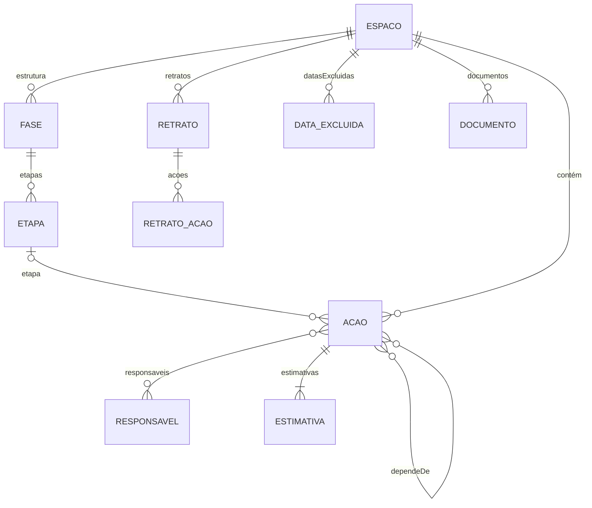

# Especificação da reescrita (versão 2)

**Situação:** em execução, passo a passo (seção 12). Passos concluídos: 0.1 a 0.5, 1.1 a 1.14, 1.14a, 1.14b, 1.14c, 1.14d, 1.15, 1.16, 1.17a, 1.17b, 1.17c, 1.18, 1.19a e 1.19b (primeiras versões).
**Data:** 19/10/2026

Este documento reúne as decisões tomadas para a reescrita do sistema. A reescrita segue este texto. Quando a versão 2 entrar no ar, o conteúdo daqui passa para a `documentacao-tecnica.md`, e este arquivo é apagado.

---

## 1. Por que reescrever

- **Código difícil de revisar.** O `index.html` atual foi feito em etapas, como artefato do Claude: são 1.300 linhas compactas, com nomes curtos. A cada versão, limpar fica mais caro.
- **O modelo de acompanhamento mudou.** Saem o valor agregado e o Earned Schedule. Entram situações, reestimativas com histórico, retratos e notas. Reformar o código atual seria limpar partes que serão descartadas.
- **Não é do zero.** A lógica já testada é mantida e reescrita de forma legível: calendário de dias úteis, caminho crítico, Monte Carlo, roteamento das linhas do diagrama e conexão com o Firebase.

---

## 2. Princípios

- **KISS** ("mantenha simples"): a solução mais simples que resolve o problema é a melhor.
- **YAGNI** ("você não vai precisar disso"): nada é construído antes de haver necessidade real.
- **Código limpo:** nomes claros, funções pequenas, um assunto por arquivo, sem duplicação e sem código morto. Código que perde a função é apagado, não escondido; o histórico do Git guarda tudo.
- **Só pedir o necessário:** o usuário informa apenas dados que o sistema usa. Exemplo: a data de início real de uma ação não é pedida, porque não entra em nenhum cálculo.
- **Aceitar o mundo real:** o sistema absorve registros atrasados, reprogramações e imprecisões sem travar o usuário. Exemplo: a data de conclusão pode ser registrada com qualquer data, mesmo passada.
- **Linguagem simples:** mantém-se o princípio atual. Termo técnico em itálico, como "Termo técnico: …", e clicável, abrindo a explicação na Ajuda.
- **Movimento com sentido** (decisão do responsável, 21/10/2026): o que aparece, some ou muda de lugar na tela faz uma transição curta, nunca um salto. A animação mostra de onde a coisa veio e para onde foi, e isso ajuda a entender o sistema. É padrão em toda tela nova ou alterada: painéis e janelas deslizam, formulários e seções crescem a partir da altura zero e encolhem ao fechar, itens reordenados deslizam até a nova posição, alternadores movem a marca da opção escolhida. Durações curtas e iguais em todo o sistema: 0,25 s (`--mov`) e 0,18 s para detalhes (`--mov-rapido`), com a mesma curva (`--mov-curva`), no CSS e em `js/telas/movimento.js` (`abrirSuave`, `fecharSuave`). Quem ativou "Reduzir movimento" no aparelho não vê animação.
- **Números contínuos, não categorias:** indicadores contínuos aparecem como barras, com o número discreto em cinza. Cortes arbitrários, como "acima de 50% é prioritária", são evitados, porque tratam como diferentes casos praticamente iguais (paradoxo de sorites). Carimbos ficam só para fatos binários, como "Atrasada".

---

## 3. Arquitetura

### 3.1 Arquivos, sem compilação

O sistema passa de um arquivo único para **poucos arquivos por assunto**, carregados direto pelo navegador como módulos JavaScript (`<script type="module">`). Não há etapa de compilação, npm nem *framework*. Os motivos estão na seção 10.

Estrutura prevista:

```
index.html            estrutura da página
css/estilo.css        aparência, variáveis de cor, temas claro e escuro
js/calendario.js      dias úteis e feriados
js/calculo.js         estimativas, caminho crítico, situações (funções puras, sem tela)
js/simulacao.js       Monte Carlo (funções puras)
js/modelo.js          campos de cada entidade: o lado "código" do dicionário de dados (seção 4)
js/dados.js           Store: operações do sistema, sem termos de banco (seção 3.4)
js/banco/firestore.js como o Firestore executa cada operação
js/banco/local.js     o mesmo, em memória (modo local e testes)
js/banco/firebase.js  carrega o SDK do Firebase e oferece o acesso (entrar, sair, trocar e redefinir senha)
js/telas/acesso.js    janelas de entrar e de trocar senha
config.js             configuração do Firebase da versão 2 (pública por desenho; null = só memória)
firestore.rules       regras do Firestore da versão 2, publicadas à mão no console
js/markdown.js        formatação segura das notas
js/telas/*.js         uma tela por arquivo: abertura, espaco, acoes, visualizacao, responsaveis, configurar, ajuda
js/identidade.js      nome do sistema e textos de identificação, num lugar só (seção 3.1)
js/exemplo.js         espaço de exemplo, com dados fictícios
js/icones.js          ícones em SVG, no lugar de emojis
js/app.js             estado, navegação, partida
testes/*.test.js      testes automáticos (node --test, rodado dentro de v2/)
testes/contrato-banco.js  garantias que todo banco cumpre (seção 3.4)
testes/firebase-falso.js  Firebase falso, em memória, para os testes do banco e da tela (nada vai ao Firebase)
testes/dados/         dados usados nos testes, como a cópia da PI²
package.json          só marca os arquivos como módulos para o Node; sem dependências
```

- **Funções puras:** cálculo e simulação não acessam a tela nem o banco. Recebem dados e devolvem resultados. Isso permite testá-las com o Node, sem navegador.
- **Tipos por comentários (JSDoc):** cada função tem, acima dela, a descrição do que recebe e devolve. Editores e a verificação do TypeScript (`tsc --checkJs`) apontam erros sem exigir compilação.
- **Bibliotecas externas:** continuam só por CDN e com versão fixa: dagre 0.8.5 e Firebase compat 10.14.1.
- **Teste local:** módulos não abrem com clique duplo no arquivo. É preciso um servidor simples, por exemplo `python3 -m http.server`. O README e o AGENTS.md serão atualizados.
- **Modo legado do artefato do Claude:** removido.
- **Nome do sistema como variável:** o nome aparece na tela, no título da aba do navegador, na Ajuda e nas exportações, mas é definido num único lugar, `js/identidade.js`. Trocar o nome é mudar uma linha. Nome provisório da versão 2: **Sextante** (decisão do responsável em 19/10/2026), sob avaliação.

### 3.2 Testes

- **Testes de unidade** das funções de calendário, cálculo, simulação e Markdown, com `node --test`, sem dependências.
- **Teste de comparação:** o espaço da PI² precisa produzir, na versão 2, as mesmas datas do caminho crítico da versão atual, já que essa regra não muda. As probabilidades mudam por causa da troca para a beta-PERT; os novos valores são registrados como referência. **Referência (versão do cálculo 1, semente 20261014, 10.000 simulações, só estimativas):** P50 em 30/03/2027, P80 em 08/04/2027, P95 em 22/04/2027 e chance de 89,5% de cumprir o prazo de 14/04/2027. Na versão atual, com a triangular e 3.000 simulações, a chance era de 74%: a triangular, com os mesmos três pontos, espalha mais as durações do que a beta-PERT, que concentra os sorteios perto do mais provável. Um teste automático confere esses valores; se mudarem, é preciso aumentar a versão do cálculo.
- **Teste do dicionário de dados:** compara os campos usados pelo código (tipos JSDoc do modelo) com os da seção 4 e falha se divergirem. Roda com os demais, em toda mudança.
- **Teste visual:** capturas de tela das três abas, nos temas claro e escuro e na largura de celular.

### 3.3 Fluxo de trabalho

A versão 2 é construída **passo a passo**, seguindo a regra "uma mudança por vez" do AGENTS.md, na ordem da seção 12. Cada passo é testado, documentado e conferido pelo responsável antes do seguinte.

- **Onde:** numa pasta própria do site, `/v2/`, publicada junto com a versão atual. O responsável confere cada passo no endereço `.../sistema-planos-de-acao/v2/`, inclusive pelo celular. A versão atual continua na raiz até a troca (passo 1.20).
- **Dados:** nas Fases 0 e 1, até o passo 1.14, a versão 2 usa só o banco em memória e o espaço de exemplo; nada é gravado. A partir do passo 1.14, usa **um segundo projeto no Firebase**, só para a versão 2 (decisão do responsável em 19/10/2026), com arquivo de configuração próprio dentro de `/v2/`. Os espaços reais ficam fisicamente separados. O responsável cria o projeto no console, com orientação passo a passo.
- **Execução em lote** (decisão do responsável, 21/10/2026): os passos 1.16, 1.17a, 1.17b, 1.17c, 1.18 e 1.19 podem ser feitos em sequência, sem esperar a conferência de cada um. Condições: cada passo é um commit próprio, marcado no GitHub com a etiqueta `v2-passo-<número>`, testado, documentado e registrado em `docs/registro-de-execucao.md`, com as decisões tomadas sem consulta marcadas como provisórias; os passos 1.17a a 1.17c são primeiras versões, sujeitas à revisão do responsável; a execução para diante de teste que falhe sem solução clara, de mudança em dados reais, nas regras do banco ou na segurança, ou de decisão de método que mude o sentido de um número. Ficam fora do lote: 1.14d, 1.20, 1.21 e 1.22.
- **Versão atual sem novidades:** enquanto a versão 2 é construída, a versão atual continua no ar como está. Não ganha funções novas, para não fazer o trabalho duas vezes; recebe só correções, se algo quebrar.

### 3.4 Preparação para a troca de banco

A meta de longo prazo é hospedar o sistema no servidor da UFCI-MG, com PostgreSQL. A versão 2 não faz essa troca, mas não pode dificultá-la.

- **O `Store` fala a língua do sistema, não a do banco.** Oferece operações com nomes do domínio, como `criarAcao`, `alterarCampo`, `acrescentarResponsavel`, `retirarResponsavel`, `registrarEstimativa`, `concluirAcao`, `salvarRetrato` e `acompanharPlano`. Nenhum termo do Firestore (coleção, documento, `onSnapshot`, `arrayUnion`) aparece fora de `js/banco/firestore.js`.
- **Cada banco é um arquivo** em `js/banco/`, que executa as mesmas operações. Hoje: Firestore e memória local. Depois: um que conversa com o servidor da UFCI-MG.
- **As regras de edição simultânea (seção 4.6) são do sistema.** No Firestore, viram transações e acréscimos em listas. No PostgreSQL, viram restrições do próprio banco, como código único por espaço, tabelas de ligação para responsáveis e dependências, e conferência da última alteração antes de gravar.
- **Tempo real como operação, não como recurso do banco.** `acompanharPlano` avisa a tela quando algo muda. No Firestore, isso vem pronto. No servidor, pode começar com consultas periódicas, por exemplo a cada 10 segundos.
- **Os mesmos testes para todos os bancos.** Os testes de `node --test` rodam contra o banco em memória e servem de contrato: um banco novo precisa passar neles.
- **A cópia de segurança é a ponte.** O arquivo da cópia tem formato próprio, independente do banco, e documentado. A troca será: exportar do Firebase, importar no servidor e conferir com o teste de comparação.

Fica para a época da troca, fora da versão 2: o programa do servidor, que passa a conter as permissões hoje no `firestore.rules` (já com os níveis de permissão pendentes), e o login institucional, que exigirá recadastrar os usuários.

---

## 4. Modelo de dados (dicionário de dados)

**Esta seção é o dicionário de dados da versão 2.** Toda mudança na estrutura do banco atualiza esta seção no mesmo commit (AGENTS.md). O teste `testes/dicionario.test.js` compara cada tabela marcada abaixo com `js/modelo.js`, a lista de campos que o código usa, e falha se divergirem. O Store recusa gravar campos que não estejam nessa lista.

Quando a versão 2 entrar no ar, esta seção passa para a documentação técnica.

### Convenções

- **Data:** texto `AAAA-MM-DD`, sem hora nem fuso. É uma data do calendário, lida no horário de Brasília. Exemplo: `2026-10-19`.
- **Momento:** texto ISO 8601 em UTC, com milissegundos e `Z`. Exemplo: `2026-10-19T13:45:00.000Z` (10h45 em Brasília).
- **Id:** texto gerado pelo sistema (UUID). Exemplo: `3f2b8c1e-…`. Exceção: a ação, cuja chave é o código.
- **Usuário:** e-mail de login de quem gravou. Vazio quando não há login (modo local).
- **Dias úteis:** número de dias úteis do espaço, descontadas as datas excluídas. Aceita frações, como `2.5`.
- **Vazio:** campo ausente ou `null`. "Obrig." indica se o campo precisa ter valor.
- **Exclusão lógica:** nada é apagado; `excluidoEm` preenchido indica item excluído (seção 4.7).
- **Nomes dos campos:** em português, sem acentos, no formato `palavraPalavra`.

### Entidades e relações



**Como ler o diagrama:** notação "pé de galinha" (*Termo técnico: crow's foot, de James Martin*), padrão em modelagem de dados. Em cada ponta da linha: `||` exatamente um; `|o` zero ou um; `|{` um ou muitos; `o{` zero ou muitos (o "pé" indica "muitos"). Exemplo: entre ESPACO e ACAO, cada ação pertence a exatamente um espaço, e um espaço tem zero ou muitas ações.

- Um **espaço** tem ações, retratos, datas excluídas, documentos e uma estrutura de fases e etapas.
- Uma **ação** pertence a um espaço e, opcionalmente, a uma etapa; depende de outras ações do mesmo espaço; tem responsáveis e um histórico de estimativas.
- **Responsáveis** são globais: os mesmos para todos os espaços.

### 4.1 Espaço de Planejamento

<!-- dicionario: espaco -->
| Campo | Tipo | Obrig. | Significado | Exemplo |
|---|---|---|---|---|
| `id` | id | sim | Identificador do espaço. Imutável | `3f2b8c1e-…` |
| `nome` | texto | sim | Nome do espaço | `PI² · Fase 1` |
| `inicio` | data | não | Início do espaço: a partir dele contam os dias úteis | `2026-08-03` |
| `prazoFinal` | data | não | Prazo final, por exemplo o fixado por ato da Diretoria-Geral | `2027-04-14` |
| `datasExcluidas` | lista de data excluída (4.1.1) | não | Datas sem expediente próprias do espaço (feriados locais, exclusões específicas), que complementam o calendário geral (4.1.5) | |
| `datasGeraisDesconsideradas` | lista de data | não | Datas do calendário geral que este espaço não exclui (por exemplo, um ponto facultativo em que a equipe trabalha) | `["2027-02-08"]` |
| `documentos` | lista de documento (4.1.2) | não | Documentos do espaço, como o espaço aprovado e suas revisões | |
| `simulacoes` | inteiro | sim | Número de simulações. Padrão 10.000. Definido na criação e **imutável** (seção 5.7) | `10000` |
| `semente` | inteiro | sim | Semente da simulação. Padrão 20261014. Definida na criação e **imutável** (seção 5.7) | `20261014` |
| `estrutura` | lista de fase (4.1.3) | não | Fases e etapas, na ordem de exibição (seção 8.3) | |
| `camposOpcionais` | campos opcionais (4.1.4) | não | Quais campos opcionais o espaço usa. Ausente: todos ligados | |
| `proximoNumero` | inteiro | não | Número que a próxima ação criada no espaço vai receber (seção 4.2). Mantido pelo sistema, não editável; só cresce, para nenhum número ser reaproveitado. Ausente: 1 | `13` |
| `tons` | mapa de id de responsável → inteiro de 1 a 15 | não | Tom do círculo de cada **pessoa** responsável por alguma ação do espaço (seção 8.3). Mantido pelo sistema, não editável: quem chega recebe o menor tom livre; quem deixa de ser responsável por todas as ações sai, e o tom fica livre; acima de 15 pessoas, repete o tom menos usado. Gravado sem carimbo de alteração | `{"3f2b…": 1, "9c1a…": 2}` |
| `criadoEm` | momento | sim | Criação do espaço. Imutável | `2026-10-19T13:45:00.000Z` |
| `alteradoEm` | momento | sim | Última gravação no espaço | |
| `alteradoPor` | usuário | não | Autor da última gravação | `ana@ufci.edu.br` |
| `excluidoEm` | momento | não | Exclusão lógica (seção 4.7). Vazio: espaço ativo | |
| `excluidoPor` | usuário | não | Quem excluiu | |

Saem da versão atual: `dist` (escolha de distribuição), `statusDate` (a data de referência é sempre hoje), `baseline` (substituído pelos retratos) e `nearCrit` (seção 7.3).

#### 4.1.1 Data excluída: cada item de `datasExcluidas`

<!-- dicionario: dataExcluida -->
| Campo | Tipo | Obrig. | Significado | Exemplo |
|---|---|---|---|---|
| `data` | data | sim | Dia sem expediente, que não conta como dia útil | `2026-11-20` |
| `motivo` | texto | não | Motivo, para conferência posterior | `Consciência Negra` |

#### 4.1.2 Documento: cada item de `documentos`

<!-- dicionario: documento -->
| Campo | Tipo | Obrig. | Significado | Exemplo |
|---|---|---|---|---|
| `nome` | texto | sim | Nome do documento | `Plano aprovado` |
| `data` | data | não | Data do documento | `2026-08-01` |
| `identificacao` | texto | não | Número no sistema de protocolo da instituição (SIPAC/Protocolo) | `23062.001234/2026-11` |
| `link` | texto (endereço web) | não | Endereço para abrir o documento. O envio do arquivo fica para o servidor da UFCI-MG (passo 4.3) | `https://…` |

#### 4.1.3 Fase e etapa: cada item de `estrutura` e de `etapas`

<!-- dicionario: fase -->
| Campo | Tipo | Obrig. | Significado | Exemplo |
|---|---|---|---|---|
| `id` | id | sim | Identificador da fase. Imutável | `f1` |
| `nome` | texto | sim | Nome da fase | `Planejamento` |
| `etapas` | lista de etapa | sim | Etapas da fase, na ordem de exibição | |

<!-- dicionario: etapa -->
| Campo | Tipo | Obrig. | Significado | Exemplo |
|---|---|---|---|---|
| `id` | id | sim | Identificador da etapa, usado no campo `etapa` da ação. Imutável | `e1` |
| `nome` | texto | sim | Nome da etapa | `Requisitos e arquitetura` |

#### 4.1.4 Campos opcionais: o objeto `camposOpcionais`

<!-- dicionario: camposOpcionais -->
| Campo | Tipo | Obrig. | Significado | Exemplo |
|---|---|---|---|---|
| `fasesEtapas` | sim/não | não | Usa fases e etapas. Desligado: lista sem separadores | `true` |
| `descricao` | sim/não | não | Usa o campo descrição das ações | `true` |
| `notas` | sim/não | não | Usa as notas das ações | `true` |
| `codigos` | sim/não | não | Usa os códigos mnemônicos das ações, como `LEV` (seção 4.2). **Ausente: desligado**, ao contrário dos demais | `false` |

Desligar um campo o esconde do formulário, da tabela e das exportações; os dados já gravados são mantidos.

#### 4.1.5 Calendário geral

Um só, para todos os espaços (seção 5.1). Cuidado pelo Administrador do Sistema.

<!-- dicionario: calendarioGeral -->
| Campo | Tipo | Obrig. | Significado | Exemplo |
|---|---|---|---|---|
| `datasExcluidas` | lista de data excluída (4.1.1) | sim | Feriados nacionais, recessos e outras datas sem expediente na instituição | |
| `alteradoEm` | momento | sim | Última gravação | |
| `alteradoPor` | usuário | não | Autor da última gravação | |

### 4.2 Ação

Chave: o par (espaço, `numero`).

**Como as ações são identificadas** (decisão do responsável, 20/10/2026). Ferramentas de equipe de uso amplo (Asana, Monday, Notion, Todoist) não mostram código: a dependência é escolhida pelo nome e aparece pelo nome. Códigos poluem a tela e aumentam a carga para o público leigo. Por isso:

- **Número fixo em sequência** (`numero`), como no Jira e no GitHub: 1, 2, 3…, dado pelo sistema ao criar a ação, imutável e nunca reaproveitado (nem depois de exclusões). Não é a posição na lista: inserir uma ação no meio não renumera nada. É ele que liga as dependências. Fica **invisível no uso normal** e aparece só onde é útil: no modo "Editar em planilha" e na importação por planilha, para digitar "depende de 3; 5" num espaço sem códigos.
- **Código mnemônico** (`codigo`), como `LEV`: opcional, ligado em "Configurar o espaço" (campo opcional `codigos`, desligado por padrão). Serve a equipes técnicas e às conversas em reunião ("o LIC atrasou"). Como não liga dependências, pode ser alterado; não pode repetir no espaço.
- Descartado o **número da posição** (MS Project, Smartsheet): inserir uma linha no meio renumera as seguintes, e o que estava escrito em atas passa a apontar para a ação errada.

<!-- dicionario: acao -->
| Campo | Tipo | Obrig. | Significado | Exemplo |
|---|---|---|---|---|
| `numero` | inteiro | sim | Identificador da ação no espaço: 1, 2, 3…, na ordem de criação. Imutável e nunca reaproveitado; é a referência das dependências | `7` |
| `codigo` | texto | não | Código mnemônico, de 2 a 8 letras maiúsculas ou números, único no espaço. Só aparece com o campo opcional `codigos` ligado | `LEV` |
| `ordem` | inteiro | sim | Posição na "Ordem do espaço" | `3` |
| `etapa` | id | não | Etapa a que a ação pertence (e, por ela, a fase). Vazio: sem fase nem etapa | `e1` |
| `rotulo` | texto | sim | Nome curto, usado no cronograma e no diagrama | `Levantar requisitos` |
| `descricao` | texto | não | Descrição completa | |
| `dependeDe` | lista de inteiro | sim | Números das ações anteriores, do mesmo espaço. Lista vazia: sem anteriores | `[1, 4]` |
| `responsaveis` | lista de id | sim | Ids dos responsáveis (4.5). Lista vazia: sem responsável | |
| `estimativas` | lista de estimativa (4.3) | sim | Da primeira à mais recente. A vigente é a última | |
| `concluidaEm` | data | não | Data de conclusão. Vazio: não concluída | `2026-09-22` |
| `naoAntesDe` | data | não | Data mínima de liberação, "Não começa antes de" (seção 5.1) | `2026-10-19` |
| `notas` | texto (Markdown) | não | Notas da ação (seção 8.5) | |
| `checklist` | lista de item do checklist (4.2.2) | não | Itens a cumprir dentro da ação, na ordem em que foram acrescentados (seção 16.5; passo 2.8). Vazio: sem checklist | |
| `criadaEm` | momento | sim | Criação da ação. Imutável | |
| `alteradaEm` | momento | sim | Última gravação na ação (seção 4.6) | |
| `alteradaPor` | usuário | não | Autor da última gravação | |
| `excluidaEm` | momento | não | Exclusão lógica (seção 4.7). Vazio: ação ativa | |
| `excluidaPor` | usuário | não | Quem excluiu | |

Saem da versão atual: custo, custo gasto, % concluído, início real e término real separado. O campo `entrega` da ação, previsto antes, foi retirado em 20/10/2026 para não se confundir com as **entregas do Plano de Ação** (seção 16.7); o que a coluna "Entrega" da planilha da PI² dizia passa para a descrição.

#### 4.2.1 Histórico de alterações: um registro por campo alterado

Toda alteração de uma ação gera registros no histórico (seção 16.4; passo 1.16): um por campo que mudou, com o valor antigo e o novo. A criação gera um registro só. Os registros são gravados na mesma operação da alteração (no Firebase, na mesma transação): um não existe sem o outro. Só de acréscimo: ninguém altera nem apaga, nem o Administrador do Sistema. Não entram os carimbos da própria gravação (`criadaEm`, `alteradaEm`, `alteradaPor`, `excluidaPor`), que o registro já guarda em `em` e `por`. A correção de uma estimativa, que não cria item novo em `estimativas` (seção 4.3), também é registrada aqui, com a lista antes e depois.

<!-- dicionario: historico -->
| Campo | Tipo | Obrig. | Significado | Exemplo |
|---|---|---|---|---|
| `id` | id | sim | Identificador do registro | |
| `entidade` | texto | sim | O que foi alterado. Por enquanto, sempre `acao` | `acao` |
| `chave` | inteiro | sim | Número da ação no espaço | `7` |
| `tipo` | texto | sim | `criacao` ou `alteracao` | `alteracao` |
| `campo` | texto | não | Campo da ação que mudou (seção 4.2). Vazio na criação | `concluidaEm` |
| `antes` | qualquer | não | Valor antes da alteração, no formato do campo. Vazio na criação ou se o campo não existia | `null` |
| `depois` | qualquer | não | Valor depois da alteração. Vazio na criação ou se o campo foi esvaziado | `2026-10-21` |
| `em` | momento | sim | Quando | |
| `por` | usuário | não | Quem. Vazio só em gravações sem login (espaço de exemplo, na memória) | |

#### 4.2.2 Item do checklist: cada item de `checklist`

Passo 2.8 (seção 16.5). Cada item é mudado sozinho, numa operação que lê e grava a ação de uma vez (no Firebase, numa transação): duas pessoas marcando itens ao mesmo tempo não apagam uma à outra (seção 4.6). Cada mudança entra no histórico de alterações (4.2.1), com a lista antes e depois. O checklist não entra no cálculo: marcar itens não conclui a ação nem muda previsões.

<!-- dicionario: checklistItem -->
| Campo | Tipo | Obrig. | Significado | Exemplo |
|---|---|---|---|---|
| `id` | id | sim | Identificador do item, único na ação | |
| `texto` | texto | sim | O que precisa ser feito | `Enviar minuta à Procuradoria` |
| `feito` | sim ou não | sim | Marcado como feito | `false` |

### 4.3 Estimativa: cada item de `estimativas`

<!-- dicionario: estimativa -->
| Campo | Tipo | Obrig. | Significado | Exemplo |
|---|---|---|---|---|
| `em` | data | sim | Dia em que a estimativa foi feita | `2026-10-19` |
| `por` | usuário | não | Quem registrou | |
| `o` | dias úteis inteiros | sim | Otimista. A partir de 0 | `3` |
| `m` | dias úteis inteiros | sim | Mais provável. Entre `o` e `p` | `5` |
| `p` | dias úteis inteiros | sim | Pessimista. Maior que 0 | `10` |
| `contaDe` | texto | sim | `liberacao`: conta da liberação (primeira estimativa); `data`: conta do dia `em` (reestimativa) | `data` |
| `motivo` | texto | não | Motivo da reestimativa | `Atraso do fornecedor` |

A primeira estimativa nunca é alterada. Corrigir um erro de digitação logo após cadastrar substitui a estimativa mais recente, sem criar histórico, desde que seja no mesmo dia e antes de qualquer reestimativa. Enquanto a ação não está liberada, a estimativa muda sem histórico (seção 5.3).

### 4.4 Retrato

Chave: id. Pertence a um espaço. Só leitura depois de criado.

**O retrato é uma cópia integral do espaço naquele momento** (decisão de 20/10/2026): o espaço com todos os campos, todas as ações ativas com todos os campos (inclusive notas e o histórico completo de estimativas), os responsáveis citados e os resultados calculados. Assim ele se sustenta sozinho, mesmo que tudo mude ou seja excluído depois, e permite refazer o cálculo exatamente. Só ficam de fora os **comentários** e o **histórico de alterações**, que já são permanentes por conta própria (seções 16.4 e 16.5).

O retrato é guardado em duas partes: o cabeçalho, abaixo, e um registro por ação (4.4.1). Assim, um espaço grande com notas longas não esbarra no limite de tamanho de um documento do Firebase (cerca de 1 MB).

<!-- dicionario: retrato -->
| Campo | Tipo | Obrig. | Significado | Exemplo |
|---|---|---|---|---|
| `id` | id | sim | Identificador do retrato | |
| `nome` | texto | sim | Nome dado ao retrato | `Plano aprovado` |
| `origem` | texto | sim | `manual` (salvo por um administrador do espaço) ou `automatico` (salvo pelo sistema). Na tela, cada origem tem um selo | `manual` |
| `criadoEm` | momento | sim | Quando foi salvo | |
| `criadoPor` | usuário | não | Quem salvou. Vazio nos automáticos | |
| `semente` | inteiro | sim | Semente usada no cálculo | `20261014` |
| `simulacoes` | inteiro | sim | Número de simulações usado | `10000` |
| `versaoCalculo` | inteiro | sim | Versão do método de cálculo (seção 5.7) | `1` |
| `espaco` | espaço (4.1) | sim | Cópia integral do espaço, com todos os campos de 4.1 | |
| `datasExcluidasEfetivas` | lista de data excluída (4.1.1) | sim | Datas excluídas que valiam no cálculo naquele momento: calendário geral, menos as desconsideradas, mais as do espaço. O calendário geral pode mudar depois; sem esta cópia, refazer o cálculo daria outro resultado | |
| `responsaveis` | lista de responsável (4.5) | sim | Cópia integral dos responsáveis citados nas ações, para os nomes continuarem legíveis | |
| `resumo` | resumo do retrato (4.4.2) | sim | Resultado do espaço naquele momento | |

Os retratos **automáticos não podem ser excluídos** à mão, para o histórico usado no Data Lakehouse não ter buracos. O retrato automático depende de um programa no servidor; chega com o servidor da UFCI-MG (passo 4.4). No Firebase gratuito, só há retratos manuais.

Se um dia for preciso apagar algum texto de um retrato por exigência legal, isso será tratado caso a caso pela equipe de TI, fora do sistema (decisão de 20/10/2026: situação extremamente rara, que não justifica uma função própria).

#### 4.4.1 Ação do retrato: um registro por ação

Cada ação do retrato tem **todos os campos da ação (4.2)**, copiados como estavam, e mais estes valores calculados naquele momento:

<!-- dicionario: retratoAcaoCalculos -->
| Campo | Tipo | Obrig. | Significado | Exemplo |
|---|---|---|---|---|
| `situacao` | texto | sim | `naoLiberada`, `liberada` ou `concluida` | `liberada` |
| `atrasada` | sim/não | sim | Carimbo Atrasada | `false` |
| `liberacaoPrevista` | data | sim | Data prevista de liberação | `2026-10-05` |
| `conclusaoPrevista` | data | sim | Data prevista de conclusão | `2026-10-27` |
| `folga` | dias úteis | sim | Folga total no cálculo determinístico | `4` |
| `prioridadeExecucao` | número de 0 a 1 | sim | Índice de criticidade (seção 7.1) | `0.72` |
| `prioridadeRevisao` | número de 0 a 1 | sim | Contribuição para a variância do prazo (seção 7.2) | `0.18` |

#### 4.4.2 Resumo do retrato: o objeto `resumo`

<!-- dicionario: retratoResumo -->
| Campo | Tipo | Obrig. | Significado | Exemplo |
|---|---|---|---|---|
| `conclusaoPrevista` | data | sim | Conclusão prevista do espaço (P50) | `2026-12-22` |
| `dataSegura` | data | sim | Data com 80% de chance (P80) | `2027-01-15` |
| `p95` | data | sim | Data com 95% de chance | `2027-02-03` |
| `chancePrazo` | número de 0 a 1 | não | Chance de cumprir o prazo final. Vazio se o espaço não tem prazo final | `0.74` |

### 4.5 Responsável

Chave: id. Pertence a um espaço (desde o passo 1.14b), com cadastro livre em "Configurar este espaço".

**Revisto em 21/10/2026 (decisão do responsável; feito no passo 1.14b):** os responsáveis **criados no sistema** passam a ser **de cada espaço**: ficam dentro do espaço (`espacos/{id}/responsaveis/{id}`), aparecem só nele e são cuidados em "Configurar este espaço". A mesma pessoa em dois espaços tem dois cadastros, até a integração com a instituição; o e-mail de login não se repete dentro de um espaço, mas pode aparecer em vários. Só os responsáveis **da instituição** (servidores pela IU e unidades organizacionais do CEFET-MG, Fase 4) formam uma lista geral, só para leitura, vinda de outro sistema. **O Administrador do sistema não cadastra responsáveis.**

<!-- dicionario: responsavel -->
| Campo | Tipo | Obrig. | Significado | Exemplo |
|---|---|---|---|---|
| `id` | id | sim | Identificador do responsável. Imutável | |
| `tipo` | texto | sim | `pessoa` ou `unidade` (unidade organizacional, equipe ou grupo de unidades). Escolhido no cadastro e **imutável**. Define o desenho na tela: pessoa num círculo com as iniciais; unidade num quadrado arredondado com a sigla | `pessoa` |
| `nome` | texto | sim | Nome da pessoa, equipe ou unidade | `Ana Souza` |
| `sigla` | texto | não | Sigla curta, usada em espaços pequenos como o diagrama; numa unidade, é o que aparece no quadrado | `DTI` |
| `setor` | texto | não | Setor ou unidade | `DGDI` |
| `usuario` | usuário | não | E-mail de login ligado a este responsável. Vazio: responsável sem login. Só uma pessoa pode ter login | `ana@ufci.edu.br` |
| `criadoEm` | momento | sim | Cadastro do responsável. Imutável | |
| `alteradoEm` | momento | sim | Última gravação | |
| `alteradoPor` | usuário | não | Autor da última gravação | |
| `excluidoEm` | momento | não | Exclusão lógica (seção 4.7) | |
| `excluidoPor` | usuário | não | Quem excluiu | |

O campo `tipo` (decisão do responsável, 20/10/2026) separa **pessoas** de **unidades**. **O tipo não muda depois do cadastro** (decisão do responsável, 21/10/2026): pessoa e unidade são coisas diferentes, e "converter" uma na outra seria estranho. Um cadastro com o tipo errado é corrigido criando outro, com o tipo certo, e excluindo o errado com a opção "substituir por" (seção 4.7), que passa todas as ações para o novo de uma vez, sem refazê-las à mão. Entre as pessoas, há hoje dois casos, sem campo próprio para distingui-los:

- **Membro da equipe com acesso ao sistema:** tem `usuario`. Para esses, funcionam o filtro "Minhas ações" e, na Fase 2, os papéis por espaço.
- **Responsável diverso:** pessoa de fora do sistema, ou qualquer unidade organizacional, equipe ou grupo de unidades (`tipo: unidade`). Fica sem `usuario`. É cadastrado livremente, inclusive direto no formulário da ação ("Cadastrar … como responsável").

**Quatro tipos de responsável, previstos para a Fase 4** (decisão do responsável, 21/10/2026). O tipo (pessoa ou unidade) e a **origem** (da instituição ou criado no sistema) são duas perguntas separadas:

| | Da instituição | Criado no sistema |
|---|---|---|
| **Pessoa** | (i) usuário do sistema, identificado pela Identificação Única (IU) do CEFET-MG | (ii) etiqueta: pessoa de fora, ou que não usa o sistema |
| **Unidade** | (a) unidade organizacional oficial, do banco de dados da instituição | (b) grupo de pesquisa, comissão temporária ou outro grupo de pessoas |

- Os cadastros **da instituição** vêm de fora e não são editados no sistema: nome, e-mail e sigla seguem o cadastro oficial, sem duplicatas nem nomes escritos de jeitos diferentes. Cada um guarda o identificador oficial (a IU da pessoa; o código da unidade). As unidades oficiais vêm em árvore (subunidades), o que permite, no futuro, filtros como "ações da DGDI e das suas subunidades".
- Os cadastros **criados no sistema** continuam livres, como hoje.
- Até a Fase 4, o e-mail de login (`usuario`) é a forma provisória de ligar uma pessoa a quem entra no sistema (login por e-mail e senha, passo 1.14). Com a IU, a ligação passa a ser pelo identificador da IU.
- Campos previstos (seção 4.10): `origem` (`instituicao` ou `sistema`) e `identificadorInstitucional`. Não entram antes da Fase 4, porque, sem a IU e o banco de unidades, ficariam vazios.

### 4.6 Edição simultânea

Várias pessoas podem editar o mesmo espaço ao mesmo tempo. Nenhuma gravação pode apagar, em silêncio, o trabalho de outra pessoa. A versão 1 já grava só o campo alterado e mostra as mudanças em tempo real; a versão 2 mantém isso e fecha três falhas encontradas na versão 1 em 17/10/2026 (registradas em "Pendências" da documentação técnica).

| Situação | Regra |
|---|---|
| Duas pessoas mudam campos diferentes | Cada gravação leva só o campo alterado, nunca a ação inteira |
| Responsáveis e "depende de" | Acrescentar e retirar itens um a um, nunca regravar a lista inteira. Assim, se duas pessoas acrescentam responsáveis ao mesmo tempo, os dois ficam |
| Reestimativa | Entra no fim do histórico, sem regravar as anteriores. A correção de digitação da seção 4.3, que substitui a mais recente, só grava se ninguém tiver acrescentado outra estimativa nesse meio-tempo |
| Ação nova | O número é reservado no banco (contador do espaço, gravado numa transação), e não na tela de quem cria: duas pessoas criando ao mesmo tempo recebem números diferentes. O código mnemônico, quando usado, é conferido contra o banco; se outra pessoa usou o mesmo código antes, aparece "Já existe uma ação com o código X. Escolha outro." |
| Mesmo campo, mesma ação, quase juntas | Vale a última gravação, mas sem surpresa: se a ação aberta na janela for alterada por outra pessoa, a janela mostra "Fulano alterou esta ação agora" e atualiza os campos que não estão sendo editados. O campo em edição fica como está, e a pessoa decide se grava |
| Importação, restauração e regravação de ações inteiras | Só em operações explícitas, com confirmação, e nunca durante a edição comum |

Os campos `alteradaEm` e `alteradaPor` (seção 4.2) servem para o aviso. As regras dizem o que garantir, não como: cada banco as executa do seu jeito (seção 3.4). No modo local há um usuário só. Cada regra tem um teste em `node --test`, com duas gravações concorrentes simuladas.

### 4.7 Exclusão lógica

Nada é apagado de verdade pelo uso comum do sistema. Excluir um espaço, uma ação ou um responsável grava **quando** e **quem** excluiu (`excluidoEm`/`excluidaEm` e `excluidoPor`/`excluidaPor`), e o item some da tela.

- **Um único filtro, no `Store`.** As operações comuns (listar ações, calcular, exportar) devolvem só itens ativos. Ver os excluídos exige pedir explicitamente: a lixeira, a cópia de segurança e as cargas para o Data Lakehouse. Como nenhuma outra parte do código lê o banco (seção 3.4), o filtro existe num lugar só.
- **Teste automático:** um espaço de exemplo com uma ação excluída; o teste confere que ela não aparece na lista, no quadro, no cálculo, na simulação nem nas exportações, e que aparece na lixeira e na cópia de segurança.
- **Desfazer:** a lixeira do espaço mostra as ações excluídas, com quem e quando, e permite restaurá-las.
- **Exclusão encadeada:** excluir algo que outros itens usam abre uma janela que explica a consequência e oferece alternativas.
  - **Ação de que outras dependem:** (a) ligar as dependentes às anteriores da ação excluída, mantendo a sequência lógica; é a opção já marcada, e só aparece se a excluída tiver anteriores; (b) só retirar a dependência; (c) cancelar e rever a estrutura.
  - **Responsável que está em ações:** (a) substituir por outro responsável; (b) só retirar das ações; (c) cancelar.
  - **Etapa ou fase com ações:** (a) mover as ações para outra etapa; (b) deixar as ações sem etapa; (c) cancelar.
  - Cada mudança feita assim entra no histórico de alterações das ações afetadas. Restaurar o item da lixeira não refaz as ligações alteradas; o histórico mostra como eram.
- **Código ocupado:** o código de uma ação excluída continua reservado. Ao tentar criar uma ação com ele, o sistema oferece restaurar a antiga.
- **Carga incremental:** `alteradaEm` muda também na exclusão, para que a carga perceba.

Motivos da escolha, em vez de uma lista separada de exclusões: uma única consulta para a carga incremental, possibilidade de desfazer, auditoria completa (inclusive o conteúdo do que foi excluído) e retratos antigos que continuam mostrando o nome das ações.

### 4.8 Valores calculados, que não ficam no banco

O banco guarda os fatos: estimativas, dependências, datas de conclusão. O que deriva deles e da data de hoje é calculado na tela, a cada mudança, e **não é gravado**: um valor gravado ficaria velho no dia seguinte e criaria duas fontes de verdade. Quem fizer cargas para o Data Lakehouse encontra esses valores congelados nos retratos (4.4).

| Valor | Onde é definido |
|---|---|
| Situação (Não liberada, Liberada, Concluída) e carimbo Atrasada | Seção 6 |
| Datas previstas de liberação e de conclusão, folga | Seções 5.1 a 5.5 |
| Estimativa vigente, número de reprogramações, deslocamento do término | Seção 5.3 |
| Conclusão prevista (P50), data segura (P80), P95 e chance de cumprir o prazo | Seção 5.7 |
| Prioridade de execução e prioridade de revisão | Seções 7.1, 7.2 e 15 |

### 4.9 Onde cada entidade é guardada

| Entidade | Firebase (versão 2, segundo projeto) | PostgreSQL (servidor da UFCI-MG, proposta) |
|---|---|---|
| Espaço | `espacos/{id}` | tabela `espaco` |
| Data excluída, documento | listas dentro do espaço | tabelas `espaco_data_excluida`, `espaco_documento` |
| Fase, etapa | lista `estrutura` dentro do espaço | tabelas `fase`, `etapa` |
| Ação | `espacos/{id}/acoes/{numero}` | tabela `acao`, chave (`espaco_id`, `numero`) |
| Dependência | lista `dependeDe` dentro da ação | tabela `acao_dependencia` |
| Responsável da ação | lista `responsaveis` dentro da ação | tabela `acao_responsavel` |
| Estimativa | lista `estimativas` dentro da ação | tabela `estimativa` |
| Histórico de alterações | `espacos/{id}/historico/{id}` | tabela `historico`, com `espaco_id` |
| Retrato | cabeçalho em `espacos/{id}/retratos/{id}`; ações em `espacos/{id}/retratos/{id}/acoes/{numero}` | tabelas `retrato`, `retrato_acao` |
| Calendário geral | documento `sistema/calendario` | tabela `data_excluida_geral` |
| Responsável (criado no sistema) | `espacos/{id}/responsaveis/{id}` | tabela `responsavel`, com `espaco_id` |

Os nomes do Firebase passam a ser em português, porque a versão 2 usa um projeto novo (seção 3.3); a migração (seção 11) converte os nomes da versão atual (`projects`, `tasks`, `people`). No PostgreSQL, as listas viram tabelas de ligação e as regras da seção 4.6 viram restrições do banco (seção 3.4).

### 4.10 Entidades previstas, ainda fora do código

Entram no dicionário, com tabela marcada e teste, no passo em que forem construídas.

- **Fase 2 e seguintes:** campos opcionais da seção 16.8 (`etiquetas`, `posicaoPrioridade`, `documentos` da ação, `justificativa`, `local`, `dataLimite`; depois, `custoPrevisto`, `custosExecutados`, `orcamento` e o registro de riscos).
- **Fase 4:** origem dos responsáveis (`origem`: `instituicao` ou `sistema`) e identificador institucional (`identificadorInstitucional`: a IU da pessoa ou o código da unidade), com a lista de unidades oficiais em árvore (seção 4.5).
- **Fase 2:** entregas do Plano de Ação e registro do alcance, com evidência (seção 16.7); tipo do espaço, visibilidade, espaço aberto ou fechado, encerramento e papéis por espaço (seção 16.3); catálogo do PEI/PDI (seção 16.1); situações personalizadas (seção 16.2); comentários (seção 16.5). O checklist entrou no passo 2.8 (4.2.2).

---

## 5. Regras de cálculo

### 5.1 Contagem do tempo

- Prazos em **dias úteis**: de segunda a sexta, descontadas as datas excluídas, que vêm de dois cadastros (decisão do responsável, 21/10/2026):
  - **Calendário geral**, cuidado pelo Administrador do Sistema em "Configurar o sistema" (menu do usuário): feriados nacionais, recessos e datas da instituição, que valem para todos os espaços. Um botão acrescenta as datas de um ano conforme a lista anual típica do MGI (feriados nacionais e pontos facultativos, inclusive os móveis: Carnaval, Quarta-feira de Cinzas, Paixão de Cristo, Corpus Christi; Dia do Servidor Público, vésperas de Natal e de Ano Novo), para revisão antes de salvar: a lista pode ser corrigida e completada. Os pontos facultativos de parte do dia entram como dia inteiro, por zelo com os prazos. As pontes prováveis (segunda-feira antes de feriado na terça; sexta-feira depois de feriado na quinta) entram com o motivo "⚠️ Ponte provável (ponto facultativo) — confira na portaria do MGI" (decisão do responsável, 21/10/2026). Os anos oferecidos vão do anterior a dois à frente do ano corrente. Até existirem os papéis (Fase 2), qualquer pessoa conectada pode editá-lo.
  - **Datas do espaço**, cuidadas pelo administrador do espaço em "Configurar o espaço": feriados locais e exclusões específicas, que complementam o calendário geral. Ali se vê também a lista geral, sem poder editá-la, e se pode **desconsiderar** uma data geral no espaço (por exemplo, um ponto facultativo em que a equipe trabalha).
  - Datas efetivas do espaço = calendário geral, menos as desconsideradas, mais as do espaço.
  - Nas listas editáveis (datas e documentos), o que ainda não foi salvo fica destacado, com o aviso "Alterações não salvas" junto do botão Salvar; ao salvar, volta à aparência normal.
- Uma ação é **liberada** quando todas as anteriores estão concluídas. Sem ações anteriores, é liberada no início do espaço.
- **"Não começa antes de" (data mínima, opcional).** A ação só é liberada quando todas as anteriores estiverem concluídas **e** essa data tiver chegado. Liberação = a mais tardia entre a conclusão das anteriores e a data mínima. É o mesmo conceito da restrição "não iniciar antes de" do MS Project, numa forma simples.
  - **Nova ação:** o campo já vem preenchido com a data de criação. Assim, uma ação criada depois que as anteriores terminaram não nasce atrasada. O usuário pode apagar a data, se a ação puder começar assim que as anteriores terminarem.
  - **Outros usos:** ações que dependem de uma data externa, como liberação de orçamento, início do semestre ou publicação de um ato.
  - Enquanto a data não chega, a ação fica "Não liberada", com a indicação "a partir de dd/mm".
  - **Na janela da ação:** o campo só aparece quando tem data. Vazio, dá lugar a um link discreto, "+ Definir data mínima de início", que abre o campo. Em ações concluídas, não aparece.
  - **Em reavaliação** (seção 14, item 1).
- **O prazo de uma ação conta da liberação até a conclusão**, incluindo o tempo até alguém começar. A data de início real não é registrada. Isso precisa estar claro no formulário de estimativa e na Ajuda.

### 5.2 Estimativa de cada ação

- Fórmula PERT: (O + 4M + P) / 6, a média da distribuição beta-PERT.
- **Os três pontos são dias úteis inteiros** (decisão do responsável, 20/10/2026): o calendário conta em dias inteiros, e a fração sugeriria uma precisão que a estimativa não tem; a incerteza se expressa pela distância entre otimista e pessimista. O otimista pode ser 0 ("pode terminar no dia em que for liberada"). O prazo PERT resultante pode ter fração, que o calendário arredonda ao virar data.
- **Uma só distribuição em todo o sistema: beta-PERT.** A escolha entre triangular e beta é retirada. Motivos: coerência entre as datas do cronograma e a simulação, simplicidade para o usuário leigo e estabilidade das datas e carimbos. O otimismo nas estimativas será tratado pela previsão por classe de referência, não por troca de fórmula.

- **Ação sem estimativa** (decisão do responsável, 21/10/2026; passo 1.14a): pode existir, para a criação rápida. Conta como zero dias no cálculo e na simulação, só para o fluxo não quebrar; leva a marca **"Falta estimar"** no lugar da conclusão prevista, e o espaço avisa "Previsão incompleta: N ações sem estimativa contam como zero dias". Não recebe o carimbo Atrasada, porque não tem prazo para vencer, e não mostra as prioridades de execução e de revisão, que sairiam de uma duração zero (a faixa de cor fica neutra); como qualquer ação liberada, não termina no passado (seção 5.5). Rejeitados: esconder as previsões enquanto faltar estimativa (o espaço em montagem ficaria sem informação) e pedir um único número de dias (estimativa sem incerteza deixaria a chance de cumprir o prazo otimista sem ninguém perceber).

### 5.3 Reestimativa

- **Antes da liberação**, a estimativa pode ser alterada livremente, sem histórico: ainda é planejamento. A estimativa "original", que vale para o histórico e para a previsão por classe de referência, é a vigente no momento da liberação. Aceita pelo responsável, mas **em reavaliação** (seção 14, item 2).

- Disponível **a qualquer momento** para ação liberada e não concluída. Para ação atrasada, aparece em destaque, com alerta.
- O usuário informa os três pontos do **tempo que falta, a partir de hoje**.
- Cada reestimativa é registrada com data, autor, três pontos e motivo opcional.
- Conclusão prevista de uma ação reestimada: data da reestimativa + PERT dos novos três pontos.
- A tela da ação mostra a estimativa original, o número de reprogramações e quantos dias úteis o término andou desde a primeira estimativa.

### 5.4 Ações concluídas

Entram em todos os cálculos com a **duração real**, da liberação à conclusão, sem sorteio.

### 5.5 Regra interna: nada termina no passado

Para uma ação liberada e não concluída cuja conclusão prevista já passou sem reestimativa, **o cálculo considera conclusão a partir de hoje**. Na simulação, vale o mesmo: um sorteio que terminaria antes de hoje passa a terminar hoje.

A regra não restringe o usuário; só evita previsões otimistas demais. Na tela, quando ela estiver em ação, aparece ao lado da data prevista: "Prazo vencido sem reestimativa: o cálculo considera conclusão a partir de hoje." Ela deve constar na Ajuda e no manual, quando este for refeito.

### 5.6 Recálculo

Tudo é recalculado a cada mudança: conclusão, reestimativa ou edição. A estimativa vigente de cada ação é a mais recente.

### 5.7 Simulação de Monte Carlo

- Distribuição beta-PERT.
- **Semente e número de simulações visíveis, mas imutáveis.** São definidos na criação do espaço (pelo usuário ou com o padrão) e aparecem em "Configurar este espaço" só para leitura. Assim, qualquer pessoa ou IA pode conferir os resultados por fora, em planilha, Python ou R, e ninguém pode trocar a semente até o número "ficar bonito".
- **Conferência por fora:** a seção 15 deve documentar, junto com o código da versão 2, o gerador de números (mulberry32), a ordem dos sorteios e o método de sorteio da beta-PERT, para permitir reproduzir os resultados **exatamente**. Uma ferramenta com outro gerador chega a resultados estatisticamente equivalentes, com diferença da ordem de meio ponto percentual na chance de cumprir o prazo.
- **Versão do cálculo:** se um dia o método de cálculo mudar (por exemplo, a correção de um erro), a mesma semente passa a dar outro resultado. Por isso, o código tem um número de versão do cálculo, guardado em cada retrato.
- Ações concluídas: duração real. Ações reestimadas: a contagem começa na data da reestimativa. Regra da seção 5.5 aplicada.
- **Resultados do espaço:** datas P50, P80 e P95 da conclusão, chance de cumprir o prazo final e distribuição das datas finais (gráfico).
- **Resultados por ação:** índice de criticidade (seção 7.1) e contribuição para a variância do prazo (seção 7.2). Fórmulas e justificativas na seção 15.
- **Saem da tela o SSI e a crucialidade** como números próprios. A contribuição para a variância é a forma padrão e mais comunicável de responder à pergunta que os dois respondiam (seção 15.4).

---

## 6. Situações e carimbo

### 6.1 Situação: exatamente uma

| Situação | Quando |
|---|---|
| **Não liberada** | Alguma ação anterior não foi concluída, ou a data mínima ("Não começa antes de") não chegou. Antes chamada "Aguardando" (seção 16.2) |
| **Liberada** | Todas as anteriores concluídas (ou nenhuma anterior), e esta não concluída |
| **Concluída** | Tem data de conclusão |

### 6.2 Carimbo **Atrasada**

- Aplica-se à ação **liberada** cuja data prevista de conclusão (PERT da estimativa mais recente) já passou.
- O atraso é medido contra a **estimativa mais recente**, de propósito. A reestimativa tira o carimbo. É uma "colher de chá" ao executor, que exige dele uma atitude ativa (assumir uma nova data). O histórico de reprogramações registra a dimensão do problema.
- Uma ação não liberada nunca recebe o carimbo, porque, pela regra da seção 5.5, a previsão das anteriores não fica no passado.
- Não existe mais o carimbo "Prioritária": a prioridade é mostrada pela barra contínua da seção 7.1.

---

## 7. Indicadores por ação

Barras horizontais, com o número em cinza ao lado. A tabela pode ser ordenada por qualquer uma delas.

### 7.1 Prioridade de execução

*Termo técnico: índice de criticidade.*

Legenda: "Quanto um atraso nesta ação atrasa a conclusão prevista. Por exemplo, com 70%, cada dia de atraso nesta ação atrasa a conclusão em cerca de 0,7 dia. Considera só o prazo final; outros motivos de prioridade ficam a critério da equipe."

Fundamento: em cada simulação, um dia a mais numa ação atrasa a conclusão de todas as ações em um dia se ela estiver no caminho crítico, e em zero se não estiver. A média é o índice de criticidade. Por isso ele mede exatamente o efeito esperado de um atraso.

### 7.2 Prioridade de revisão do planejamento

*Termo técnico: contribuição para a variância do prazo.*

Legenda: "Esta ação responde por 18% da incerteza do prazo final. Quanto maior, mais vale revisar as estimativas, dividir a ação ou reduzir riscos." (o número é o da ação)

- **O que mostra:** a parcela da incerteza do prazo final que vem de cada ação. As parcelas de todas as ações não concluídas somam 100%.
- **Número em cinza:** a parcela em porcentagem inteira; abaixo de 1%, aparece "<1%".
- **Barra:** proporcional à parcela, numa escala fixa de 0% a 100%. Assim, a barra e o número dizem a mesma coisa, e o tamanho da barra pode ser comparado entre espaços.
- **Fundamento:** é a medida padrão das ferramentas de análise de risco de cronograma (gráfico "tornado"). Uma ação previsível no caminho crítico tem prioridade de execução alta e parcela quase nula: não há incerteza nela para reduzir. Detalhes matemáticos na seção 15.
- **Natureza relativa:** a parcela compara as ações entre si. Isso é adequado aqui, porque a barra serve para ordenar onde revisar o planejamento, não para disparar alertas.

### 7.3 Cores no fluxo e no cronograma

- **Intensidade contínua pela prioridade de execução:** a cor de cada ação não concluída varia gradualmente do **cinza** (índice de criticidade 0%) ao **vermelho** (100%). Quanto mais vermelha, mais um atraso nela atrasa a conclusão.
- **Verde:** ação concluída.
- Saem as categorias "sem folga", "quase sem folga" e "com folga", o limite de 10 dias (`nearCrit`) e as setas vermelhas do caminho crítico determinístico. Tudo passa a seguir uma única medida, a mesma da barra da seção 7.1. Isso evita que uma ação apareça como "crítica" numa tela e com prioridade baixa em outra.
- A folga em dias úteis continua visível como número, no detalhe da ação e no rótulo do fluxo.
- A legenda mostra a faixa de cores, de cinza a vermelho, com "menos prioritária" e "mais prioritária" nas pontas.
- As cores do gradiente seguem a paleta do logotipo e são ajustadas para o tema escuro.

### 7.4 Símbolos

Os mesmos da planilha da PI², no fluxo, no cronograma e na aba Ações:

| Símbolo | Significado |
|---|---|
| Visto num círculo | Concluída |
| Cadeado aberto | Liberada |
| Cadeado fechado | Não liberada |
| Relógio | Atrasada |

São ícones em SVG, desenhados no mesmo estilo e coloridos pelas variáveis dos temas, e não emojis (seção 16.2). O protótipo ainda usa emojis e "Aguardando"; vale esta seção.

Saem o símbolo "▶ em andamento", porque o sistema não registra mais o início real, e o "❗ prioritária", substituído pela intensidade da cor.

---

## 8. Interface

### 8.1 Topo

*Revisto em 21/10/2026 (passo 1.14c):* o menu do espaço e o menu do usuário deram lugar ao **menu lateral** (`js/telas/navegacao.js`), descrito no passo 1.14c da seção 12. A barra do topo ficou só com o botão do menu lateral, à esquerda, e o nome do espaço, no centro; logotipo, nome do sistema e sigla da instituição saíram da tela de trabalho. O que segue sobre os menus do topo vale como histórico; continua valendo o comportamento da barra ao rolar (cor do fundo no alto da página, vidro ao rolar).

- **Barra do aplicativo compacta, com dois estados**, como no Spotify do iPhone: **no topo da página**, sem rolagem, fica **da cor do fundo da página**, sem linha na base, com os textos na cor normal (o tom levemente mais escuro, testado antes, foi abandonado: pesava no topo); **ao rolar**, transforma-se suavemente em **vidro bem transparente** (cerca de 20% de véu no tema claro e 30% no escuro), que desfoca o conteúdo que passa por baixo, com uma linha fina na base e uma sombra suave. **A ida e a volta são simétricas**: a mesma transição de 0,3 s, com o mesmo desfoque nos dois estados (só a cor, a linha e a sombra mudam), para a volta ao topo ser o inverso exato da descida. Fica fixa no alto, com 48 px de altura. Reúne numa linha: logotipo e nome do sistema, menu do espaço (nome do espaço aberto, com uma setinha) e menu do usuário (iniciais). A Ajuda não tem botão próprio na barra: fica no menu do usuário, para poluir menos a tela. No celular, o nome encolhe para "Planos de Ação"; **no celular na vertical, logotipo e nome somem**, e o menu do espaço ocupa o espaço (KISS). Quem ativou "Reduzir transparência" no sistema, ou usa navegador sem suporte ao desfoque, vê a barra opaca, na cor de fundo da página. Objetivo: o máximo de tela para as ações.
- **Revisto em 21/10/2026 (decisão do responsável):** as ferramentas da lista foram para a **barra do topo, à direita**: seletor de modo (ícones), **Filtrar** (ícone de funil, com o número de filtros ativos; abre um painel pequeno com situação e contagens, responsável, "Minhas ações" e "Limpar filtros"), **Ordenar** (ícone de setas, com um ponto quando a ordem não é a do espaço; abre as ordens e "Recolher fases") e **Nova ação**. Os painéis fecham ao clicar fora ou com Esc. No alto do conteúdo ficam só os avisos: "N ações atrasadas. Ver" (filtra as atrasadas; de novo, mostra todas) e "Previsão incompleta". A **Legenda** virou um item no pé do menu lateral, que a mostra e esconde. No celular, a barra tem só o nome do espaço e um funil, que abre "Filtros e ordem" (modo, situação, responsável, ordem e recolher fases); o (+) flutuante cria ações. O que segue nesta seção sobre as ferramentas vale como histórico.
- **Revisto em 22/10/2026 (pedido do responsável):** a barra do topo do espaço tem três partes: à esquerda, seletor de modo, Filtrar e Ordenar (os painéis abrem sob eles); no meio, o nome do espaço; à direita, **Nova ação**. Abaixo dela, na mesma linha, "Barra" (tempo restante, prioridade de execução, prioridade de revisão ou nenhuma) e "Mostrar até" (fases, etapas ou ações) ficam à esquerda, no mesmo desenho do seletor de modo, e o alerta de ações atrasadas fica à direita.
- **Revisto em 22/10/2026 (decisões do responsável):** na lista, o ícone da situação vem antes do nome. Um botão **Colunas**, no começo da segunda linha, abre caixas de marcar: nome e situação são fixos; **Descrição** (texto inteiro; só se o espaço usa o campo), **Participantes** e **Barras** são opcionais, lembradas no aparelho. "Nenhuma" saiu do seletor Barra; sem a coluna Barras, o seletor não aparece. No quadro, a barra continua sempre visível. Os participantes aparecem em ordem alfabética.
- **Revisto em 22/10/2026 (decisão do responsável, revendo a anterior):** no seletor Barra, as prioridades aparecem pelos nomes técnicos, "Índice de criticidade" e "Contribuição para a variância", por serem medidas matemáticas precisas. Para explicá-las (e também o tempo restante, desde 22/10/2026: dias úteis até a conclusão prevista ou, em vermelho, desde que ela venceu), a linha de cada etapa aberta traz, sobre a coluna das barras, o nome e o que representa; o nome abre, ao passar o mouse, uma caixa com a explicação e, ao clicar, o verbete do glossário, que mostra a equação.
- **Revisto em 22/10/2026 (decisão do responsável):** os nomes técnicos valem em todo o sistema (seletor Barra, ordens, legenda, janela da ação e glossário); "prioridade de execução" e "prioridade de revisão" ficam no glossário como "Em palavras simples". Cada verbete traz a fonte primária, com DOI.
- **Acrescentado em 22/10/2026 (pedido do responsável):** edição no lugar com **Alt+clique**, para quem pode gravar, na lista, no quadro e na rede: nome (nas três), descrição (lista) e participantes (lista e quadro). Campos calculados (situação, datas e barras) não se editam. Com Alt pressionado, os campos editáveis ficam contornados.
- **Revisto em 22/10/2026 (decisão do responsável):** o menu "Colunas" passa a se chamar **Exibir** e vale na lista, no quadro, na rede e no cronograma. Traz o **identificador** antes do nome, na mesma linha: nenhum, número (#1) ou código (este só nos espaços que usam códigos); um ou outro, nunca os dois. Ação sem código mostra o número. Padrão: código onde há códigos; nenhum nos demais. Escolha lembrada no aparelho. Na lista, o mesmo menu mantém as colunas.
- **Em teste desde 23/10/2026 (pedido do responsável):** no computador, a barra do topo passa a ter o nome do espaço à esquerda e os menus Visualização, Filtrar, Ordenar e Exibir, todos abrindo para baixo; "Barra" vira o item "Indicador" do Exibir, e "Mostrar até" também vai para o Exibir; a segunda linha some, e as atrasadas viram uma etiqueta vermelha ao lado de "Nova ação". Área do conteúdo até 1600 px. No celular, nada muda.
- **Ferramentas da lista no computador:** filtros de situação, Lista ou Editar em planilha, Minhas ações, responsável, ordenação, Recolher fases, Legenda e Nova ação. A legenda de cores e símbolos fica escondida até ser aberta.
- **Ferramentas da lista no celular**, em uma só linha: os filtros de situação numa faixa que rola para o lado e um botão **"Filtros e ordem"**, que mostra quantas opções estão ativas. Ele abre um painel que sobe de baixo, com: Minhas ações, responsável, ordenação, recolher ou expandir fases, legenda e "Limpar filtros e ordem". **Nova ação** vira um botão flutuante (+) no canto inferior direito. A edição em planilha fica só no computador. Nos cartões de ações concluídas, as barras de prioridade, sem uso, não aparecem.

- Logotipo, nome do sistema e instituição.
- **Menu do espaço:** junta o seletor de espaço e "Configurar o espaço", que deixa de ter botão próprio (engrenagem). Ao tocar no nome do espaço, abre uma lista com os espaços (✓ no espaço aberto), uma linha divisória, "Configurar este espaço" e "Novo espaço" (nome, datas e prazo final). Sem login, mostra só a lista de espaços. Segue o padrão de troca de espaço de trabalho do Slack e do Notion. Custo aceito: configurar passa a exigir dois toques, e a lista deixa de ser a nativa do celular. Busca na lista só quando houver muitos espaços (YAGNI).
- **Ajuda:** painel dentro do sistema, aberto pelo item "Ajuda e manual" do menu do usuário ou pelos links "o que é?" da tela. Contém o glossário, que antes era a aba "Entenda os termos", e, futuramente, o manual. Cada "Termo técnico" na tela abre a explicação correspondente.
- **Configurar o espaço** (item "Configurar este espaço" do menu do espaço): painel lateral com: dados do espaço (nome, datas, prazo final, datas excluídas com motivo); campos opcionais em uso; documentos do espaço; retratos (salvar e listar); importar e exportar; cópia de segurança.
- **Menu do usuário:** seus dados (e-mail, nome, responsável ligado), Ajuda e manual, trocar senha (pede a senha atual), sair. Sem login, o lugar das iniciais mostra um ícone de pessoa, e o menu traz só "Ajuda e manual" e "Entrar", para quem só consulta não perder o acesso à Ajuda.
- **Configurar o sistema:** reservado para o futuro (por exemplo, gestão de usuários e permissões). O nome "Configurar o espaço" evita confusão com ele.

### 8.2 Abas

**Ações · Responsáveis**, em ordem de frequência de uso. *Revisto em 21/10/2026:* a aba Visualização sai; o cronograma, a rede e a linha do tempo viram modos do seletor da aba Ações (seção 8.4).

### 8.3 Aba Ações

Reúne o cadastro, o acompanhamento e as previsões por ação, como na planilha da PI².

- **Fases e etapas como separadores**, como na gestão clássica de projetos (estrutura analítica): fase > etapa > ações. Cada separador mostra o nome e, **só quando está recolhido**, o número de ações, quantas foram concluídas, as atrasadas e a data em que o grupo termina, com uma pequena barra de progresso (decisão do responsável, 20/10/2026: aberto, os cartões já mostram tudo, e o resumo poluía a tela). O resumo aparece e some com um esmaecimento curto. **No celular**, para não tumultuar, o grupo recolhido mostra só a barrinha de progresso e, se houver ação atrasada, o relógio vermelho, na linha do nome (decisão do responsável, 20/10/2026). Fases e etapas podem ser **recolhidas e expandidas** com animação suave, e, acima da lista, "Mostrar até: Fases · Etapas · Ações" recolhe ou abre todas de uma vez (22/10/2026). O aninhamento aparece por recuo leve. Ações sem etapa ficam num grupo "Sem fase nem etapa". *Revisto em 22/10/2026 (decisão do responsável):* o agrupamento vale em qualquer ordenação; a ordem escolhida (prioridade, data) vale dentro de cada etapa. Os separadores só somem ao desligar "Fases e etapas" em Campos opcionais.
- **Fases e etapas são cadastradas em "Configurar o espaço"** (criar e renomear; reordenar e excluir na versão final). Na ação, a etapa é escolhida numa lista agrupada por fase. O campo opcional "Fases e etapas" pode ser desligado; nesse caso, a lista fica sem separadores.
- **Animação dos filtros:** ao filtrar ou reordenar, as ações que continuam deslizam até a nova posição e as que entram aparecem suavemente. Respeita a preferência do sistema por menos movimento.
- **Responsáveis no cartão** (decisão do responsável, 20/10/2026): **pessoa** num círculo com as duas iniciais do nome (primeiro e último), num tom só dela dentro do espaço, de uma paleta de 15 tons espaçados por igual no círculo das cores, com a mesma claridade (campo `tons`, seção 4.1; decisão do responsável, 20/10/2026: comissões de até 10 a 12 pessoas, quase sem fotos, precisam reconhecer cada pessoa pela cor; a ordem de distribuição alterna tons distantes, e as 8 primeiras pessoas recebem cores bem diferentes); **unidade** num quadrado de cantos arredondados com a sigla, em tom neutro. É o padrão do GitHub para usuários e organizações. Primeiro as pessoas, depois as unidades, na mesma linha; com mais de três pessoas, os círculos se sobrepõem e terminam em "+N". O nome completo aparece ao passar o mouse ou tocar, e por extenso na janela da ação. Quem entrou com login vê o próprio círculo com um anel verde. A foto da pessoa substitui as iniciais quando houver login institucional (Fase 4).
- **Linha compacta:** código e rótulo; situação e carimbo; responsáveis; conclusão prevista; as duas barras de prioridade. **Sem cabeçalho de tabela** (decisão do responsável, 20/10/2026: com cartões, o cabeçalho confundia e poluía a tela): a data e as barras levam um rótulo pequeno no próprio cartão ("Conclusão prevista" ou "Concluída em", "Prioridade de execução", "Prioridade de revisão"), e os links "o que é?" das prioridades ficam na legenda. Nas ações concluídas, as barras não aparecem.
- **Cada linha é um cartão** com leve sombra e cantos arredondados, para separar visualmente as ações. *Revisto em 22/10/2026 (decisão do responsável):* sem a faixa colorida à esquerda, que repetia a prioridade já mostrada na barra. Também em 22/10/2026: a ação concluída não mostra a data de conclusão; as demais mostram, no lugar da data prevista, quantos dias úteis faltam ("Faltam 6 dias úteis", "Conclui hoje"), e a atrasada, há quantos dias úteis a previsão venceu. A data aparece ao parar o mouse e na janela da ação. *Revisto de novo em 22/10/2026, para a lista ficar menos carregada (decisões do responsável):* a situação aparece só pelo ícone (concluída, ✓; não liberada, cadeado fechado); a liberada, que é o normal, fica sem marca; sai o carimbo "Atrasada" e a seta do canto direito; o prazo é uma barra (decisão do responsável, 22/10/2026, no lugar do número com seta, que não se sustentou no golpe de vista): verde para a direita, com os dias úteis que faltam, e vermelha para a esquerda, com há quantos dias úteis a previsão venceu, numa escala única do espaço, do mais vencido ao que mais falta, com o zero marcado; o número fica ao lado, pequeno; saem os rótulos repetidos de cada cartão ("Conclusão prevista", "Prioridade de…"). Acima da lista e do quadro, "Barra: Tempo restante · Execução · Revisão · Nenhuma" escolhe a única barra de cada cartão, ou nenhuma (revisto em 22/10/2026: antes, o prazo e a prioridade dividiam o cartão); a escolha fica lembrada no aparelho. Cada barra tem símbolo próprio à esquerda e cor própria: tempo restante, cronômetro, barra verde para a direita ou vermelha para a esquerda; prioridade de execução, raio, violeta (cor de destaque forte, sem ser vermelho, pedida pelo responsável e fora da paleta do logotipo); prioridade de revisão, lupa, laranja. No celular, os botões mostram só os símbolos. A ação sem estimativa mostra "Falta estimar" na barra do tempo ou, com outra barra, ao lado da situação; as reprogramações aparecem pequenas, ao lado da situação. *Ajuste de 22/10/2026:* o ícone da situação fica numa coluna estreita, logo à direita dos nomes; "a partir de", "Falta estimar" e as reprogramações passam para baixo do nome, pequenos. Os responsáveis aparecem lado a lado, sem se sobrepor, com duas letras (nome único: as duas primeiras letras, como "HE"), todos os que couberem na largura do cartão e, se faltar espaço, "+N" no fim.
- **Detalhe numa janela sobreposta**, ao tocar na linha, com o fundo escurecido, como no Todoist. Assim nenhum campo da lista fica escondido. A janela abre com uma animação curta. No celular, ela sobe da parte de baixo da tela e ocupa quase toda a altura.
- **Conteúdo da janela:** no topo, etapa e rótulo (e o código, com o campo `codigos` ligado); um resumo com situação, conclusão prevista, responsáveis e as duas barras. Abaixo: descrição, dependências e notas; botões de reestimar e de registrar a conclusão; alerta da regra interna, quando houver; histórico de estimativas, com o resumo das reprogramações.
- **Fica fora da janela** o quadro de estimativa vigente com folga, data de liberação e fórmula: carga cognitiva sem uso prático. A estimativa vigente aparece como último item do histórico, e a fórmula fica na Ajuda.
- **No celular:** cada linha vira um cartão.
- Filtros: situação, responsável, "Minhas ações".
- **Edição no lugar, na janela:** cada campo (rótulo, etapa, descrição, "Não começa antes de" e notas) é editado ao ser clicado, com Salvar e Cancelar. Dependências e responsáveis são etiquetas com ×, acrescentadas e retiradas na hora, item a item (seção 4.6). A estimativa também, enquanto a ação aguarda (seção 5.3).
- **Três jeitos de criar ações** (decisão do responsável, 21/10/2026), separando capturar de detalhar, como no Todoist:
  - **Linha de criação rápida** ("+ Adicionar ação"), no fim de cada etapa (inclusive as vazias), no fim da lista sem fases e no fim da coluna Liberadas do quadro: digita-se o nome e tecla-se Enter; a ação nasce ali, sem estimativa, e a linha fica pronta para a próxima. Só aparece sem filtros, para a ação não sumir da tela ao nascer.
  - **Janela "Nova ação" compacta**, pelo botão "Nova ação" e pelo (+) do celular. À vista, o que o tipo do espaço considera essencial; no tipo com estimativas, o rótulo e os três pontos, que induzem o preenchimento mas podem ficar em branco (a ação nasce com "Falta estimar"; preencher só parte deles não é aceito). O opcional fica recolhido em botões pequenos (etapa, responsáveis, depende de, "Não começa antes de", descrição e, com o campo `codigos` ligado, código), que mostram o valor quando há; "Todos os campos" abre todos. Enter cria a ação e deixa a janela aberta e limpa para a próxima, mantendo a etapa e a data mínima. **Regra geral:** a janela mostra à vista o essencial do tipo de espaço e recolhe o resto; no Quadro de tarefas (passo 3.1), sem estimativas nem dependências, o essencial é o nome (e, se for o caso, responsável e data-limite).
  - **Modo "Editar em planilha"**, para cadastros grandes no computador, disponível também com o espaço vazio.
  - **Código opcional**, só com o campo `codigos` ligado: se vazio, o sistema sugere um a partir do rótulo; se preenchido, precisa ter de 2 a 8 letras ou números e não pode repetir um código existente, com aviso enquanto se digita.
- **Seletores com busca** para dependências e responsáveis: ao digitar, aparecem as opções que contêm o texto (código ou nome da ação; nome, sigla ou setor da pessoa). Setas e Enter escolhem; cada escolha vira uma etiqueta com ×. Nas dependências, ficam de fora a própria ação e as que dependem dela, o que impede ciclos. Nos responsáveis, as últimas opções são "Cadastrar … como pessoa" e "Cadastrar … como unidade" (o tipo é obrigatório, seção 4.5).
- **Seletor de modo** (decisão do responsável, 21/10/2026), sempre no canto esquerdo das ferramentas, no mesmo lugar em todos os modos: só ícones em SVG, no padrão do sistema (lista com marcadores, quadro de colunas, grade de planilha); o modo ativo mostra também o nome, e os demais o mostram ao passar o mouse; o leitor de tela lê o nome de todos. Motivo: o seletor é usado o tempo todo e fica fixo, então os ícones se aprendem em poucos usos (como no seletor de visualização do Finder, no Mac), e o nome do modo ativo evita que quem chega fique perdido. No celular, ficam só Lista e Quadro, no painel "Filtros e ordem"; Planilha, Cronograma e Rede não aparecem.
- **Modo "Editar em planilha"**, ao lado da lista: uma grade com todas as ações e uma coluna por campo, para edição rápida por usuários experientes. Cada célula é salva ao sair dela; Enter desce para a linha de baixo; é possível colar um bloco copiado do Google Planilhas ou do Excel, inclusive criando linhas novas. Dependências e responsáveis são digitados como códigos e siglas separados por vírgula, com validação (código inexistente, ciclo, sigla desconhecida). Células que não podem ser editadas ali ficam cinza, com o motivo ao passar o mouse; por exemplo, a estimativa de uma ação liberada, que só muda por reestimativa.
- **Modo "Quadro"** (estilo Kanban, como o Trello), ao lado de Lista e Editar em planilha: os mesmos cartões em três colunas, **Não liberadas**, **Liberadas** e **Concluídas**, cada uma com a contagem. "Atrasada" não é coluna: é o carimbo (ícone de relógio) no cartão, e o filtro "Atrasadas" continua disponível. O cartão mostra código, rótulo, etapa, responsáveis, conclusão prevista e a barra de prioridade de execução, com a faixa de cor à esquerda; tocar nele abre a janela da ação.
  - **Arrastar** (no computador): de Liberadas para Concluídas abre o registro da conclusão, com a data; de Concluídas para Liberadas desfaz a conclusão. A coluna Não liberadas não aceita cartões, porque a liberação é automática (quando as anteriores terminam e a data mínima chega); a descrição da coluna explica isso.
  - **No celular:** as colunas ficam lado a lado, deslizando para o lado, uma por vez; a escolha entre Lista e Quadro fica no painel "Filtros e ordem". Concluir é feito pela janela da ação.
  - No Quadro, a lista não é separada por fases e etapas; a etapa aparece em cada cartão.
- **Edição nas linhas da lista:** feita pelo modo planilha. Na lista, tocar na linha abre a janela; tornar os campos da linha editáveis causaria edições acidentais, principalmente no celular.
- **O número da ação não muda** depois de criado, porque é a referência usada nas dependências (seção 4.2). O código mnemônico, quando usado, pode ser alterado.
- **Protótipo antes da implementação:** esta aba será prototipada com dados fictícios e publicada como página de teste privada, para avaliação do responsável no computador e no celular.

### 8.4 Modos de visualização interativos

*Revisto em 21/10/2026 (decisão do responsável):* a aba Visualização sai. O cronograma, a rede e a linha do tempo passam a ser **modos do seletor da aba Ações** (seção 8.3), ao lado de Lista, Quadro e Planilha, e são **interativos**, como nos programas comerciais, no mesmo padrão visual e de movimento do resto do sistema. Os desenhos estáticos da versão atual (diagrama por etapas, Gantt e linha do tempo renderizados) são descartados. Só no computador.

- **Linha do tempo:** do início do espaço ao prazo final, com hoje, a conclusão prevista, a data segura (P80) e o prazo final, este com a chance de cumprir o prazo; interativa. Recebe também o gráfico "Em que data o trabalho pode terminar" (resultado da simulação), por responder à mesma pergunta (decisão do responsável, 21/10/2026). O desenho previsto antes (eixo fino com as datas junto das marcas e faixa entre a conclusão prevista e a data segura) serve de ponto de partida, não de regra.
- **Cronograma** (*Termo técnico: Gantt*): barras das ações no tempo, com as dependências, e opção de comparar com um retrato (linha fina sob cada barra).
- **Rede** ("Fluxo das ações"; *Termo técnico: diagrama de rede PERT/CPM*) *Revista em 22/10/2026 (pedido do responsável):* desenho em camadas, como o do Mermaid (Sugiyama), sem setas sobre os cartões e com poucos cruzamentos; cartões no padrão do quadro, com a borda colorida pela folga. *Revista de novo em 22/10/2026:* marcos (milestones) verticais por etapa, como no Bizagi (antes, raias horizontais), setas em ângulo reto (como no Bizagi), cruzamentos evitados sempre que possível e, quando inevitáveis, com salto da horizontal sobre a vertical (como no Visio). Zoom como nos quadros infinitos: Ctrl + rolar aproxima e afasta em volta do cursor; arrastar o fundo move a rede (22/10/2026).
- **Fora das visualizações** (decisão do responsável, 21/10/2026): o alto do espaço não mostra mais datas nem a chance, que ficam na linha do tempo e no cronograma. O aviso "Previsão incompleta" continua sempre à vista, em qualquer modo.
- **Calendário: a avaliar, sem compromisso.** Faz sentido sobretudo com datas fixas (data-limite, Fase 2); com as datas previstas pelo PERT, que mudam a cada recálculo, o calendário "se mexeria sozinho" e confundiria. Se for feito, aparece também no celular, ao lado de Lista e Quadro.

Construir um Gantt e uma rede interativos sem biblioteca externa é o maior trabalho da versão 2; por isso o passo 1.17 é dividido em três.

### 8.5 Notas

- **Editor visual** (o que se vê é o que se obtém), com botões de negrito, itálico, link e lista, e os atalhos Ctrl+B, Ctrl+I e Ctrl+K. Por trás, a nota é guardada em **Markdown**, que pode ser levado para qualquer lugar. Ao salvar, o conteúdo do editor é convertido para Markdown, e só os elementos permitidos são mantidos. Texto colado entra sem formatação, para não trazer estilos de outros programas. Sem biblioteca externa.
- Aceita negrito, itálico, links, endereços da web automáticos, listas e quebras de linha.
- **Segurança:** o texto é sempre tratado como texto e só esses elementos são convertidos. Nenhum HTML digitado é executado. Links só para `http`, `https` e `mailto`, abrindo em nova aba. Sem biblioteca externa: o conversor é pequeno e próprio, com testes.

---

## 9. O que sai

| Item | Motivo |
|---|---|
| Valor agregado, Earned Schedule e o indicador "Ritmo" | Exigem % concluído e custos, raramente disponíveis; difíceis para leigos. A pergunta útil ("quando termina, com o que já aconteceu?") é respondida pelo recálculo contínuo |
| Campos de custo, custo gasto, % concluído e início real | Só serviam ao valor agregado, ou não são usados (KISS, "só pedir o necessário") |
| Aba Andamento | O acompanhamento passa a acontecer em cada ação |
| Abas Cronograma, Diagrama e Previsões | Modos interativos do seletor da aba Ações (seção 8.4) |
| Aba Entenda os termos | Vai para a Ajuda |
| Escolha triangular/beta | Uma só distribuição (seção 5.2) |
| Crucialidade e SSI como números na tela | Substituídos pela contribuição para a variância, que responde à mesma pergunta de forma padronizada e mais clara (seção 15.4) |
| Carimbo "Prioritária" e símbolo ❗ | Substituídos pela barra contínua e pela intensidade da cor (seções 7.1 e 7.3) |
| Categorias de folga (sem folga, quase sem folga, com folga) e limite `nearCrit` | Substituídas pela intensidade contínua da cor (seção 7.3) |
| Símbolo "▶ em andamento" | O início real não é mais registrado |
| Plano original único (baseline) | Substituído por retratos |
| Modo do artefato do Claude | Versão descontinuada |

---

## 10. Decisão: vários arquivos, sem compilação

- **Vários arquivos:** separação de responsabilidades; testes automáticos dos cálculos; leitura mais fácil por pessoas e IAs. O custo, a necessidade de um servidor simples para testar localmente, é pequeno.
- **Sem compilação:** qualquer pessoa edita e vê o resultado; menos ferramentas a manter numa instituição em que as equipes mudam; menos riscos de segurança. A checagem de tipos vem dos comentários JSDoc.
- A regra "um único arquivo" do AGENTS.md será substituída quando a versão 2 entrar no ar.

---

## 11. Migração dos dados atuais

A versão 2 converte os dados atuais na primeira leitura de cada plano da versão atual, antes de qualquer gravação. Antes, é feita uma cópia de segurança completa.

| Atual | Versão 2 |
|---|---|
| `name` / `desc` | `rotulo` / `descricao` |
| `stage` (texto) | vira uma etapa da estrutura do espaço, numa fase única "Fase 1", a ser reorganizada pelo usuário |
| `id` da tarefa (o código, como `LEV`) | `codigo`, com o campo opcional `codigos` ligado no espaço migrado; `numero` dado na ordem das tarefas (1, 2, 3…) |
| `preds`, `owners`, `order` | `dependeDe` (convertido de códigos para números), `responsaveis`, `ordem` |
| `o, m, p` | primeira estimativa, `contaDe: "liberacao"`; frações arredondadas para cima |
| `aF` (término real) | `concluidaEm` |
| `cost`, `ac`, `pct`, `aS` | descartados |
| `status` (importado da PI²) | descartado; a situação é calculada |
| `baseline` do plano (versão atual) | retrato "Plano original", com as datas guardadas |
| `holidays` (texto) | `datasExcluidas` com motivo vazio |
| responsáveis (`people`) | `tipo` escolhido na migração: a lista de responsáveis é mostrada para marcar quais são unidades, antes de gravar (o tipo não muda depois). Os `tons` de cada espaço são distribuídos na migração, na ordem das ações |
| coleções `projects`, `tasks` e `people` | `espacos`, `acoes` e `responsaveis`, no segundo projeto do Firebase (seção 4.9) |
| coluna "Entrega" da planilha da PI² | acrescentada ao fim da `descricao`, como "Entrega esperada: …" (o campo `entrega` da ação não existe mais; seção 4.2) |

**Programa da migração (preparado no lote de 22/10/2026, sem executar):** `v2/js/migracao.js` converte a cópia de segurança da versão atual (botão "Copiar cópia de segurança") numa cópia de segurança da versão 2, que a própria versão 2 confere e restaura num banco vazio. A migração não grava nada por conta própria; o original fica intocado. Ensaio: `node testes/migrar-copia.mjs copia.json saida.json --unidades id1,id2`, dentro de `v2/`. Testes em `v2/testes/migracao.test.js`, com a cópia real da PI²: a versão 2 restaura o resultado e dá as mesmas datas do caminho crítico que a versão atual, e o plano original vira o retrato "Plano original" com as datas da versão atual. Decisões provisórias, a confirmar na troca: a migração parte da cópia de segurança, e não da "primeira leitura de cada plano"; o retrato "Plano original" leva a origem `manual` e, além das datas guardadas, os números recalculados para o dia em que foi salvo; ação com 100% e sem data de término fica não concluída, com aviso; a coluna "Entrega" só existe na planilha da PI², e não no banco, por isso não é tratada aqui. Atenção: a restauração exige banco vazio, e o banco da versão 2 já tem espaços (a PI² importada por planilha em 22/10/2026); a troca precisa decidir entre esvaziar o banco da versão 2 ou importar só os planos que ainda não estão nele.

---

## 12. Ordem de trabalho

Aprovada pelo responsável em 19/10/2026, para execução um passo por vez, com ajustes de ordem ou de escopo combinados no percurso. Cada item é um passo: pequeno, testado, documentado e conferido pelo responsável antes do seguinte (seção 3.3). As fases servem de mapa. Passos concluídos ficam marcados com ✔.

### Fase 0: preparação (nada muda para os usuários)

0.1. ✔ Pasta `/v2/` no site, com página provisória; AGENTS.md ajustado (a regra do arquivo único passa a valer só para a versão atual; testes com `node --test`).
0.2. ✔ Estrutura de arquivos, testes automáticos, banco em memória e `Store` com operações do sistema (seção 3.4).
0.3. ✔ Dicionário de dados completo: modelo lógico, mapeamento físico, diagrama das relações, campos calculados que não ficam no banco, formato das datas e fuso. Teste do dicionário.
0.4. ✔ Espaço de exemplo, com dados fictícios e datas relativas a hoje (`js/exemplo.js`), e cópia do espaço da PI² para o teste de comparação (`testes/dados/pi2-fase1.json`, lida dos dados reais só por leitura, sem responsáveis nem descrições, com conferência por SHA-256). A PI² não é exemplo público: dados reais mudam, e o exemplo precisa ser estável e didático (decisão de 20/10/2026). Este primeiro exemplo serve de base ao tipo Projeto; os exemplos de Plano de Ação e de Quadro de tarefas entram nos passos 2.6 e 3.1.
0.5. ✔ Base visual: cores, temas claro e escuro (`css/estilo.css`), ícones em SVG (`js/icones.js`) e barra do topo, mostrados numa página provisória. Esconder logotipo e nome no celular na vertical fica para o passo 1.5, quando houver o menu do espaço para ocupar o lugar.

### Fase 1: núcleo (substitui a versão atual)

1.1. ✔ Calendário (dias úteis, datas excluídas com motivo; `js/calendario.js`) e caminho crítico, com "Não começa antes de" (`js/calculo.js`). Teste de comparação com a PI²: o cálculo da versão atual é executado no teste, a partir do `index.html` da raiz, e as 29 ações dão as mesmas datas, folgas e ações críticas (conclusão em 22/03/2027, 115 dias úteis). Ações concluídas, reestimativas e a regra "nada termina no passado" entram no passo 1.2.
1.2. ✔ Situações (Não liberada, Liberada, Concluída), carimbo Atrasada e regra "nada termina no passado", mais ações concluídas com a duração real e reestimativas contadas do dia em que foram feitas (`js/calculo.js`, com a data de hoje como parâmetro). A regra do passado vale exatamente para as ações com carimbo Atrasada: prazo vencido sem reestimativa. Conclusão prevista para hoje não é atraso.
1.3. ✔ Simulação beta-PERT, semente imutável, versão do cálculo e as duas prioridades (`js/simulacao.js`). Documentação para conferência por fora (seção 15.6). Referência da PI² registrada na seção 3.2. Desempenho: 29 ações e 10.000 simulações levam cerca de 0,2 s num computador; se, nos testes no celular, a tela travar, a simulação passa a rodar em segundo plano (*Termo técnico: Web Worker*) no passo 1.6, junto com a tela que a usa.
1.4. ✔ Abertura do sistema: quem não tem espaço vê a tela de boas-vindas (criar espaço, "Ver um exemplo" e, com o banco vazio, restaurar a cópia de segurança); quem tem espaços vai direto ao último espaço aberto naquele aparelho; quem chega por um link de espaço abre esse espaço. As boas-vindas continuam acessíveis pelo menu do espaço, e o exemplo, pela Ajuda (passo 1.5). Feito no passo 1.4: boas-vindas com "Criar um espaço de planejamento" (nome, início e prazo final) e "Ver um exemplo"; link de espaço no endereço (`#/espaco/<id>`); lembrança do último espaço no aparelho; e um resumo provisório do espaço aberto (situações, conclusão prevista, data segura e chance), para conferir o cálculo na tela até a lista de ações do passo 1.6. A restauração de cópia entra nas boas-vindas no passo 1.19, junto com a cópia de segurança.
1.5. ✔ Topo: menu do espaço (lista, "Configurar este espaço", "Novo espaço"), menu do usuário e Ajuda (glossário e links "o que é?"). Feito no passo 1.5: menu do espaço com a lista (✓ no aberto), "Configurar este espaço" (avisa que chega no passo 1.13), "Novo espaço" (abre as boas-vindas já com o formulário) e "Boas-vindas", que substitui o botão "Voltar às boas-vindas" do passo 1.4; menu do usuário sem login, com ícone de pessoa, "Ajuda e manual" e "Entrar" (avisa que chega no passo 1.14); Ajuda em painel lateral, que entra e sai deslizando pela direita em 0,25 s (sem animação para quem ativou "Reduzir movimento"), com "Ver um exemplo" e o glossário (`v2/js/glossario.js`), que destaca o termo aberto por um link "o que é?" (`data-termo`; o primeiro está na data segura do resumo provisório); no celular em pé, a marca some e o menu do espaço ocupa a largura. O manual entra na Ajuda quando for refeito.
1.6. ✔ Lista de ações: cartões, fases e etapas recolhíveis, filtros, ordenação, "Minhas ações", legenda e animações; no celular, painel "Filtros e ordem" e botão (+). Feito no passo 1.6: regras da lista em `js/lista.js` (o que cada linha mostra, contagem, filtros, ordenação com empate pela ordem do espaço, agrupamento e resumo de fase e etapa), com testes; tela em `js/telas/espaco.js`. Fase ou etapa recolhida também some para o teclado e o leitor de tela. "Minhas ações" só aparece para quem entrou com login, ligado a um responsável (passos 1.12 e 1.14). Tocar numa ação e "Nova ação" avisam em que passo chegam (1.7 e 1.9). Os modos Quadro e "Editar em planilha" entram nos passos 1.10 e 1.11. A conclusão prevista, a data segura e a chance de cumprir o prazo ficam numa linha provisória acima da lista, até a linha do tempo da aba Visualização (passo 1.17). Desempenho: a simulação do exemplo levou 88 ms no celular do responsável; abaixo de 100 ms a tela não chega a parecer travada, e a simulação continua na tela, sem rodar em segundo plano.
1.7. ✔ Janela da ação: edição no lugar, seletores com busca (sem ciclos), reestimativa, conclusão e histórico de estimativas. Feito no passo 1.7: janela no centro da tela no computador e subindo de baixo no celular (`js/telas/janela-acao.js`), com a faixa de cor da prioridade no alto; regras em `js/acao.js` (estimativa livre, anteriores possíveis sem ciclo, busca sem acentos, resumo das estimativas, o que falta para liberar), com testes. Rótulo, etapa, descrição, "Não começa antes de" e a estimativa livre são editados no lugar, com Salvar e Cancelar (Esc cancela). Dependências e responsáveis mudam item a item, na hora, sem Salvar, como etiquetas com ×; a busca de responsáveis oferece "Cadastrar … como pessoa" e "como unidade". Reestimar e Registrar conclusão abrem um formulário na própria janela; a ação concluída mostra "Desfazer conclusão". O `Store` ganhou operações item a item (`acrescentarResponsavelNaAcao`, `acrescentarDependencia` e as de retirar), `reestimar`, `corrigirEstimativa`, `concluir` e `desfazerConclusao`; o banco ganhou `acrescentarNaLista`, `retirarDaLista`, `acrescentarEstimativa` e `trocarUltimaEstimativa`, com testes de contrato de gravações simultâneas (seção 4.6). O teste encontrou uma falha no banco em memória, que lia e gravava em dois tempos; corrigida. A tela do espaço passou a acompanhar o banco: cada gravação recalcula a lista e a janela aberta, mantendo filtros, grupos e o que está sendo digitado. O aviso "Fulano alterou esta ação agora" entra com o Firebase (passo 1.14); as notas aparecem como texto até o editor do passo 1.8.
1.8. ✔ Notas com editor visual (Markdown seguro). Feito no passo 1.8: conversor próprio em `js/notas.js` (Markdown para HTML e o conteúdo do editor de volta para Markdown), com testes de segurança (HTML digitado vira texto; links só http, https e mailto); na janela da ação, a nota aparece formatada e, ao clicar, vira um editor com os botões N (negrito), I (itálico), Link e Lista e os atalhos Ctrl+B, Ctrl+I e Ctrl+K; texto colado entra sem formatação; dentro do editor, clicar num link não o abre.
1.9. ✔ Nova ação: janela central, código opcional. Feito no passo 1.9: janela em `js/telas/nova-acao.js`, aberta por "Nova ação", pelo botão (+) do celular e pela tela do espaço sem ações; regras do código em `js/acao.js` (normalização, problema e sugestão a partir do rótulo, como "Publicar o edital de seleção" → PES, ou PE2 se PES estiver ocupado), com testes; o `Store` passou a recusar, na criação, estimativa inválida e anterior inexistente. A estimativa é obrigatória. "Não começa antes de" já vem com a data de hoje quando o espaço já começou, para a ação não nascer atrasada (como no protótipo); pode ser apagada. A ação criada vai para o fim da ordem do espaço e fica destacada na lista. O seletor com busca virou peça comum (`js/telas/seletor.js`), usado aqui e na janela da ação; depois de cada escolha, a lista de sugestões se recolhe até a pessoa voltar a digitar. **Revisto em 20/10/2026, depois do passo 1.9:** as ações passaram a ser identificadas por um número fixo em sequência, invisível no uso normal, e o código mnemônico virou campo opcional do espaço, desligado por padrão (seção 4.2). Dependências aparecem pelo nome (com a etapa na busca, para distinguir nomes parecidos); o banco ganhou `reservarNumero` (contador `proximoNumero` do espaço, com teste de contrato de criações simultâneas); o código, quando usado, pode ser alterado na janela da ação. O exemplo guarda os códigos, mas com o campo desligado. Ligar e desligar os códigos fica em "Configurar o espaço" (passo 1.13).
1.10. ✔ Modo Quadro. Feito no passo 1.10: botões "Lista | Quadro" junto dos filtros (no celular, no painel "Filtros e ordem"); três colunas com contagem e uma dica curta; cartões com etapa, responsáveis, conclusão prevista, carimbo Atrasada e a barra de prioridade de execução; no quadro, os filtros de situação se reduzem a Todas e Atrasadas, e o filtro de responsável e a ordenação continuam valendo dentro das colunas. Arrastar de Liberadas para Concluídas abre a janela da ação já no registro da conclusão; de Concluídas para Liberadas desfaz a conclusão; os cartões não liberados não se arrastam. No celular, as colunas deslizam para o lado, uma por vez.
1.11. ✔ Modo "Editar em planilha", no computador. Feito no passo 1.11: terceiro botão em "Lista | Quadro | Editar em planilha", só no computador (`js/telas/editar-planilha.js`; regras em `js/planilha.js`, com testes). Colunas: Nº (o número da ação, só leitura), Código (com os códigos ligados), Rótulo, Etapa (lista), Descrição, Depende de (números ou códigos, separados por ponto e vírgula), Responsáveis (siglas ou nomes), Não começa antes de, os três pontos da estimativa e Concluída em (preencher registra a conclusão; apagar desfaz). Cinza, com o motivo ao passar o mouse: o número; a estimativa de ação liberada ou concluída; a conclusão de ação não liberada. Dependências e responsáveis são gravados item a item (seção 4.6), com as mesmas recusas da janela (ciclo, inexistente, sigla desconhecida). Colar um bloco do Google Planilhas ou do Excel aceita células entre aspas com quebra de linha e cria ações novas para as linhas que passarem do fim; a etapa colada é reconhecida pelo nome. A última linha, vazia, cria uma ação ao receber um rótulo. No modo planilha, os filtros, a ordenação e a legenda ficam escondidos: a grade mostra todas as ações, na ordem do espaço.
1.12. ✔ Aba Responsáveis, com a ligação ao usuário que faz funcionar "Minhas ações". Feito no passo 1.12: abas do espaço, por enquanto Ações e Responsáveis (Visualização chega no passo 1.17); aba Responsáveis em `js/telas/responsaveis.js`, com busca, pessoas e unidades em grupos separados, quantas ações cada um tem no espaço aberto e cadastro e edição no lugar (tipo, nome, sigla, setor e, só para pessoas, o e-mail de login). O `Store` passou a validar o e-mail de login (formato e um responsável por e-mail). O tipo é escolhido só no cadastro e não muda depois (revisto em 21/10/2026; seção 4.5). O banco avisa todos os espaços acompanhados quando um responsável muda, porque a lista é a mesma para todos. "Minhas ações" já usa o e-mail de login, mas só aparece depois da entrada com login (passo 1.14). A exclusão de responsáveis chega com a lixeira (passo 1.15).
1.13. ✔ Configurar o espaço: dados, datas excluídas, fases e etapas, campos opcionais, documentos (identificação no SIPAC/Protocolo e link) e semente visível. Feito no passo 1.13: painel lateral aberto por "Configurar este espaço", no menu do espaço (`js/telas/configurar.js`), com seções recolhíveis (só os dados do espaço começam abertos): dados do espaço (nome, início, prazo final); datas excluídas com motivo; fases e etapas (criar, renomear, reordenar com ↑ e ↓ e retirar as que não têm ações; a retirada das que têm ações chega com a exclusão encadeada, no passo 1.15); campos opcionais, gravados na hora, incluindo "Códigos das ações"; documentos (nome, data, identificação no SIPAC/Protocolo e link, com botão Abrir); e a simulação (semente, cenários e versão do cálculo), visível e fixa. Cada seção grava pelo seu botão Salvar. O `Store` passou a conferir o espaço inteiro a cada gravação: prazo final não antes do início, datas excluídas sem repetir, fases e etapas com nome e identificadores únicos, documentos com nome e link só http ou https, e os campos de cada item contra o dicionário de dados. Ao renomear, o nome muda também no topo. Retratos, importação, exportação e cópia de segurança entram nos passos 1.18 e 1.19. **Revisto em 21/10/2026:** calendário em dois níveis (seção 5.1). "Configurar o sistema", no menu do usuário (`js/telas/configurar-sistema.js`), cuida do calendário geral, agrupado por ano, com o botão que sugere os feriados nacionais de um ano (`js/feriados.js`, com a Páscoa calculada; fixos e móveis, inclusive os pontos facultativos de Carnaval e Corpus Christi), destacados para revisão antes de salvar. Em "Configurar o espaço", a seção de datas excluídas mostra as datas gerais a partir do início do espaço, cada uma com "desconsiderar", e as datas próprias do espaço. O cálculo usa as datas efetivas (`datasEfetivas`, em `js/calendario.js`). O exemplo continua com os feriados na lista própria, por ser fictício e não poder alterar o calendário geral.
1.14. ✔ Firebase: área de dados separada, login, troca de senha e edição simultânea com aviso (seção 4.6). Feito no passo 1.14: os espaços passam a ficar no projeto "sextante-v2" do Firebase (`v2/config.js`), separado do sistema em uso; o exemplo continua num banco em memória à parte e nunca vai ao Firebase. Banco do Firestore em `js/banco/firestore.js`, que passa nos mesmos testes de contrato do banco em memória, rodados sobre um Firebase falso (`testes/firebase-falso.js`): número da ação por transação no contador do espaço, responsáveis e dependências com `arrayUnion` e `arrayRemove`, estimativas por transação (o `arrayUnion` juntaria duas estimativas idênticas), responsáveis e calendário geral acompanhados por um ouvinte só, sem reler tudo a cada mudança. Regras provisórias em `v2/firestore.rules`, como na versão em uso: qualquer pessoa consulta, só quem entrou cria e altera, ninguém apaga; os papéis chegam no passo 2.1. Login por e-mail e senha (`js/banco/firebase.js` e `js/telas/acesso.js`), com "Esqueci a senha", como na versão em uso; usuários são cadastrados pelo administrador, no console. Menu do usuário com login: iniciais do responsável ligado ao e-mail, nome e e-mail, "Configurar o sistema", "Trocar senha" (pede a atual) e "Sair". Sem login: o `Store` recusa gravações com "Entre com seu e-mail e senha para fazer alterações", "Nova ação", "Configurar este espaço" e "Novo espaço" somem, e as boas-vindas oferecem "Entrar para criar um espaço". A tela inteira só para leitura (sem os campos editáveis) fica para os papéis do passo 2.1. Na janela da ação, quando outra pessoa grava, aparece por 10 segundos "Fulano alterou esta ação agora" (nome do responsável ligado ao e-mail, ou o e-mail), e o campo em edição fica como está. Se o Firebase não carregar, o sistema abre só na memória, com aviso.
1.14a. ✔ Criação rápida de ações (incluído em 21/10/2026, a pedido do responsável). Feito no passo 1.14a: o espaço vazio já mostra as ferramentas (Lista, Quadro, Editar em planilha) e a linha de criação rápida; linhas "+ Adicionar ação" no fim de cada etapa, da lista e da coluna Liberadas do quadro (`js/telas/espaco.js`; etapas vazias aparecem com `agrupar(…, {vazias: true})`, em `js/lista.js`), que mantêm o cursor e o texto quando a lista é redesenhada; janela "Nova ação" compacta (`js/telas/nova-acao.js`), com rótulo e três pontos à vista e os demais campos em botões; ações sem estimativa com a marca "Falta estimar" na lista, no quadro e na janela da ação, e aviso de previsão incompleta no alto do espaço (seção 5.2). O cálculo já contava a ação sem estimativa como zero dias; passou a não lhe dar o carimbo Atrasada. A versão do cálculo não muda: até aqui, toda ação tinha estimativa.
1.14b. ✔ Responsáveis por espaço (seção 4.5): banco, regras, seção em "Configurar este espaço" e fim das abas do espaço; os responsáveis criados antes passam para o espaço em que foram usados. Feito no passo 1.14b: o banco guarda os responsáveis dentro do espaço (no Firestore, `espacos/{id}/responsaveis/{id}`; no banco em memória, uma lista por espaço), e `acompanharEspaco` entrega também os responsáveis do espaço; o `Store` pede o espaço em `criarResponsavel`, `listarResponsaveis` e `alterarResponsavel`, e o e-mail de login não se repete dentro do espaço. A tela dos responsáveis virou a seção "Responsáveis" de "Configurar este espaço", atualizada enquanto o painel está aberto; a tela do espaço ficou sem abas. Regras novas em `v2/firestore.rules`. Os quatro responsáveis da lista geral antiga foram copiados para o único espaço real, e a coleção antiga foi excluída pelo responsável, no console. O nome de quem entrou, no topo, é o do responsável ligado ao e-mail no espaço aberto.
1.14c. ✔ Menu lateral recolhível, como no Todoist e no Notion (decisão do responsável, 21/10/2026): no alto, quem entrou (trocar senha, sair ou entrar); no meio, a lista de espaços, cada um com engrenagem para "Configurar este espaço", e "+ Novo espaço"; no pé, "Ajuda e manual" e "Configurar o sistema". No celular, abre pelo botão ☰. A barra de cima fica só com o nome do espaço, no centro; logotipo, nome do sistema e sigla da instituição saem da tela de trabalho e ficam nas boas-vindas, na Ajuda e na aba do navegador. Feito no passo 1.14c: `js/telas/navegacao.js` (no lugar de `js/telas/topo.js`); no computador, a partir de 900 px, o menu fica ao lado do conteúdo e recolhe pelo botão ☰, deslizando, com a escolha lembrada no aparelho; abaixo disso, abre por cima, com fundo escurecido, e fecha ao escolher algo, ao tocar fora ou com Esc. A engrenagem aparece no espaço aberto e, no computador, ao passar o mouse nos outros (abre o espaço e a configuração dele). O item "Boas-vindas" saiu: o exemplo fica na Ajuda, e "Novo espaço" abre as boas-vindas com o formulário. O nome do espaço também saiu do alto do conteúdo e foi para a barra e para o título da aba do navegador. O logotipo virou o ícone da aba e aparece, com o nome e a sigla, nas boas-vindas e na Ajuda.
1.14d. ✔ Cadastro provisório de logins pelo Administrador do sistema, só durante a prototipagem, no lugar do console do Firebase. Feito em 22/10/2026, junto com a importação de responsáveis (decisão do responsável): em "Configurar este espaço" > Responsáveis > "Importar responsáveis de planilha", colar Nome (obrigatório), Tipo, Sigla, Setor e E-mail; conferir antes de gravar; gravar. Com e-mail, é uma pessoa e ganha a conta de acesso; sem e-mail, o tipo (pessoa ou unidade) precisa vir na planilha, porque não muda depois. A conta é criada numa segunda instância do Firebase, sem guardar sessão, para quem está cadastrando continuar logado; a senha é sorteada e descartada, e o Firebase manda à pessoa um e-mail para ela definir a própria. Conta que já existe só é ligada. Ninguém digita nem vê senhas. Responsável que já existe no espaço (mesmo e-mail, sigla ou nome) fica como está, ou ganha o e-mail, se for pessoa sem e-mail. No exemplo, as contas não são criadas. Provisório: até os papéis (passo 2.1), qualquer pessoa com login pode criar contas. Regras em `js/importar-responsaveis.js`; `importarResponsaveis` no `Store`; `criarConta` em `js/banco/firebase.js`.
1.15. ✔ Exclusão lógica e lixeira, para espaços, ações e responsáveis, com as regras de exclusão encadeada. Feito no passo 1.15: o `Store` filtra os excluídos em um lugar só (listas, leitura do espaço e acompanhamento) e ganhou `excluirAcao` (com `religar`: as dependentes passam às anteriores da excluída), `excluirResponsavel` (com `substituto`), `excluirEtapas` (com `destino` ou sem etapa), `excluirEspaco`, os `restaurar…` correspondentes e `listarLixeira`; o código de uma ação na lixeira continua reservado. Na tela (`js/telas/exclusao.js`, `js/telas/lixeira.js`): "Excluir ação" no pé da janela da ação; "Excluir" no formulário do responsável; o × de fase e etapa com ações; "Excluir este espaço" no fim de "Configurar este espaço". Exclusão sem itens afetados acontece na hora, com "Desfazer" no aviso (decisão do responsável, 21/10/2026); exclusão que afeta outros itens abre uma janela por cima do painel, com as alternativas da seção 4.7 e a primeira marcada. "Lixeira" no pé do menu lateral: o que foi excluído no espaço aberto e os espaços excluídos, com quem, quando e "Restaurar". Restaurar não refaz as ligações alteradas; o registro delas chega com o histórico (passo 1.16).
1.16. ✔ Histórico de alterações (seção 16.4). Primeira versão, feita em lote (21/10/2026; detalhes em `docs/registro-de-execucao.md`): registro por campo alterado (seção 4.2.1), gravado na mesma operação da alteração (no Firebase, na mesma transação), em `espacos/{id}/historico/{id}`, só de acréscimo; seção "Histórico de alterações" na janela da ação, em frases simples; o histórico entra na cópia de segurança (formato versão 2). Regras do banco atualizadas em `v2/firestore.rules`.
1.17. Modos de visualização interativos, no seletor da aba Ações, só no computador (seção 8.4; revisto em 21/10/2026, no lugar da aba Visualização), em três passos:
1.17a. ✔ Linha do tempo interativa, com a chance de cumprir o prazo e o gráfico da data final. Primeira versão, feita em lote (21/10/2026; detalhes e decisões provisórias em `docs/registro-de-execucao.md`): modo "Linha do tempo" no seletor, só no computador; regras em `js/linha-do-tempo.js`, com testes; tela em `js/telas/linha-do-tempo.js`.
1.17b. ✔ Cronograma (Gantt) interativo, com comparação de retrato. Primeira versão, feita em lote (21/10/2026; detalhes em `docs/registro-de-execucao.md`): modo "Cronograma", só no computador, com barras por fase e etapa, setas das dependências, caminho crítico, hoje e prazo final, aproximação em semanas ou meses; regras em `js/cronograma.js`, com testes; tela em `js/telas/cronograma.js`. A comparação com retrato chegou no passo 1.18.
1.17c. ✔ Rede (fluxo das ações) interativa. Primeira versão, feita em lote (21/10/2026; detalhes em `docs/registro-de-execucao.md`): modo "Rede", só no computador, com cartões em colunas na ordem em que as ações podem acontecer, setas (vermelhas no caminho crítico), destaque do que vem antes e depois ao passar o mouse e "Ver tudo"; regras em `js/rede.js`, com testes; tela em `js/telas/rede.js`.
1.18. ✔ Retratos manuais. Primeira versão, feita em lote (21/10/2026; detalhes em `docs/registro-de-execucao.md`): seção "Retratos" em "Configurar este espaço" (salvar com um nome e listar, com o resultado de cada um); cópia integral conforme a seção 4.4, com cabeçalho e ações em documentos próprios, gravados numa transação; no cronograma, "Comparar com" um retrato, com uma linha fina sob cada barra (completa o passo 1.17b). Regras em `js/retrato.js`; regras do banco em `v2/firestore.rules`. Enquanto não houver papéis, qualquer pessoa com login salva retratos.
1.19. Importação e exportação (planilha e Mermaid), cópia de segurança e restauração. *Dividido em dois na execução em lote (21/10/2026, provisório, à espera do responsável):* o que só lê os dados (1.19a) e o que grava (1.19b).
1.19a. ✔ Exportação e cópia de segurança. Primeira versão, feita em lote (21/10/2026; detalhes e formato do arquivo em `docs/registro-de-execucao.md`): em "Configurar este espaço", seção Exportar, com "Copiar para planilha" e "Copiar fluxograma" (Mermaid); em "Configurar o sistema", "Baixar cópia de segurança" de todos os espaços, inclusive a lixeira. Regras em `js/exportar.js` e `copiaDeSeguranca` no `Store`, com testes.
1.19b. ✔ Importação por planilha e restauração da cópia de segurança. A importação por Mermaid foi cancelada (decisão do responsável, 22/10/2026). Feito no passo 1.19b:
- **Importar ações de planilha** (nome dado pelo responsável em 22/10/2026), em "Configurar este espaço": colar as linhas com a linha de títulos, no formato de "Copiar para planilha" (as colunas calculadas são ignoradas); escolher entre "Só criar ações novas" e "Também atualizar as que já existem" (decisão do responsável, 22/10/2026); conferir antes de gravar, linha a linha, com avisos; gravar. Uma ação já existe quando tem o mesmo número, código ou nome. Ao atualizar, célula vazia não muda nada. Fases e etapas que faltam são criadas. Dependências podem citar ações existentes (número, código ou nome) e outras linhas da planilha (nome, ou o número da coluna Número quando ele não existe no espaço, como ao levar ações para um espaço novo). Ação já liberada não tem a estimativa mudada pela importação (aviso: use "Reestimar"). Responsável não cadastrado fica de fora, com aviso. Também na conferência (ajuste de 22/10/2026): dependência que criaria um ciclo, código inválido ou já usado (no espaço ou em outra linha) e nome repetido na planilha. Dependências pelo código (ajuste de 22/10/2026, planilha da PI²): o código de cada linha é guardado mesmo com "Códigos das ações" desligado, e "Depende de" procura primeiro os códigos (da planilha e do espaço), depois os números e os nomes; assim, códigos só de algarismos, como "001", não se confundem com números. Títulos aceitos também: "ID" e "Cod" para o código; "Predecessoras" para as dependências. Cada linha é gravada pelas operações comuns, com validação e histórico; uma linha que falhe não impede as outras. Regras em `js/importar.js` e `importarAcoes` no `Store`.
- **Restaurar uma cópia**, em "Configurar o sistema" (e, com o banco vazio, pelo link nas boas-vindas): confere o arquivo, mostra o resumo, pede confirmação e recria tudo exatamente como estava (ids, números, lixeira, histórico, retratos e calendário geral). Só com login e só num banco sem nenhum espaço, nem na lixeira: nunca mistura nem sobrescreve. `conferirCopia` e `restaurarCopia` no `Store`; teste de ida e volta (a cópia do banco restaurado é igual à original).
1.20. Troca: cópia de segurança, migração dos dados (seção 11; programa preparado em 22/10/2026, sem executar) e versão 2 na raiz. Se houver outros usuários nessa época, também aviso prévio e gravação congelada na versão atual durante a migração. Documentação técnica refeita a partir desta especificação, inclusive a revisão das "Decisões tomadas" superadas; AGENTS.md, README e CONTRIBUTING atualizados; este arquivo removido.
1.21. Piloto: espaço da PI² atualizado com o andamento real e acompanhado na versão 2.
1.22. Manual do usuário, quando o responsável liberar. Deve trazer as tabelas de decisão da especificação, como a das situações das entregas (seção 16.7); as que chegarem depois entram no manual junto com o passo que as implementar.

### Fase 2: organização e permissões (obrigatória antes do uso oficial)

2.1. Papéis por espaço (Administrador do espaço, Usuário, Leitor) e espaço aberto ou fechado, com as regras de acesso do banco correspondentes (seção 16.3).
2.2. Visibilidade: pública, institucional ou restrita.
2.3. Encerrar e reabrir; regra do último administrador; telas mínimas de administração (espaço órfão).
2.4. Tipos de espaço e modelos prontos; estimativas opcionais e previsões desligáveis (seção 16.1). No menu lateral, os espaços passam a ser agrupados por tipo, cada grupo com o nome do tipo no plural ("Planos de Ação", "Projetos", "Quadros de Tarefas"), só para os tipos que existirem; até lá, um grupo só, "Espaços" (decisão do responsável, 21/10/2026).
2.5. Catálogo do PEI/PDI e Gestor da Estratégia.
2.6. Entregas dos Planos de Ação: cadastro obrigatório das entregas e registro do alcance, com evidência (seção 16.7). Exemplo de Plano de Ação, com entregas e evidências.
2.7. Situações personalizadas, aviso de nova dependência, volta à situação inicial e nome renomeável da situação inicial (seção 16.2).
2.8. ✔ Checklist. Feito no lote de 22/10/2026 (antes dos passos 2.1 a 2.7, por não depender deles nem de regras novas no banco): campo `checklist` da ação (4.2.2); na janela da ação, "Adicionar checklist", itens com caixa de marcar, texto editável com um clique e ×; progresso "feitos/total" nos cartões da lista e do quadro.
2.9. Comentários.
2.10. Extração personalizada (seção 16.6).
2.10a. Campos opcionais: etiquetas, prioridade da equipe (lista ordenada), links e documentos da ação, justificativa e local; forma de prazo "data-limite opcional" (seções 16.1 e 16.8).
2.11. Proteção da `main`: com o uso oficial, mudanças só por *pull request* (gatilho do AGENTS.md).

### Fase 3: quadro de tarefas

3.1. Tipo "Quadro de tarefas": sem dependências nem previsões, com colunas criadas no dia a dia e experiência no estilo Trello, Planner e Todoist. Exemplo de Quadro de tarefas.
3.2. Recorrência de tarefas (seção 16.8).

### Fase 4: servidor da UFCI-MG

4.1. PostgreSQL e programa do servidor, com as permissões.
4.2. Login institucional (Identificação Única), com recadastro dos usuários; responsáveis da instituição (pessoas pela IU e unidades oficiais em árvore), ao lado dos criados no sistema (seção 4.5).
4.3. Envio de arquivos dos documentos do espaço.
4.4. Retratos automáticos, com periodicidade definida pelo Administrador do Sistema.
4.5. ETL para o Data Lakehouse (Apache Spark ou Apache Hop).

### Futuro, sem fase

- Previsão por classe de referência (documentação técnica, seção 9).
- Custos: custo previsto e lançamentos executados por ação, orçamento do espaço e curvas de previsto contra executado (seção 16.8).
- Registro de riscos do espaço (seção 16.8).
- Aplicativo instalável no celular (PWA; documentação técnica, seção 9).
- Avaliar baixar o diagrama como imagem.
- Editor visual do fluxo dentro do sistema, que torne desnecessárias a importação e a exportação por Mermaid (desejo do responsável).
- Reavaliar os pontos da seção 14 com o sistema em uso.
- Revisar o nome do sistema, já que "Planos de Ação" deixa de abranger todos os tipos de espaço (decisão do responsável). Nome provisório adotado: **Sextante**, instrumento de navegação, em harmonia com o logotipo; continua sob avaliação. Antes de torná-lo definitivo: pesquisar marcas registradas no INPI ("Sextante" já é o nome de uma editora conhecida no Brasil, o que pode gerar confusão, embora de outro ramo). Outro candidato considerado: **Dira** ("bússola" em suaíli), sujeito às mesmas verificações e à de não coincidir com sigla de unidade da instituição.

### Decisões pendentes, com o passo em que precisam estar tomadas

- **Nome padrão da situação inicial** nos espaços sem dependências, como "A fazer" (passo 2.7).
- **Integração com os cadastros da instituição** (servidores pela IU e unidades organizacionais): protocolo de comunicação desconhecido; pode não acontecer (passo 4.2).

## 13. Fora desta reescrita

Tudo o que foi combinado está na seção 12, inclusive o que fica para o futuro. O manual do usuário continua congelado até o responsável liberar (passo 1.22).

## 14. Pontos para reavaliação

Decisões aceitas para seguir em frente, mas que o responsável pediu para **reavaliar depois**, com o sistema em uso. Quem mexer nessas regras deve ler esta seção antes.

1. **Data de liberação de ações criadas depois (seção 5.1).** Problema: hoje toda ação começa a contar no dia em que a anterior termina. Uma ação criada no meio do espaço, cujas anteriores já terminaram, nasceria atrasada. Solução adotada: campo opcional "Não começa antes de", preenchido com a data de criação. Alternativas consideradas: (a) contar sempre da data de criação, regra invisível e confusa; (b) permitir defasagem entre ações, como "começa 5 dias após a anterior" no MS Project, mais complexa (YAGNI). A reavaliar: se o campo é compreendido pelos usuários e se a data de criação é o padrão certo.
2. **Estimativa livre antes da liberação (seção 5.3).** Enquanto a ação aguarda, a estimativa muda sem histórico; a "original" passa a ser a vigente na liberação. A reavaliar: se isso esconde o otimismo do planejamento inicial, o que prejudicaria a previsão por classe de referência. Alternativa: registrar também essas mudanças, sem contá-las como reprogramação.

3. **Distribuição beta-PERT (seção 5.2).** Adotada por coerência com a fórmula das datas, por ser padrão de mercado e fácil de explicar. Crítica conhecida: concentra os sorteios perto do mais provável e dá pouco peso aos extremos, o que pode deixar a previsão otimista. Alternativas: a triangular, mais pessimista com os mesmos três pontos (na PI², 74% contra 89,5% de chance de cumprir o prazo); ou tratar o otimista e o pessimista como "10% e 90% de chance", e não como limites absolutos, o que engorda as caudas. A reavaliar: comparar previsões e conclusões reais quando houver histórico.
4. **Durações independentes entre ações (seção 5.7).** A simulação supõe que o prazo de uma ação não influencia o das outras. Na prática, uma mesma causa (falta de pessoal, greve, troca de gestão) atrasa várias ações juntas, e ignorar isso deixa o resultado otimista; costuma ser o efeito mais forte. Alternativas, em ordem de complexidade: correlação entre ações de uma mesma etapa ou responsável; causas comuns modeladas explicitamente (*Termo técnico: risk drivers*). A reavaliar com o sistema em uso. A correção principal do otimismo continua prevista na previsão por classe de referência, com o histórico real da instituição.

### 14.1 Decisões provisórias da execução em lote (21 e 22/10/2026)

Tomadas sem consulta durante a execução em lote (seção 3.3), à espera do "sim" ou do "não" do responsável. Ao decidir, o item sai desta lista: aprovado, vira regra da seção correspondente; recusado, vira correção. O diário técnico (`docs/registro-de-execucao.md`) guarda os detalhes de cada passo.

**Já aprovadas pelo responsável (22/10/2026):**
- Linha do tempo (passo 1.17a): eixo do início do espaço (ou de hoje, se for antes) até a última data simulada ou o prazo final, com uma semana de folga; barras por semana, de segunda a domingo; em cada cenário, o trabalho termina no dia útil em que a última ação acaba (a mesma regra da conclusão prevista); faixa do cartão "Prazo final" vermelha quando a chance é menor que 50%; modo só no computador; termo "Chance de cumprir o prazo" no glossário.
- Aviso de falta de conexão na barra do topo, inclusive para a rede ligada sem internet.

Os itens abaixo mantêm a numeração original (1 a 4, da linha do tempo, já aprovados).

**Cronograma (passo 1.17b)**
5. Sem filtros nem ordem: mostra sempre o espaço inteiro, na ordem do espaço, porque as setas ligariam ações escondidas.
6. Uma ação pode começar no mesmo dia em que a anterior termina, quando a anterior termina no meio do dia (o cálculo usa frações de dia).
7. Cores: vermelho sem folga, verde-azulado com folga, verde concluída; ação sem estimativa como um pequeno retângulo tracejado.
8. Duas aproximações, semanas e meses. Sem arrastar barras: as datas vêm das estimativas e das dependências.

**Rede (passo 1.17c)**
9. Sem filtros nem ordem, como no cronograma.
10. Sem cartões de "Início" e "Fim".
11. Uma seta que pula colunas passa por trás dos cartões do meio, sem desvio.
12. Cartões de tamanho fixo, com o nome em até duas linhas; o nome inteiro aparece ao parar o mouse.

**Exportação e cópia de segurança (passo 1.19a)**
13. O passo 1.19 foi dividido em 1.19a (só leitura) e 1.19b (importação e restauração, que gravam).
14. Exportar fica em "Configurar este espaço"; a cópia de segurança, de todos os espaços, em "Configurar o sistema".
15. Planilha por cópia (colar), sem gerar arquivo .xlsx; colunas como no diário técnico; sem as prioridades calculadas.
16. Nome do arquivo da cópia: nome do sistema, "copia" e a data.

**Histórico de alterações (passo 1.16)**
17. Um registro por campo alterado; nas listas (dependências, responsáveis, estimativas), a lista inteira antes e depois.
18. Só as ações têm histórico (seção 16.4); o espaço e os responsáveis, não.
19. A correção de estimativa também entra no histórico de alterações.
20. A seção começa recolhida na janela da ação; o autor aparece pelo nome do responsável ligado ao e-mail.

**Retratos (passo 1.18)**
21. Qualquer pessoa com login salva retratos, até existirem os papéis (passo 2.1).
22. Não há como excluir retrato, nem os manuais.
23. A comparação com retrato fica só no cronograma, com uma linha cinza fina sob cada barra.

**Lote de 22/10/2026, à noite (detalhes no diário de execução)**
24. Quadro: cartões sem data nem carimbo "Atrasada"; a coluna diz a situação e a barra, o prazo.
25. Círculo da pessoa com a sigla só quando ela tem até três letras; sem sigla, as iniciais.
26. Textos pequenos em `--muted` (contraste mínimo de 4,5:1); `--faint` fica para traços e enfeites.
27. Simulação reaproveitada quando nada do que entra nela muda; sem *Web Worker* por enquanto.
28. Checklist sem "feito por" e "feito em" no item (o histórico guarda) e sem reordenar itens.
29. Migração a partir da cópia de segurança da versão 1 (seção 11), com as escolhas registradas lá.

**Já combinado para o passo 1.19b:** na importação, quem importa escolhe entre atualizar as ações que já existem ou só criar novas (responsável, 22/10/2026).

## 15. Fundamentos matemáticos dos indicadores por ação

Esta seção registra as fórmulas, as hipóteses e as razões de cada escolha, para revisão por especialistas. As decisões foram discutidas com o responsável em 16/10/2026, inclusive à luz da conversa "Schedule Sensitivity Index".

### 15.1 Notação

- A simulação gera *K* cenários (padrão: 10.000), com semente fixa.
- Em cada cenário *k*: dᵢ⁽ᵏ⁾ é a duração sorteada da ação *i*, em dias úteis (distribuição beta-PERT; ações concluídas têm duração fixa, igual à real); T⁽ᵏ⁾ é a duração total, do início à conclusão de todas as ações.
- σᵢ e σ_T são os desvios-padrão de dᵢ e de T entre os cenários.
- 𝟙ᵢ⁽ᵏ⁾ vale 1 se a ação *i* está no caminho crítico do cenário *k* (folga total zero), e 0 caso contrário.

### 15.2 Prioridade de execução: índice de criticidade

**Fórmula:** CIᵢ = (1/K) · Σₖ 𝟙ᵢ⁽ᵏ⁾

**Por que é a medida certa para "o que não pode atrasar":** em cada cenário, T é o máximo das somas de durações sobre todos os caminhos da rede. Quando o caminho crítico é único (o que ocorre com probabilidade 1 em distribuições contínuas), a derivada de T em relação a dᵢ é 1 se *i* está nesse caminho e 0 se não está: ∂T⁽ᵏ⁾/∂dᵢ = 𝟙ᵢ⁽ᵏ⁾. Logo, um atraso pequeno δ, imposto à ação *i*, aumenta a duração esperada do espaço em aproximadamente E[∂T/∂dᵢ] · δ = CIᵢ · δ. Ou seja, CIᵢ é o **efeito médio, em dias do espaço, de cada dia de atraso na ação**. Daí a legenda "com 70%, cada dia de atraso atrasa o espaço em cerca de 0,7 dia".

**Limitação conhecida:** numa rede muito sequencial, quase todas as ações têm CI perto de 100%, e o indicador diferencia pouco. Não é erro: nessa rede, qualquer atraso atrasa a conclusão. A ordem de execução entre ações igualmente críticas fica a critério da equipe, como diz a legenda.

**Alternativa considerada e descartada: inclinação da regressão** de T sobre dᵢ, βᵢ = Cov(dᵢ, T) / Var(dᵢ), que também estima "dias de conclusão por dia da ação". Ela mede a resposta da conclusão à **variação natural** da ação; o CI mede a resposta a um **atraso imposto**, que é a pergunta do gestor. Além disso, βᵢ é instável quando Var(dᵢ) é pequena (divisão por um número próximo de zero) e indefinida para ações de duração fixa. Em redes com caminho dominante, βᵢ ≈ CIᵢ, e o CI é mais estável.

**Por que não usar um corte (por exemplo, "prioritária se CI ≥ 50%"):** cortes tratam como diferentes casos praticamente iguais (49% e 51%), o problema do paradoxo de sorites. O indicador é mostrado como barra contínua.

### 15.3 Prioridade de revisão: contribuição para a variância

**Fórmula, em três passos:**

1. Correlação de Pearson entre a duração da ação e a duração total, nos *K* cenários: rᵢ = Cov(dᵢ, T) / (σᵢ · σ_T).
2. Parcela bruta: qᵢ = max(rᵢ, 0)². Correlações negativas, que em redes só com dependências término→início vêm de ruído amostral, são tratadas como zero.
3. Normalização: CVᵢ = qᵢ / Σⱼ qⱼ, somando sobre as ações não concluídas. Assim, Σᵢ CVᵢ = 100%.

Ações concluídas e ações de duração fixa (σᵢ = 0, em que rᵢ fica indefinida) recebem CVᵢ = 0.

**Interpretação:** se T fosse uma função linear das durações, T ≈ a + Σᵢ bᵢ dᵢ, com durações independentes, teríamos Var(T) = Σᵢ bᵢ² σᵢ² e rᵢ² = bᵢ² σᵢ² / σ_T². Então rᵢ² seria exatamente a **fração da variância do prazo explicada pela ação *i***, e as frações somariam 1. Como a rede tem trechos em paralelo, T é o máximo entre caminhos e não é linear; a soma dos rᵢ² fica abaixo de 1. A normalização reparte a parte explicada entre as ações, preservando a ordem e dando um número fácil de comunicar: "responde por X% da incerteza".

**Precisão:** com K = 10.000, o erro-padrão de rᵢ é aproximadamente (1 − rᵢ²)/√K ≤ 0,01. É mais que suficiente para ordenar as ações.

**Relação com o SSI:** SSIᵢ = CIᵢ · σᵢ / σ_T. No modelo linear com bᵢ ≈ CIᵢ, rᵢ ≈ CIᵢ · σᵢ / σ_T = SSIᵢ. Logo, a ordem das ações pela contribuição para a variância é, em geral, a mesma que pelo SSI; as duas medidas respondem à mesma pergunta.

### 15.4 Por que a contribuição para a variância, e não o SSI ou a crucialidade

- **SSI (índice de sensibilidade do cronograma):** responde à pergunta certa, mas o número ("0,28") não tem leitura direta para leigos e não tem nome comum fora da literatura acadêmica.
- **Crucialidade (correlação de Pearson ou de Spearman):** é o passo 1 do cálculo acima. Sozinha, também não tem leitura direta, e seus valores não somam nada interpretável. O defeito apontado antes, a instabilidade em ações de prazo pouco incerto, pesa pouco aqui, porque essas ações ficam com parcelas quase nulas de qualquer forma.
- **Contribuição para a variância:** mesma ordem, leitura direta ("18% da incerteza") e é a medida padrão das ferramentas comerciais de análise de risco de cronograma, reconhecível por gestores e auditores.
- **Conferência por dois índices (SSI e crucialidade de Spearman),** recomendada para analistas: fica fora da tela, para não mostrar dois números parecidos a leigos. Ideia futura: calcular a crucialidade de Spearman internamente e só mostrar um aviso quando a ordem divergir muito, o que costuma indicar caminhos paralelos competindo.

### 15.6 Como reproduzir a simulação por fora

Com a semente, o número de simulações e a versão do cálculo de um retrato, qualquer pessoa ou IA pode refazer a simulação, em Python, R ou outra linguagem, e obter **exatamente** os mesmos números, desde que siga estes passos (versão do cálculo 1; código em `v2/js/simulacao.js`):

1. **Gerador:** mulberry32, iniciado com a semente (inteiro de 32 bits sem sinal). Cada chamada soma 0x6D2B79F5 ao estado e devolve um número em [0, 1), pelas operações de 32 bits do código.
2. **Normal padrão:** Box-Muller, com dois sorteios (u, v), repetidos enquanto valem 0: √(−2 ln u) · cos(2πv).
3. **Gama(forma, 1):** método de Marsaglia e Tsang; para forma < 1, Gama(1 + forma) · U^(1/forma), com um sorteio U depois.
4. **Beta-PERT:** se P ≤ O, a duração é M, sem sorteio. Senão, α = 1 + 4(M − O)/(P − O), β = 1 + 4(P − M)/(P − O), X = Gama(α), Y = Gama(β), nessa ordem, e a duração é O + (P − O) · X/(X + Y).
5. **Ordem dos sorteios:** cenário por cenário; dentro de cada cenário, ação por ação na ordem de cálculo, que é a ordem topológica (algoritmo de Kahn, com fila) partindo das ações ordenadas por `ordem` e, nos empates, por código. Ações concluídas não sorteiam.
6. **Em cada cenário:** as regras do cálculo determinístico (seções 5.1 a 5.5), com a duração sorteada no lugar do PERT. Uma ação liberada cuja conclusão sorteada caia em dia anterior a hoje passa a terminar hoje.
7. **Resultados:** quantis pela posição mais próxima para cima (o valor de posição ⌈q·K⌉ na lista ordenada); chance de cumprir o prazo = fração dos cenários com conclusão até o prazo final, inclusive; prioridades pelas fórmulas das seções 15.2 e 15.3, com folga menor que 10⁻⁶ dia considerada zero.

Com outro gerador, os resultados são estatisticamente equivalentes, com diferença da ordem de meio ponto percentual na chance de cumprir o prazo.

### 15.5 Referências

- VAN SLYKE, R. M. Monte Carlo methods and the PERT problem. *Operations Research*, v. 11, n. 5, p. 839–860, 1963. DOI: [10.1287/opre.11.5.839](https://doi.org/10.1287/opre.11.5.839). Texto completo (relatório técnico, Universidade da Califórnia em Berkeley): [DTIC AD0412731](https://apps.dtic.mil/sti/pdfs/AD0412731.pdf). (Fonte primária do índice de criticidade: probabilidade de a ação estar no caminho mais longo.)
- WILLIAMS, T. M. Criticality in stochastic networks. *Journal of the Operational Research Society*, v. 43, n. 4, p. 353–357, 1992. DOI: [10.1057/jors.1992.50](https://doi.org/10.1057/jors.1992.50) (resumo público). (Discute o índice de criticidade e propõe a crucialidade, base da contribuição para a variância; o SSI.)
- ELMAGHRABY, S. E. On criticality and sensitivity in activity networks. *European Journal of Operational Research*, v. 127, 2000.
- VANHOUCKE, M. Using activity sensitivity and network topology information to monitor project time performance. *Omega*, v. 38, 2010. (Compara CI, SSI e crucialidade.)
- HULETT, D. *Practical Schedule Risk Analysis*. Gower, 2009. (Análise de risco de cronograma e gráficos de sensibilidade.)


---

## 16. Ampliação do escopo (em discussão)

Decisões acordadas com o responsável em 19/10/2026. A fase em que cada uma entra (versão 2 ou depois) ainda será definida. Quando for, cada item migra para a seção correspondente desta especificação.

### 16.1 Finalidades e tipos de espaço

**Nomes na tela (decisão de 20/10/2026):** cada tipo é chamado pelo próprio nome, para não se confundir com o "Plano de Entregas" e o "Plano de Trabalho" do PGD. **Palavra geral: Espaço de Planejamento** (decisão de 20/10/2026), o conjunto que reúne um Plano de Ação, um Projeto ou um Quadro de tarefas. Na fala do dia a dia, "espaço"; na tela, o nome completo sempre que couber, e "Espaço" nas telas estreitas. Exemplos: "Meus espaços"; "Novo espaço de planejamento: Plano de Ação, Projeto ou Quadro de tarefas". O qualificativo "de Planejamento" afasta o sentido físico e as colisões com outros "espaços", como os do Google Chat. Foram descartados: Espaço (colide com o PGD), Projeto (errado para o quadro), Painel (já significa *dashboard*), Rota (não combina com o quadro de tarefas, de destinos difusos) e outros. Nesta especificação, o conjunto é sempre chamado de "espaço"; no código e no banco, `espaco`. Na criação, escolhe-se o tipo, com explicação clara de cada um na tela:

1. **Plano de Ação:** só os estrategicamente formalizados, derivados do PEI/PDI. Mantém o sentido institucional exato. Exige escolher o Programa que o prevê, num catálogo (Objetivo Estratégico → Objetivo de Desenvolvimento → Política → Portfólio, opcional → Programa → Plano de Ação; cadeia confirmada pelo responsável), e informar o documento que o aprovou: a identificação no SIPAC/Protocolo e, opcionalmente, o link. Enviar o arquivo só será possível no servidor da UFCI-MG.
2. **Projeto:** os de propósito geral; mesmo motor do tipo 1, sem vínculo obrigatório ao catálogo.
3. **Quadro de tarefas:** gestão de tarefas no estilo Trello, Planner e Todoist. Sem dependências nem previsões. Experiência a mais simples e fluida possível. Pode ser **individual** (uma pessoa organiza as próprias tarefas) e ser compartilhado depois, quando alguém chega à equipe: é só um espaço restrito em que o criador convida outras pessoas (papéis e visibilidade, seção 16.3). O nome era "Quadro de equipe" até 21/10/2026; mudou porque "de equipe" excluía o uso individual.

**Ação e tarefa são a mesma coisa** (decisão do responsável, 21/10/2026). No Plano de Ação e no Projeto, o item do espaço se chama **ação**; no Quadro de tarefas, **tarefa**, porque é assim que se pensa num quadro (como no Planner e no Todoist) e porque "ação" soa formal para o uso diário. Só a palavra na tela muda conforme o tipo do espaço: a entidade, os campos, o código e o banco são os mesmos (`acao`, seção 4.2). Os textos da tela ficam centralizados, para a troca ser feita num lugar só.

**Formas de prazo** (decisão do responsável, 21/10/2026). Cada espaço escolhe como os prazos são definidos:

1. **Estimativa em dias úteis:** três pontos por ação, cálculo, previsões, prioridades e datas excluídas (seção 5). É a única forma até a Fase 2. Uma ação sem estimativa não entra nas previsões.
2. **Data-limite opcional:** cada ação pode ter uma data-limite escolhida pela pessoa, como no Planner e no Todoist, sem cálculo nem previsões. A ação com data-limite vencida e não concluída recebe o carimbo "Atrasada"; a ação sem data-limite simplesmente não tem prazo. Ter e não ter data-limite convivem no mesmo espaço.

As **datas excluídas** só fazem sentido na forma 1: em "Configurar o espaço", a seção aparece só nela (não é um campo opcional próprio). A escolha da forma entra entre as opções dos modelos de configuração, na Fase 2, quando a forma 2 for construída (novo campo `dataLimite` na ação, com regra própria de "Atrasada" e telas sem as barras de prioridade). O Quadro de tarefas (Fase 3) usa só a forma 2.

Nos tipos 1 e 2, a criação oferece **modelos prontos de configuração**, como na escolha de opções no início de um jogo: "Cronograma estruturado" (dependências, estimativas e previsões ligadas; por exemplo, obras e eventos), "Cronograma aberto" (sem dependências, estimativas opcionais; por exemplo, projetos de TI) e "Personalizado". Escolhido o modelo, cada opção pode ser ajustada. No tipo 3, não há modelo: as colunas são criadas no dia a dia.

Uma ação sem estimativa não entra nas previsões. Desligar as previsões é um campo opcional do espaço.

### 16.2 Situações das ações

- **Não liberada** (substitui "Aguardando"): calculada pelo sistema; só existe em espaços com dependências. Símbolo: cadeado fechado.
- **Liberada:** base das ações não bloqueadas. Símbolo: cadeado aberto. Nos espaços sem dependências, o nome padrão na tela é outro, para não confundir (como "A fazer"), e o administrador do espaço pode renomeá-lo, como no Planner.
- **Situações personalizadas:** criadas pelo administrador do espaço, como "Selecionada", "Em andamento", "Em teste" e "Em revisão". São subtipos de Liberada e viram colunas do quadro.
- **Concluída:** obrigatória em todos os tipos. Símbolo: visto (✓) num círculo.

O carimbo **Atrasada** continua independente das situações.

**Volta à liberação:** quando as anteriores de uma ação Não liberada terminam, ela volta sempre para a situação inicial (Liberada ou o nome dado a ela), e não para a situação personalizada em que estava antes. É mais simples e previsível.

**Nova dependência numa ação liberada:** se alguém acrescenta como anterior uma ação ainda não concluída, abre-se um aviso antes de gravar: a ação passará para Não liberada e sairá da sua situação atual (por exemplo, "Em teste"). A pessoa confirma ou desiste.

**Símbolos, não emojis.** Emojis mudam de desenho e de cor conforme o aparelho e não combinam com um sistema institucional. Situações, carimbos e filtros usam um conjunto único de ícones em SVG, desenhados no mesmo estilo e coloridos pelas variáveis de cor dos temas claro e escuro.

### 16.3 Papéis e visibilidade

- **Login institucional** (Identificação Única) quando houver o servidor da UFCI-MG. Todo usuário institucional pode criar espaços e é administrador dos espaços que cria.
- **Papéis por espaço:** Administrador do espaço, Usuário do espaço, Leitor. Sem papel no espaço, a pessoa vê o espaço só se a visibilidade permitir.
- **Responsáveis sem login** continuam existindo: pessoa, equipe ou unidade.
- **Administrador do Sistema:** sem passe livre. Acessa as telas de administração e, nos espaços, tem os mesmos papéis de qualquer usuário. Única exceção: nomear um novo administrador para um espaço órfão, com registro de quem fez e quando.
- **Gestor da Estratégia:** mantém o catálogo do PEI/PDI.
- **Todo espaço tem pelo menos um administrador.** O último não pode ser removido.
- **Encerrar e reabrir** (decisão de 20/10/2026, no lugar de "arquivar"): disponível para os administradores do espaço. "Encerrar" diz o que aconteceu com o espaço, que terminou; é o que justifica as exigências sobre as entregas (seção 16.7). Um espaço encerrado fica só para leitura, sai da lista principal e continua acessível. Encerrar é diferente de excluir.
- **Visibilidade, escolhida pelo administrador:** Público (qualquer pessoa com o link, sem login), Institucional (qualquer usuário com login) ou Restrito (só quem tem papel no espaço).
- **Espaço aberto ou fechado,** chave do administrador. Aberto: usuários do espaço atualizam todas as ações. Fechado: cada um atualiza só as ações em que é responsável. Atualizar inclui estimar, reestimar, alterar o escopo, concluir e escrever notas. Criar e excluir ações e configurar o espaço são exclusivos dos administradores.

### 16.4 Histórico de alterações

Toda alteração de uma ação é registrada, **por qualquer pessoa, inclusive administradores**: quem, quando, campo, valor antigo e valor novo. O histórico aparece na janela da ação.

Ninguém altera nem apaga o histórico, nem o Administrador do Sistema. O registro é gravado junto com a alteração, de forma que um não exista sem o outro. Fica numa coleção (ou tabela) própria, só de acréscimo, e não dentro da ação. Serve à transparência, à auditoria e às cargas para o Data Lakehouse.

### 16.5 Checklist e comentários

- **Checklist:** lista simples de itens dentro da ação, como no Planner. Não ocupa espaço até alguém tocar em "Adicionar checklist". O cartão mostra o progresso, como "2/5".
- **Comentários:** espaço de conversa na ação, com autor e data. Aparece sempre que o espaço tem mais de um usuário com login (um administrador e um único responsável já formam duas pessoas).
  - **Histórico próprio:** cada edição de um comentário guarda a versão anterior; a tela mostra a última, com a indicação "editado".
  - **Apagar é só esconder:** o autor do comentário ou o administrador do espaço pode "apagar", e o comentário some da tela de todos os usuários. Mas ele **nunca é apagado do banco**, com todas as versões: uma eventual injúria, calúnia ou difamação precisa poder ser recuperada pelas autoridades competentes, por pedido formal à equipe de TI, fora do sistema. No lugar, a conversa mostra "Comentário apagado pelo autor" ou "Comentário apagado pelo administrador do espaço", com a data, para ninguém esconder nada em silêncio.
  - **Fora dos retratos:** os comentários já são o próprio histórico, por isso não são copiados nos retratos.

### 16.6 Relatórios e extração de dados

- **No sistema, "Extração personalizada":** escolher os espaços, os campos (com os nomes do dicionário de dados) e os filtros, e exportar em Excel (.xlsx), LibreOffice (.ods), CSV com ponto e vírgula, ou PDF pela impressão do navegador. Inclui exportar um espaço com o histórico de alterações.
- **No Data Lakehouse, não no sistema:** painéis entre espaços (por programa, objetivo ou unidade) e análises livres, com ferramentas próprias de painel (por exemplo, Superset ou Metabase), alimentadas por ETL com Apache Spark ou Apache Hop a partir do PostgreSQL. Construir um "Power BI interno" no sistema foi descartado: seria um produto à parte.

### 16.7 Entregas dos Planos de Ação

Pedido do responsável em 19/10/2026; detalhado em 20/10/2026.

- **Cadastro obrigatório:** todo Plano de Ação (tipo 1, seção 16.1) precisa ter as **entregas** que se quer alcançar. O espaço pode ser criado sem entregas, como rascunho, com o aviso fixo "sem entregas cadastradas"; o vínculo ao Programa só se conclui depois de haver pelo menos uma entrega. Assim, ninguém precisa cadastrar uma entrega de mentira só para criar o espaço (decisão de 20/10/2026).
- **Só um sentido para "entrega":** as entregas são resultados do Plano de Ação como um todo, os que importam para o PEI/PDI. O antigo campo `entrega` da ação foi retirado (seção 4.2), para não haver dois sentidos para a mesma palavra. Produtos intermediários continuam descritos nas próprias ações.
- **Tipo de meta, como no Programa de Gestão e Desempenho (PGD) da instituição:**
  - **Percentual:** taxas e proporções. Exemplo: "95% dos pedidos atendidos em até 24 horas".
  - **Quantitativa:** número absoluto. Exemplo: "10 Procedimentos-Padrão publicados".
  - **Entrega padrão:** sim ou não. Exemplo: "Relatório de Gestão 2025 homologado até 30/04/2026".
- **Alcance parcial, sem cortes arbitrários:** nas metas percentuais e quantitativas, o alcance é contínuo: valor alcançado comparado à meta (por exemplo, 150 de 200, ou 75%), mostrado como barra (princípio dos números contínuos, seção 2). Quem precisa medir o parcial escolhe meta percentual ou quantitativa ao planejar.
- **Situação da entrega: uma lista única**, válida a qualquer momento do espaço, sem uma fase separada de encerramento (KISS; decisão de 20/10/2026):

  | Situação | Algo foi feito? | O que se obteve | A busca da entrega… | Evidência | Justificativa |
  |---|---|---|---|---|---|
  | **Não iniciada** | não | nada | continua, ou o espaço foi encerrado | não | só ao encerrar o espaço |
  | **Em andamento** | sim | nada ou parte | continua | só ao encerrar o espaço | não |
  | **Alcançada** | sim | tudo | terminou | sim | não |
  | **Parcialmente alcançada** | sim | parte | terminou | sim | sim |
  | **Não alcançada** | sim | nada | terminou | não | sim |
  | **Cancelada** | qualquer | qualquer | foi interrompida por decisão, por exemplo por mudança de estratégia | não | sim |

  A tabela serve também de **tabela de decisão** para a Ajuda e o manual: respondendo às três perguntas (algo foi feito? o que se obteve? a busca continua?), chega-se a uma única situação. Uma entrega cancelada continua visível e não conta como não alcançada. "Nada feito" é sempre "Não iniciada", inclusive no encerramento; "Não alcançada" pressupõe que algo foi feito.

  "Em andamento" e "Parcialmente alcançada" podem ter o mesmo avanço; a diferença é se a busca continua. Uma entrega "Em andamento" no fim do espaço é a porta para continuá-la no espaço seguinte (caminho A, abaixo).
- **Encerrar o espaço** exige completar o registro das entregas que ficaram pelo caminho: justificativa para cada uma "Não iniciada" (nesse momento, elas se igualam às não alcançadas e às canceladas) e evidência para cada uma "Em andamento". Durante a execução, "Em andamento" não exige evidência, para não travar o trabalho nem estimular evidências de faz de conta (decisão de 20/10/2026).
- **Metas numéricas:** a situação também é escolhida pelo administrador; o valor alcançado aparece ao lado, como barra. Se os dois não combinarem (por exemplo, "Alcançada" com valor abaixo da meta), o sistema avisa antes de gravar.
- **Entregas que atravessam espaços (caminho A, decisão de 20/10/2026):** a entrega pertence a um espaço, que responde pelo seu período. Ao criar o espaço seguinte, é possível "continuar" uma entrega do anterior: ela é trazida para o novo espaço com uma ligação "continua a entrega X". A cadeia de ligações mostra a trajetória completa ao painel do Programa e ao Data Lakehouse. Foi descartado o caminho B (entrega independente, ligada a vários espaços), pela dificuldade de definir quem a administra, onde se registra o alcance e como conciliar visibilidades diferentes.
- **Registro do alcance:** feito pelo administrador do espaço, numa tela própria. Cada registro tem data, valor alcançado (ou sim/não), descrição e **pelo menos uma evidência**. Os registros se acumulam como histórico (um registro novo não apaga o anterior); o mais recente é o alcance atual.
- **Evidência:** descrição obrigatória e, pelo menos, um entre link ou arquivo. O envio de arquivo, o ideal, vem com o servidor da UFCI-MG (passo 4.3); até lá, link e identificação no SIPAC/Protocolo.
- **Quem registrou × quem realizou:** quem registrou é o usuário logado, gravado automaticamente. Quem realizou é uma lista livre de responsáveis (pessoas, equipes ou unidades, seção 4.5), sem limite de tamanho.
- **Sem validação por terceiros:** o registro é uma declaração do administrador do espaço. A confiabilidade vem da evidência, aberta a quem quiser conferir, e do histórico, que ninguém altera nem apaga (seção 16.4).
- **Ligação com as ações:** opcional e discreta. Na janela da ação, um campo "Entrega do Plano de Ação", escondido sob "Mais opções", como os atributos avançados dos cartões do Trello.
- **Estrutura:** duas entidades novas, **Entrega** e **Registro de alcance**, que entram no dicionário de dados (seção 4), com tabela e teste, no passo 2.6. Esboço: Entrega (título, descrição, tipo de meta, meta, unidade, prazo, ordem, responsáveis, situação de cancelamento com justificativa, ligação "continua a entrega"); Registro de alcance (entrega, data, valor alcançado, descrição, evidências, quem realizou, registrado em, registrado por).

### 16.8 Campos opcionais previstos (decisão do responsável, 21/10/2026)

Os campos opcionais servem à **adesão** (o espaço começa simples) e à **sofisticação gradual** do uso. Todos são desligados por padrão, salvo indicação, e nenhum pode atrapalhar as demais funções. Como o banco aceita campos novos sem migração, entram quando forem construídos; aqui fica o desenho, para ninguém construir algo que o contrarie.

- **Etiquetas** (Fase 2). Catálogo **por espaço** (nome e cor da paleta), como no Trello e no Planner; cada equipe usa as suas. A ação guarda os ids das etiquetas (`etiquetas`), gravados item a item (seção 4.6); filtro por etiqueta. Previsto: campo `etiquetas` no espaço (lista de {`id`, `nome`, `cor`}) e na ação (lista de id).
- **Prioridade da equipe** (Fase 2). Sem níveis (P1 a P4, "urgente", "importante"), que sofrem inflação (tudo vira o mais alto) e envelhecem sem revisão; nem estrela, que destaca mas não ordena. Adota-se a **lista ordenada** (o Guia do Scrum fala em backlog ordenado; Linear, Jira e Notion priorizam pela posição): a equipe arrasta as ações na ordenação "Prioridade da equipe", revista a cada mudança de contexto. É separada da "Ordem do espaço" (estrutura de fases e etapas). Nos espaços com cálculo, convive com as prioridades calculadas (seção 7). A posição é guardada como uma chave de ordenação fracionária (campo previsto `posicaoPrioridade`, texto): mover uma ação grava só ela, sem regravar a lista, o que evita conflito entre duas pessoas reordenando ao mesmo tempo. A estrela fica como possibilidade futura, só se a prática pedir. Usos principais: Quadro de tarefas e projetos sem dependências.
- **Links e documentos da ação** (Fase 2): identificação no SIPAC/Protocolo e link, como nos documentos do espaço (4.1.2). Campo previsto `documentos` na ação.
- **Justificativa** (por quê) e **Local** (onde), do 5W2H (Fase 2): textos opcionais, pouco usados no geral. Campos previstos `justificativa` e `local`.
- **Recorrência** (Fase 3, Quadro de tarefas): tarefas que se repetem (por exemplo, relatório mensal), como no Todoist e no Planner.
- **Custos** (futuro, sem fase; para quando houver amadurecimento):
  - na ação, custo previsto (`custoPrevisto`) e uma lista de **lançamentos executados** (`custosExecutados`: data, valor, descrição e, opcionalmente, o número do empenho ou de outro documento), porque a execução acontece ao longo do tempo;
  - no espaço, o orçamento total (`orcamento`);
  - acompanhamento: curva prevista (o custo de cada ação distribuído pelo seu prazo) contra a executada, em gráfico e tabela, no espírito do valor agregado da versão atual;
  - valores em centavos (inteiros), para evitar erros de arredondamento;
  - ligação futura com o orçamento institucional (ação orçamentária, natureza de despesa, fonte), quando essa integração for desenhada.
- **Registro de riscos do espaço** (futuro, sem fase): risco, probabilidade, impacto e resposta, como no PMBOK e na gestão de riscos cobrada pelo TCU.
- **Continuam fora, de propósito:** percentual concluído, data de início real e horas de esforço (seções 4.2 e 5.1): geram trabalho de registro sem melhorar as previsões.

