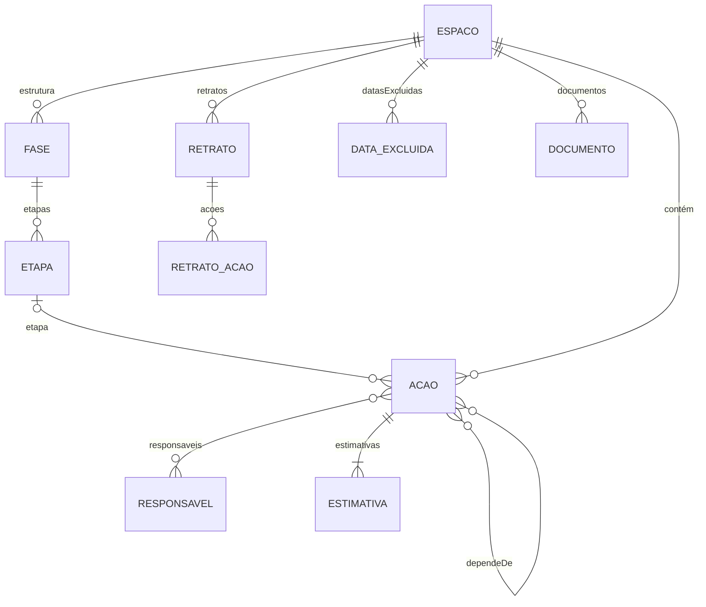

# Especificação da reescrita (versão 2)

**Situação:** em execução, passo a passo (seção 12). Passos concluídos: 0.1 a 0.3.
**Data:** 19/10/2026

Este documento reúne as decisões tomadas para a reescrita do sistema. A reescrita segue este texto. Quando a versão 2 entrar no ar, o conteúdo daqui passa para a `documentacao-tecnica.md`, e este arquivo é apagado.

---

## 1. Por que reescrever

- **Código difícil de revisar.** O `index.html` atual foi feito em etapas, como artefato do Claude: são 1.300 linhas compactas, com nomes curtos. A cada versão, limpar fica mais caro.
- **O modelo de acompanhamento mudou.** Saem o valor agregado e o Earned Schedule. Entram situações, reestimativas com histórico, retratos e notas. Reformar o código atual seria limpar partes que serão descartadas.
- **Não é do zero.** A lógica já testada é mantida e reescrita de forma legível: calendário de dias úteis, caminho crítico, Monte Carlo, roteamento das linhas do diagrama e conexão com o Firebase.

---

## 2. Princípios

- **KISS** ("mantenha simples"): a solução mais simples que resolve o problema é a melhor.
- **YAGNI** ("você não vai precisar disso"): nada é construído antes de haver necessidade real.
- **Código limpo:** nomes claros, funções pequenas, um assunto por arquivo, sem duplicação e sem código morto. Código que perde a função é apagado, não escondido; o histórico do Git guarda tudo.
- **Só pedir o necessário:** o usuário informa apenas dados que o sistema usa. Exemplo: a data de início real de uma ação não é pedida, porque não entra em nenhum cálculo.
- **Aceitar o mundo real:** o sistema absorve registros atrasados, reprogramações e imprecisões sem travar o usuário. Exemplo: a data de conclusão pode ser registrada com qualquer data, mesmo passada.
- **Linguagem simples:** mantém-se o princípio atual. Termo técnico em itálico, como "Termo técnico: …", e clicável, abrindo a explicação na Ajuda.
- **Números contínuos, não categorias:** indicadores contínuos aparecem como barras, com o número discreto em cinza. Cortes arbitrários, como "acima de 50% é prioritária", são evitados, porque tratam como diferentes casos praticamente iguais (paradoxo de sorites). Carimbos ficam só para fatos binários, como "Atrasada".

---

## 3. Arquitetura

### 3.1 Arquivos, sem compilação

O sistema passa de um arquivo único para **poucos arquivos por assunto**, carregados direto pelo navegador como módulos JavaScript (`<script type="module">`). Não há etapa de compilação, npm nem *framework*. Os motivos estão na seção 10.

Estrutura prevista:

```
index.html            estrutura da página
css/estilo.css        aparência, variáveis de cor, temas claro e escuro
js/calendario.js      dias úteis e feriados
js/calculo.js         estimativas, caminho crítico, situações (funções puras, sem tela)
js/simulacao.js       Monte Carlo (funções puras)
js/modelo.js          campos de cada entidade: o lado "código" do dicionário de dados (seção 4)
js/dados.js           Store: operações do sistema, sem termos de banco (seção 3.4)
js/banco/firestore.js como o Firestore executa cada operação
js/banco/local.js     o mesmo, em memória (modo local e testes)
js/acesso.js          login, menu do usuário
js/markdown.js        formatação segura das notas
js/telas/*.js         uma tela por arquivo: acoes, visualizacao, responsaveis, configurar, ajuda
js/identidade.js      nome do sistema e textos de identificação, num lugar só (seção 3.1)
js/app.js             estado, navegação, partida
testes/*.test.js      testes automáticos (node --test, rodado dentro de v2/)
testes/contrato-banco.js  garantias que todo banco cumpre (seção 3.4)
package.json          só marca os arquivos como módulos para o Node; sem dependências
```

- **Funções puras:** cálculo e simulação não acessam a tela nem o banco. Recebem dados e devolvem resultados. Isso permite testá-las com o Node, sem navegador.
- **Tipos por comentários (JSDoc):** cada função tem, acima dela, a descrição do que recebe e devolve. Editores e a verificação do TypeScript (`tsc --checkJs`) apontam erros sem exigir compilação.
- **Bibliotecas externas:** continuam só por CDN e com versão fixa: dagre 0.8.5 e Firebase compat 10.14.1.
- **Teste local:** módulos não abrem com clique duplo no arquivo. É preciso um servidor simples, por exemplo `python3 -m http.server`. O README e o AGENTS.md serão atualizados.
- **Modo legado do artefato do Claude:** removido.
- **Nome do sistema como variável:** o nome aparece na tela, no título da aba do navegador, na Ajuda e nas exportações, mas é definido num único lugar, `js/identidade.js`. Trocar o nome é mudar uma linha. Nome provisório da versão 2: **Sextante** (decisão do responsável em 19/10/2026), sob avaliação.

### 3.2 Testes

- **Testes de unidade** das funções de calendário, cálculo, simulação e Markdown, com `node --test`, sem dependências.
- **Teste de comparação:** o espaço da PI² precisa produzir, na versão 2, as mesmas datas do caminho crítico da versão atual, já que essa regra não muda. As probabilidades mudam por causa da troca para a beta-PERT; os novos valores são registrados como referência.
- **Teste do dicionário de dados:** compara os campos usados pelo código (tipos JSDoc do modelo) com os da seção 4 e falha se divergirem. Roda com os demais, em toda mudança.
- **Teste visual:** capturas de tela das três abas, nos temas claro e escuro e na largura de celular.

### 3.3 Fluxo de trabalho

A versão 2 é construída **passo a passo**, seguindo a regra "uma mudança por vez" do AGENTS.md, na ordem da seção 12. Cada passo é testado, documentado e conferido pelo responsável antes do seguinte.

- **Onde:** numa pasta própria do site, `/v2/`, publicada junto com a versão atual. O responsável confere cada passo no endereço `.../sistema-planos-de-acao/v2/`, inclusive pelo celular. A versão atual continua na raiz até a troca (passo 1.20).
- **Dados:** nas Fases 0 e 1, até o passo 1.14, a versão 2 usa só o banco em memória e o espaço de exemplo; nada é gravado. A partir do passo 1.14, usa **um segundo projeto no Firebase**, só para a versão 2 (decisão do responsável em 19/10/2026), com arquivo de configuração próprio dentro de `/v2/`. Os espaços reais ficam fisicamente separados. O responsável cria o projeto no console, com orientação passo a passo.
- **Versão atual sem novidades:** enquanto a versão 2 é construída, a versão atual continua no ar como está. Não ganha funções novas, para não fazer o trabalho duas vezes; recebe só correções, se algo quebrar.

### 3.4 Preparação para a troca de banco

A meta de longo prazo é hospedar o sistema no servidor da UFCI-MG, com PostgreSQL. A versão 2 não faz essa troca, mas não pode dificultá-la.

- **O `Store` fala a língua do sistema, não a do banco.** Oferece operações com nomes do domínio, como `criarAcao`, `alterarCampo`, `acrescentarResponsavel`, `retirarResponsavel`, `registrarEstimativa`, `concluirAcao`, `salvarRetrato` e `acompanharPlano`. Nenhum termo do Firestore (coleção, documento, `onSnapshot`, `arrayUnion`) aparece fora de `js/banco/firestore.js`.
- **Cada banco é um arquivo** em `js/banco/`, que executa as mesmas operações. Hoje: Firestore e memória local. Depois: um que conversa com o servidor da UFCI-MG.
- **As regras de edição simultânea (seção 4.6) são do sistema.** No Firestore, viram transações e acréscimos em listas. No PostgreSQL, viram restrições do próprio banco, como código único por espaço, tabelas de ligação para responsáveis e dependências, e conferência da última alteração antes de gravar.
- **Tempo real como operação, não como recurso do banco.** `acompanharPlano` avisa a tela quando algo muda. No Firestore, isso vem pronto. No servidor, pode começar com consultas periódicas, por exemplo a cada 10 segundos.
- **Os mesmos testes para todos os bancos.** Os testes de `node --test` rodam contra o banco em memória e servem de contrato: um banco novo precisa passar neles.
- **A cópia de segurança é a ponte.** O arquivo da cópia tem formato próprio, independente do banco, e documentado. A troca será: exportar do Firebase, importar no servidor e conferir com o teste de comparação.

Fica para a época da troca, fora da versão 2: o programa do servidor, que passa a conter as permissões hoje no `firestore.rules` (já com os níveis de permissão pendentes), e o login institucional, que exigirá recadastrar os usuários.

---

## 4. Modelo de dados (dicionário de dados)

**Esta seção é o dicionário de dados da versão 2.** Toda mudança na estrutura do banco atualiza esta seção no mesmo commit (AGENTS.md). O teste `testes/dicionario.test.js` compara cada tabela marcada abaixo com `js/modelo.js`, a lista de campos que o código usa, e falha se divergirem. O Store recusa gravar campos que não estejam nessa lista.

Quando a versão 2 entrar no ar, esta seção passa para a documentação técnica.

### Convenções

- **Data:** texto `AAAA-MM-DD`, sem hora nem fuso. É uma data do calendário, lida no horário de Brasília. Exemplo: `2026-10-19`.
- **Momento:** texto ISO 8601 em UTC, com milissegundos e `Z`. Exemplo: `2026-10-19T13:45:00.000Z` (10h45 em Brasília).
- **Id:** texto gerado pelo sistema (UUID). Exemplo: `3f2b8c1e-…`. Exceção: a ação, cuja chave é o código.
- **Usuário:** e-mail de login de quem gravou. Vazio quando não há login (modo local).
- **Dias úteis:** número de dias úteis do espaço, descontadas as datas excluídas. Aceita frações, como `2.5`.
- **Vazio:** campo ausente ou `null`. "Obrig." indica se o campo precisa ter valor.
- **Exclusão lógica:** nada é apagado; `excluidoEm` preenchido indica item excluído (seção 4.7).
- **Nomes dos campos:** em português, sem acentos, no formato `palavraPalavra`.

### Entidades e relações



**Como ler o diagrama:** notação "pé de galinha" (*Termo técnico: crow's foot, de James Martin*), padrão em modelagem de dados. Em cada ponta da linha: `||` exatamente um; `|o` zero ou um; `|{` um ou muitos; `o{` zero ou muitos (o "pé" indica "muitos"). Exemplo: entre ESPACO e ACAO, cada ação pertence a exatamente um espaço, e um espaço tem zero ou muitas ações.

- Um **espaço** tem ações, retratos, datas excluídas, documentos e uma estrutura de fases e etapas.
- Uma **ação** pertence a um espaço e, opcionalmente, a uma etapa; depende de outras ações do mesmo espaço; tem responsáveis e um histórico de estimativas.
- **Responsáveis** são globais: os mesmos para todos os espaços.

### 4.1 Espaço de Planejamento

<!-- dicionario: espaco -->
| Campo | Tipo | Obrig. | Significado | Exemplo |
|---|---|---|---|---|
| `id` | id | sim | Identificador do espaço. Imutável | `3f2b8c1e-…` |
| `nome` | texto | sim | Nome do espaço | `PI² · Fase 1` |
| `inicio` | data | não | Início do espaço: a partir dele contam os dias úteis | `2026-08-03` |
| `prazoFinal` | data | não | Prazo final, por exemplo o fixado por ato da Diretoria-Geral | `2027-04-14` |
| `datasExcluidas` | lista de data excluída (4.1.1) | não | Feriados e outras datas sem expediente | |
| `documentos` | lista de documento (4.1.2) | não | Documentos do espaço, como o espaço aprovado e suas revisões | |
| `simulacoes` | inteiro | sim | Número de simulações. Padrão 10.000. Definido na criação e **imutável** (seção 5.7) | `10000` |
| `semente` | inteiro | sim | Semente da simulação. Padrão 20261014. Definida na criação e **imutável** (seção 5.7) | `20261014` |
| `estrutura` | lista de fase (4.1.3) | não | Fases e etapas, na ordem de exibição (seção 8.3) | |
| `camposOpcionais` | campos opcionais (4.1.4) | não | Quais campos opcionais o espaço usa. Ausente: todos ligados | |
| `criadoEm` | momento | sim | Criação do espaço. Imutável | `2026-10-19T13:45:00.000Z` |
| `alteradoEm` | momento | sim | Última gravação no espaço | |
| `alteradoPor` | usuário | não | Autor da última gravação | `ana@ufci.edu.br` |
| `excluidoEm` | momento | não | Exclusão lógica (seção 4.7). Vazio: espaço ativo | |
| `excluidoPor` | usuário | não | Quem excluiu | |

Saem da versão atual: `dist` (escolha de distribuição), `statusDate` (a data de referência é sempre hoje), `baseline` (substituído pelos retratos) e `nearCrit` (seção 7.3).

#### 4.1.1 Data excluída: cada item de `datasExcluidas`

<!-- dicionario: dataExcluida -->
| Campo | Tipo | Obrig. | Significado | Exemplo |
|---|---|---|---|---|
| `data` | data | sim | Dia sem expediente, que não conta como dia útil | `2026-11-20` |
| `motivo` | texto | não | Motivo, para conferência posterior | `Consciência Negra` |

#### 4.1.2 Documento: cada item de `documentos`

<!-- dicionario: documento -->
| Campo | Tipo | Obrig. | Significado | Exemplo |
|---|---|---|---|---|
| `nome` | texto | sim | Nome do documento | `Plano aprovado` |
| `data` | data | não | Data do documento | `2026-08-01` |
| `identificacao` | texto | não | Número no sistema de protocolo da instituição (SIPAC/Protocolo) | `23062.001234/2026-11` |
| `link` | texto (endereço web) | não | Endereço para abrir o documento. O envio do arquivo fica para o servidor da UFCI-MG (passo 4.3) | `https://…` |

#### 4.1.3 Fase e etapa: cada item de `estrutura` e de `etapas`

<!-- dicionario: fase -->
| Campo | Tipo | Obrig. | Significado | Exemplo |
|---|---|---|---|---|
| `id` | id | sim | Identificador da fase. Imutável | `f1` |
| `nome` | texto | sim | Nome da fase | `Planejamento` |
| `etapas` | lista de etapa | sim | Etapas da fase, na ordem de exibição | |

<!-- dicionario: etapa -->
| Campo | Tipo | Obrig. | Significado | Exemplo |
|---|---|---|---|---|
| `id` | id | sim | Identificador da etapa, usado no campo `etapa` da ação. Imutável | `e1` |
| `nome` | texto | sim | Nome da etapa | `Requisitos e arquitetura` |

#### 4.1.4 Campos opcionais: o objeto `camposOpcionais`

<!-- dicionario: camposOpcionais -->
| Campo | Tipo | Obrig. | Significado | Exemplo |
|---|---|---|---|---|
| `fasesEtapas` | sim/não | não | Usa fases e etapas. Desligado: lista sem separadores | `true` |
| `descricao` | sim/não | não | Usa o campo descrição das ações | `true` |
| `notas` | sim/não | não | Usa as notas das ações | `true` |

Desligar um campo o esconde do formulário, da tabela e das exportações; os dados já gravados são mantidos.

### 4.2 Ação

Chave: o par (espaço, `codigo`). O código é único dentro do espaço.

<!-- dicionario: acao -->
| Campo | Tipo | Obrig. | Significado | Exemplo |
|---|---|---|---|---|
| `codigo` | texto | sim | Identificador da ação no espaço: de 2 a 8 letras ou números. Imutável, porque é a referência das dependências | `LEV` |
| `ordem` | inteiro | sim | Posição na "Ordem do espaço" | `3` |
| `etapa` | id | não | Etapa a que a ação pertence (e, por ela, a fase). Vazio: sem fase nem etapa | `e1` |
| `rotulo` | texto | sim | Nome curto, usado no cronograma e no diagrama | `Levantar requisitos` |
| `descricao` | texto | não | Descrição completa | |
| `dependeDe` | lista de código | sim | Códigos das ações anteriores, do mesmo espaço. Lista vazia: sem anteriores | `["LEV","REQ"]` |
| `responsaveis` | lista de id | sim | Ids dos responsáveis (4.5). Lista vazia: sem responsável | |
| `estimativas` | lista de estimativa (4.3) | sim | Da primeira à mais recente. A vigente é a última | |
| `concluidaEm` | data | não | Data de conclusão. Vazio: não concluída | `2026-09-22` |
| `naoAntesDe` | data | não | Data mínima de liberação, "Não começa antes de" (seção 5.1) | `2026-10-19` |
| `notas` | texto (Markdown) | não | Notas da ação (seção 8.5) | |
| `criadaEm` | momento | sim | Criação da ação. Imutável | |
| `alteradaEm` | momento | sim | Última gravação na ação (seção 4.6) | |
| `alteradaPor` | usuário | não | Autor da última gravação | |
| `excluidaEm` | momento | não | Exclusão lógica (seção 4.7). Vazio: ação ativa | |
| `excluidaPor` | usuário | não | Quem excluiu | |

Saem da versão atual: custo, custo gasto, % concluído, início real e término real separado. O campo `entrega` da ação, previsto antes, foi retirado em 20/10/2026 para não se confundir com as **entregas do Plano de Ação** (seção 16.7); o que a coluna "Entrega" da planilha da PI² dizia passa para a descrição.

### 4.3 Estimativa: cada item de `estimativas`

<!-- dicionario: estimativa -->
| Campo | Tipo | Obrig. | Significado | Exemplo |
|---|---|---|---|---|
| `em` | data | sim | Dia em que a estimativa foi feita | `2026-10-19` |
| `por` | usuário | não | Quem registrou | |
| `o` | dias úteis | sim | Otimista | `3` |
| `m` | dias úteis | sim | Mais provável. Entre `o` e `p` | `5` |
| `p` | dias úteis | sim | Pessimista | `10` |
| `contaDe` | texto | sim | `liberacao`: conta da liberação (primeira estimativa); `data`: conta do dia `em` (reestimativa) | `data` |
| `motivo` | texto | não | Motivo da reestimativa | `Atraso do fornecedor` |

A primeira estimativa nunca é alterada. Corrigir um erro de digitação logo após cadastrar substitui a estimativa mais recente, sem criar histórico, desde que seja no mesmo dia e antes de qualquer reestimativa. Enquanto a ação não está liberada, a estimativa muda sem histórico (seção 5.3).

### 4.4 Retrato

Chave: id. Pertence a um espaço. Só leitura depois de criado.

**O retrato é uma cópia integral do espaço naquele momento** (decisão de 20/10/2026): o espaço com todos os campos, todas as ações ativas com todos os campos (inclusive notas e o histórico completo de estimativas), os responsáveis citados e os resultados calculados. Assim ele se sustenta sozinho, mesmo que tudo mude ou seja excluído depois, e permite refazer o cálculo exatamente. Só ficam de fora os **comentários** e o **histórico de alterações**, que já são permanentes por conta própria (seções 16.4 e 16.5).

O retrato é guardado em duas partes: o cabeçalho, abaixo, e um registro por ação (4.4.1). Assim, um espaço grande com notas longas não esbarra no limite de tamanho de um documento do Firebase (cerca de 1 MB).

<!-- dicionario: retrato -->
| Campo | Tipo | Obrig. | Significado | Exemplo |
|---|---|---|---|---|
| `id` | id | sim | Identificador do retrato | |
| `nome` | texto | sim | Nome dado ao retrato | `Plano aprovado` |
| `origem` | texto | sim | `manual` (salvo por um administrador do espaço) ou `automatico` (salvo pelo sistema). Na tela, cada origem tem um selo | `manual` |
| `criadoEm` | momento | sim | Quando foi salvo | |
| `criadoPor` | usuário | não | Quem salvou. Vazio nos automáticos | |
| `semente` | inteiro | sim | Semente usada no cálculo | `20261014` |
| `simulacoes` | inteiro | sim | Número de simulações usado | `10000` |
| `versaoCalculo` | inteiro | sim | Versão do método de cálculo (seção 5.7) | `1` |
| `espaco` | espaço (4.1) | sim | Cópia integral do espaço, com todos os campos de 4.1 | |
| `responsaveis` | lista de responsável (4.5) | sim | Cópia integral dos responsáveis citados nas ações, para os nomes continuarem legíveis | |
| `resumo` | resumo do retrato (4.4.2) | sim | Resultado do espaço naquele momento | |

Os retratos **automáticos não podem ser excluídos** à mão, para o histórico usado no Data Lakehouse não ter buracos. O retrato automático depende de um programa no servidor; chega com o servidor da UFCI-MG (passo 4.4). No Firebase gratuito, só há retratos manuais.

Se um dia for preciso apagar algum texto de um retrato por exigência legal, isso será tratado caso a caso pela equipe de TI, fora do sistema (decisão de 20/10/2026: situação extremamente rara, que não justifica uma função própria).

#### 4.4.1 Ação do retrato: um registro por ação

Cada ação do retrato tem **todos os campos da ação (4.2)**, copiados como estavam, e mais estes valores calculados naquele momento:

<!-- dicionario: retratoAcaoCalculos -->
| Campo | Tipo | Obrig. | Significado | Exemplo |
|---|---|---|---|---|
| `situacao` | texto | sim | `naoLiberada`, `liberada` ou `concluida` | `liberada` |
| `atrasada` | sim/não | sim | Carimbo Atrasada | `false` |
| `liberacaoPrevista` | data | sim | Data prevista de liberação | `2026-10-05` |
| `conclusaoPrevista` | data | sim | Data prevista de conclusão | `2026-10-27` |
| `folga` | dias úteis | sim | Folga total no cálculo determinístico | `4` |
| `prioridadeExecucao` | número de 0 a 1 | sim | Índice de criticidade (seção 7.1) | `0.72` |
| `prioridadeRevisao` | número de 0 a 1 | sim | Contribuição para a variância do prazo (seção 7.2) | `0.18` |

#### 4.4.2 Resumo do retrato: o objeto `resumo`

<!-- dicionario: retratoResumo -->
| Campo | Tipo | Obrig. | Significado | Exemplo |
|---|---|---|---|---|
| `conclusaoPrevista` | data | sim | Conclusão prevista do espaço (P50) | `2026-12-22` |
| `dataSegura` | data | sim | Data com 80% de chance (P80) | `2027-01-15` |
| `p95` | data | sim | Data com 95% de chance | `2027-02-03` |
| `chancePrazo` | número de 0 a 1 | não | Chance de cumprir o prazo final. Vazio se o espaço não tem prazo final | `0.74` |

### 4.5 Responsável

Chave: id. Lista global, com cadastro livre, compartilhada por todos os espaços.

<!-- dicionario: responsavel -->
| Campo | Tipo | Obrig. | Significado | Exemplo |
|---|---|---|---|---|
| `id` | id | sim | Identificador do responsável. Imutável | |
| `nome` | texto | sim | Nome da pessoa, equipe ou unidade | `Ana Souza` |
| `sigla` | texto | não | Sigla curta, usada em espaços pequenos como o diagrama | `ANA` |
| `setor` | texto | não | Setor ou unidade | `DGDI` |
| `usuario` | usuário | não | E-mail de login ligado a este responsável. Vazio: responsável sem login | `ana@ufci.edu.br` |
| `criadoEm` | momento | sim | Cadastro do responsável. Imutável | |
| `alteradoEm` | momento | sim | Última gravação | |
| `alteradoPor` | usuário | não | Autor da última gravação | |
| `excluidoEm` | momento | não | Exclusão lógica (seção 4.7) | |
| `excluidoPor` | usuário | não | Quem excluiu | |

Um responsável pode ser de dois tipos, sem campo próprio para distingui-los:

- **Membro da equipe com acesso ao sistema:** tem `usuario`. Para esses, funcionam o filtro "Minhas ações" e, na Fase 2, os papéis por espaço.
- **Responsável diverso:** pessoa de fora do sistema, unidade organizacional, equipe ou grupo de unidades. Fica sem `usuario`. É cadastrado livremente, inclusive direto no formulário da ação ("Cadastrar … como responsável").

### 4.6 Edição simultânea

Várias pessoas podem editar o mesmo espaço ao mesmo tempo. Nenhuma gravação pode apagar, em silêncio, o trabalho de outra pessoa. A versão 1 já grava só o campo alterado e mostra as mudanças em tempo real; a versão 2 mantém isso e fecha três falhas encontradas na versão 1 em 17/10/2026 (registradas em "Pendências" da documentação técnica).

| Situação | Regra |
|---|---|
| Duas pessoas mudam campos diferentes | Cada gravação leva só o campo alterado, nunca a ação inteira |
| Responsáveis e "depende de" | Acrescentar e retirar itens um a um, nunca regravar a lista inteira. Assim, se duas pessoas acrescentam responsáveis ao mesmo tempo, os dois ficam |
| Reestimativa | Entra no fim do histórico, sem regravar as anteriores. A correção de digitação da seção 4.3, que substitui a mais recente, só grava se ninguém tiver acrescentado outra estimativa nesse meio-tempo |
| Ação nova | Criada só se o código estiver livre no banco, e não só na tela de quem cria. Se outra pessoa criou o mesmo código antes, aparece "Já existe uma ação com o código X. Escolha outro." |
| Mesmo campo, mesma ação, quase juntas | Vale a última gravação, mas sem surpresa: se a ação aberta na janela for alterada por outra pessoa, a janela mostra "Fulano alterou esta ação agora" e atualiza os campos que não estão sendo editados. O campo em edição fica como está, e a pessoa decide se grava |
| Importação, restauração e regravação de ações inteiras | Só em operações explícitas, com confirmação, e nunca durante a edição comum |

Os campos `alteradaEm` e `alteradaPor` (seção 4.2) servem para o aviso. As regras dizem o que garantir, não como: cada banco as executa do seu jeito (seção 3.4). No modo local há um usuário só. Cada regra tem um teste em `node --test`, com duas gravações concorrentes simuladas.

### 4.7 Exclusão lógica

Nada é apagado de verdade pelo uso comum do sistema. Excluir um espaço, uma ação ou um responsável grava **quando** e **quem** excluiu (`excluidoEm`/`excluidaEm` e `excluidoPor`/`excluidaPor`), e o item some da tela.

- **Um único filtro, no `Store`.** As operações comuns (listar ações, calcular, exportar) devolvem só itens ativos. Ver os excluídos exige pedir explicitamente: a lixeira, a cópia de segurança e as cargas para o Data Lakehouse. Como nenhuma outra parte do código lê o banco (seção 3.4), o filtro existe num lugar só.
- **Teste automático:** um espaço de exemplo com uma ação excluída; o teste confere que ela não aparece na lista, no quadro, no cálculo, na simulação nem nas exportações, e que aparece na lixeira e na cópia de segurança.
- **Desfazer:** a lixeira do espaço mostra as ações excluídas, com quem e quando, e permite restaurá-las.
- **Exclusão encadeada:** excluir algo que outros itens usam abre uma janela que explica a consequência e oferece alternativas.
  - **Ação de que outras dependem:** (a) ligar as dependentes às anteriores da ação excluída, mantendo a sequência lógica; é a opção já marcada, e só aparece se a excluída tiver anteriores; (b) só retirar a dependência; (c) cancelar e rever a estrutura.
  - **Responsável que está em ações:** (a) substituir por outro responsável; (b) só retirar das ações; (c) cancelar.
  - **Etapa ou fase com ações:** (a) mover as ações para outra etapa; (b) deixar as ações sem etapa; (c) cancelar.
  - Cada mudança feita assim entra no histórico de alterações das ações afetadas. Restaurar o item da lixeira não refaz as ligações alteradas; o histórico mostra como eram.
- **Código ocupado:** o código de uma ação excluída continua reservado. Ao tentar criar uma ação com ele, o sistema oferece restaurar a antiga.
- **Carga incremental:** `alteradaEm` muda também na exclusão, para que a carga perceba.

Motivos da escolha, em vez de uma lista separada de exclusões: uma única consulta para a carga incremental, possibilidade de desfazer, auditoria completa (inclusive o conteúdo do que foi excluído) e retratos antigos que continuam mostrando o nome das ações.

### 4.8 Valores calculados, que não ficam no banco

O banco guarda os fatos: estimativas, dependências, datas de conclusão. O que deriva deles e da data de hoje é calculado na tela, a cada mudança, e **não é gravado**: um valor gravado ficaria velho no dia seguinte e criaria duas fontes de verdade. Quem fizer cargas para o Data Lakehouse encontra esses valores congelados nos retratos (4.4).

| Valor | Onde é definido |
|---|---|
| Situação (Não liberada, Liberada, Concluída) e carimbo Atrasada | Seção 6 |
| Datas previstas de liberação e de conclusão, folga | Seções 5.1 a 5.5 |
| Estimativa vigente, número de reprogramações, deslocamento do término | Seção 5.3 |
| Conclusão prevista (P50), data segura (P80), P95 e chance de cumprir o prazo | Seção 5.7 |
| Prioridade de execução e prioridade de revisão | Seções 7.1, 7.2 e 15 |

### 4.9 Onde cada entidade é guardada

| Entidade | Firebase (versão 2, segundo projeto) | PostgreSQL (servidor da UFCI-MG, proposta) |
|---|---|---|
| Espaço | `espacos/{id}` | tabela `espaco` |
| Data excluída, documento | listas dentro do espaço | tabelas `espaco_data_excluida`, `espaco_documento` |
| Fase, etapa | lista `estrutura` dentro do espaço | tabelas `fase`, `etapa` |
| Ação | `espacos/{id}/acoes/{codigo}` | tabela `acao`, chave (`espaco_id`, `codigo`) |
| Dependência | lista `dependeDe` dentro da ação | tabela `acao_dependencia` |
| Responsável da ação | lista `responsaveis` dentro da ação | tabela `acao_responsavel` |
| Estimativa | lista `estimativas` dentro da ação | tabela `estimativa` |
| Retrato | cabeçalho em `espacos/{id}/retratos/{id}`; ações em `espacos/{id}/retratos/{id}/acoes/{codigo}` | tabelas `retrato`, `retrato_acao` |
| Responsável | `responsaveis/{id}` | tabela `responsavel` |

Os nomes do Firebase passam a ser em português, porque a versão 2 usa um projeto novo (seção 3.3); a migração (seção 11) converte os nomes da versão atual (`projects`, `tasks`, `people`). No PostgreSQL, as listas viram tabelas de ligação e as regras da seção 4.6 viram restrições do banco (seção 3.4).

### 4.10 Entidades previstas, ainda fora do código

Entram no dicionário, com tabela marcada e teste, no passo em que forem construídas.

- **Histórico de alterações** (passo 1.16): quem, quando, entidade, chave, campo, valor antigo e valor novo; coleção ou tabela própria, só de acréscimo (seção 16.4).
- **Fase 2:** entregas do Plano de Ação e registro do alcance, com evidência (seção 16.7); tipo do espaço, visibilidade, espaço aberto ou fechado, encerramento e papéis por espaço (seção 16.3); catálogo do PEI/PDI (seção 16.1); situações personalizadas (seção 16.2); checklist e comentários (seção 16.5).

---

## 5. Regras de cálculo

### 5.1 Contagem do tempo

- Prazos em **dias úteis**, descontadas as datas excluídas do espaço.
- Uma ação é **liberada** quando todas as anteriores estão concluídas. Sem ações anteriores, é liberada no início do espaço.
- **"Não começa antes de" (data mínima, opcional).** A ação só é liberada quando todas as anteriores estiverem concluídas **e** essa data tiver chegado. Liberação = a mais tardia entre a conclusão das anteriores e a data mínima. É o mesmo conceito da restrição "não iniciar antes de" do MS Project, numa forma simples.
  - **Nova ação:** o campo já vem preenchido com a data de criação. Assim, uma ação criada depois que as anteriores terminaram não nasce atrasada. O usuário pode apagar a data, se a ação puder começar assim que as anteriores terminarem.
  - **Outros usos:** ações que dependem de uma data externa, como liberação de orçamento, início do semestre ou publicação de um ato.
  - Enquanto a data não chega, a ação fica "Não liberada", com a indicação "a partir de dd/mm".
  - **Na janela da ação:** o campo só aparece quando tem data. Vazio, dá lugar a um link discreto, "+ Definir data mínima de início", que abre o campo. Em ações concluídas, não aparece.
  - **Em reavaliação** (seção 14, item 1).
- **O prazo de uma ação conta da liberação até a conclusão**, incluindo o tempo até alguém começar. A data de início real não é registrada. Isso precisa estar claro no formulário de estimativa e na Ajuda.

### 5.2 Estimativa de cada ação

- Fórmula PERT: (O + 4M + P) / 6, a média da distribuição beta-PERT.
- **Uma só distribuição em todo o sistema: beta-PERT.** A escolha entre triangular e beta é retirada. Motivos: coerência entre as datas do cronograma e a simulação, simplicidade para o usuário leigo e estabilidade das datas e carimbos. O otimismo nas estimativas será tratado pela previsão por classe de referência, não por troca de fórmula.

### 5.3 Reestimativa

- **Antes da liberação**, a estimativa pode ser alterada livremente, sem histórico: ainda é planejamento. A estimativa "original", que vale para o histórico e para a previsão por classe de referência, é a vigente no momento da liberação. Aceita pelo responsável, mas **em reavaliação** (seção 14, item 2).

- Disponível **a qualquer momento** para ação liberada e não concluída. Para ação atrasada, aparece em destaque, com alerta.
- O usuário informa os três pontos do **tempo que falta, a partir de hoje**.
- Cada reestimativa é registrada com data, autor, três pontos e motivo opcional.
- Conclusão prevista de uma ação reestimada: data da reestimativa + PERT dos novos três pontos.
- A tela da ação mostra a estimativa original, o número de reprogramações e quantos dias úteis o término andou desde a primeira estimativa.

### 5.4 Ações concluídas

Entram em todos os cálculos com a **duração real**, da liberação à conclusão, sem sorteio.

### 5.5 Regra interna: nada termina no passado

Para uma ação liberada e não concluída cuja conclusão prevista já passou sem reestimativa, **o cálculo considera conclusão a partir de hoje**. Na simulação, vale o mesmo: um sorteio que terminaria antes de hoje passa a terminar hoje.

A regra não restringe o usuário; só evita previsões otimistas demais. Na tela, quando ela estiver em ação, aparece ao lado da data prevista: "Prazo vencido sem reestimativa: o cálculo considera conclusão a partir de hoje." Ela deve constar na Ajuda e no manual, quando este for refeito.

### 5.6 Recálculo

Tudo é recalculado a cada mudança: conclusão, reestimativa ou edição. A estimativa vigente de cada ação é a mais recente.

### 5.7 Simulação de Monte Carlo

- Distribuição beta-PERT.
- **Semente e número de simulações visíveis, mas imutáveis.** São definidos na criação do espaço (pelo usuário ou com o padrão) e aparecem em "Configurar este espaço" só para leitura. Assim, qualquer pessoa ou IA pode conferir os resultados por fora, em planilha, Python ou R, e ninguém pode trocar a semente até o número "ficar bonito".
- **Conferência por fora:** a seção 15 deve documentar, junto com o código da versão 2, o gerador de números (mulberry32), a ordem dos sorteios e o método de sorteio da beta-PERT, para permitir reproduzir os resultados **exatamente**. Uma ferramenta com outro gerador chega a resultados estatisticamente equivalentes, com diferença da ordem de meio ponto percentual na chance de cumprir o prazo.
- **Versão do cálculo:** se um dia o método de cálculo mudar (por exemplo, a correção de um erro), a mesma semente passa a dar outro resultado. Por isso, o código tem um número de versão do cálculo, guardado em cada retrato.
- Ações concluídas: duração real. Ações reestimadas: a contagem começa na data da reestimativa. Regra da seção 5.5 aplicada.
- **Resultados do espaço:** datas P50, P80 e P95 da conclusão, chance de cumprir o prazo final e distribuição das datas finais (gráfico).
- **Resultados por ação:** índice de criticidade (seção 7.1) e contribuição para a variância do prazo (seção 7.2). Fórmulas e justificativas na seção 15.
- **Saem da tela o SSI e a crucialidade** como números próprios. A contribuição para a variância é a forma padrão e mais comunicável de responder à pergunta que os dois respondiam (seção 15.4).

---

## 6. Situações e carimbo

### 6.1 Situação: exatamente uma

| Situação | Quando |
|---|---|
| **Não liberada** | Alguma ação anterior não foi concluída, ou a data mínima ("Não começa antes de") não chegou. Antes chamada "Aguardando" (seção 16.2) |
| **Liberada** | Todas as anteriores concluídas (ou nenhuma anterior), e esta não concluída |
| **Concluída** | Tem data de conclusão |

### 6.2 Carimbo **Atrasada**

- Aplica-se à ação **liberada** cuja data prevista de conclusão (PERT da estimativa mais recente) já passou.
- O atraso é medido contra a **estimativa mais recente**, de propósito. A reestimativa tira o carimbo. É uma "colher de chá" ao executor, que exige dele uma atitude ativa (assumir uma nova data). O histórico de reprogramações registra a dimensão do problema.
- Uma ação não liberada nunca recebe o carimbo, porque, pela regra da seção 5.5, a previsão das anteriores não fica no passado.
- Não existe mais o carimbo "Prioritária": a prioridade é mostrada pela barra contínua da seção 7.1.

---

## 7. Indicadores por ação

Barras horizontais, com o número em cinza ao lado. A tabela pode ser ordenada por qualquer uma delas.

### 7.1 Prioridade de execução

*Termo técnico: índice de criticidade.*

Legenda: "Quanto um atraso nesta ação atrasa a conclusão prevista. Por exemplo, com 70%, cada dia de atraso nesta ação atrasa a conclusão em cerca de 0,7 dia. Considera só o prazo final; outros motivos de prioridade ficam a critério da equipe."

Fundamento: em cada simulação, um dia a mais numa ação atrasa a conclusão de todas as ações em um dia se ela estiver no caminho crítico, e em zero se não estiver. A média é o índice de criticidade. Por isso ele mede exatamente o efeito esperado de um atraso.

### 7.2 Prioridade de revisão do planejamento

*Termo técnico: contribuição para a variância do prazo.*

Legenda: "Esta ação responde por 18% da incerteza do prazo final. Quanto maior, mais vale revisar as estimativas, dividir a ação ou reduzir riscos." (o número é o da ação)

- **O que mostra:** a parcela da incerteza do prazo final que vem de cada ação. As parcelas de todas as ações não concluídas somam 100%.
- **Número em cinza:** a parcela em porcentagem inteira; abaixo de 1%, aparece "<1%".
- **Barra:** proporcional à parcela, numa escala fixa de 0% a 100%. Assim, a barra e o número dizem a mesma coisa, e o tamanho da barra pode ser comparado entre espaços.
- **Fundamento:** é a medida padrão das ferramentas de análise de risco de cronograma (gráfico "tornado"). Uma ação previsível no caminho crítico tem prioridade de execução alta e parcela quase nula: não há incerteza nela para reduzir. Detalhes matemáticos na seção 15.
- **Natureza relativa:** a parcela compara as ações entre si. Isso é adequado aqui, porque a barra serve para ordenar onde revisar o planejamento, não para disparar alertas.

### 7.3 Cores no fluxo e no cronograma

- **Intensidade contínua pela prioridade de execução:** a cor de cada ação não concluída varia gradualmente do **cinza** (índice de criticidade 0%) ao **vermelho** (100%). Quanto mais vermelha, mais um atraso nela atrasa a conclusão.
- **Verde:** ação concluída.
- Saem as categorias "sem folga", "quase sem folga" e "com folga", o limite de 10 dias (`nearCrit`) e as setas vermelhas do caminho crítico determinístico. Tudo passa a seguir uma única medida, a mesma da barra da seção 7.1. Isso evita que uma ação apareça como "crítica" numa tela e com prioridade baixa em outra.
- A folga em dias úteis continua visível como número, no detalhe da ação e no rótulo do fluxo.
- A legenda mostra a faixa de cores, de cinza a vermelho, com "menos prioritária" e "mais prioritária" nas pontas.
- As cores do gradiente seguem a paleta do logotipo e são ajustadas para o tema escuro.

### 7.4 Símbolos

Os mesmos da planilha da PI², no fluxo, no cronograma e na aba Ações:

| Símbolo | Significado |
|---|---|
| Visto num círculo | Concluída |
| Cadeado aberto | Liberada |
| Cadeado fechado | Não liberada |
| Relógio | Atrasada |

São ícones em SVG, desenhados no mesmo estilo e coloridos pelas variáveis dos temas, e não emojis (seção 16.2). O protótipo ainda usa emojis e "Aguardando"; vale esta seção.

Saem o símbolo "▶ em andamento", porque o sistema não registra mais o início real, e o "❗ prioritária", substituído pela intensidade da cor.

---

## 8. Interface

### 8.1 Topo

- **Barra do aplicativo compacta, com dois estados**, como no Spotify do iPhone: **no topo da página**, sem rolagem, fica **levemente mais escura** que o fundo da página (cerca de 18% mais escura no tema claro e 30% no escuro, sem tom verde), com os textos na cor normal; **ao rolar**, transforma-se suavemente em **vidro bem transparente** (cerca de 20% de véu no tema claro e 30% no escuro), que desfoca o conteúdo que passa por baixo, com uma linha fina na base e uma sombra suave. **A ida e a volta são simétricas**: a mesma transição de 0,3 s, com o mesmo desfoque nos dois estados (só a cor, a linha e a sombra mudam), para a volta ao topo ser o inverso exato da descida. Fica fixa no alto, com 48 px de altura. Reúne numa linha: logotipo e nome do sistema, menu do espaço (nome do espaço aberto, com uma setinha) e menu do usuário (iniciais). A Ajuda não tem botão próprio na barra: fica no menu do usuário, para poluir menos a tela. No celular, o nome encolhe para "Planos de Ação"; **no celular na vertical, logotipo e nome somem**, e o menu do espaço ocupa o espaço (KISS). Quem ativou "Reduzir transparência" no sistema, ou usa navegador sem suporte ao desfoque, vê a barra opaca, na cor de fundo da página. Objetivo: o máximo de tela para as ações.
- **Ferramentas da lista no computador:** filtros de situação, Lista ou Editar em planilha, Minhas ações, responsável, ordenação, Recolher fases, Legenda e Nova ação. A legenda de cores e símbolos fica escondida até ser aberta.
- **Ferramentas da lista no celular**, em uma só linha: os filtros de situação numa faixa que rola para o lado e um botão **"Filtros e ordem"**, que mostra quantas opções estão ativas. Ele abre um painel que sobe de baixo, com: Minhas ações, responsável, ordenação, recolher ou expandir fases, legenda e "Limpar filtros e ordem". **Nova ação** vira um botão flutuante (+) no canto inferior direito. A edição em planilha fica só no computador. Nos cartões de ações concluídas, as barras de prioridade, sem uso, não aparecem.

- Logotipo, nome do sistema e instituição.
- **Menu do espaço:** junta o seletor de espaço e "Configurar o espaço", que deixa de ter botão próprio (engrenagem). Ao tocar no nome do espaço, abre uma lista com os espaços (✓ no espaço aberto), uma linha divisória, "Configurar este espaço" e "Novo espaço" (nome, datas e prazo final). Sem login, mostra só a lista de espaços. Segue o padrão de troca de espaço de trabalho do Slack e do Notion. Custo aceito: configurar passa a exigir dois toques, e a lista deixa de ser a nativa do celular. Busca na lista só quando houver muitos espaços (YAGNI).
- **Ajuda:** painel dentro do sistema, aberto pelo item "Ajuda e manual" do menu do usuário ou pelos links "o que é?" da tela. Contém o glossário, que antes era a aba "Entenda os termos", e, futuramente, o manual. Cada "Termo técnico" na tela abre a explicação correspondente.
- **Configurar o espaço** (item "Configurar este espaço" do menu do espaço): painel lateral com: dados do espaço (nome, datas, prazo final, datas excluídas com motivo); campos opcionais em uso; documentos do espaço; retratos (salvar e listar); importar e exportar; cópia de segurança.
- **Menu do usuário:** seus dados (e-mail, nome, responsável ligado), Ajuda e manual, trocar senha (pede a senha atual), sair. Sem login, o lugar das iniciais mostra um ícone de pessoa, e o menu traz só "Ajuda e manual" e "Entrar", para quem só consulta não perder o acesso à Ajuda.
- **Configurar o sistema:** reservado para o futuro (por exemplo, gestão de usuários e permissões). O nome "Configurar o espaço" evita confusão com ele.

### 8.2 Abas

**Ações · Visualização · Responsáveis**, em ordem de frequência de uso.

### 8.3 Aba Ações

Reúne o cadastro, o acompanhamento e as previsões por ação, como na planilha da PI².

- **Fases e etapas como separadores**, como na gestão clássica de projetos (estrutura analítica): fase > etapa > ações. Cada separador mostra o nome, o número de ações, quantas foram concluídas, as atrasadas e a data em que o grupo termina, com uma pequena barra de progresso. Fases e etapas podem ser **recolhidas e expandidas** com animação suave, e há um botão para recolher todas as fases. O aninhamento aparece por recuo leve. Ações sem etapa ficam num grupo "Sem fase nem etapa". O agrupamento vale na ordem "Ordem do espaço"; nas ordenações por prioridade ou data, a lista fica corrida, para que a ordem escolhida prevaleça.
- **Fases e etapas são cadastradas em "Configurar o espaço"** (criar e renomear; reordenar e excluir na versão final). Na ação, a etapa é escolhida numa lista agrupada por fase. O campo opcional "Fases e etapas" pode ser desligado; nesse caso, a lista fica sem separadores.
- **Animação dos filtros:** ao filtrar ou reordenar, as ações que continuam deslizam até a nova posição e as que entram aparecem suavemente. Respeita a preferência do sistema por menos movimento.
- **Linha compacta:** código e rótulo; situação e carimbo; responsáveis; conclusão prevista; as duas barras de prioridade.
- **Cada linha é um cartão** com leve sombra e cantos arredondados, para separar visualmente as ações. A faixa colorida à esquerda segue a cor de prioridade (seção 7.3).
- **Detalhe numa janela sobreposta**, ao tocar na linha, com o fundo escurecido, como no Todoist. Assim nenhum campo da lista fica escondido. A janela abre com uma animação curta. No celular, ela sobe da parte de baixo da tela e ocupa quase toda a altura.
- **Conteúdo da janela:** no topo, código, etapa e rótulo; um resumo com situação, conclusão prevista, responsáveis e as duas barras. Abaixo: descrição, dependências e notas; botões de reestimar e de registrar a conclusão; alerta da regra interna, quando houver; histórico de estimativas, com o resumo das reprogramações.
- **Fica fora da janela** o quadro de estimativa vigente com folga, data de liberação e fórmula: carga cognitiva sem uso prático. A estimativa vigente aparece como último item do histórico, e a fórmula fica na Ajuda.
- **No celular:** cada linha vira um cartão.
- Filtros: situação, responsável, "Minhas ações".
- **Edição no lugar, na janela:** cada campo (rótulo, etapa, descrição, dependências, responsáveis e notas) é editado ao ser clicado, com Salvar e Cancelar. A estimativa também, enquanto a ação aguarda (seção 5.3).
- **Nova ação numa janela central**, como no Todoist, com: rótulo; **código opcional** (se vazio, o sistema sugere um a partir do rótulo; se preenchido, precisa ter de 2 a 8 letras ou números e não pode repetir um código existente, com aviso enquanto se digita); etapa; descrição; dependências; responsáveis; três pontos de estimativa.
- **Seletores com busca** para dependências e responsáveis: ao digitar, aparecem as opções que contêm o texto (código ou nome da ação; nome, sigla ou setor da pessoa). Setas e Enter escolhem; cada escolha vira uma etiqueta com ×. Nas dependências, ficam de fora a própria ação e as que dependem dela, o que impede ciclos. Nos responsáveis, a última opção é "Cadastrar … como responsável".
- **Modo "Editar em planilha"**, ao lado da lista: uma grade com todas as ações e uma coluna por campo, para edição rápida por usuários experientes. Cada célula é salva ao sair dela; Enter desce para a linha de baixo; é possível colar um bloco copiado do Google Planilhas ou do Excel, inclusive criando linhas novas. Dependências e responsáveis são digitados como códigos e siglas separados por vírgula, com validação (código inexistente, ciclo, sigla desconhecida). Células que não podem ser editadas ali ficam cinza, com o motivo ao passar o mouse; por exemplo, a estimativa de uma ação liberada, que só muda por reestimativa.
- **Modo "Quadro"** (estilo Kanban, como o Trello), ao lado de Lista e Editar em planilha: os mesmos cartões em três colunas, **Não liberadas**, **Liberadas** e **Concluídas**, cada uma com a contagem. "Atrasada" não é coluna: é o carimbo (ícone de relógio) no cartão, e o filtro "Atrasadas" continua disponível. O cartão mostra código, rótulo, etapa, responsáveis, conclusão prevista e a barra de prioridade de execução, com a faixa de cor à esquerda; tocar nele abre a janela da ação.
  - **Arrastar** (no computador): de Liberadas para Concluídas abre o registro da conclusão, com a data; de Concluídas para Liberadas desfaz a conclusão. A coluna Não liberadas não aceita cartões, porque a liberação é automática (quando as anteriores terminam e a data mínima chega); a descrição da coluna explica isso.
  - **No celular:** as colunas ficam lado a lado, deslizando para o lado, uma por vez; a escolha entre Lista e Quadro fica no painel "Filtros e ordem". Concluir é feito pela janela da ação.
  - No Quadro, a lista não é separada por fases e etapas; a etapa aparece em cada cartão.
- **Edição nas linhas da lista:** feita pelo modo planilha. Na lista, tocar na linha abre a janela; tornar os campos da linha editáveis causaria edições acidentais, principalmente no celular.
- **O código não muda** depois de criado, porque é a referência usada nas dependências.
- **Protótipo antes da implementação:** esta aba será prototipada com dados fictícios e publicada como página de teste privada, para avaliação do responsável no computador e no celular.

### 8.4 Aba Visualização

No alto da aba fica a **linha do tempo do espaço** (decisão do responsável: fora da aba Ações, para deixá-la mais limpa): um eixo **fino**, do início do espaço ao prazo final, com a parte já decorrida, a marca de hoje e três pontos: **conclusão prevista**, **data segura** (P80) e **prazo final**. Uma faixa clara destaca o intervalo entre a conclusão prevista e a data segura. **As datas ficam na própria linha**, junto de cada marca, acima ou abaixo do eixo, distribuídas automaticamente para não se sobreporem; no celular, em formato curto (dia/mês). Uma legenda de uma linha explica só os símbolos, com a chance de cumprir o prazo junto ao prazo final. A linha do tempo fica sobre um fundo levemente esverdeado, com cantos arredondados, para se separar do resto do conteúdo.

Três botões no topo levam a cada parte:

- **Fluxo:** "Fluxo das ações". *Termo técnico: diagrama de rede (PERT/CPM).* É o diagrama atual, por etapas.
- **Cronograma:** Gantt, com opção de comparar com um retrato (linha fina sob cada barra).
- **Data final:** "Em que data o trabalho pode terminar", o gráfico da simulação de Monte Carlo.

### 8.5 Notas

- **Editor visual** (o que se vê é o que se obtém), com botões de negrito, itálico, link e lista, e os atalhos Ctrl+B, Ctrl+I e Ctrl+K. Por trás, a nota é guardada em **Markdown**, que pode ser levado para qualquer lugar. Ao salvar, o conteúdo do editor é convertido para Markdown, e só os elementos permitidos são mantidos. Texto colado entra sem formatação, para não trazer estilos de outros programas. Sem biblioteca externa.
- Aceita negrito, itálico, links, endereços da web automáticos, listas e quebras de linha.
- **Segurança:** o texto é sempre tratado como texto e só esses elementos são convertidos. Nenhum HTML digitado é executado. Links só para `http`, `https` e `mailto`, abrindo em nova aba. Sem biblioteca externa: o conversor é pequeno e próprio, com testes.

---

## 9. O que sai

| Item | Motivo |
|---|---|
| Valor agregado, Earned Schedule e o indicador "Ritmo" | Exigem % concluído e custos, raramente disponíveis; difíceis para leigos. A pergunta útil ("quando termina, com o que já aconteceu?") é respondida pelo recálculo contínuo |
| Campos de custo, custo gasto, % concluído e início real | Só serviam ao valor agregado, ou não são usados (KISS, "só pedir o necessário") |
| Aba Andamento | O acompanhamento passa a acontecer em cada ação |
| Abas Cronograma, Diagrama e Previsões | Reunidas em Visualização e Ações |
| Aba Entenda os termos | Vai para a Ajuda |
| Escolha triangular/beta | Uma só distribuição (seção 5.2) |
| Crucialidade e SSI como números na tela | Substituídos pela contribuição para a variância, que responde à mesma pergunta de forma padronizada e mais clara (seção 15.4) |
| Carimbo "Prioritária" e símbolo ❗ | Substituídos pela barra contínua e pela intensidade da cor (seções 7.1 e 7.3) |
| Categorias de folga (sem folga, quase sem folga, com folga) e limite `nearCrit` | Substituídas pela intensidade contínua da cor (seção 7.3) |
| Símbolo "▶ em andamento" | O início real não é mais registrado |
| Plano original único (baseline) | Substituído por retratos |
| Modo do artefato do Claude | Versão descontinuada |

---

## 10. Decisão: vários arquivos, sem compilação

- **Vários arquivos:** separação de responsabilidades; testes automáticos dos cálculos; leitura mais fácil por pessoas e IAs. O custo, a necessidade de um servidor simples para testar localmente, é pequeno.
- **Sem compilação:** qualquer pessoa edita e vê o resultado; menos ferramentas a manter numa instituição em que as equipes mudam; menos riscos de segurança. A checagem de tipos vem dos comentários JSDoc.
- A regra "um único arquivo" do AGENTS.md será substituída quando a versão 2 entrar no ar.

---

## 11. Migração dos dados atuais

A versão 2 converte os dados atuais na primeira leitura de cada plano da versão atual, antes de qualquer gravação. Antes, é feita uma cópia de segurança completa.

| Atual | Versão 2 |
|---|---|
| `name` / `desc` | `rotulo` / `descricao` |
| `stage` (texto) | vira uma etapa da estrutura do espaço, numa fase única "Fase 1", a ser reorganizada pelo usuário |
| `preds`, `owners`, `order` | `dependeDe`, `responsaveis`, `ordem` |
| `o, m, p` | primeira estimativa, `contaDe: "liberacao"` |
| `aF` (término real) | `concluidaEm` |
| `cost`, `ac`, `pct`, `aS` | descartados |
| `status` (importado da PI²) | descartado; a situação é calculada |
| `baseline` do plano (versão atual) | retrato "Plano original", com as datas guardadas |
| `holidays` (texto) | `datasExcluidas` com motivo vazio |
| coleções `projects`, `tasks` e `people` | `espacos`, `acoes` e `responsaveis`, no segundo projeto do Firebase (seção 4.9) |
| coluna "Entrega" da planilha da PI² | acrescentada ao fim da `descricao`, como "Entrega esperada: …" (o campo `entrega` da ação não existe mais; seção 4.2) |

---

## 12. Ordem de trabalho

Aprovada pelo responsável em 19/10/2026, para execução um passo por vez, com ajustes de ordem ou de escopo combinados no percurso. Cada item é um passo: pequeno, testado, documentado e conferido pelo responsável antes do seguinte (seção 3.3). As fases servem de mapa. Passos concluídos ficam marcados com ✔.

### Fase 0: preparação (nada muda para os usuários)

0.1. ✔ Pasta `/v2/` no site, com página provisória; AGENTS.md ajustado (a regra do arquivo único passa a valer só para a versão atual; testes com `node --test`).
0.2. ✔ Estrutura de arquivos, testes automáticos, banco em memória e `Store` com operações do sistema (seção 3.4).
0.3. ✔ Dicionário de dados completo: modelo lógico, mapeamento físico, diagrama das relações, campos calculados que não ficam no banco, formato das datas e fuso. Teste do dicionário.
0.4. Espaço de exemplo, com dados fictícios, e cópia do espaço da PI² para o teste de comparação (só leitura dos dados reais).
0.5. Base visual: cores, temas claro e escuro, ícones em SVG e barra do topo.

### Fase 1: núcleo (substitui a versão atual)

1.1. Calendário (dias úteis, datas excluídas com motivo) e caminho crítico, com "Não começa antes de". Teste de comparação com a PI².
1.2. Situações (Não liberada, Liberada, Concluída), carimbo Atrasada e regra "nada termina no passado".
1.3. Simulação beta-PERT sem travar a tela, semente imutável, versão do cálculo e as duas prioridades. Documentação para conferência por fora (seção 15).
1.4. Abertura do sistema: quem não tem espaço vê a tela de boas-vindas (criar espaço, "Ver um exemplo" e, com o banco vazio, restaurar a cópia de segurança); quem tem espaços vai direto ao último espaço aberto naquele aparelho; quem chega por um link de espaço abre esse espaço. As boas-vindas continuam acessíveis pelo menu do espaço, e o espaço de exemplo, pela Ajuda.
1.5. Topo: menu do espaço (lista, "Configurar este espaço", "Novo espaço"), menu do usuário e Ajuda (glossário e links "o que é?").
1.6. Lista de ações: cartões, fases e etapas recolhíveis, filtros, ordenação, "Minhas ações", legenda e animações; no celular, painel "Filtros e ordem" e botão (+).
1.7. Janela da ação: edição no lugar, seletores com busca (sem ciclos), reestimativa, conclusão e histórico de estimativas.
1.8. Notas com editor visual (Markdown seguro).
1.9. Nova ação: janela central, código opcional.
1.10. Modo Quadro.
1.11. Modo "Editar em planilha", no computador.
1.12. Aba Responsáveis, com a ligação ao usuário que faz funcionar "Minhas ações".
1.13. Configurar o espaço: dados, datas excluídas, fases e etapas, campos opcionais, documentos (identificação no SIPAC/Protocolo e link) e semente visível.
1.14. Firebase: área de dados separada, login, troca de senha e edição simultânea com aviso (seção 4.6).
1.15. Exclusão lógica e lixeira, para espaços, ações e responsáveis, com as regras de exclusão encadeada.
1.16. Histórico de alterações (seção 16.4).
1.17. Aba Visualização: linha do tempo, fluxo, cronograma com comparação de retrato e data final.
1.18. Retratos manuais.
1.19. Importação e exportação (planilha e Mermaid), cópia de segurança e restauração.
1.20. Troca: cópia de segurança, migração dos dados (seção 11) e versão 2 na raiz. Se houver outros usuários nessa época, também aviso prévio e gravação congelada na versão atual durante a migração. Documentação técnica refeita a partir desta especificação, inclusive a revisão das "Decisões tomadas" superadas; AGENTS.md, README e CONTRIBUTING atualizados; este arquivo removido.
1.21. Piloto: espaço da PI² atualizado com o andamento real e acompanhado na versão 2.
1.22. Manual do usuário, quando o responsável liberar. Deve trazer as tabelas de decisão da especificação, como a das situações das entregas (seção 16.7); as que chegarem depois entram no manual junto com o passo que as implementar.

### Fase 2: organização e permissões (obrigatória antes do uso oficial)

2.1. Papéis por espaço (Administrador do espaço, Usuário, Leitor) e espaço aberto ou fechado, com as regras de acesso do banco correspondentes (seção 16.3).
2.2. Visibilidade: pública, institucional ou restrita.
2.3. Encerrar e reabrir; regra do último administrador; telas mínimas de administração (espaço órfão).
2.4. Tipos de espaço e modelos prontos; estimativas opcionais e previsões desligáveis (seção 16.1).
2.5. Catálogo do PEI/PDI e Gestor da Estratégia.
2.6. Entregas dos Planos de Ação: cadastro obrigatório das entregas e registro do alcance, com evidência (seção 16.7).
2.7. Situações personalizadas, aviso de nova dependência, volta à situação inicial e nome renomeável da situação inicial (seção 16.2).
2.8. Checklist.
2.9. Comentários.
2.10. Extração personalizada (seção 16.6).
2.11. Proteção da `main`: com o uso oficial, mudanças só por *pull request* (gatilho do AGENTS.md).

### Fase 3: quadro de equipe

3.1. Tipo "Quadro de equipe": sem dependências nem previsões, com colunas criadas no dia a dia e experiência no estilo Trello, Planner e Todoist.

### Fase 4: servidor da UFCI-MG

4.1. PostgreSQL e programa do servidor, com as permissões.
4.2. Login institucional (Identificação Única), com recadastro dos usuários.
4.3. Envio de arquivos dos documentos do espaço.
4.4. Retratos automáticos, com periodicidade definida pelo Administrador do Sistema.
4.5. ETL para o Data Lakehouse (Apache Spark ou Apache Hop).

### Futuro, sem fase

- Previsão por classe de referência (documentação técnica, seção 9).
- Aplicativo instalável no celular (PWA; documentação técnica, seção 9).
- Avaliar baixar o diagrama como imagem.
- Editor visual do fluxo dentro do sistema, que torne desnecessárias a importação e a exportação por Mermaid (desejo do responsável).
- Reavaliar os pontos da seção 14 com o sistema em uso.
- Revisar o nome do sistema, já que "Planos de Ação" deixa de abranger todos os tipos de espaço (decisão do responsável). Nome provisório adotado: **Sextante**, instrumento de navegação, em harmonia com o logotipo; continua sob avaliação. Antes de torná-lo definitivo: pesquisar marcas registradas no INPI ("Sextante" já é o nome de uma editora conhecida no Brasil, o que pode gerar confusão, embora de outro ramo). Outro candidato considerado: **Dira** ("bússola" em suaíli), sujeito às mesmas verificações e à de não coincidir com sigla de unidade da instituição.

### Decisões pendentes, com o passo em que precisam estar tomadas

- **Nome padrão da situação inicial** nos espaços sem dependências, como "A fazer" (passo 2.7).

## 13. Fora desta reescrita

Tudo o que foi combinado está na seção 12, inclusive o que fica para o futuro. O manual do usuário continua congelado até o responsável liberar (passo 1.22).

## 14. Pontos para reavaliação

Decisões aceitas para seguir em frente, mas que o responsável pediu para **reavaliar depois**, com o sistema em uso. Quem mexer nessas regras deve ler esta seção antes.

1. **Data de liberação de ações criadas depois (seção 5.1).** Problema: hoje toda ação começa a contar no dia em que a anterior termina. Uma ação criada no meio do espaço, cujas anteriores já terminaram, nasceria atrasada. Solução adotada: campo opcional "Não começa antes de", preenchido com a data de criação. Alternativas consideradas: (a) contar sempre da data de criação, regra invisível e confusa; (b) permitir defasagem entre ações, como "começa 5 dias após a anterior" no MS Project, mais complexa (YAGNI). A reavaliar: se o campo é compreendido pelos usuários e se a data de criação é o padrão certo.
2. **Estimativa livre antes da liberação (seção 5.3).** Enquanto a ação aguarda, a estimativa muda sem histórico; a "original" passa a ser a vigente na liberação. A reavaliar: se isso esconde o otimismo do planejamento inicial, o que prejudicaria a previsão por classe de referência. Alternativa: registrar também essas mudanças, sem contá-las como reprogramação.

## 15. Fundamentos matemáticos dos indicadores por ação

Esta seção registra as fórmulas, as hipóteses e as razões de cada escolha, para revisão por especialistas. As decisões foram discutidas com o responsável em 16/10/2026, inclusive à luz da conversa "Schedule Sensitivity Index".

### 15.1 Notação

- A simulação gera *K* cenários (padrão: 10.000), com semente fixa.
- Em cada cenário *k*: dᵢ⁽ᵏ⁾ é a duração sorteada da ação *i*, em dias úteis (distribuição beta-PERT; ações concluídas têm duração fixa, igual à real); T⁽ᵏ⁾ é a duração total, do início à conclusão de todas as ações.
- σᵢ e σ_T são os desvios-padrão de dᵢ e de T entre os cenários.
- 𝟙ᵢ⁽ᵏ⁾ vale 1 se a ação *i* está no caminho crítico do cenário *k* (folga total zero), e 0 caso contrário.

### 15.2 Prioridade de execução: índice de criticidade

**Fórmula:** CIᵢ = (1/K) · Σₖ 𝟙ᵢ⁽ᵏ⁾

**Por que é a medida certa para "o que não pode atrasar":** em cada cenário, T é o máximo das somas de durações sobre todos os caminhos da rede. Quando o caminho crítico é único (o que ocorre com probabilidade 1 em distribuições contínuas), a derivada de T em relação a dᵢ é 1 se *i* está nesse caminho e 0 se não está: ∂T⁽ᵏ⁾/∂dᵢ = 𝟙ᵢ⁽ᵏ⁾. Logo, um atraso pequeno δ, imposto à ação *i*, aumenta a duração esperada do espaço em aproximadamente E[∂T/∂dᵢ] · δ = CIᵢ · δ. Ou seja, CIᵢ é o **efeito médio, em dias do espaço, de cada dia de atraso na ação**. Daí a legenda "com 70%, cada dia de atraso atrasa o espaço em cerca de 0,7 dia".

**Limitação conhecida:** numa rede muito sequencial, quase todas as ações têm CI perto de 100%, e o indicador diferencia pouco. Não é erro: nessa rede, qualquer atraso atrasa a conclusão. A ordem de execução entre ações igualmente críticas fica a critério da equipe, como diz a legenda.

**Alternativa considerada e descartada: inclinação da regressão** de T sobre dᵢ, βᵢ = Cov(dᵢ, T) / Var(dᵢ), que também estima "dias de conclusão por dia da ação". Ela mede a resposta da conclusão à **variação natural** da ação; o CI mede a resposta a um **atraso imposto**, que é a pergunta do gestor. Além disso, βᵢ é instável quando Var(dᵢ) é pequena (divisão por um número próximo de zero) e indefinida para ações de duração fixa. Em redes com caminho dominante, βᵢ ≈ CIᵢ, e o CI é mais estável.

**Por que não usar um corte (por exemplo, "prioritária se CI ≥ 50%"):** cortes tratam como diferentes casos praticamente iguais (49% e 51%), o problema do paradoxo de sorites. O indicador é mostrado como barra contínua.

### 15.3 Prioridade de revisão: contribuição para a variância

**Fórmula, em três passos:**

1. Correlação de Pearson entre a duração da ação e a duração total, nos *K* cenários: rᵢ = Cov(dᵢ, T) / (σᵢ · σ_T).
2. Parcela bruta: qᵢ = max(rᵢ, 0)². Correlações negativas, que em redes só com dependências término→início vêm de ruído amostral, são tratadas como zero.
3. Normalização: CVᵢ = qᵢ / Σⱼ qⱼ, somando sobre as ações não concluídas. Assim, Σᵢ CVᵢ = 100%.

Ações concluídas e ações de duração fixa (σᵢ = 0, em que rᵢ fica indefinida) recebem CVᵢ = 0.

**Interpretação:** se T fosse uma função linear das durações, T ≈ a + Σᵢ bᵢ dᵢ, com durações independentes, teríamos Var(T) = Σᵢ bᵢ² σᵢ² e rᵢ² = bᵢ² σᵢ² / σ_T². Então rᵢ² seria exatamente a **fração da variância do prazo explicada pela ação *i***, e as frações somariam 1. Como a rede tem trechos em paralelo, T é o máximo entre caminhos e não é linear; a soma dos rᵢ² fica abaixo de 1. A normalização reparte a parte explicada entre as ações, preservando a ordem e dando um número fácil de comunicar: "responde por X% da incerteza".

**Precisão:** com K = 10.000, o erro-padrão de rᵢ é aproximadamente (1 − rᵢ²)/√K ≤ 0,01. É mais que suficiente para ordenar as ações.

**Relação com o SSI:** SSIᵢ = CIᵢ · σᵢ / σ_T. No modelo linear com bᵢ ≈ CIᵢ, rᵢ ≈ CIᵢ · σᵢ / σ_T = SSIᵢ. Logo, a ordem das ações pela contribuição para a variância é, em geral, a mesma que pelo SSI; as duas medidas respondem à mesma pergunta.

### 15.4 Por que a contribuição para a variância, e não o SSI ou a crucialidade

- **SSI (índice de sensibilidade do cronograma):** responde à pergunta certa, mas o número ("0,28") não tem leitura direta para leigos e não tem nome comum fora da literatura acadêmica.
- **Crucialidade (correlação de Pearson ou de Spearman):** é o passo 1 do cálculo acima. Sozinha, também não tem leitura direta, e seus valores não somam nada interpretável. O defeito apontado antes, a instabilidade em ações de prazo pouco incerto, pesa pouco aqui, porque essas ações ficam com parcelas quase nulas de qualquer forma.
- **Contribuição para a variância:** mesma ordem, leitura direta ("18% da incerteza") e é a medida padrão das ferramentas comerciais de análise de risco de cronograma, reconhecível por gestores e auditores.
- **Conferência por dois índices (SSI e crucialidade de Spearman),** recomendada para analistas: fica fora da tela, para não mostrar dois números parecidos a leigos. Ideia futura: calcular a crucialidade de Spearman internamente e só mostrar um aviso quando a ordem divergir muito, o que costuma indicar caminhos paralelos competindo.

### 15.5 Referências

- WILLIAMS, T. M. Criticality in stochastic networks. *Journal of the Operational Research Society*, v. 43, n. 4, 1992. (Define o índice de criticidade e o SSI.)
- ELMAGHRABY, S. E. On criticality and sensitivity in activity networks. *European Journal of Operational Research*, v. 127, 2000.
- VANHOUCKE, M. Using activity sensitivity and network topology information to monitor project time performance. *Omega*, v. 38, 2010. (Compara CI, SSI e crucialidade.)
- HULETT, D. *Practical Schedule Risk Analysis*. Gower, 2009. (Análise de risco de cronograma e gráficos de sensibilidade.)


---

## 16. Ampliação do escopo (em discussão)

Decisões acordadas com o responsável em 19/10/2026. A fase em que cada uma entra (versão 2 ou depois) ainda será definida. Quando for, cada item migra para a seção correspondente desta especificação.

### 16.1 Finalidades e tipos de espaço

**Nomes na tela (decisão de 20/10/2026):** cada tipo é chamado pelo próprio nome, para não se confundir com o "Plano de Entregas" e o "Plano de Trabalho" do PGD. **Palavra geral: Espaço de Planejamento** (decisão de 20/10/2026), o conjunto que reúne um Plano de Ação, um Projeto ou um Quadro de equipe. Na fala do dia a dia, "espaço"; na tela, o nome completo sempre que couber, e "Espaço" nas telas estreitas. Exemplos: "Meus espaços"; "Novo espaço de planejamento: Plano de Ação, Projeto ou Quadro de equipe". O qualificativo "de Planejamento" afasta o sentido físico e as colisões com outros "espaços", como os do Google Chat. Foram descartados: Espaço (colide com o PGD), Projeto (errado para o quadro), Painel (já significa *dashboard*), Rota (não combina com o quadro de equipe, de destinos difusos) e outros. Nesta especificação, o conjunto é sempre chamado de "espaço"; no código e no banco, `espaco`. Na criação, escolhe-se o tipo, com explicação clara de cada um na tela:

1. **Plano de Ação:** só os estrategicamente formalizados, derivados do PEI/PDI. Mantém o sentido institucional exato. Exige escolher o Programa que o prevê, num catálogo (Objetivo Estratégico → Objetivo de Desenvolvimento → Política → Portfólio, opcional → Programa → Plano de Ação; cadeia confirmada pelo responsável), e informar o documento que o aprovou: a identificação no SIPAC/Protocolo e, opcionalmente, o link. Enviar o arquivo só será possível no servidor da UFCI-MG.
2. **Projeto:** os de propósito geral; mesmo motor do tipo 1, sem vínculo obrigatório ao catálogo.
3. **Quadro de equipe:** gestão de tarefas no estilo Trello, Planner e Todoist. Sem dependências nem previsões. Experiência a mais simples e fluida possível.

Nos tipos 1 e 2, a criação oferece **modelos prontos de configuração**, como na escolha de opções no início de um jogo: "Cronograma estruturado" (dependências, estimativas e previsões ligadas; por exemplo, obras e eventos), "Cronograma aberto" (sem dependências, estimativas opcionais; por exemplo, projetos de TI) e "Personalizado". Escolhido o modelo, cada opção pode ser ajustada. No tipo 3, não há modelo: as colunas são criadas no dia a dia.

Uma ação sem estimativa não entra nas previsões. Desligar as previsões é um campo opcional do espaço.

### 16.2 Situações das ações

- **Não liberada** (substitui "Aguardando"): calculada pelo sistema; só existe em espaços com dependências. Símbolo: cadeado fechado.
- **Liberada:** base das ações não bloqueadas. Símbolo: cadeado aberto. Nos espaços sem dependências, o nome padrão na tela é outro, para não confundir (como "A fazer"), e o administrador do espaço pode renomeá-lo, como no Planner.
- **Situações personalizadas:** criadas pelo administrador do espaço, como "Selecionada", "Em andamento", "Em teste" e "Em revisão". São subtipos de Liberada e viram colunas do quadro.
- **Concluída:** obrigatória em todos os tipos. Símbolo: visto (✓) num círculo.

O carimbo **Atrasada** continua independente das situações.

**Volta à liberação:** quando as anteriores de uma ação Não liberada terminam, ela volta sempre para a situação inicial (Liberada ou o nome dado a ela), e não para a situação personalizada em que estava antes. É mais simples e previsível.

**Nova dependência numa ação liberada:** se alguém acrescenta como anterior uma ação ainda não concluída, abre-se um aviso antes de gravar: a ação passará para Não liberada e sairá da sua situação atual (por exemplo, "Em teste"). A pessoa confirma ou desiste.

**Símbolos, não emojis.** Emojis mudam de desenho e de cor conforme o aparelho e não combinam com um sistema institucional. Situações, carimbos e filtros usam um conjunto único de ícones em SVG, desenhados no mesmo estilo e coloridos pelas variáveis de cor dos temas claro e escuro.

### 16.3 Papéis e visibilidade

- **Login institucional** (Identificação Única) quando houver o servidor da UFCI-MG. Todo usuário institucional pode criar espaços e é administrador dos espaços que cria.
- **Papéis por espaço:** Administrador do espaço, Usuário do espaço, Leitor. Sem papel no espaço, a pessoa vê o espaço só se a visibilidade permitir.
- **Responsáveis sem login** continuam existindo: pessoa, equipe ou unidade.
- **Administrador do Sistema:** sem passe livre. Acessa as telas de administração e, nos espaços, tem os mesmos papéis de qualquer usuário. Única exceção: nomear um novo administrador para um espaço órfão, com registro de quem fez e quando.
- **Gestor da Estratégia:** mantém o catálogo do PEI/PDI.
- **Todo espaço tem pelo menos um administrador.** O último não pode ser removido.
- **Encerrar e reabrir** (decisão de 20/10/2026, no lugar de "arquivar"): disponível para os administradores do espaço. "Encerrar" diz o que aconteceu com o espaço, que terminou; é o que justifica as exigências sobre as entregas (seção 16.7). Um espaço encerrado fica só para leitura, sai da lista principal e continua acessível. Encerrar é diferente de excluir.
- **Visibilidade, escolhida pelo administrador:** Público (qualquer pessoa com o link, sem login), Institucional (qualquer usuário com login) ou Restrito (só quem tem papel no espaço).
- **Espaço aberto ou fechado,** chave do administrador. Aberto: usuários do espaço atualizam todas as ações. Fechado: cada um atualiza só as ações em que é responsável. Atualizar inclui estimar, reestimar, alterar o escopo, concluir e escrever notas. Criar e excluir ações e configurar o espaço são exclusivos dos administradores.

### 16.4 Histórico de alterações

Toda alteração de uma ação é registrada, **por qualquer pessoa, inclusive administradores**: quem, quando, campo, valor antigo e valor novo. O histórico aparece na janela da ação.

Ninguém altera nem apaga o histórico, nem o Administrador do Sistema. O registro é gravado junto com a alteração, de forma que um não exista sem o outro. Fica numa coleção (ou tabela) própria, só de acréscimo, e não dentro da ação. Serve à transparência, à auditoria e às cargas para o Data Lakehouse.

### 16.5 Checklist e comentários

- **Checklist:** lista simples de itens dentro da ação, como no Planner. Não ocupa espaço até alguém tocar em "Adicionar checklist". O cartão mostra o progresso, como "2/5".
- **Comentários:** espaço de conversa na ação, com autor e data. Aparece sempre que o espaço tem mais de um usuário com login (um administrador e um único responsável já formam duas pessoas).
  - **Histórico próprio:** cada edição de um comentário guarda a versão anterior; a tela mostra a última, com a indicação "editado".
  - **Apagar é só esconder:** o autor do comentário ou o administrador do espaço pode "apagar", e o comentário some da tela de todos os usuários. Mas ele **nunca é apagado do banco**, com todas as versões: uma eventual injúria, calúnia ou difamação precisa poder ser recuperada pelas autoridades competentes, por pedido formal à equipe de TI, fora do sistema. No lugar, a conversa mostra "Comentário apagado pelo autor" ou "Comentário apagado pelo administrador do espaço", com a data, para ninguém esconder nada em silêncio.
  - **Fora dos retratos:** os comentários já são o próprio histórico, por isso não são copiados nos retratos.

### 16.6 Relatórios e extração de dados

- **No sistema, "Extração personalizada":** escolher os espaços, os campos (com os nomes do dicionário de dados) e os filtros, e exportar em Excel (.xlsx), LibreOffice (.ods), CSV com ponto e vírgula, ou PDF pela impressão do navegador. Inclui exportar um espaço com o histórico de alterações.
- **No Data Lakehouse, não no sistema:** painéis entre espaços (por programa, objetivo ou unidade) e análises livres, com ferramentas próprias de painel (por exemplo, Superset ou Metabase), alimentadas por ETL com Apache Spark ou Apache Hop a partir do PostgreSQL. Construir um "Power BI interno" no sistema foi descartado: seria um produto à parte.

### 16.7 Entregas dos Planos de Ação

Pedido do responsável em 19/10/2026; detalhado em 20/10/2026.

- **Cadastro obrigatório:** todo Plano de Ação (tipo 1, seção 16.1) precisa ter as **entregas** que se quer alcançar. O espaço pode ser criado sem entregas, como rascunho, com o aviso fixo "sem entregas cadastradas"; o vínculo ao Programa só se conclui depois de haver pelo menos uma entrega. Assim, ninguém precisa cadastrar uma entrega de mentira só para criar o espaço (decisão de 20/10/2026).
- **Só um sentido para "entrega":** as entregas são resultados do Plano de Ação como um todo, os que importam para o PEI/PDI. O antigo campo `entrega` da ação foi retirado (seção 4.2), para não haver dois sentidos para a mesma palavra. Produtos intermediários continuam descritos nas próprias ações.
- **Tipo de meta, como no Programa de Gestão e Desempenho (PGD) da instituição:**
  - **Percentual:** taxas e proporções. Exemplo: "95% dos pedidos atendidos em até 24 horas".
  - **Quantitativa:** número absoluto. Exemplo: "10 Procedimentos-Padrão publicados".
  - **Entrega padrão:** sim ou não. Exemplo: "Relatório de Gestão 2025 homologado até 30/04/2026".
- **Alcance parcial, sem cortes arbitrários:** nas metas percentuais e quantitativas, o alcance é contínuo: valor alcançado comparado à meta (por exemplo, 150 de 200, ou 75%), mostrado como barra (princípio dos números contínuos, seção 2). Quem precisa medir o parcial escolhe meta percentual ou quantitativa ao planejar.
- **Situação da entrega: uma lista única**, válida a qualquer momento do espaço, sem uma fase separada de encerramento (KISS; decisão de 20/10/2026):

  | Situação | Algo foi feito? | O que se obteve | A busca da entrega… | Evidência | Justificativa |
  |---|---|---|---|---|---|
  | **Não iniciada** | não | nada | continua, ou o espaço foi encerrado | não | só ao encerrar o espaço |
  | **Em andamento** | sim | nada ou parte | continua | só ao encerrar o espaço | não |
  | **Alcançada** | sim | tudo | terminou | sim | não |
  | **Parcialmente alcançada** | sim | parte | terminou | sim | sim |
  | **Não alcançada** | sim | nada | terminou | não | sim |
  | **Cancelada** | qualquer | qualquer | foi interrompida por decisão, por exemplo por mudança de estratégia | não | sim |

  A tabela serve também de **tabela de decisão** para a Ajuda e o manual: respondendo às três perguntas (algo foi feito? o que se obteve? a busca continua?), chega-se a uma única situação. Uma entrega cancelada continua visível e não conta como não alcançada. "Nada feito" é sempre "Não iniciada", inclusive no encerramento; "Não alcançada" pressupõe que algo foi feito.

  "Em andamento" e "Parcialmente alcançada" podem ter o mesmo avanço; a diferença é se a busca continua. Uma entrega "Em andamento" no fim do espaço é a porta para continuá-la no espaço seguinte (caminho A, abaixo).
- **Encerrar o espaço** exige completar o registro das entregas que ficaram pelo caminho: justificativa para cada uma "Não iniciada" (nesse momento, elas se igualam às não alcançadas e às canceladas) e evidência para cada uma "Em andamento". Durante a execução, "Em andamento" não exige evidência, para não travar o trabalho nem estimular evidências de faz de conta (decisão de 20/10/2026).
- **Metas numéricas:** a situação também é escolhida pelo administrador; o valor alcançado aparece ao lado, como barra. Se os dois não combinarem (por exemplo, "Alcançada" com valor abaixo da meta), o sistema avisa antes de gravar.
- **Entregas que atravessam espaços (caminho A, decisão de 20/10/2026):** a entrega pertence a um espaço, que responde pelo seu período. Ao criar o espaço seguinte, é possível "continuar" uma entrega do anterior: ela é trazida para o novo espaço com uma ligação "continua a entrega X". A cadeia de ligações mostra a trajetória completa ao painel do Programa e ao Data Lakehouse. Foi descartado o caminho B (entrega independente, ligada a vários espaços), pela dificuldade de definir quem a administra, onde se registra o alcance e como conciliar visibilidades diferentes.
- **Registro do alcance:** feito pelo administrador do espaço, numa tela própria. Cada registro tem data, valor alcançado (ou sim/não), descrição e **pelo menos uma evidência**. Os registros se acumulam como histórico (um registro novo não apaga o anterior); o mais recente é o alcance atual.
- **Evidência:** descrição obrigatória e, pelo menos, um entre link ou arquivo. O envio de arquivo, o ideal, vem com o servidor da UFCI-MG (passo 4.3); até lá, link e identificação no SIPAC/Protocolo.
- **Quem registrou × quem realizou:** quem registrou é o usuário logado, gravado automaticamente. Quem realizou é uma lista livre de responsáveis (pessoas, equipes ou unidades, seção 4.5), sem limite de tamanho.
- **Sem validação por terceiros:** o registro é uma declaração do administrador do espaço. A confiabilidade vem da evidência, aberta a quem quiser conferir, e do histórico, que ninguém altera nem apaga (seção 16.4).
- **Ligação com as ações:** opcional e discreta. Na janela da ação, um campo "Entrega do Plano de Ação", escondido sob "Mais opções", como os atributos avançados dos cartões do Trello.
- **Estrutura:** duas entidades novas, **Entrega** e **Registro de alcance**, que entram no dicionário de dados (seção 4), com tabela e teste, no passo 2.6. Esboço: Entrega (título, descrição, tipo de meta, meta, unidade, prazo, ordem, responsáveis, situação de cancelamento com justificativa, ligação "continua a entrega"); Registro de alcance (entrega, data, valor alcançado, descrição, evidências, quem realizou, registrado em, registrado por).
